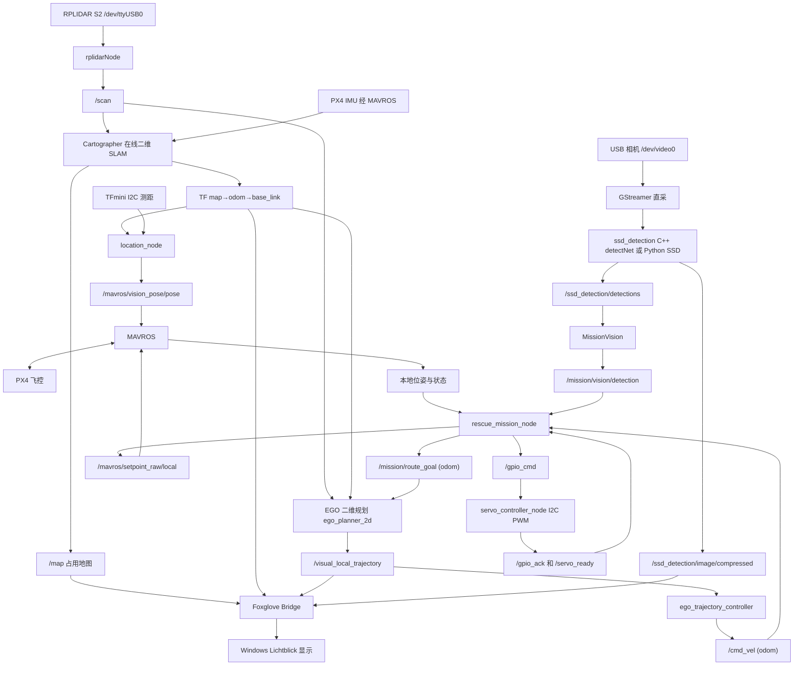

# 低空消防无人机总技术指南

版本：**version1018 基线**（7 个 ROS 包、11 个可执行目标、11 类 SSD 模型）；2026-10-22 按当前 `src/`、默认 launch、模型文件与五篇逐模块分析复核。本文是静态阅读与方案文档：没有编译、没有启动 ROS/Gazebo/PX4、没有连接或操作无人机，也没有飞行、投放或性能验收。

> **平台方向：** SHELL 于 2026-10-19 确认用 **TB-RK3399ProD** 替换原 **Jetson Nano 4GB P3448-0020 SOM＋JETSON-IO-BASE-A Rev2 载板**，重新配置系统并重构视觉识别；采购、系统迁移与 RKNN/YOLO 评估见[10月21日工程日志](../logs/2026-10-21_RK板采购与迁移路线.md)和[10月19日接续记录](../logs/2026-10-19_工作接续.md)。本文描述的是 version1018 工作树（Nano/Melodic 基线）的源码事实，不表示 RK 板已经配置、迁移或适配，也不把旧 CUDA/TensorRT、I²C 总线号、USB IP 或系统版本直接套到新平台。

**阅读原则：以当前源码、实际默认 launch、模型文件和核验材料为准。** SHELL 已明确：与规划不符时按源码解释，旧规划可能已被淘汰。因此本文不把 AMCL、MobileNetV2 或历史 move_base 方案当作必须补回的需求；没有运行证据的代码能力仍标为待验证。文中 `文件:行号` 按当前工作树核对，改码后会漂移；无法稳定定位时用文件名加符号名。

## 阅读导航与交付状态

本文将系统全貌、接口、学长起飞指南、电脑编译、实时显示与 Gazebo 仿真合为一个入口。逐模块证据见：

| 文档 | 查阅内容 |
|---|---|
| [飞行任务与舵机](源码分析/飞行任务与舵机.md) | 15 个任务状态、控制设定值、新航线、视觉对齐、舵机协议、失败分支与参数 |
| [定位建图与视觉](源码分析/定位建图与视觉.md) | RPLIDAR/Cartographer/TFmini/T265、ONNX 结构、两种检测后端、图像与消息 |
| [EGO规划算法](源码分析/EGO规划算法.md) | 二值栅格、A*、B 样条/L-BFGS、重规划与跟随、算法问题 |
| [电脑编译与实时可视化](源码分析/电脑编译与实时可视化.md) | 7 包/11 目标、WSL2/Docker 兼容性、Lichtblick 连接与验收 |
| [Gazebo仿真与场地](源码分析/Gazebo仿真与场地.md) | 仿真包结构、场地与传感器模型、两条启动链、Cartographer 仿真、投放模拟与检查脚本 |
| [Lichtblick安装与回传接续](项目资料/Lichtblick安装与回传接续_2026-10-13.md) | Windows 客户端安装记录与布局、独立桥、Nano 返修后的自操作步骤 |
| [仿真测试方案与设备分工](项目资料/仿真测试方案与设备分工_2026-10-13.md) | Windows／RTX3060Ti／16GB、WSL 资源、SITL 与现代平台适配及验收 |
| [version1012 静态文件清单](验证记录/source_analysis_inventory_2026-10-12.json) | **2026-10-12 的六包历史清单**：文件哈希、launch 节点/参数、CMake 目标与模型/图片哈希 |
| [当天工程日志](../logs/2026-10-12_源码分析与总技术指南.md) | 2026-10-12 静态分析的目标、真实结果、未执行项与下一步 |

| 项目 | 本次实际状态 |
|---|---|
| 七个包的一方源码、配置、构建声明及接口分析 | 已完成静态阅读与文档交付；第三方 SDK/优化器按关键调用链和接口审查，不是逐行安全审计 |
| 当前 ONNX/标签核对 | 已读取结构、形状、类别、字节数与 SHA256；未执行推理、未测准确率 |
| 学长起飞指南合并 | 已完成图片内容转录、逐条解释和源码核对 |
| 本机 WSL/Docker 条件核对、方案评估 | 已完成只读查询和方案；未安装、未配置容器、未编译 |
| Lichtblick 客户端与项目配置 | 2026-10-13 留有旧机 Windows 1.29.1 安装与布局导入记录（非本轮复核）；独立桥/相机静态核验通过，Nano 返修，未部署或收到实时流 |
| 电脑仿真建议 | 已按 Windows／3060Ti／16GB 交付分层方案；`gc_2026_sim` 材料随源码提供，但本机未配置 WSL/Docker、未构建、未运行仿真 |
| 真实定位、舵机负载、起飞、投放、飞行性能 | 助手未执行、未验收；SHELL 报告的历史试飞与返修情况见工程日志，不计为本文的成功飞行或性能证据 |

## 1. 当前无人机的软件工作形式

这是 **Jetson Nano 上运行的 ROS1 系统**（version1018 源码基线）。Nano 承担激光建图定位、相机检测、二维避障规划和任务调度；PX4 飞控承担实时飞行控制与状态估计；ROS 和 PX4 由 MAVROS 连接；舵机由 Nano 通过 I2C PWM 板独立驱动。当前源码已收敛为 **EGO 单一规划后端**，删除了 move_base、DWA、TEB 及其 costmap 配置。

默认行为是：在线激光 SLAM 建立坐标和地图 → 定位节点补入测距高度并发送外部位姿 → PX4 输出本地状态 → 任务节点按固定场地航点巡航 → EGO 按实时激光生成二维路径 → 跟随器输出 odom 水平速度 → 任务节点组合位置、速度和固定航向设定值发送给 PX4 → 到任务区后转相机、视觉对齐、舵机投放、返航和降落。真机视觉由检测节点直接用 GStreamer 取图，任务进程只消费检测消息。

**这份代码的“消防”具体实现是检测任务卡/目标并投放物资。** 源码中没有水泵、喷嘴闭环、火焰温度估计或自主灭火水流控制链。`DROP_FIRE` 是物资舵机命令，不能由命名推断已具备实际灭火能力。



上图是源码数据流，不是实测接线图。`gc_2026_sim` 是独立的仿真/场地包，不在这条机载飞行链上。默认入口和关键源文件：

- [定位入口](../src/location/launch/location.launch)、[Cartographer 入口](../src/location/launch/cartographer_2d.launch)。
- [导航任务入口](../src/navigation_2d/launch/navigation_2d.launch)、[任务状态机](../src/navigation_2d/src/rescue_mission.cpp)。
- [EGO 规划节点](../src/ego_planner_2d/src/ego_planner_2d_node.cpp)、[EGO 跟随器](../src/navigation_2d/src/ego_trajectory_controller.cpp)、[飞行设定值封装](../src/navigation_2d/src/flight_control.cpp)。
- [C++ 检测节点](../src/ssd_detection/src/ssd_detection_node.cpp)、[任务视觉](../src/navigation_2d/src/mission_vision.cpp)、[舵机节点](../src/servo_control/src/servo_controller_node.cpp)。
- [仿真包](../src/gc_2026_sim/README.md)、[仿真场地 world](../src/gc_2026_sim/gazebo/worlds/gc_2026_field.world)。

## 2. 已保存的实际技术栈

版本表来自已经下载校验的 Nano 环境清单，是 version1012 导出时的环境快照；本轮没有重新登录 Nano。依据：[环境核验](项目资料/Nano环境核验与补备份_2026-10-11.md)、[结构化环境证据](验证记录/nano_environment_summary_2026-10-11.json)。

| 层次 | 当前证据与角色 |
|---|---|
| 机载计算 | NVIDIA Jetson Nano，AArch64/ARM64；SHELL 于 2026-10-19 补充为 4GB P3448-0020 SOM＋JETSON-IO-BASE-A Rev2 载板，实物标签与真实接线未由助手重新核验；目标机已改为 TB-RK3399ProD，本文不把 Nano 环境当新板现状 |
| 系统 | Ubuntu 18.04.6 LTS，内核 4.9.201-tegra，L4T 32.5.2（历史快照）；不能把电脑 Ubuntu 镜像等同 Jetson BSP，也不能直接套给 RK 板 |
| ROS | ROS1 Melodic，catkin/CMake；项目 C++、Python、XML launch、YAML、Lua 混合 |
| 视觉加速 | 历史快照为 CUDA 10.2.89、TensorRT 7.1.3、cuDNN 8.0.0.180；jetson-inference/jetson-utils 位于 `/usr/local`，外部源码已补档。这些只对核对历史产物有意义 |
| 图像库 | OpenCV 3.2 和 4.1.1 并存，原构建缓存选择 opencv4；节点动态依赖仍需按目标核验 |
| Python | python/python2 为 2.7.17，python3 入口为 3.7.15，另有 3.6；ROS Melodic Python 绑定与 Python3 检测脚本不能默认为兼容 |
| 建图定位 | cartographer_ros 在线二维激光 SLAM，读取 PX4 IMU；TFmini 补 z；默认没有 AMCL、地图加载定位或三维 SLAM |
| 雷达 | rplidar_ros 自带 SDK；项目 wrapper 默认 S2 配置、串口 `/dev/ttyUSB0`、1,000,000 baud、DenseBoost；硬件型号不能只由默认参数确认 |
| 飞行桥 | MAVROS/MAVLink，定位 launch 内 FCU 默认 `/dev/ttyACM0:57600`，GCS 为 `tcp-l://0.0.0.0:5760` |
| 规划 | 本地移植的 ROS1 EGO 二维规划 + 路径几何跟随；**没有 move_base、DWA、TEB 或 `planner_backend` 开关**（`navigation_2d.launch:163-167`） |
| 图像入口 | 真机由检测节点用 GStreamer 直采 `v4l2:///dev/video0`，640×480@15、mjpeg；ROS Image 入口只在检测节点 `input_URI` 为空时用于订阅回放/仿真图像 |
| 视觉模型 | 包内 `ssd-mobilenet.onnx`，PyTorch 2.4.1 导出、opset 17 / IR 8、11 类；C++ 走 detectNet，Python 优先 onnxruntime、回退 cv2.dnn |
| 机构 | Nano 的 `/dev/i2c-1`，地址 0x40，50 Hz PWM，camera 通道 0、drop 通道 1 |
| 仿真 | `gc_2026_sim` 含 Gazebo 场地、三类模型、4 个 launch、7 个脚本、Cartographer 仿真参数和投放模拟；本机未安装 Gazebo/PX4，未运行 |
| 监看 | 环境快照已有 Foxglove Bridge 0.6.3；navigation 可选开桥默认 false；仿真 PX4 入口自带 8765 桥。Lichtblick 在电脑显示 |

### 旧表述与当前源码的差异

| 历史表述 | 当前按源码确认的事实 |
|---|---|
| 六包、9 个可执行目标 | **七包**（新增 `gc_2026_sim`）、**11 个可执行目标**（10 无条件＋1 条件），另有 4 个 EGO 静态库与 1 个可选 gtest |
| 旧版可选 move_base/DWA/TEB 三种后端 | 运行入口只有 EGO；`move_base.launch`、六份 costmap/局部规划 YAML、相关依赖与 `planner_backend` 已删除（`navigation_2d.launch:163-167`；`navigation_2d/CMakeLists.txt:83-84`） |
| 任务目标 `/move_base_simple/goal` | 任务发布 `/mission/route_goal`，frame=`odom`；EGO 的 `goal` 重映射到它（`navigation_2d.launch:184`；`rescue_mission.cpp:1518-1526`）。旧话题不再驱动当前规划链 |
| 旧版模型的类别数、导出器与 opset | 11 类、`scores [1,3000,11]`、PyTorch 2.4.1 / opset 17 / IR 8；旧模型只作 version1012 历史对照 |
| usb_cam 发布 `/camera/image_raw`，检测与任务各订阅一次 | 真机不再启动 usb_cam，raw 图不进 ROS；任务进程不订阅图像。ROS Image 入口只在 `input_URI` 为空时保留 |
| `/mission/video/compressed` 与 `/ssd_detection/debug_image/compressed` 两路回传 | 当前唯一检测回传画面是 `/ssd_detection/image/compressed`，两条旧话题没有发布路径 |
| 赛前 Cartographer 建图、比赛 AMCL 定位 | 默认 `location` 启动在线 Cartographer；没有 AMCL 节点或地图加载定位入口 |
| SSD-MobileNetV2 | 当前训练/导出默认骨干是 MobileNet V1 SSD（`tools/ssd_training/train_pytorch_ssd.py`）；源码没有 V2 证据，模型文件名不决定 V1/V2 |
| EGO 只是规划、跟随器需另写 | 导出源码已有 `ego_trajectory_controller_node` 与完整任务控制链 |
| RViz 或 Foxglove 启动即证明任务运行 | 可视化、规划和实际控制各有独立状态，需分别验收 |
| README 等于现状 | `navigation_2d/README.md` 仍写 `planner_backend`、target_index、旧视频话题和 move_base，属于滞后文档，不能当现状清单 |

旧设计资料保留追溯，但不覆盖当前代码。若以后迁移 AMCL、V2、ROS2 或其他规划后端，应作为新的明确需求。

## 3. 目录、七包与构建目标

开发源码唯一入口是 [`../src`](../src)，模型与标签在 [`../src/ssd_detection/models`](../src/ssd_detection/models)。七个包与 CMake 声明目标如下（顶层 [`src/CMakeLists.txt`](../src/CMakeLists.txt) 是 catkin toplevel 模板）：

| 目录/包 | 负责内容 | CMake 声明目标 |
|---|---|---|
| `location` | 驱动组合、SLAM 启动、TF 转外部位姿、TFmini 高度 | `location_node`、`tfmini_test` |
| `rplidar_ros` | 雷达连接、数据解包、LaserScan 与控制服务 | `rplidarNode`、`rplidarNodeClient` |
| `ego_planner_2d` | 局部二值栅格、A*、B 样条/L-BFGS 路径 | `ego_planner_2d_node`＋`bspline_opt`、`path_searching`、`grid_map_2d`、`plan_manage` 四个静态库 |
| `navigation_2d` | 航线/任务状态机、检测消息消费与对齐、MAVROS 设定值、EGO 跟随 | `rescue_mission_node`、`ego_trajectory_controller_node`；`TargetDetection` 消息；测试目标 `ego_path_tracking_test` 仅 `CATKIN_ENABLE_TESTING` 时出现 |
| `ssd_detection` | C++ Jetson detectNet 或 Python onnxruntime/OpenCV 检测；自定义检测消息；模型安装 | **条件生成** `ssd_detection_node`；Python 脚本安装；`VisionDetection`、`VisionDetectionArray` 消息 |
| `servo_control` | PCA9685 I2C PWM、camera/drop 通道、双阶段投放 | `servo_controller_node` |
| `gc_2026_sim` | Gazebo 场地/模型、假 MAVROS 载具、PX4 传感器架、仿真 SLAM 与投放 | `gazebo_simulation_vehicle_node`、`px4_sensor_rig_node` |

总计 **11 个可执行目标**：**10 个无条件**（`location_node`、`tfmini_test`、`rplidarNode`、`rplidarNodeClient`、`ego_planner_2d_node`、`rescue_mission_node`、`ego_trajectory_controller_node`、`servo_controller_node`、`gazebo_simulation_vehicle_node`、`px4_sensor_rig_node`）＋**1 个条件**（`ssd_detection_node`，仅在找到 jetson-inference＋OpenCV＋CUDA 时生成，`ssd_detection/CMakeLists.txt:76-125`）。按用途分为机载节点 7 个（含条件目标）、仿真节点 2 个、工具/自检 2 个。历史“9 个生产/工具目标”是 version1012 的口径，不应继续沿用；这里也只是声明清单，没有本轮生成的编译产物。

`gc_2026_sim` 的两个节点只依赖 `gazebo_msgs` 等消息包，**不链接 Gazebo 库本体**，因此在 amd64 容器里具备准备编译的条件；这不等于世界、插件或 PX4 能在容器里运行。

工程现状：`src/` 没有独立 `.git`；项目根目录于 2026-10-22 初始化 Git 仓库并完成首次提交（`main` 分支、无远端，覆盖全库内容）。本文的源码输入仍以版本号＋文件清单＋SHA256 描述，不把某个提交号当作唯一依据；旧 `build/devel/logs/.catkin_tools` 不复制进开发工作空间。原始 `nanooutput_origin/Nano导出/` 及 `Nano补充导出/` 保存 version1012 证据，不能直接改原件；Windows 外部库只读副本有已记录的大小写名称映射，不能直接拿来还原 Linux 构建树。

## 4. 定位、TF 与外部状态估计

默认 `location.launch` 依次声明雷达、MAVROS、延时 `location_node`、延时 Cartographer 和占用地图节点。`node_start_delay` 当前为 **3.0 s**（`location.launch:16,65-66`），Cartographer 自己的启动延时仍为 **6.0 s**（`cartographer_2d.launch:7,22`）。两个固定 `sleep` 都只是等待，不检查传感器、TF 或飞控估计是否就绪；学长提到的启动阶段 Cartographer 报错可能与输入未就绪有关，具体原因仍需日志确认。

默认 Cartographer 配置：`map_frame=map`、`odom_frame=odom`、`tracking/published_frame=base_link`、`provide_odom_frame=true`、`use_odometry=false`、`use_imu_data=true`、二维在线匹配；占用地图分辨率 0.05 m（`location/param/ROSSLAM/cartographer_2Dlidar_mapping_location_params.lua:18-51`、`cartographer_2d.launch:31-32`）。静态变换为 `base_link→laser_link`，平移 0、yaw 约 π、周期 30 ms（`location.launch:93-94`），这个安装方向必须与实物核对。地图链为：

```text
map ──Cartographer 全局修正──> odom ──连续局部位姿──> base_link ──静态安装变换──> laser_link
                                 │
                                 └─location_node 取 x/y/姿态，TFmini 距离覆盖 z
                                   → /mavros/vision_pose/pose → MAVROS → PX4 估计器
```

`location_node` 没有实现 Kalman/EKF 传感器融合。它查询 `odom→base_link` 并复制 x/y/姿态，再用测距减安装偏移覆盖高度（`location_with_ftmini.cpp:81-89,137-208`）；没有把 `map→odom` 的全局回环修正直接加到外部位姿，也没有把测距高度广播回 TF。因此显示端看到的 Cartographer 机体 TF 仍来自二维定位，`vision_pose` 里的 z 与该 TF 的 z 不是同一个输出。launch 声明 `tf_mini_height=0.09` 却没有 `<param>` 传给节点，实际代码默认 0.1 m（`location.launch:19,65-85`；`location_with_ftmini.cpp:284`）；I2C 默认 bus 0、address 16（0x10）。

当前 TFmini 高度处理（version1018 新增/加强）：

- `dist` 是 `std::atomic<float>`（`location_with_ftmini.cpp:27`），采集线程与发布线程不再有无保护的 float 撕裂读。
- 原始值在 **0.05–6.0 m** 内、且相对上次接受值跳变不超过 **0.60 m**（或连续拒收已达 **20 个发布周期**）才接受；接受后 `z = raw − tf_mini_height`，并夹紧到 **−0.20–3.00 m**（`:59-64,137-175,288-293`）。
- 不合格时保留上一次有效 z；还没有有效值时 z 保留 Pose 对象旧值（初始 0），但仍按周期发布（`:176-195`）。这是“保持/限幅”，不是故障状态机。
- XY 相对上次接受位置跳变超过 **0.30 m** 且连续拒收不足 **10 个发布周期**时，x/y 暂时换回上次接受值；达到 10 个周期则接受新值并重建基准（`:71-72,102-133,294-295`）。门限按位置发布周期计数，不是按传感器采样次数计数。

向 `/mavros/vision_pose/pose` 发布不等于 PX4 已经融合。还缺实际 PX4 版本、外部视觉融合参数、帧原点/航向对齐、测距朝向/标定、时间延迟和飞控估计健康证据。T265 入口作为可选分支保留（`rplidar_location=false`），当前不是默认路线，环境快照未发现 `realsense2_camera`；不要为解释默认雷达路线强制安装该分支。

`location` 的主要静态问题：高度样本没有采集时间戳/新鲜度超时（LOC-01）；最新 TF 的原始时间戳被丢弃并改成 now（LOC-02）；高度门限是未标定的固定默认值，超界只限幅不报错（LOC-03）；`tf_mini_height` 参数未送达节点（LOC-04）；3 s 延时不是就绪门禁，缺 I2C 时构造异常不在 main 捕获（LOC-05）；XY 门限对雷达和 T265 都生效且未按来源/速度区分（LOC-06）。详见[定位建图与视觉](源码分析/定位建图与视觉.md) 4.1 节。

雷达侧，version1018 相对 1012 **只新增 A2M7、A2M8、S3 三个型号 launch**，驱动主体未变；项目默认仍用 `location/launch/rplidar.launch` 的 S2 wrapper（frame=`laser_link`、DenseBoost、1,000,000 baud），不是 `rplidar_ros/launch/rplidar_s2.launch`。LaserScan 的时间戳、`range_max` 来自硬件模式回报、角度排序与队列积压等问题见[定位建图与视觉](源码分析/定位建图与视觉.md) 第 6 节。

## 5. 视觉模型、检测和投放对齐

### 5.1 当前模型

当前模型是 [`ssd-mobilenet.onnx`](../src/ssd_detection/models/ssd-mobilenet.onnx)，大小 **32,193,674 字节**，SHA256：

```text
de7d37abfd53bcc18fbc57a556e3f1402d77e2192274a11fff4a815af4ac335e
```

该值与同目录 `ssd-mobilenet.onnx.sha256sum` 一致。只读解析结果：

| 项目 | 值 |
|---|---|
| producer / IR | pytorch 2.4.1 / 8 |
| opset | 默认域 17（仅 `ai.onnx`） |
| 输入 | `input_0`，float32 `[1,3,300,300]` |
| 输出 0 | `scores`，float32 `[1,3000,11]` |
| 输出 1 | `boxes`，float32 `[1,3000,4]` |
| 图节点 / 初始化张量 | 158 / 94 |
| labels | 197 字节，11 行 |
| TensorRT engine | `ssd-mobilenet.onnx.1.1.7103.GPU.FP16.engine`，21,587,397 字节；本地缓存，不是本轮推理验收 |

**旧版模型的类别数、导出器与 opset 数都不是当前值。** 当前图没有 1012 的 `Preprocessor/*`、`adapt/denorm_*` 节点，两个后端都必须自己做 `2*p/255−1` 的 RGB 归一化；`scores` 末端是 Softmax，`boxes` 已解码，不能把“图内有 Exp”当作轴序、数值范围或精度的证明。

| 类 ID = 标签行号 | 原文 | 任务 zone |
|---:|---|---|
| 0 | `BACKGROUND` | 不发布为目标 |
| 1 | `hazard_flammable` | hazard |
| 2 | `hazard_explosive` | hazard |
| 3 | `hazard_corrosive` | hazard |
| 4 | `hazard_toxic` | hazard |
| 5 | `hazard_biohazard` | hazard |
| 6 | `hazard_ionizing_radiation` | hazard |
| 7 | `hazard_fissionable` | hazard |
| 8 | `hazard_oxidizer` | hazard |
| 9 | `hazard_gas_cylinder` | hazard |
| 10 | `person_injured` | person |

人员索引从 1012 的 1 变为 **10**，旧 labels 不能与新模型混用。zone 规则是大小写敏感：`person` 前缀归 person，其余一律 hazard（`jetson_detector.cpp:91-95`；Python `zone_of`）；新增未知类别会自动成为 hazard，改标签/类别必须同步检查任务消费规则。

### 5.2 图像源与检测后端

当前没有 `vision_backend` 参数，也没有 usb_cam 节点。`use_usb_cam` 只用于选择检测 launch（`navigation_2d.launch:126,535-559`）：

| 场景 | 选择 | 实际行为 |
|---|---|---|
| 真机 | `use_usb_cam=true` → `ssd_detection_trt.launch` | C++ 节点用 `videoSource`/GStreamer 直采 `camera_uri`，默认 `v4l2:///dev/video0`，640×480@15、mjpeg（`navigation_2d.launch:131-138`；`ssd_detection_trt.launch:35-42`）。raw 图不进 ROS，也没有 `/camera/image_raw` |
| 仿真/台架 | `use_usb_cam=false`（默认）→ `ssd_detection.launch` | Python 节点订阅 `input_image_topic`；该参数默认空串（`navigation_2d.launch:141`），必须由外层 launch 显式传入 Gazebo 相机或回放话题，否则单独启动导航没有图像源 |

C++ 节点的 ROS Image 入口**只在 `input_URI` 为空时可用**：此时订阅 `input_image_topic`（`ssd_detection_trt.launch:44,77`；`ssd_detection_node.cpp:449-473`）。台架回放要把 `input_URI` 和 `input_image_topic` 都显式设置，只清 URI 不够。Python 后端没有相机直采分支。

Python ONNX 检测器按后缀选择：`.onnx` 先尝试 `onnxruntime` 的 `CPUExecutionProvider`，不可用或初始化失败才回退 `cv2.dnn.readNetFromONNX`；`.pb` 走 `readNetFromTensorflow` 备用路径。源码注释称旧 OpenCV 读不了 opset 17 的 Slice，因此 onnxruntime 不是单纯性能优化，而是旧 OpenCV 上读取当前模型的前提之一（`ssd_detection_node.py:289-332`）；本轮未复测该兼容问题。C++ 节点走 detectNet，构造命令行绑定 `input_0`/`scores`/`boxes`，engine 由 detectNet 自己建并缓存。

两个后端共享同一 `.onnx` 与消息，但**不保证输出数值和框集合等价**：C++ detectNet 跨类聚类、顺序由 detectNet 决定；Python 逐类 IoU NMS（0.45）、按置信度降序、最多 100 框。预处理缩放采样与 TensorRT/OpenCV 算术也不同，不能把“同一模型”当成一致性验收。

### 5.3 消息与任务视觉

`VisionDetectionArray` 当前为 `Header header` ＋ `uint32 image_width` ＋ `uint32 image_height` ＋ `VisionDetection[] detections`（[msg](../src/ssd_detection/msg/VisionDetectionArray.msg#L11-L20)）；单框字段为 `class_name`、`zone`、`confidence`、归一化 `xmin/ymin/xmax/ymax`（[VisionDetection.msg](../src/ssd_detection/msg/VisionDetection.msg#L13-L19)）。**`image_width/image_height` 是 1018 新增字段，会改变 ROS1 消息 MD5；1012 与 1018 的发布/订阅二进制不能混用。** 任务侧只在值为 0 时回退到自己的 `camera_width_/camera_height_`（默认 640×480），不能兼容旧消息类型。

`MissionVision` 与 `RescueMission` 同进程，是一个普通 C++ 对象，不是独立 ROS 执行目标。它**不再打开相机、不订阅图像、不做 HSV、不发 JPEG**，只消费 `/ssd_detection/detections` 并发布 `/mission/vision/detection`（`mission_vision.cpp:9-31,102-290`）。处理要点：

- 先按 `ssd_score_threshold`（默认 0.5）过滤，归一化坐标夹到 [0,1]，按 `zone=="person"` 分入 person，其余全部算 hazard。
- 每个框按消息 `image_width/height` 换算成像素；宽高 <1 或**贴边**的框丢弃，因为裁掉的框中心会偏向画面中心，导致方向对但幅度偏小。
- `selectCandidate` 取**离画面中心最近**的候选，不再按 `hazard_target_index/person_target_index` 取第几个。
- 稳定判定只看相邻处理帧的中心移动 ≤ `stable_pixel_tolerance` 12 px、连续 `stable_frames_required` 5 帧；不考察框尺寸、类别一致性、物理位置或推理帧序号。
- 模式为 IDLE 时仍每帧发布一条 `found=false` 的 `TargetDetection`；这条心跳是起飞前 `require_vision_ready` 门的存活证据，不能停发。
- `TargetDetection` 含 `mode/found/stable/center_x/y/width/height/pixel_dx/dy/confidence/image_width/height`（[msg](../src/navigation_2d/msg/TargetDetection.msg#L1-L13)）；`pixel_dx = 框中心 x − 图像中心 x`，`pixel_dy` 同理。

### 5.4 视觉对齐与投放

处理稳定框后只计算一次位置目标（`rescue_mission.cpp:1842-1896`）：

```text
body_dx = sign_x × pixel_dx × max(0.2, current_z) / max(1, fx)
body_dy = sign_y × pixel_dy × max(0.2, current_z) / max(1, fy)
body_dx/body_dy 各轴夹到 ±max_task_correction（默认 0.15 m）
world = current_xy + R(current_yaw) × (body_dx, body_dy)
target = clampAlignTarget(world)
```

`fx/fy` 默认 874，`pixel_to_body_x_sign/y_sign` 默认 +1（`navigation_2d.launch:448-451`）。`clampAlignTarget` 在场地系把安全场再缩进 `align_body_clearance=0.35 m` 后夹紧（`rescue_mission.cpp:2368-2441`），若缩进后矩形退化则原样返回并报错。ALIGN 只检查能否抵达这个位置，不持续视觉闭环检查卡片是否居中，也不要求投放前检测仍新鲜；ALIGN 的 5 s 总超时从进入状态起算，超出容差只重置驻留计时，不重置总超时（`:1907-1922,1946-1949`）。

视觉保底不是“无条件原地盲投”：`vision_with_fallback` 下 5 s 无稳定检测后，若已在写定航点 0.20 m 内，以当前位置进入 ALIGN；否则把目标设为写定航点、继续靠过去，直到进入 0.20 m 或 `task_timeout` 12 s 中止（`:1783-1838`）。`vision` 模式没有 5 s 保底，等到 12 s 才中止；`waypoint` 模式不依赖检测结果。

这里用 `current_z` 当相机离地高度，没有减地面高度/相机安装偏移，也没有 roll/pitch 补偿、镜头畸变或相机光轴/机体的完整旋转矩阵，CameraInfo 不参与。只用两个符号无法表达相机实际安装的 x/y 交换、90° 旋转或偏置；源码不能确认当前 `+1` 与 874 就适用于真实机体。

### 5.5 回传画面与已发现的问题

任务进程不再发布 `/mission/video/compressed`，也不对图像做缩放/JPEG 编码。唯一的回传画面由检测节点发布到 **`/ssd_detection/image/compressed`**（`navigation_2d.launch:154-156`）；默认 `publish_image=true`、`video_width=640`（只缩小不放大）、`jpeg_quality=70`、`max_rate=0`（不限速）。Foxglove/Lichtblick 的 Image 面板应选这一路，不要再用旧话题。画面上的红/蓝框由检测节点绘制，任务侧看不到原图；任务报“no stable detection”时框仍可能存在，排查要同时看 `/ssd_detection/detections`、`/mission/vision/detection` 和检测节点日志。

**VIS-01（入口相关）：** detectNet 的接口要求输入是 CUDA 可访问内存。真机相机直采的指针来自 `videoSource` 的 NVMM 映射缓冲区，从源码意图看更符合该契约；订阅模式和离线预览仍把 `cv_bridge`/`cv::Mat` 的普通 CPU 指针交给 `Detect`，没有显式 host→device 上传。旧版“所有入口都违反 CUDA 内存契约”应改为“订阅/离线路径仍未解决，相机直采路径可能符合，需在匹配的 Jetson 库上验证”。

**VIS-02：** `Detect` 返回 ≤0 时应用全部当空检测返回（`jetson_detector.cpp:331-334`），接口错误的负值与正常零检出没有状态区分。相机流结束后主循环返回，`main` 仍以 0 退出；任务侧不能只看进程退出码判断视觉健康。

其他：检测缓存消费旧帧没有年龄/帧关联检查；C++ 消息顺序由 detectNet 决定，注释“置信度降序”只对 Python 成立；`MissionVision` 选“最近中心”未与抽签点/任务区 ID 关联；新增字段导致旧 bag/旧节点不能直接混用。详见[飞行任务与舵机](源码分析/飞行任务与舵机.md) 第 8 节和[定位建图与视觉](源码分析/定位建图与视觉.md) 第 7 节。

## 6. 导航规划、任务状态机与控制

### 6.1 默认规划链（只有 EGO）

任务发布 odom 系 `/mission/route_goal` → EGO 生成参考并结合激光避障 → `/visual_local_trajectory` → EGO 跟随器以 20 Hz 输出 odom 系 `/cmd_vel` → 任务以 50 Hz 组合设定值。规划 5 Hz、任务决策 10 Hz，均为代码名义定时频率，不是实测吞吐（`navigation_2d.launch:169-303`；`rescue_mission.cpp:321-322,2494`）。

EGO 是二维规划，整机参数为：8×8 m 局部地图、**0.05 m** 格、**0.375 m** 膨胀、3.5 m 感知半径、0.35 m/s 速度、0.5 m/s² 加速度、0.45 m 跟随前视距离；`max_jerk=1.5` 只是参数，未形成显式 jerk 硬上限。发布的 1.5 m 路径高度来自 `fly_height`，并非三维避障结果。LaserScan 同时喂 SLAM 和规划，EGO 没有直接使用 Cartographer 的 `/map` 作占用地图（`navigation_2d.launch:186-269`）。

version1018 的 EGO 加强点：A* 搜索步长改由地图分辨率驱动（不再写死 0.1 m），斜向扩展前禁止对角切角，最终碰撞采样覆盖整条曲线，起点落入膨胀带时清空计划；重规划失败时，旧轨迹仍被判安全则保留、被判碰撞则清空。发布前统计落入膨胀带的轨迹点，但**只告警、不拒绝发布**。`refine` 失败分支仍注释掉 `return false`，仍把重参数化轨迹当成功交给节点；`publishAll()` 每周期用 `now` 重发旧轨迹，跟随器只按收到时间刷新，因此旧计划仍可能被当成新计划执行。A* 开放堆更新、负半轴取整、障碍分段只扫描前约 2/3 控制点等问题仍在。详见[EGO规划算法](源码分析/EGO规划算法.md) 第 6、7 节。

当前没有 DWA/TEB、move_base launch、六份 costmap YAML 和 `planner_backend`；`mission_with_move_base.h` 只是历史文件名，`/move_base/cancel` 仍被 advertise 但 EGO 不订阅，实际是空操作（`rescue_mission.cpp:301,2231-2241`）。**文件名和话题名不代表在用机制。**

### 6.2 航线、任务状态机与坐标

任务有 15 个状态（`mission_with_move_base.h:31-48`）：`WAIT_FCU → TAKEOFF → NAV_HAZARD → HAZARD_HOVER → HAZARD_ALIGN → HAZARD_DROP → NAV_PERSON →（stage2: NAV_RESCUE → RESCUE_HOVER/ALIGN/DROP）→ RETURN_HOME → LANDING → COMPLETE`，异常进入 `ABORT`。任务入口先要求 `have_pose_`、`have_home_` 和 `have_map_pose_`（`rescue_mission.cpp:980-991`）；即使控制只用 odom，没有 `map→base_link` 时任务也不会推进。

固定航线是**场地系**数字，z 均写死 1.50 m；stage2 一点航线 z 取 `fly_height`（`navigation_2d.launch:316-363`）：

| 航线 | 顺序 x/y（m） |
|---|---|
| hazard | (-0.25,-1.80) → (1.40,-1.80) → (1.40,0.00) |
| person | (1.50,-0.90) → (1.50,-2.20) → (2.70,-2.20) → (2.70,-2.65) → (2.70,-1.85) → (2.70,-1.05) |
| return | (2.70,-2.20) → (0.00,-2.20) → (0.00,0.00) |
| stage2 rescue | (rescue_drop_x, rescue_drop_y)，z=`fly_height` |

危险品三点未变；人员航线由 5 点改为 **6 点**，先从 y=-0.90 南下到 y=-2.20，再沿 y=-2.20 向东到 x=2.70、自南向北覆盖三张卡；返航横向走廊从 y=-2.00 改为 **y=-2.20**。这些数字在节点构造时由 `loadRoute` 读入，随后 `applyRouteFrameYaw()` 按 `field_yaw_deg` 一次性旋转（`rescue_mission.cpp:266-269,456-545`）；stage2 抽签点也按同一角度旋转（`:496-504`），之后 `publishNextGoal` 直接以 `frame_id="odom"` 发布（`:1518-1526`）。默认 `field_yaw_deg=0` 时旋转是恒等。

**`field_yaw_deg` 与 `fix_heading_deg` 是两件事：**

- `field_yaw_deg`（launch 默认 0.0，`navigation_2d.launch:40`）描述**起飞/开始定位时机头在场地系里的朝向**（0=场地 +x，90=+y，180=−x，−90=−y）。节点把每个场地航点按 `−field_yaw_deg` 旋进 odom；默认 0 不改变任何数字。它只处理旋转，**不补偿起点平移误差**。非 0 时启动日志打印安全场在 odom 中的矩形，用于人工核对角度；默认 0 时 `applyRouteFrameYaw()` 直接返回，launch 注释所说的“启动打印方框/逐航点场地→odom 对”并不发生。
- `fix_heading_deg`（launch 默认 0.0，`navigation_2d.launch:10`）是 **odom 中的机头设定值**，0 表示机头指 odom +x；它被写进每个 `PositionTarget.yaw`，不再取“起飞瞬间实测 yaw”。改变它不会旋转航线，只改变飞控保持的机头。

安全场是场地系数字：x[-0.60,3.30]、y[-3.30,0.60]（`navigation_2d.launch:423-426`），节点内部缺省值更小，以 launch 覆盖值为准。`insideSafeField()` 先把 odom 位置转回场地系再比较（`rescue_mission.cpp:2341-2366`）；视觉修正目标则用 `clampAlignTarget()` 在场地系把安全场再缩进 `align_body_clearance=0.35 m` 后夹紧（`:2368-2441`）。这两个矩形回答不同问题：前者是“飞机现在可以在哪”，后者是“允许命令它去哪”。

关键任务参数与行为：

| 参数/行为 | 当前值/语义 |
|---|---|
| `stage` | 默认 1：危险品投放一次、遍历人员区、返航；stage2 增加抽签人员位置投放 |
| `rescue_drop_x/y` | 默认 999.0 是非法哨兵；stage2 未给有效场地坐标时拒绝开始（`navigation_2d.launch:60-61`） |
| `drop_align_mode` | 默认 `vision_with_fallback`；`vision` 无 5 s 保底；`waypoint` 不依赖检测 |
| `require_vision_ready` | 默认 **true**；只在 auto_start=true 时要求最近 2 s 内有 `/mission/vision/detection` 才允许 OFFBOARD/解锁；超过 `vision_ready_timeout=60 s` 只打印拒绝并继续等待 |
| `auto_start=false` | 不自动请求 OFFBOARD/解锁，但仍持续发当前位置设定值；已解锁且 OFFBOARD 即进入 TAKEOFF。此手动路径**不拦截视觉门** |
| `route_no_motion_timeout` | **6.0 s**：一条腿从发目标起一帧移动指令都没收到就中止；另有 10 s 规划失败中止、30 s 单航点超时、最多 2 次重试 |
| `max_task_correction` | **0.15 m**：单次视觉对准允许的最大水平修正量 |
| `align_body_clearance` | **0.35 m**：对准目标在安全场内的缩进量，按桨尖半径量得 |
| `align_timeout` | 5.0 s，从进入 ALIGN 起算，不因未到点而重置 |
| ABORT | 未请求降落且仍 OFFBOARD+armed 时先 hold；距 captured home ≤0.25 m 走正常相机前向/landing，更远则稳定 0.5 s 后请求就地 **AUTO.LAND**，每 2 s 重试；`armed=false` 后 COMPLETE |

航线到达判定使用 x/y 距目标 ≤0.12 m、z 差 ≤0.40 m、该航点派发后 >0.6 s；`waypoint_dwell=0.6` 是从派发时刻计算，不要求连续在容差内 0.6 s。`publishNextGoal` 在航点 z≤0.05 时回退到 `fly_height`（`rescue_mission.cpp:1444-1447`）；返回 (0,0) 与捕获 home 不是同一概念。`fly_height` 改大不会同步修改 rosparam 中 route 的 1.50 m，而到达判断还检查 z 差 ≤0.40 m，不能只改一个高度参数。`poseCallback` 未检查消息 `frame_id`，home 由第一帧位置直接捕获，未要求定位稳定或飞控未解锁。默认 EGO 与跟随器用 TF `odom→base_link`，任务到达与 setpoint 却用 `/mavros/local_position/pose`；需要验证两个系统的原点、朝向、尺度、延迟、重置行为一致。

### 6.3 PX4 设定值的具体形式

实际发布 `mavros_msgs/PositionTarget` 到 `/mavros/setpoint_raw/local`，有两种路径（`flight_control.cpp:83-139`）：

| 阶段 | 调用 | `type_mask` | 语义 |
|---|---|---|---|
| TAKEOFF | `setpoint_raw_local_pos` | 3064（忽略三轴速度、三轴加速度、FORCE、yaw_rate） | 纯位置；x/y 取捕获 home，z 从当前值按 `max_velocity` 斜坡到 `fly_height` |
| 其余飞行阶段 | `setpoint_raw_local_pos_vel` | 3008（忽略三轴加速度、FORCE、yaw_rate） | 位置和速度同时有效；导航时 x/y 取当前 PX4 估计位置，速度取规划器速度 |

两条路径都使用 `coordinate_frame=FRAME_LOCAL_NED`、`yaw=mission_heading_`，并在消息里填 `ros::Time::now()`。**在 ROS 侧按 ENU 惯例提供数据，MAVROS 进行 ENU/NED 转换**，不要因为消息字段名 NED 就手动再翻转 z。作为接口参考，官方 MAVROS 1.5.2 `setpoint_raw` 的 `local_cb` 对非 body 坐标执行 ENU→NED 转换；这里不是对本机 MAVROS 版本的认定，最终需与保存的版本/插件配置核对。

非导航的悬停/ALIGN/DROP 状态按每轴 `clamp(gain × error, ±0.35)` 计算速度，再设 `position = current + velocity × 0.2`，因此非导航平面总速度可能达到 √2×0.35≈0.495 m/s，未像导航速度那样作平面模长限幅（`rescue_mission.cpp:942-955,2443-2447`）。`auto_start=false` 只是关闭程序自动切 OFFBOARD/解锁；已解锁且 OFFBOARD 的飞控会使任务进入 TAKEOFF。PX4 要求持续 Offboard 生命信号，丢流行为受固件与 `COM_OF_LOSS_T` 等参数影响；名义 50 Hz 不证明全负载下时延满足要求。`abort_on_offboard_loss` 默认 true，在非 WAIT/LANDING/COMPLETE/ABORT 状态离开 OFFBOARD 会直接 `abortMission`。

## 7. 舵机机构接口

`servo_controller_node` 打开 `/dev/i2c-1`、地址 0x40，设置 50 Hz PWM，使用 750..2250 μs 脉宽换算 0..180°（`navigation_2d.launch:561-585`；`servo_controller_node.cpp:94-105,185-242`）。camera 通道 0，front 170°、down 55°；drop 通道 1，程序默认停放位 30°，危险物资 90°、救助物资 140°。物理安全位、开锁角度和限位须实物标定；`restore_after_drop` 默认 false。

| 默认动作 | 通道 | 角度 | 对应脉宽（μs） | tick（理论 50 Hz） |
|---|---:|---:|---:|---:|
| 相机前向 | 0 | 170° | 2166.7 | 444 |
| 相机下向 | 0 | 55° | 1208.3 | 247 |
| 投放停放 | 1 | 30° | 1000 | 205 |
| 危险品投放 | 1 | 90° | 1500 | 307 |
| 救助物资投放 | 1 | 140° | 1916.7 | 393 |

这些是程序算出的命令脉宽，不是实测真实角度或已标定开锁角；PWM 分辨率约 4.88 μs，振荡器误差/供电/舵机型号可使物理角度不同。

`/gpio_cmd` 命令包括 `CAMERA_DOWN`、`CAMERA_FRONT`、`DROP_FIRE`、`DROP_RESCUE`；`/gpio_ack` 返回对应 `_DONE`；`/servo_ready` 标识启动等待完成。这些确认来自软件写 PWM 后的计时，不是角度编码器、限位开关或物资已落下的传感器反馈。相机等待时长：相同角度等 `servo_motion_seconds`（默认 0.8 s）；不同角度取 `max(0.8, max(0.1, 角差×0.006))`。投放默认等 `drop_action_seconds=1.0 s` 后 ACK，`restore_after_drop=false` 保持最后开锁角，不回 30°。

**默认 `use_real_servos=true`，节点启动就设置 camera 170° 与 drop 30°。** 不能把 navigation 启动看作无动作的资料观察。相机与投放共用一个 `action_timer_` 和 `pending_ack_`，新命令会 stop 上次动作 timer；两个发布者或标定/飞行节点混用时不能并发确认两通道动作。节点析构只 close I2C fd，不关闭 PCA9685 输出、不回安全角。

台架入口是 [`servo_bench.launch`](../src/servo_control/launch/servo_bench.launch)，启用 `angle_debug=true`；`navigation_2d.launch` 没有声明 `angle_debug`，命令行传它会被 roslaunch 静默丢弃。调试前端已从包内移到 [`../tools/servo_debug.py`](../tools/servo_debug.py)（与 1012 包内文件字节相同，属于搬家），用法是 `python3 tools/servo_debug.py ...`；它提示 `source /opt/ros/noetic/setup.bash`，与原 Nano Melodic 环境不一致。扫角/`PARK` 会真实开仓并可能穿过开锁角，只能在空载或机构隔离后标定。

## 8. 合并学长的起飞技术指南

### 8.1 原始来源和完整操作要点

SHELL 指定的图片保存在 [参考资料/无人机起飞控制技术指南.png](参考资料/无人机起飞控制技术指南.png)；前期核对记录 SHA256 为 `5fed040c6c38bd926d0b628037dfdc762fabe396810594197d1e7b94bf6e0616`，未修改图片。按图中内容整理：

1. 先启动定位与建图：`roslaunch location location.launch`。启动时若 Cartographer 报错，学长建议 Ctrl+C 退出后重启，通常与 ROS 包的启动顺序和 IMU 的冲突有关。
2. 再启动导航与任务：`roslaunch navigation_2d navigation_2d.launch`。不要在同一时刻发起两个 launch，location 就绪后再起 navigation；之后两者需同时保持运行。等待模型加载/检测稳定，再切 OFFBOARD 起飞；学长提醒启动/加载高占用可能造成起飞后规划延迟。
3. 调试数据可用 RViz；如需地图与路径实时监视，学长建议在虚拟机或 WSL 准备 ROS，并使用 Foxglove/Lichtblick。
4. 起飞前机头对准地图 +x 方向，也就是起飞区朝危险品任务区的方向。
5. 可通过 QGC 切 OFFBOARD 直接开始任务。
6. 先 SSH 连接机载机；学长图中写 `nvpmodel -m0` 选择最大性能模式，再执行 `sudo jetson_clocks`。实际切换模式通常需 sudo 权限，先核对该型号的模式定义。
7. 执行时保持两个 SSH 窗口，一个运行 location、一个运行 navigation，按以上顺序启动。学长认为 MobaXterm、PuTTY 等 SSH 工具更便于使用。

### 8.2 与当前源码核对后的解释

| 学长要点 | 当前应如何理解 |
|---|---|
| 先 location 再 navigation | 对应依赖链：导航需要 MAVROS 状态、odom/TF、激光。用实际话题/TF 就绪判断，不只等固定秒数（当前 location_node 延时 3 s、Cartographer 6 s，都是 `sleep`） |
| Cartographer 启动时报错重启 | 仅用于起飞前启动排障；应看日志确认 IMU/TF/时间/串口根因。飞行中 Ctrl+C 会移除外部定位，不能作为飞行中的通用修复 |
| 等模型加载 | 当前有 `require_vision_ready` 门：auto_start=true 时要求最近 2 s 内有 `/mission/vision/detection`。这比单看 TRT 日志更接近真实就绪，但仍只证明检测消息链存活，不证明识别正确 |
| 机头朝 +x | 与 `fix_heading_deg=0`、固定 odom 航点相符；场地旋转由 `field_yaw_deg` 单独描述。需要确认真实 yaw/坐标原点，不能只凭地面标线 |
| QGC 切 OFFBOARD 起飞 | auto_start=false 时，FCU 已解锁且 OFFBOARD、TF/位姿和 servo 等门槛满足才进入 TAKEOFF；单切模式不保证起飞。手动路径不拦截视觉门，只记录“解锁时视觉还没起来” |
| 最大性能/jetson_clocks | 先查看该设备支持的模式与散热/供电。`jetson_clocks` 通常锁定允许频率，图中“超频”不是修改硬件频率上限的证明 |
| 两个 SSH 窗口 | 是交互和日志管理形式，不是 ROS 或硬件隔离。断 SSH 后的进程行为取决于会话/进程管理，需单独确认 |
| Lichtblick/WSL | Windows 桌面 Lichtblick 可直接连接桥；仅显示无需在电脑先搭 ROS/WSL。WSL/Docker 主要服务编译、回放和后续开发 |

### 8.3 可查阅的启动和验收顺序

以下是**后续验证说明，本轮未执行**。真实飞行前，先解决或验收第 11 节关键分支、定位/坐标、机构标定和飞控模式/失效参数。

每个 Nano 终端需加载正确环境（原机工作空间路径为历史记录，按实机为准）：

```bash
source /opt/ros/melodic/setup.bash
source /home/jcfh/catkin_ws/devel/setup.bash
```

第一窗口启动定位入口：

```bash
roslaunch location location.launch
```

检查其真正就绪的证据：

```bash
rostopic echo -n 1 /mavros/state
rostopic hz /mavros/imu/data
rostopic hz /scan
rosrun tf tf_echo odom base_link
rostopic hz /mavros/vision_pose/pose
rostopic hz /mavros/local_position/pose
rostopic echo -n 1 /map/header
```

这些命令订阅数据；location 入口本身会使用硬件并向飞控发送外部位姿，不能将它归类为完全无写入的观察工具。需要确认姿态、z、方向、origin 和时间均合理，以及飞控真正接受外部定位。

第二窗口的历史任务命令为：

```bash
roslaunch navigation_2d navigation_2d.launch
```

**当前 version1018 的真实飞行不能照抄这一行默认值。** 该 launch 默认 `use_usb_cam=false`，会选择 Python 检测器，而 `input_image_topic` 默认空串——单独启动时没有任何图像源；同时默认 `use_real_servos=true`，会初始化真实舵机并发送 setpoint。真机应显式选择直采检测器，例如：

```bash
roslaunch navigation_2d navigation_2d.launch use_usb_cam:=true
```

仿真/台架则由 `gc_2026_sim` 的包装 launch 显式传入 Gazebo 图像话题。无论哪种方式，该入口都会启动检测节点、加载模型、启动 PWM 并发送设定值（真机直采路径还会打开相机）；在安全台架或仿真配置完成前，不作为电脑编译或监看验证的启动命令。先看图像/检测/规划输入与资源指标，再根据飞控状态和现场流程切模式。stage2 需给实际抽签坐标；物资角度需按机构标定。

模式状态、解锁状态、`/servo_ready`、相机/检测时间戳、TF 年龄、定位 z、规划/控制真实频率和功耗温度，分别记录。仅有 RViz 轨迹或检测框不足以证明可自主起飞。

## 9. Windows Docker＋WSL 编译评估

**可行，适合通用 ROS 开发与部分仿真；本机不能原样复现 Jetson GPU 运行环境，也不能把 RK 板适配算进这条链。** Windows Docker 应采用 Docker Desktop 的 WSL2 后端和 Linux 容器，源码在 WSL 的 Linux 文件系统副本中构建。详细只读结果、官方依据和分阶段命令见[电脑编译报告](源码分析/电脑编译与实时可视化.md)。

2026-10-12 的只读快照来自一台 AMD 笔记本：Windows 11 家庭中文版 25H2/build 26200，Ryzen 7 7735H、8 核 16 线程，约 15.2 GiB 内存，AMD Radeon 显示设备；未见 NVIDIA GPU、`nvidia-smi` 或 Docker，WSL 报告未安装；固件虚拟化已开、`HypervisorPresent=true`，D 盘约 190 GiB、C 盘约 85 GiB 空余。该快照只作方法与历史样例；2026-10-13 与 10-21 的记录把实施对象写成 SHELL 另一台 **Windows、RTX 3060Ti、16GB** 电脑，安装前必须在实施机重跑同一组只读查询。

建议构建层次：

| 层次 | 目标/方式 | 本机可行性和验收口径 |
|---|---|---|
| amd64 通用编译 | Ubuntu18.04/Melodic 容器；7 包的 10 个无条件目标＋`ssd_detection`/`navigation_2d` 的自定义消息＋Python 入口＋模型安装 | 可行候选；必须逐目标确认新生成和链接，I2C/串口可编译不代表硬件能用 |
| amd64 CPU 视觉验证 | 当前 ONNX＋onnxruntime 或 OpenCV DNN | 可行候选；Python3/cv_bridge 和模型前处理另验，不能称原 TRT 目标重建 |
| ARM64 目标编译 | 匹配 L4T32.5.2 sysroot＋交叉工具链，或 ARM64 用户态容器/QEMU | 有条件；ARM 库 ABI、CMake 搜索、CUDA 头/库逐项核验，速度/硬件限制明显。已转 RK 板时这条主要用于核对历史产物 |
| Jetson 视觉目标 | 原 CUDA10.2/TRT7.1.3/jetson 库条件下生成 `ssd_detection_node` | 本机 AMD 无 Jetson GPU 运行条件；交叉构建不能证明推理运行通过 |
| 可选 SITL/仿真 | `gc_2026_sim` 材料＋外部 PX4/Gazebo/MAVROS/Cartographer | 已不再缺仿真包，但仍无容器、无 PX4 版本锁、无运行验收；脚本默认 `noetic`，与 Melodic 容器计划冲突 |

关键限制：

- ARM64 的 `/opt/ros`、`/usr/local` 和 `/usr/lib` 归档可以当分析证据或目标 sysroot 材料，不能覆盖到 amd64 容器里直接链接。`--platform linux/arm64` 只选择用户态架构，不会把 AMD GPU 变成 Nano GPU。
- WSL 发行版本与容器内部版本可以不同；为分析原工程优先使用 Melodic 兼容的 Bionic 容器。升级 Noetic/ROS2 应另开迁移任务，不替换本次基线。
- 旧 ROS/Ubuntu 的软件源和镜像可用性需要实际拉取确认。Dockerfile 应固定镜像摘要和依赖版本，记录来源、日志与失败，不能从文字命令称已可复现。
- 代码在 D 盘保留原件，在 WSL ext4 中建立 Linux 工作副本；每个架构使用独立 build/devel，模型另挂数据卷，避免复用旧 CMake 绝对路径。
- 根仓库 2026-10-22 才有首次提交且无远端，因此输入锁定仍用“文件清单＋SHA256”，提交号只作辅助；`tools/` 里也不存在 `verify_project_isolation.py`、`verify_git_baseline.py`、`backup_nano_software*.sh` 等一键核验/备份脚本，`docs/验证记录/` 下的是历史证据文件而非可执行工具。
- SSD CMake 使用 QUIET 条件查库，缺 Jetson 依赖会静默跳过 C++ 目标并打印 `skipping the detectNet node`。必须逐目标验收，不能只看 `catkin_make` 退出 0 就说“整个无人机重建成功”。

本轮完成的是评估和操作方案。没有安装 WSL/Docker、修改 BIOS/驱动、下载容器或执行新编译。

## 10. Lichtblick 建图实时画面回传的评估

**适合这个项目，而且不要求先完成电脑 ROS 编译环境。** 采用 Windows 版 Lichtblick 作为地面显示端，目标机侧使用快照中已有的 Foxglove Bridge 0.6.3，将 ROS 消息通过 WebSocket 送到电脑。官方当前稳定版曾核为 v1.29.1，支持 Windows 及 ROS1 连接；原机现有桥需要实机验证，不能把新版本 Noetic 桥安装命令直接套给 Melodic。[Lichtblick 官方 ROS1 连接说明](https://lichtblick-suite.github.io/docs/docs/connecting-to-data/frameworks/ros1/)、[官方发行页](https://github.com/lichtblick-suite/lichtblick/releases/tag/v1.29.1)

2026-10-13 留有旧机 Windows 客户端 1.29.1 的安装与布局导入记录（安装器 SHA256 与官方 digest 相符、界面为 “No data source”）；该记录不构成本文对任何一台电脑“当前可用”的结论。本轮没有启动客户端、没有复核那台机器，也没有 ROS 连通性证据。Nano 返修，上传/ROS 连接/地图/视频/无线性能均待恢复后由 SHELL 按[完整接续步骤](项目资料/Lichtblick安装与回传接续_2026-10-13.md)操作。

```text
目标机 ROS1 Master/节点 → Foxglove Bridge（常用 8765）
                    → USB 网络或后续验收的无线局域网
                    → Windows Lichtblick 桌面端 ws://目标机地址:8765
```

现有 USB 地址 192.168.55.1 是此前核验结果；本轮未测当前连通。飞行中的无线网卡、AP 覆盖、IP、吞吐和断线恢复尚无验收。SHELL 另在工程日志中记录无线 IP 由路由器固定为 192.168.1.102，飞行用局域网、调试默认 USB 192.168.55.1；地址安排已同步至接续指南，但 AP 覆盖、吞吐、断线及实际视频回传仍未验收。

| 目标画面 | 话题 | Lichtblick 显示方式 |
|---|---|---|
| 当前二维地图 | `/map`，nav_msgs/OccupancyGrid | 3D 面板 Display frame 选 map、俯视/2D 视角；不是地理经纬度 Map 面板 |
| 实时雷达 | `/scan`，sensor_msgs/LaserScan | 3D 激光层，需要 laser_link 的 TF |
| 机器人坐标和姿态 | `/tf`、`/tf_static`、`/mavros/local_position/pose` | TF/位姿层及 Raw/Plot 检查 |
| 参考与规划路径 | `/visual_global_path`、`/visual_local_trajectory` | Path 层，默认规划 frame=odom；两条 Path 是 latched |
| 回弹/障碍调试 | `/trajectories`、`/visual_obstacles`、`/visual_local_obstacles` | MarkerArray/PointCloud2 层；两条点云**不是** latched |
| 检测画面（唯一 JPEG） | `/ssd_detection/image/compressed` | Image 面板，JPEG；红框=危险品，蓝框=人员 |
| 可选独立相机预览 | `/monitor/camera/image/compressed` | 只有单独启动旧 `camera_preview` 时才有；不是检测画面 |
| 检测字段和机构状态 | `/ssd_detection/detections`、`/mission/vision/detection`、`/servo_ready`、`/gpio_ack` | Raw/Plot；自定义框不保证自动叠图，优先用现成 JPEG |

**旧配置必须改：** [`监看/README.md`](监看/README.md#L44-L48) 与 `validation_2026-10-13.json` 仍把图像来源写成 `/monitor/camera/image/compressed`、`/mission/video/compressed`、`/ssd_detection/debug_image/compressed` 三选一；后两个当前源码不再发布。`monitor_layout.json` 的 Image 面板仍选 `/monitor/camera/image/compressed`。此外 README 引用的 `bridge_readonly.launch`、`start_monitor_bridge.sh`、`camera_preview.launch` **不在本工作区副本里**（验证记录只留了哈希），“直接用现成只读桥”不成立：要么按哈希取回，要么按新话题重写。

只看 EGO 路径可将 Display frame 选 odom；同时叠地图需要 map→odom 有效 TF。Lichtblick 的 fixed frame 还受父级 TF 链影响，与 RViz 术语不完全相同。规划关闭时旧路径会留在屏幕（latched），需看时间戳和 `trigger_plan` 状态；两个障碍点云不会补发。

网络和资源方案：先只传地图＋TF＋scan，再增加一路压缩图像。640×480×3 字节×15 帧的裸像素约 110.6 Mbit/s，尚未算 ROS 协议开销，不能盲目将 raw 图像全量无线转发；当前检测 JPEG 按每帧 20–100 KB、15 Hz 估算约 2.4–12 Mbit/s，实际随画面与质量变化，必须测量。桥白名单限制数据，避免重复订阅相同视频；全链路同时跑时测 CPU/GPU/内存/温度、FPS 与控制时延。

只读桥示例（基于 0.6.3 launch 参数，**本轮未执行**；与 `监看/` 的旧白名单不同）：

```bash
source /opt/ros/melodic/setup.bash
roslaunch foxglove_bridge foxglove_bridge.launch \
  address:=0.0.0.0 port:=8765 \
  capabilities:="[]" client_topic_whitelist:="[]" \
  param_whitelist:="[]" service_whitelist:="[]" \
  topic_whitelist:="['^/tf$', '^/tf_static$', '^/map$', '^/scan$', '^/visual_global_path$', '^/visual_local_trajectory$', '^/trajectories$', '^/visual_obstacles$', '^/visual_local_obstacles$', '^/ssd_detection/image/compressed$', '^/ssd_detection/detections$', '^/mission/vision/detection$', '^/servo_ready$', '^/gpio_ack$', '^/mavros/local_position/pose$', '^/mavros/local_position/odom$', '^/mavros/state$']"
```

不要为看图启动 navigation：该入口默认起真实舵机并发送 setpoint。仿真的 PX4 入口会自己起一个监听 8765、`address=0.0.0.0` 的桥，没有只读白名单，不能与上面的只读桥同时监听同一端口。没有通过本轮连接测试，本文不宣称地图、无线链路或实时画面已调通。

## 11. 已发现问题与处理优先级

这里列当前源码中可追溯的问题，不将旧方案的淘汰视为缺陷。逐项行号、触发条件和建议验收见五篇模块附录；“高”表示应在受控任务验证前修正/证伪，“中”影响可靠性或参数可用性，“低”属于文档/工具问题。未声称这些问题已经在真实无人机上发生。

| 优先级 | 当前问题 | 对任务的影响 | 证据 |
|---|---|---|---|
| 高 | 重规划失败时保留仍被判安全的旧轨迹，并按 `now` 重发；跟随器只按收到时间刷新 | 旧路径因新障碍失效时仍可能被跟随，接收超时保护失效；离散“未判碰撞”不等于连续安全 | EGO-01/03/12、FM-06；`ego_planner_2d_node.cpp:688-742,885-889` |
| 高 | 定位、规划跟随与任务未统一校验 pose/TF/检测年龄 | 上游停止后可能继续使用旧位置、旧路径、旧框 | EGO-02、FM-04/05、LOC-01/02 |
| 高 | 相机 ACK 每次重试重置超时起点 | 5 s 失败路径可能永远达不到，起飞准备或降落前无限等待 | FM-01；`rescue_mission.cpp:1110-1121,1309-1331,2012-2031` |
| 高 | AUTO.LAND 请求不检查返回却停发 setpoint | 降落请求失败时没有按预期重试，行为转由飞控失流策略决定 | FM-02；`rescue_mission.cpp:1338-1344,1393-1401`；`flight_control.cpp:45-59` |
| 高 | 投放 ACK 不区分成功/失败/超时；仿真先发 ACK 再生成物体 | “投放完成”不能证明物资已释放或已生成 | FM-03、SIM-03；`rescue_mission.cpp:699-702,1963-1977`；`px4_sensor_rig.cpp:310-417` |
| 高 | hazard route 为空/缺失时仍起飞并进入 hover，fallback 可能在 home 附近投放 | 非法配置可推进状态机到错误位置投放 | FM-08；`rescue_mission.cpp:1428-1432,1684-1686,1783-1807` |
| 高 | HOVER 下降无总超时、TAKEOFF 无总超时；stage2 候选未与抽签点关联 | 可能无限等待或在多卡视野选错目标 | FM-10/11；`rescue_mission.cpp:1713-1719,1066-1154` |
| 高 | 视觉只修正一次，ALIGN 不复查目标是否仍存在/居中 | 失准或延迟检测也可到旧目标后投放 | FM-14；`rescue_mission.cpp:1842-1960` |
| 高 | detectNet 订阅/离线路径把普通 CPU 图像指针交给要求 CUDA 内存的接口 | 视觉推理输入不可靠，应先隔离验证 | VIS-01；`jetson_detector.cpp:374-469` |
| 中 | 任务用 `AsyncSpinner(3)`，Timer/Subscriber 共享状态无共同锁 | 状态和控制决策存在数据竞争，应在修改分支核验 | FM-07；`rescue_mission.cpp:284,322-324,2494` |
| 中 | TFmini 坏帧校验仍返回成功、小数 `sleep` 被截为 0；高度无采样时间戳 | 坏帧可能被接受，旧高度可能持续转发 | LOC-01/03；`tf_mini_i2c.cpp:79-88,7,59,104` |
| 中 | `fly_height` 与 route z 写死 1.50 耦合 | 只改一个高度参数会永不达位（差 0.50 > 0.40） | FM-12；`navigation_2d.launch:2,316-363` |
| 中 | 非导航每轴 0.35 限幅可合成 0.495 m/s；`enforce_safe_field=false` 默认且只覆盖部分阶段 | 斜向速度超约定，越界保护不完整 | FM-18/19；`rescue_mission.cpp:944-947,2368-2447` |
| 中 | 像素到机体只用两个符号、`current_z` 当离地高度、无 roll/pitch/外参 | 安装不一致会朝错方向修正 | FM-13；`rescue_mission.cpp:1842-1850` |
| 中 | A* 开放堆更新、负半轴取整、障碍分段只到约前 2/3 控制点 | 搜索几何与末段回弹方向仍需加强 | EGO-04/06/14；`dyn_a_star.cpp:255-268`；`bspline_optimizer.cpp:64,688` |
| 中 | 轻量仿真只广播 `map→base_link`，EGO/跟随器却查 `odom→base_link`；两处 SDF 对 `kinematic` 说法相反 | 轻量入口可能拿不到位姿，可见模型可能不跟随 | SIM-01/02；`simulation_vehicle.cpp:226-270` |
| 中 | `field_yaw_deg` 只在 `px4_sitl_field.launch` 声明，两个最外层入口未透传；Cartographer 固定 15 s 延时且 `required=true` | 从最外层传角度不生效；延时不可调，崩溃会带走整链 | SIM-04/09；`px4_gazebo_slam.launch:2-13,49-58`；`simulation_slam.launch:10,18-21` |
| 中 | 旧消息 MD5 不兼容、旧监看白名单/布局仍指向已删除话题 | 新旧二进制不能混用；面板可能静默空白 | `VisionDetectionArray.msg:11-20`；[监看 README](监看/README.md#L44-L48) |
| 低 | README/注释与默认不一致；`/move_base/cancel` 无订阅者；`use_position_hint` 等死参数 | 易误判当前后端和可用开关 | FM-15/20、EGO-13；`navigation_2d/README.md:50-55,106-109,117-126,152` |
| 低 | 仿真脚本 `check_slam_topics.sh` 无退出码且未安装；安装后相对路径失效；`check_px4_field.py` 未含本包模型路径 | 脚本不能当自动门，贴图/材质冒烟测不到 | SIM-06/07/16；`gc_2026_sim/CMakeLists.txt:40-48` |

建议首先以独立离线输入/容器验证这些失败分支和坐标契约，再建立仿真或台架配置，最后开展受控飞行。当前没有修改一方源码去“顺手修复”，保持导出基线便于复现问题与评审新改动。

## 12. 环境和证据缺口

| 缺口 | 影响范围 | 后续结果标准 |
|---|---|---|
| 电脑 WSL2/Docker/容器尚未配置 | 实际编译 | 记录镜像/版本/日志；**10 个 amd64 无条件目标**逐项确认，SSD Jetson 条件目标另列 |
| 第 11 个条件目标未构建 | Jetson 视觉 | 目标机同架构构建方案、`readelf`/`ldd`/engine 日志；RK 板另走 RKNN 路线 |
| Jetson 视觉输入修复、推理实测 | 图像识别运行 | 固定模型哈希，验证正确类别/框、FPS、延迟、资源；区分相机直采与订阅/离线入口 |
| PX4 固件/外部视觉融合/失流参数及坐标原点 | 控制和定位 | 地面验证符号/尺度/时间、EKF 融合状态及异常模式；`map/odom/PX4` 三者一致性 |
| camera 内参、舵机角度、PWM/实际机构反馈 | 视觉对齐与投放 | 按实物记录标定、空载/负载、成功反馈和失败处理 |
| 当前实际 launch 覆盖值/稳定版来源 | 还原真机启动 | 保存实际启动命令、rosparam dump、进程/配置与版本记录；仿真/台架/飞行分开保存 |
| 无线链路和 Lichtblick 显示尚未验证 | 实时回传 | 先 USB 桥接验收，后无线吞吐/延迟/掉线/负载验收 |
| 仿真环境（ROS 发行版、PX4/Gazebo/MAVROS 版本）未定 | 仿真与 SITL | `start_px4_slam.sh` 默认 noetic，需显式选定并锁定版本；先 `gazebo_field.launch` 冒烟，再 PX4 链 |
| 当前地图、录制数据、训练集/精度数据 | 回放、训练与模型评估 | 按当前方案收集；不强制恢复已淘汰的 AMCL/V2 路线 |
| 版本输入与隔离证据 | 可复现性 | 根仓库 2026-10-22 首次提交、无远端；用 `src`/`tools` 的逐文件哈希与原始归档锁定输入，不把 Git 提交当独立备份 |

程序分析不依赖整盘镜像。本轮不建立 Nano 的 `catkin_ws_rebuild`，不在无人机上独立再编译；已有原 Nano 编译建议属于被替代的历史安排。既有归档和当前 Git 仓库也不是整机恢复证明。

## 13. 证据、范围与后续使用

当前 `src/` 清点为 **240 个普通文件**（含 4 个 `.pyc` 缓存：`gc_2026_sim/scripts/__pycache__/` 两个、`ssd_detection/scripts/__pycache__/` 两个），`gc_2026_sim` 不含缓存为 **35 个普通文件**；这些是文件计数，不代表依赖或运行状态。2026-10-11 的[逐文件隔离基线](验证记录/project_isolation_baseline.json)记录的是原导出 3,101 文件、开发基线 212 文件（version1012 时期），只作历史证据，不是 version1018 的版本控制或完整性证明。

本轮覆盖七个包的一方代码、全部 launch/参数/消息/CMake、当前模型结构与标签；对雷达 SDK、L-BFGS、Jetson 库按关键接口和调用实现核对，不是所有第三方代码的形式化或逐行安全审计。现有材料足以解释当前软件链，仍无法从离线文件断言实物接线、生效参数、真实飞控融合和实时性能。**这是静态分析的边界：未编译、未启动、未连接硬件、未飞行，不能把文档结论当作运行验收。**

接续入口：本指南 → 相关模块问题表 → [电脑编译与可视化方案](源码分析/电脑编译与实时可视化.md)与[Gazebo 仿真与场地](源码分析/Gazebo仿真与场地.md)。后续改代码前先保存文件清单与哈希、在独立工作副本进行，并同步当天日志；不要用分支、标签或提交号描述当前源码输入。

## 14. Gazebo 仿真、设备分工与版本基线

### 14.1 `gc_2026_sim` 提供了什么

`gc_2026_sim` 只包含 2026 赛题的 Gazebo Classic / PX4 SITL 部分，作者明确说明它“故意与 `navigation_2d` 分开，所以不需要拷到 Jetson 飞控计算机上”（[README](../src/gc_2026_sim/README.md)）。它不含导航逻辑、不发布飞控指令、不替代任何机载节点；包内提供：

- **场地**：4 m × 4 m 地面、3 m 高围墙、4 个固定障碍、2 个指定摆放位置的圆柱障碍、起飞区、2 张危险品卡片、3 张人员卡片（[world](../src/gc_2026_sim/gazebo/worlds/gc_2026_field.world)）；两套坐标换算为 `mat x 0..4 → gazebo −0.65..3.35`、`mat y 0..4 → gazebo −3.35..0.65`。
- **模型资源**：`gc_task_markers`（10 张 PNG：9 类危险品＋人员，及材质脚本）、`px4_sensor_rig`（10 Hz/360 点激光、640×480/15 Hz 下视相机）、`sim_quadrotor`（轻量可视四旋翼，自带 `/sim_camera`）。
- **启动材料**：4 个 launch（`gazebo_field.launch`、`px4_gazebo_slam.launch`、`px4_sitl_field.launch`、`simulation_slam.launch`）、7 个脚本、独立 `cartographer_sim.lua`（`published_frame=odom`、`provide_odom_frame=false`、`use_odometry=false`、`max_range=3.40`、15 s 启动延时）。
- **两个 C++ 节点**：`gazebo_simulation_vehicle_node` 伪造 MAVROS 状态/位姿/解锁/模式服务并驱动可视模型；`px4_sensor_rig_node` 从 `/gazebo/model_states` 取真值、发布 `odom→base_link` 与 `/simulation/ground_truth/odom`，并模拟投放物与 Marker。
- **投放模拟**：收到 `DROP_FIRE`/`DROP_RESCUE` 后在机体下方 **0.30 m** 生成 80 mm 立方体，交给重力，并发布 `/simulation/payloads`；不模拟机构、质量变化或舱门。

包内普通文件 35 个（不含两个 Python 3.13 缓存）；两个节点只依赖 `gazebo_msgs` 等消息包、**不链接 Gazebo 库本体**，因此 amd64 可准备编译——但世界加载、插件、SLAM、PX4 仍需完整外部环境。

链接的[仿真详案](项目资料/仿真测试方案与设备分工_2026-10-13.md)第 159 行仍写 `gc_2026_sim` 不在当前六包源码，这个结论对 version1018 已过时：包已随源码提供场景、模型、launch 与检查脚本，但仍缺环境、版本锁定与运行验收。

### 14.2 两条仿真路径

包内实际有两条互不依赖的启动链，共用同一个 world 和同一份 `navigation_2d.launch`，但在“谁提供飞控状态、谁提供位姿、有没有 SLAM”上完全不同：

| 维度 | `gazebo_field.launch`（轻量） | `start_px4_slam.sh` → `px4_gazebo_slam.launch` → `px4_sitl_field.launch`（PX4） |
|---|---|---|
| 飞控 | `simulation_vehicle.cpp` 假 MAVROS | 外部 PX4 SITL + MAVROS |
| 位姿来源 | 本节点速度积分 | `odom→base_link` 来自 Gazebo 真值；PX4 自身仍用 EKF 本地位置 |
| TF 边 | 仅 `map→base_link` | `map→odom`（SLAM）＋`odom→base_link`（rig）＋`base_link→laser_link`（静态） |
| 传感器 | `sim_quadrotor` 自带 `/scan`、`/sim_camera/*` | `px4_sensor_rig` 的 `/scan`、`/camera/*` |
| SLAM | 无 | Cartographer + occupancy grid |
| 任务 | `navigation_2d.launch`，`auto_start` 默认 **true** | 同一份，默认手动开始（`auto_start=false`） |
| 能检查 | 任务状态机与话题控制流的快速冒烟 | PX4 模式与起降、模拟传感器、TF、建图、规划、任务、投放的结合 |

两条链都向导航传 `use_real_servos=false`，因此 `servo_control` 不启动，`/gpio_ack` 由仿真载具节点（轻量）或传感器架（PX4）产生。这是“仿真里能走下去”的必要条件，不是舵机功能被验证。PX4 路径的 `map→odom` 由 Cartographer 发布，`odom→base_link` 由 rig 从 Gazebo 真值发布，所以**仿真定位精度不是 SLAM 的精度**；该链没有启动 `location_node`、没有 TFmini、没有向 MAVROS 注入外部位姿，不能据此认定真机 SLAM→外部视觉定位闭环已经完成。

### 14.3 静态阅读发现的关键边界

- **轻量入口的 TF 父帧不一致**：`simulation_vehicle.cpp` 只广播 `map→base_link`（`:245-249`），而 EGO 的 `global_frame=odom`、`pose_source=tf`，跟随器也查 `odom→base_link`（`navigation_2d.launch:266-268,278-279`）。除非运行环境另补这条边，否则 EGO 拿不到位姿，首条航线腿可能以 `Planner never started moving` 中止（SIM-01）。本次未运行，属待实测项。
- **`kinematic` 说法互相矛盾**：`px4_sensor_rig` 注释称 Gazebo 会拒绝对 kinematic 模型调用 `set_model_state`，因此设 `kinematic=false`；轻量 `sim_quadrotor` 全部 link 却是 `kinematic=true`，仍被每 100 ms 搬一次（SIM-02）。没有 Gazebo 可运行，无法判定。
- **相机话题/ TF**：`px4_sensor_rig` SDF 同时给出 `cameraName=camera` 和绝对 `imageTopicName=/camera/image_raw`，最终拼出的名字需 `rostopic list` 核对；`camera_link` 没有 TF 发布者。当前任务视觉只消费检测消息、不查 TF，所以不影响卡片识别，但任何按 TF 把像素投到地面的功能都缺这条边（SIM-05）。
- **投放先 ACK 后生成**：生成服务缺失/失败/开关关闭时只 WARN，任务仍认为投放完成（SIM-03）。运行时判据必须同时看 Gazebo 里出现 `payload_*` 模型、`/simulation/payloads` 多一个 Marker、节点日志有 `Payload ... released`。
- **`CAMERA_FRONT` 在仿真里不存在**：传感器架对所有 `/gpio_cmd` 无条件回 `<命令>_DONE`，相机固定下视、永不转动；真机前视舵机动作在仿真里被丢掉（SIM-12）。
- **`field_yaw_deg` 透传断点**：只在 `px4_sitl_field.launch:26,108` 声明并透传，两个最外层入口（`px4_gazebo_slam.launch`、`gazebo_field.launch`）都没有声明/透传（SIM-04）；从最外层传该参数不能假设生效。
- **15 s 延时是时间猜测**：`simulation_slam.launch:10` 固定 15 s，且 `cartographer_node` `required=true`，崩溃会带走整棵 launch；延时不能从上层调，也不检查 rig 是否已发第一帧 TF（SIM-09）。
- **安装/脚本边界**：`check_slam_topics.sh` 没有退出码、且未列入 `install(PROGRAMS)`；`start_px4_slam.sh`/`install_px4_field_world.sh` 的相对路径只在源码树下成立；`check_px4_field.py` 的 `GAZEBO_MODEL_PATH` 不含本包模型目录，不能证明贴图/材质可用（SIM-06/07/16）。`start_px4_slam.sh` 默认 `ROS_DISTRO=noetic`，与 Bionic/Melodic 容器计划冲突；包内没有锁定的 PX4 tag/commit、子模块或二进制，也没有 Dockerfile/Compose。

详细证据与建议验收顺序见[Gazebo仿真与场地](源码分析/Gazebo仿真与场地.md) 3.4、7、8 节；本轮没有编译或启动其中任何一条链。

### 14.4 设备分工与版本基线

SHELL 另一台电脑为 Windows、RTX3060Ti、16GB 内存。建议它承担编译、PX4 SITL、Gazebo 与 ROS 计算，当前 AMD 笔记本承担 Lichtblick 和资料管理，Nano 修好后承担 Jetson 专用推理和真实传感器/机构台架；RK3399ProD 到货后另立 RKNN/系统迁移路线。初期软件仿真无需购买额外飞控、雷达或 GPU。

先保留 Windows，采用 WSL2＋Docker；WSL 初始 6GB／4 逻辑 CPU、编译并行 2，单架飞机、轻场景和一路低帧率图像。按假消息/回放→SITL 控制→传感器/SLAM/EGO 逐层推进。兼容基线推荐冻结 Ubuntu18.04／Melodic／Gazebo9／PX4 v1.13.3；其发行版已结束支持，旧容器图形加速与依赖取得要另验。长期路线为 Ubuntu24.04／ROS2 Jazzy／Gazebo Harmonic／PX4 v1.17.0，需要单列迁移工作。**注意仿真脚本默认 noetic**，若采用 PX4 链，应显式选定 ROS 发行版并记录，不能把 Melodic 编译容器与 Noetic 仿真环境混为一套。版本依据、后备方案与具体测试集见[仿真详案](项目资料/仿真测试方案与设备分工_2026-10-13.md)。

3060Ti 可以承担渲染与另建 x86 推理后端，但不能复用 Nano ARM64 库或 TensorRT engine。原机 C++ 视觉与 x86 CPU 替代检测分列验收；WSL CUDA 成功不等于旧 Gazebo 硬件 OpenGL 已通。`is_simulation=true` 也不自动补齐高度、传感器、舵机 ACK 或状态机模拟；仿真、台架、飞行配置应分别保存并标明验收状态。
