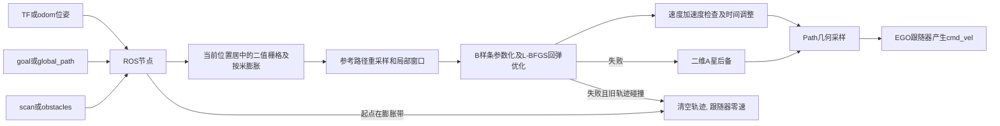

# EGO 二维规划算法源码分析

分析日期：2026-10-21（初版 2026-10-12；本轮按 version1018 复核）。源码基线：version1018 当前工作副本 `src/`，初版对应 version1012。本文是静态阅读结论，没有编译、启动 ROS、连接飞控或飞行；文中的“安全/可通行”都只是对离散代码路径的推论，不构成仿真或实机避障验收。本文位于 `docs/源码分析/`，源码入口为 `../../src`；独立规划包为 `../../src/ego_planner_2d`，整机导航包为 `../../src/navigation_2d`。`文件:行号` 按 2026-10-21 工作副本核对，改码后会漂移；无法稳定定位的地方改以文件名 + 符号名表述。

[总技术指南](../技术文档.md) · [飞行任务与舵机](飞行任务与舵机.md) · [定位建图与视觉](定位建图与视觉.md) · [电脑编译与实时显示](电脑编译与实时可视化.md) · [Gazebo仿真与场地](Gazebo仿真与场地.md)

## 1. 这个规划器到底做什么

`ego_planner_2d` 是 ROS1 的二维局部路径规划包，核心是二值占用栅格、二维 A*、三次 B 样条和 L-BFGS 优化。它把参考路径和激光障碍转换为一条平滑的 x/y 路径，通过 `nav_msgs/Path` 发布；不直接解锁飞控、不发布 MAVLink，也不负责三维避障或高度估计。

version1018 相对初版的实质变化集中在四处：A* 的搜索步长改由地图分辨率驱动，并在斜向扩展前禁止对角切角；优化器最终碰撞采样覆盖整条曲线；节点在起点落入膨胀带时主动清空计划，重规划失败时区分旧轨迹是否仍被判安全；发布前统计落入膨胀带的轨迹点并记录窗口端点/目标诊断。导航实际配置也从 0.10 m/0.35 m 改为 0.05 m/0.375 m（分辨率/膨胀），目标输入改用 `/mission/route_goal`。

包内 README 描述其源自 ROS2 移植及 FAST-Lab 算法；本文核对的是本地实际代码，不以这些上游名称或 README 的性能说法作为验收证据。`initEsdfMap` 名称虽然包含 ESDF，实际 `GridMap2D` 保存的是 `vector<vector<bool>>` 二值栅格，没有构建连续欧氏有符号距离场。当前 EGO 默认也不订阅 `/map`；Cartographer 地图供定位/显示，规划避障直接读取 `/scan`。

代码入口：`../../src/ego_planner_2d/src/ego_planner_2d_node.cpp:14-90`；地图表示：`include/plan_env/grid_map.h:15-25`；接口初始化：`src/plan_manage/planner_interface.cpp:29-59`。

## 2. 文件和实际调用关系

下表中路径省略共同前缀 `../../src/ego_planner_2d`；“整机”一行省略前缀 `../../src/navigation_2d`。

| 文件 | 作用与阅读结论 |
|---|---|
| `src/ego_planner_2d_node.cpp`、`include/ego_planner_2d/ego_planner_2d_node.h` | ROS 参数、订阅、TF、障碍过滤、定时重规划、起点膨胀检查、保留/丢弃旧轨迹、路径和 Marker 发布 |
| `src/plan_manage/planner_interface.cpp`、对应头文件 | 将参考点送入样条优化、分配时间、按地图分辨率调用 A* 后备、采样输出 |
| `include/plan_manage/plan_container.hpp` | 规划参数与局部样条数据；不是 ROS 消息 |
| `include/plan_manage/bspline_msg.h` | 内部轻量 Bspline 结构，替代上游生成消息；没有相应 ROS Bspline 话题 |
| `src/plan_env/grid_map.cpp`、对应头文件 | 地图随当前位置居中、米到栅格转换、二值占用、按米计算的圆形膨胀 |
| `src/path_searching/dyn_a_star.cpp`、对应头文件 | 八邻域 A*、可配置步长、节点池、起终点占用调整、禁止对角切角、路径回溯 |
| `src/bspline_opt/uniform_bspline.cpp`、对应头文件 | 样条参数化、de Boor 求值、导数、物理限值检查、时间拉长 |
| `src/bspline_opt/bspline_optimizer.cpp`、对应头文件 | 障碍分段、A* 回弹方向、平滑/碰撞/可行性/拟合代价、L-BFGS、全时段碰撞采样 |
| `include/bspline_opt/lbfgs.hpp` | 包内第三方优化器实现；不需要另装 liblbfgs 才能编译此包 |
| `gradient_descent_optimizer.cpp/.h` | 编进 `bspline_opt`，但本默认样条调用链使用 L-BFGS，并未实例化这个梯度下降器 |
| `launch/ego_planner_2d.launch`、`rviz/ego_planner_2d.rviz` | 独立交互演示入口，与整机 navigation launch 的参数不同 |
| `launch/navigation_2d.launch` | 整机唯一 launch：直接定义 EGO 节点和 EGO 跟随器；不再有 DWA/TEB、move_base、`planner_backend` |
| `CMakeLists.txt`、`package.xml`、`README.md` | C++14、Eigen、ROS1 接口与安装规则；README 的实现说明和性能说法需与代码分开看 |

调用链：

## 3. 独立默认值与整机默认值

整机入口是 `navigation_2d/launch/navigation_2d.launch`，它自己定义 EGO 节点，没有直接 include EGO 独立 launch。不能从 `ego_planner_2d.launch` 的 50 m 地图、2 m/s 速度推断整机速度。`navigation_2d` 目录当前只有这一份 launch，`param/`、`move_base.launch` 与六份 DWA/TEB/costmap YAML 已在 2026-10-17 删除，launch 里也没有 `planner_backend` 开关；`mission_with_move_base.h` 只是保留的历史文件名。

| 参数 | C++ 默认（launch 未覆盖） | 独立 launch | 整机 navigation | 意义 |
|---|---|---|---|---|
| `max_vel` | 2.0 m/s | 2.0 m/s | 0.35 m/s | 样条速度可行性限值；跟随器和任务层另有限幅 |
| `max_acc` | 3.0 m/s² | 3.0 m/s² | 0.50 m/s² | 样条加速度可行性限值 |
| `max_jerk` | 4.0 | 4.0 | 1.5 | 传入参数结构，未形成显式 jerk 上限检查 |
| `map_resolution` | 0.1 m | 0.1 m | 0.05 m | 栅格分辨率；整机 160×160 格 |
| `map_x_size/map_y_size` | 50/50 m | 50/50 m | 8/8 m | 当前机体周围局部地图大小 |
| `map_inflate_value` | 0.5 m | 0.5 m | 0.375 m | 二值占用膨胀半径，按米判定 |
| `sensing_range` | 10 m | 10 m | 3.5 m | 进入本地障碍集合的距离限制 |
| `planning_rate` | 5 Hz | 5 Hz | 5 Hz | 定时器频率；单次规划阻塞会降低实际频率 |
| `path_sample_interval` | 0.3 m | 0.3 m | 0.20 m | 参考路径几何重采样间隔 |
| `local_window_points` | 50 | 50 | 20 | 局部优化参考点窗口 |
| `min_traj_points` | 10 | 10 | 5 | 轨迹点数少时触发重规划 |
| `min_ref_points` | 8 | 未设置（8） | 8 | 短参考路径按同跨度加密的下限 |
| `obstacle_accumulate` | true | true | false | 整机每帧激光替换障碍集合 |
| `obstacle_height_band` | 1.0 m | 1.0 m | 0.0 m | 0 表示关闭高度过滤；旧文档写的整机 1.0 m 与源码不符 |
| `global_frame` | map | map | odom | 规划和发布坐标系 |
| `pose_source` | odom | 未设置（odom） | tf | 整机查 `odom → base_link`，odom 订阅被忽略 |
| `base_frame` | base_link | 未设置（base_link） | base_link | TF 位姿目标 |
| `output_traj_height` | -1（当前输入 z） | 未设置（-1） | `fly_height`，默认 1.5 m | 发布路径的显示/指令高度，不代表轨迹三维优化 |
| `goal` 输入 | `goal` | `goal` | `/mission/route_goal` | 整机由任务节点独占发布，旧 `/move_base_simple/goal` 不再驱动 |

A* 节点池不是 launch 参数：`PlannerInterface::initEsdfMap` 按“10 m 空间跨度 / 分辨率”反算，0.05 m 时为 200×200（40 000 个节点），独立 launch 的 0.1 m 时为 100×100。池中心取本次 A* 查询的起终点中点，所以这 10 m 是单次查询的跨度，不是全局地图尺寸。导航配置的两项关键变化是 `map_resolution` 0.10→0.05 与 `map_inflate_value` 0.35→0.375；`min_ref_points=8`、`obstacle_height_band=0.0`、8 m 地图在 1012 与 1018 的 launch 中本来就相同。

证据：节点 `18-43`；独立 launch `9-33`；整机 launch `169-270`；A* 池 `planner_interface.cpp:44-57`。数值用于解释当前导出版本，不是新硬件参数建议或安全裕度证明。

## 4. ROS 接口的精确契约

所有以下名字在根命名空间运行时带 `/` 前缀，可以 remap。整机 launch 将 `goal` 重映射到 `/mission/route_goal`，`scan` 重映射到 `scan_topic`（默认 `/scan`）。`/mission/route_goal` 由 `rescue_mission_node` 独占发布，消息统一打 `odom` 戳。launch 注释指出，同一系统里 `mavros_extras` 的 `guided_target` 插件仍会 advertise `/move_base_simple/goal`，但 EGO 已不订阅那个名字，RViz 的 “2D Nav Goal” 和旧话题都不会再驱动这条规划链（插件本身在仓库外，本文未核对其源码）。向 `/mission/route_goal` 发一个 frame 不是 `odom` 的目标会触发 `goalCallback` 的 `clearPlan()`，效果是清空当前计划并让跟随器刹车；这正是任务节点要独占该话题、且 launch 里反复强调 frame 必须一致的原因。

| 输入 | 消息 | 实际处理 |
|---|---|---|
| `odom` | nav_msgs/Odometry | 非 TF 模式直接读 x/y/z/yaw；不转换 header 坐标系、不检查年龄 |
| `global_path` | nav_msgs/Path | 非空 frame 必须匹配 `global_frame`，否则清空计划；空路径同样清空 |
| `goal` | geometry_msgs/PoseStamped | 匹配 frame 后生成当前位置到目标的直线参考；没有位姿时警告但起点未显式赋值（见 EGO-08） |
| `scan` | sensor_msgs/LaserScan | 激光转点，经最新 TF 进入 `global_frame`，过滤无效值、范围并去重；整机高度过滤关闭 |
| `obstacles` | sensor_msgs/PointCloud2 | 直接认为 x/y/z 已经处于 `global_frame`，不做 TF，也不检查 `header.frame_id` |
| `clicked_point` | geometry_msgs/PointStamped | 取 x/y、令 z=0 放交互障碍；未转换输入 frame |
| `initialpose` | geometry_msgs/PoseWithCovarianceStamped | 直接写当前位姿；下一次 TF/odom 会覆盖；并不是向 Cartographer 设初始位姿 |
| `trigger_plan` | std_msgs/Bool | 开启后标记重规划；关闭后停止发布新规划，保留最后一条可视化 |

| 输出 | 消息 | Latch | 行为 |
|---|---|---|---|
| `/visual_global_path` | nav_msgs/Path | 是 | 全局参考路径，所有点绘于输出高度 |
| `/visual_local_trajectory` | nav_msgs/Path | 是 | 几何样条或 A* 路径；EGO 跟随器真正消费的路径 |
| `/trajectories` | visualization_msgs/MarkerArray | 是 | 回弹 A* 搜索线；不是最终飞行控制指令，也不包含“后备 A* 成功”的那条路径 |
| `/visual_obstacles` | sensor_msgs/PointCloud2 | 否 | 当前原始障碍集合 |
| `/visual_local_obstacles` | sensor_msgs/PointCloud2 | 否 | 局部栅格中占用单元的点云，默认包含膨胀 |

证据：`ego_planner_2d_node.cpp:64-81,170-376,804-1053`；跟随器 `navigation_2d/src/ego_trajectory_controller.cpp:104-136`。节点内部注释和 README 称“所有可视化话题都 latched”，但两条 PointCloud2 的 `advertise` 没有传 `true`，实际不保持最后帧；Lichtblick/Foxglove 应按话题实际实现订阅。路径停止更新但仍显示时，结合 `trigger_plan`、时间戳和任务状态判断。

空路径有明确语义：节点在起点落入膨胀带、重规划失败且没有可保留的旧轨迹（或旧轨迹仍碰撞）、或 `clearPlan()` 之后会发布空的 `/visual_local_trajectory`；尚未就绪时发布的是当前 `planned_traj_`（首次启动为空，丢失输入后可能仍是旧轨迹），而 `/trigger_plan=false` 时节点停止发布、保留最后一帧。跟随器收到空路径后发布零 `Twist`（`ego_trajectory_controller.cpp:115-120`）。这表示“刹车/停住”，不等于飞控已经完成位置保持；实际减速、悬停还是继续漂移取决于飞行控制层和任务层超时。

## 5. 从激光到局部地图

1. `scanCallback`（`306-364`）用 `angle_min + i*angle_increment` 将每条有效射线转为 `(x,y,0)`。过滤 NaN/Inf、低于 `range_min` 和接近 `range_max` 的无回波。
2. 查询 `lookupTransform(global_frame, scan.frame_id, Time(0))`，使用最新 TF 而非扫描时间戳的 TF；没有逐束运动去畸变。scan 的 header 被复制，但 `pin.header.stamp` 被改成 `now` 再变换。
3. `addObstaclePointLocked:392-417` 先按 `obstacle_height_band_` 过滤：只有参数大于 0 时才比较 `abs(z - cur_z) ≤ band/2`；整机配置为 0.0，因此**不做高度过滤**，不同高度的回波都会被压进同一张二维图。随后按 `sensing_range` 裁剪，并按 `map_resolution`（整机 0.05 m）量化去重。
4. 每次规划先 `setCurPose` 把地图原点置于当前位置减半幅（`grid_map.cpp:13-40`），再由 `resetMap`（`grid_map.h:46-57`）清空二值栅格，然后标入当前障碍并圆形膨胀。8 m/0.05 m 对应 160×160 格（25 600 格）；独立 launch 的 50 m/0.1 m 对应 500×500 格。
5. 膨胀（`grid_map.cpp:142-238`）以 `sqrt(dr²+dc²)*resolution ≤ radius` 判断，距离单位是米，不再用 `ceil(radius/resolution)` 的整格数直接比较。因此 `map_inflate_value` 的含义就是半径本身；障碍点先经 `worldToGrid` 就近取整，单轴最大偏移半格（0.05 m 时 0.025 m）。地图外视为占用。

证据：`grid_map.cpp:13-40,54-69,125-139,142-238,257-265`；`grid_map.h:46-57`；`planner_interface.cpp:67-90,98-101`；节点 `483-486`。

启动注释按“障碍格心可落在真实表面内外各半个对角”估算：0.05 m 时单轴半格 0.025 m、对角半格约 0.035 m，0.375 m 膨胀的最坏净空约 0.340 m。这是几何估算，不是连续几何验证；离散栅格仍可能漏掉薄障碍、斜面和刚好落在格边界上的表面。

这个地图没有占用概率、自由射线清除或三维层次。`obstacle_accumulate=false` 使每帧替换，物体消失后可以解除占用；true 模式只累积点并做距离裁剪，`obstacle_cells_` 去重集合不会随 `obstacles_` 的裁剪同步清理（EGO-09），因此“离开感知范围再回来”的同一格点可能无法重新加入。默认 EGO 和 Cartographer 分别维护地图，显示的地图与规划障碍不是同一个数据结构。

## 6. 重规划、样条优化与后备

### 6.1 ROS 层

`planningLoop:422-505` 每 0.2 s 刷新 TF，要求位姿和 ≥2 点的参考路径。参考变化、障碍变化、轨迹点数不足或旧轨迹碰撞时调用 `replan`。整机 `obstacle_accumulate=false`，每帧 scan 都会把 `needs_replan_` 置位，因此实际是“每帧尝试重规划”；5 Hz 只是定时器请求频率，不是已测吞吐。

`replan:507-788` 的顺序：

1. **起点膨胀检查**（`532-553`）：若 `getInflateOccupancy(local_pose)` 为真，清空 `planned_traj_` 和 `a_star_pathes_` 后直接返回，不再调用优化器。下一周期 `planned_traj_.size() < min_traj_points_` 会强制再次进入 `replan`，起点恢复自由后自动恢复规划。清空的是轨迹和回弹线，不清空 `global_plan_traj_`。
2. 将参考路径按 `path_sample_interval` 离散；不足 2 点则警告并返回（`556-568`）。
3. 找距离当前位置最近的参考点，从当前位置拼接后续参考，再重新离散并截取 `local_window_points` 个点（`570-594`）。整机窗口最多约 20×0.20 m = 4 m（19 段间隔）。
4. 若参考点少于 `min_ref_points`，沿同一几何跨度用更密的间隔重采样（`596-633`）。三次样条把 K 个参考点变成 K+2 个控制点，L-BFGS 自由变量为 `2*(K-4)`，所以 K 必须大于 4；短路径重采样是为了避免 `LBFGSERR_INVALID_N (-1021)`。
5. 记录窗口末端、全局目标、两者距离，以及二者是否在膨胀带内（`635-666`）。这些值只用于日志，不改变本次规划。
6. 调用 `makePlan`，把结果先写入局部变量；成功才替换 `planned_traj_` 和 `a_star_pathes_`（`668-686,745-754`）。失败时按三种情况处理（`688-742`）：没有旧轨迹则只告警；旧轨迹仍被 `collisionDetection` 判碰撞则清空（刹车）；旧轨迹未被判碰撞则保留原轨迹。失败后是否马上重试取决于 `needs_replan_` 是否再次被障碍/路径更新置位；整机每帧 scan 会置位，通常下一周期再试。
7. 成功发布前统计 `planned_traj_` 中落入膨胀带的点数（`745-773`）。点数大于 0 只打印 WARN，**不拒绝发布**；随后 INFO 记录规划终点到目标的距离、窗口末端/目标是否在膨胀带内、障碍数和点数（`779-787`）。失败分支的 WARN 也记录参考点数、窗口末端距离、两个膨胀标志、障碍数和 A* 路径数（`688-698`），用于区分“窗口末端进障碍”和“目标本身进障碍”。

只要规划没有被 `/trigger_plan` 关闭，`planningLoop` 每周期都会调用 `publishAll` 发布当前 `planned_traj_`；旧轨迹被保留时，`publishLocalTrajectory` 会用 `now` 重新打戳（`885-911`），所以跟随器的 `command_timeout` 不会因“规划失败”自然过期。被清空时发布空路径，跟随器转为零速。

### 6.2 算法层

`PlannerInterface::makePlan:138-286`：

- 参考点的内部 z 固定 0.2，实际优化只取 x/y；起点速度、起点加速度、目标速度都设零，不按当前真实飞行速度构造边界条件。参考点只有 2 个时插入中点；少于 3 个直接返回。
- K≥5 先尝试样条；更短的路径走 A*。首次时间间隔 `ts = ctrl_pt_dist/max_vel*1.2`，`ctrl_pt_dist=0.4 m`；距离小于 0.1 m 时系数改为 5。整机 0.35 m/s 下每段约 1.37 s，样条时间轴被拉得很长；但发布的是 `nav_msgs/Path`，跟随器按空间前视，不按这条时间轴严格跟踪。
- 障碍段用 A* 生成回弹方向；对中间控制点进行 L-BFGS，memory=16、最多 200 迭代、梯度阈值 0.001。
- 平滑权重初值 12、回弹距离权重初值 1、速度加速度可行性权重 3；距离 clearance 硬编码 0.6 m。它是优化代价要求，不能把它和 0.375 m 膨胀简单相加为已证明的避障净距。
- 物理限值验证是分量约束（x/y 各自检查，`uniform_bspline.cpp:136-194`），后续跟随器又限制速度大小；不可行时拉长时间并重新拟合。
- `max_jerk` 仅保存，平滑项惩罚三阶差分，没有按该参数执行 jerk 硬上限。曲率和转向代价函数存在，但默认组合代价中调用已注释（`1160-1161`）。

**全时段碰撞采样（本轮加强）**：`rebound_optimize:992-1032` 和 `refine_optimize:1107-1130` 的采样循环从 `tm` 到 `tmp + 1e-9`，覆盖整条参数曲线，不再是旧版的 `t < tmp * 2 / 3`。`t_step` 由 `span / (起终点直线距离 / resolution)` 折算；若 `t_step` 非有限或 ≤1e-6，退化为 `span/20`；采样数上限 4000，达到上限就提前结束。span 为 0 时 `span/20` 仍为 0，4000 上限使 `for` 最多原地采样 4000 次而不是挂死，这是“步长异常处理”的实际作用。注意这里的“距离”是起终点弦长，不是弧长，绕行曲线越弯，实际采样密度越低于“每格一点”；4000 上限也可能截断极长曲线。反弹阶段若在 `t ≤ bspline_interval_` 就撞障碍，直接返回 false 并打印前几个控制点；否则最多再尝试 2 次（`MAX_RESART_NUMS_SET=3` 限制重启计数）并把 `new_lambda2_` 翻倍。refine 阶段碰撞会翻倍 `lambda4_`，但循环条件是 `iter_count <= 0`，实际只跑一轮便返回 false。

另需区分：`initControlPoints` 的障碍分段仍只扫描约前 2/3 控制点（`64` 的 `i_end`），`check_collision_and_rebound` 也仍用 `end_idx - (end_idx-order_)/3` 作为扫描上界（`688`）。因此“最终碰撞判定覆盖全时段”不等于“障碍分段和回弹方向生成也覆盖全时段”；末段障碍可能没有对应的回弹方向，只能靠最终采样拒绝并转入 A* 后备。

**refine 失败仍在发布**：`reboundReplan:350-378` 在时间重分配后若 `refineTrajAlgo` 返回 false（末段碰撞、控制点不足或数值失败），只打印“This refined trajectory hits obstacles”，把 `return false` 注释掉，仍然 `updateTrajInfo(pos)` 并返回 true。由于 `refineTrajAlgo` 在调用优化器前已经把 `pos` 重参数化，这条路径会把“已判碰撞或未完成 refine 的重参数化轨迹”当作成功结果交给节点；节点的发布前统计只会 WARN，不会拒绝（EGO-03/EGO-12）。不能把 `PlannerInterface` 的“优化成功”当作最终无碰撞证明。

证据：`planner_interface.cpp:18-25,139-174,281-359`；`bspline_optimizer.cpp:10-26,46-133,679-770,911-1140,1143-1171`；`uniform_bspline.cpp:136-207,211-281`。

### 6.3 A* 后备和输出

八邻域 A* 采用对角启发函数乘 1.0001 的 tie breaker；相邻正交步代价为 1、对角步为 √2（单位是格）。搜索步长由调用方传入地图分辨率：`planner_interface.cpp:230-237`（后备）与 `bspline_optimizer.cpp:121-124,759-760`（回弹分段）都使用 `grid_map_->getResolution()`，不再写死 0.1 m。A* 内部把这个步长用于自身网格节点坐标到世界坐标的换算（`dyn_a_star.h:107-121`）和起点/终点沿连线逐格调整（`dyn_a_star.cpp:87-135`）；这个网格以本次查询的起终点中点为锚，步长不等于地图分辨率时，它与 `GridMap2D` 的格子会错位成两套采样，所以调用点必须传分辨率。

节点池由 `initEsdfMap` 按 10 m 跨度反算：0.05 m 时 200×200；池中心是本次查询的起终点中点，单次查询的起终点相距超过约 10 m（端点离池心超过 5 m）时会打印 “Ran out of pool” 并失败（`dyn_a_star.h:112-121`；`dyn_a_star.cpp:144`）。每次搜索以 `rounds_` 区分新旧节点，边界保留 1 格余量（`207-211`）。

`Coord2Index`（`dyn_a_star.h:112-121`）用 `((pt-center)/step + 0.5).cast<int>()` 取整；C++ 对负值向零截断，所以当中点左侧/下侧的偏移超过半格时，索引会比最近格向中心偏一格，`Index2Coord` 回算的坐标偏差可达约 1.5 个步长（0.05 m 时约 0.075 m）。这个不对称在静态代码里可以直接读出，本文没有运行验证它对具体航点/回弹端点的影响；如果 A* 起点因此偏移，节点层的实际起点膨胀检查仍会先拦截真正不可走的起点，但 A* 内部的占用判断和端点调整用的是偏移后的点。

对角扩展前，A* 同时检查两个正交邻格 `(cx+dx, cy)` 和 `(cx, cy+dy)`，任一被占则跳过该斜向邻居（`231-249`）。这是本轮新增的“禁止切角”：旧版只检查目标格，斜线段会从两格共用顶点旁擦过（0.10 m 时最近约 0.0707 m），可能把实际压进膨胀带的缝隙判成可走。当前规则消除了“从两个被占格的角缝挤过去”，但仍是格心离散判定，不是连续 swept segment 证明；起终点沿连线逐格调整也可能跨过薄障碍。

后备路径只要到目标 ≤0.15 m，或比起点更接近目标，便被接受（`planner_interface.cpp:239-277`）。因此“有一条路径”不代表到达任务航点，可能止于膨胀区外的中间点；A* 的 `getPath` 返回自身网格节点坐标，几何上被量化到分辨率。

样条最终每 0.1 s 求值，转换为路径位置点（`planner_interface.cpp:483-494`）；`nav_msgs/Path` 没有携带整条样条的执行时序、速度和加速度。下游按空间前视跟随，是几何路径追踪，不是按样条时间严格跟踪。输出高度由 ROS 层覆盖为 `output_traj_height`（整机 `fly_height`，默认 1.5 m），水平优化不感知上下方障碍。

证据：`dyn_a_star.cpp:25-42,87-135,138-275,278-290`；`planner_interface.cpp:213-258,443-495`；节点 `885-911`。

## 7. 具体问题与验证顺序

下表是本次源码可确定的实现行为及其推论；没有把它们写成已发生的真机故障。version1018 已加强的项在编号后标注，但不等于问题已消除。改动应另建源码分支，本文未修复基线。所有检查都基于离散栅格/离散采样，不构成连续碰撞证明。

| 编号/优先级 | 触发与影响 | 源码证据 | 建议验证/修正方向 |
|---|---|---|---|
| EGO-01 中（已加强，残余） | 旧轨迹不再无条件保留：起点在膨胀带内直接清空；重规划失败时仅当旧轨迹仍被判碰撞才清空，否则保留并重新打戳发布。残余：`collisionDetection` 只逐点查离散路径点，“未被判碰撞”不等于连续安全；旧轨迹可能已接近其末端，跟随器会停在最后一个点 | 节点 `532-553,688-742`；跟随器 `104-136` | 构造“新障碍封堵 + 重规划失败 + 旧轨迹末段擦边”fixture；要求区分离散点安全与连续安全 |
| EGO-02 高 | 一旦曾经成功，TF 失败或停止更新后 `has_pose_` 仍保持 true；`Time(0)` 仍可返回缓存旧变换，未检查年龄。定位失联不一定让规划停下 | 节点 `127-151,424-448` | 停止 TF 流并保持规划节点存活；年龄阈值内转 hold，恢复后重新生成计划 |
| EGO-03 高 | 样条 refine 失败分支注释掉 `return false`，仍 `updateTrajInfo` 并 return true；refine 会先修改轨迹。全时段碰撞检查加强后，这条路径可能把已判碰撞的重参数化轨迹发布出去 | `planner_interface.cpp:350-378`；`bspline_optimizer.cpp:1107-1139` | 让 refine 失败返回 false 或转 A*/刹车；用末段障碍 fixture 检查发布结果 |
| EGO-04 中（部分加强） | 最终 rebound/refine 碰撞采样已覆盖 `[tm,tmp]`，但采样步长按起终点弦长折算、4000 次上限可能截断；障碍分段与回弹方向搜索仍只到约前 2/3 控制点 | `bspline_optimizer.cpp:64,688,992-1032,1107-1130` | 用弧长而非弦长定步长；扫描全部控制点；对末段障碍检查是否只能靠 A* 后备 |
| EGO-05 低（已加强） | 斜向扩展已禁止对角切角，但仍是格心离散检查；起终点沿连线逐格调整同样可能跨过薄障碍 | `dyn_a_star.cpp:87-135,231-249` | 对角相邻阻塞格 fixture；进一步检查 swept segment/连续几何 |
| EGO-06 中 | 开放集节点 fScore 下降后没有重新入堆或修复堆序，`std::priority_queue` 存的是会被修改的指针 | `dyn_a_star.cpp:255-268`；`dyn_a_star.h:34-41,84` | 与 Dijkstra 最短路结果对比；使用不可变队列条目并丢弃过期项或正确 decrease-key |
| EGO-07 中 | 点云不做 frame 检查/变换；独立 odom 同样未核对 frame。相机系或 map 系点误送 odom 将产生错误障碍 | 节点 `153-168,274-304` | 异坐标系输入应拒收或变换；给 frame/时间契约 |
| EGO-08 中 | 独立启动收到 goal 时还没有 pose，`PathPoint start` 未初始化；日志写“using (0,0)”但没有赋值，后续直线路径使用未定义值 | 节点 `221-232`；`planner_interface.h:22-28` | 未就绪时拒绝 goal，或显式把 start 置为 (0,0)；修掉误导性日志 |
| EGO-09 中 | true 累积模式距离裁剪 `obstacles_` 后，没有同步清理 `obstacle_cells_`；离开后回来同格障碍可能无法再次加入 | 节点 `405-409,466-481` | 往返位置 fixture；同步重建去重集合。整机 false 每帧清空，避免这条分支 |
| EGO-10 低 | map 尺寸 double 先变 `Vector2i`，非整数米会截断；`local_data_.traj_id_` 未初始化却 `++`；`getObstacles` 的 `temp.z` 未赋值（发布时被覆盖为 0） | `planner_interface.cpp:35,116-127,413-421`；`plan_container.hpp:28-38` | 参数合法性与结构体零初始化；z/v 不作为该接口可靠输出 |
| EGO-11 说明 | scan 用最新 TF 和当前时间而非采样时间，转弯/延迟时有时空误差 | 节点 `318,338` | 回放中比较扫描 timestamp 变换与 `Time(0)`，统计转弯误差 |
| EGO-12 中 | 发布前审计只告警：`inflated_pts > 0` 的轨迹仍会被发布；任何上游漏检都会原样进入跟随器 | 节点 `745-773` | 把审计变成发布门槛或至少切换为 A* 后备/刹车；记录被发布轨迹的点数 |
| EGO-13 低（文档/死代码） | `navigation_2d/README.md` 仍写 `planner_backend`、move_base 与 0.35 m 膨胀；`rescue_mission.cpp` 仍 advertise 无订阅者的 `/move_base/cancel`；历史文件名 `mission_with_move_base.h` 保留 | `navigation_2d/README.md:80,106-107,126,152,182`；`rescue_mission.cpp:301` | 同步 README；删除无消费者的 cancel 发布或注明保留原因；不要按文件名判断当前后端 |
| EGO-14 低 | `Coord2Index` 在 `+0.5` 后直接 `cast<int>`，负值向零截断，偏离中点超过半格的起终点索引比最近格偏一格；`Index2Coord` 回算偏差可达约 1.5 个步长（0.05 m 时约 0.075 m） | `dyn_a_star.h:112-121`；`dyn_a_star.cpp:144` | 用 `std::lround`/`floor(q+0.5)` 对称取整；对负半轴起点 fixture 比较 `Index2Coord(Coord2Index(p))` 与 p |

补充：`dyn_a_star.h:10` 的 `constexpr double inf = 1 >> 20` 实际为 0（整数右移），所以 `GridNode` 的 `gScore/fScore` 默认初始化成 0 而非大值；`AStar` 的 `GridNodeMap_` 成员也未在构造函数初始化，析构函数先判断 `nullptr`，若从未 `initGridMap` 就析构会读到未初始化指针。默认 `PlannerInterface::initEsdfMap` 会调用 `initGridMap`，且新发现节点的 g/f 会在入堆前显式赋值，不能仅凭这两点断言正常默认路径已经失败；仍建议在后续清理中改成真正的无穷大并初始化指针。未使用梯度下降器的输入输出/上限边界也不构成默认 L-BFGS 失效证明。

与《version1018 与 version1012 更新分析》（2026-10-19）第 7 节对照：A* 步长/池、起点清空、旧轨迹处理、发布前诊断等结论与源码一致；需要补充的是：(1) 最终碰撞采样覆盖全时段，但障碍分段与回弹方向搜索仍只到约前 2/3；(2) 采样步长按起终点直线距离而非弧长折算；(3) DWA/TEB/move_base 的 launch、YAML、依赖和 `planner_backend` 已从运行入口删除，但 README 与 `/move_base/cancel` 发布者仍有残留。另外静态复核还发现 `Coord2Index` 对负半轴取整不对称（EGO-14），不在该报告第 7 节列举范围内。

## 8. 编译与运行覆盖

CMake 生成 `bspline_opt`、`path_searching`、`grid_map_2d`、`plan_manage` 四个静态库和 `ego_planner_2d_node`。C++14、Eigen3、ROS 消息、tf2 为主要依赖；不链接 CUDA/TensorRT，是电脑 x86_64 容器的优先验证模块。

CMake 注释称核心“无 ROS 依赖”，但 `planner_interface.h` 通过 `bspline_msg.h` 引用 `geometry_msgs/Point`，不能把整个包当纯 Eigen 库直接脱离 ROS 构建。当前未运行编译；历史 AArch64 产物不等于新电脑或新目标机构建成功。

整机侧 `navigation_2d` 现在只安装 `navigation_2d.launch` 和两个可执行节点；`package.xml` 不再依赖 move_base/DWA/TEB，launch 直接启动 `ego_planner_2d_node` 与 `ego_trajectory_controller_node`，goal 话题重映射到 `/mission/route_goal`。README 的旧后端说明尚未同步（EGO-13），不能按 README 判断当前后端。version1018 另提供 `src/gc_2026_sim` 的 Gazebo 场地、模型和 launch；本文没有启动它，仿真覆盖与限制见更新分析报告第 3 节。

建议验收顺序：构建目标与依赖确认 → 独立 ROS Master 下固定输入回放 → 上表失败分支 fixture（起点在膨胀带、末段障碍、对角角缝、refine 失败、空路径）→ 加入跟随器校验 frame/超时/零速度 → Gazebo/PX4 SITL（`gc_2026_sim` 已提供材料，本轮未启动）→ 台架和真实定位验收。所有离线交互发布都应在独立 Master，避免 `goal/trigger_plan` 进入真实任务链。

## 9. 分析覆盖的边界

本次核对了 `ego_planner_2d` 的源文件清单、主要算法/ROS 实现、头文件、CMake、package、两份 launch、README 和显示配置，并审查内置 L-BFGS 的调用接口/终止参数；同时核对了 `navigation_2d` 的 launch、README、CMake/package 与 EGO 跟随器、任务目标发布相关代码。未逐行审计第三方优化器的数值正确性，也没有重新验证上游论文、所有第三方 ROS 内部实现或目标机实时性能。README/代码注释中的历史仿真时间、上游冒烟测试和“毫秒级、余量充足”说法未附当前硬件测量，不作为实机结论。

本轮没有编译、运行、启动 Gazebo/PX4 SITL，也没有连接飞控或验证避障。文中的“已加强”“禁止切角”“全时段采样”只描述代码路径；离散栅格、离散轨迹点和按弦长/上限折算的采样都不构成连续碰撞证明。launch 中的 0.05 m/0.375 m 是当前配置，不是安全裕度或飞行验收结论。
