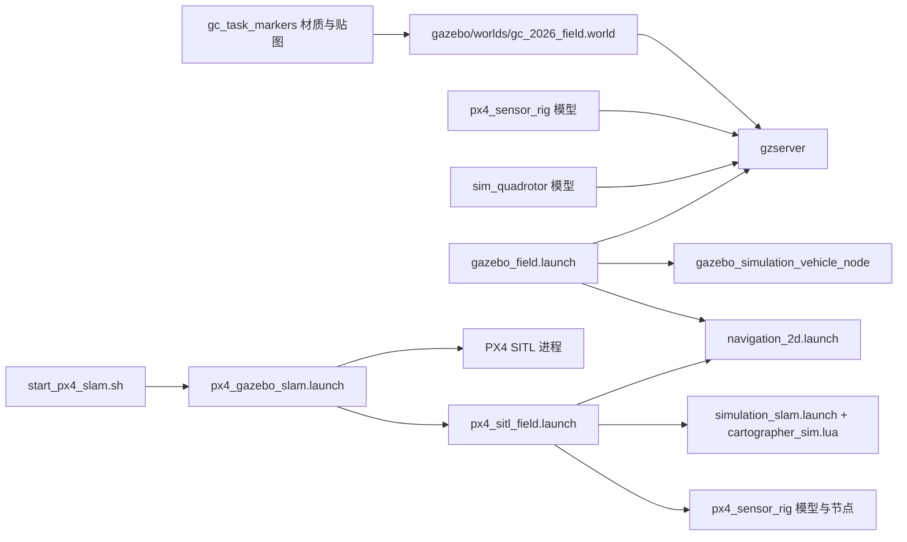

# Gazebo 仿真与赛项场地源码分析

分析日期：2026-10-22 复核。源码基线：**version1018**；Git 仓库位于项目根（2026-10-22 建立），日常源码入口是 `src/`。本文为静态阅读结论：本机未安装 Gazebo、PX4、ROS，**未编译、未启动仿真、未运行包内任何脚本**。文中所有尺寸、频率、话题名、超时和阈值都是配置值或代码常量，不是实测值；源码注释里引用的历史运行现象（2026-09-24/25 的地图漂移、2026-10-18 的“识别到了但没投放”等）只作为作者留下的说明记录，本次没有复现。

[总技术指南](../技术文档.md) · [定位建图与视觉](定位建图与视觉.md) · [EGO规划算法](EGO规划算法.md) · [飞行任务与舵机](飞行任务与舵机.md) · [电脑编译与实时显示](电脑编译与实时可视化.md)

本文路径记号：`SIM/` = `../../src/gc_2026_sim/`；`NAV/` = `../../src/navigation_2d/`；`TOOLS/` = `../../tools/`。行号按当前源码逐行核对，源文件改动后需重新定位。同批输入还有项目上一级的《[version1018 与 version1012 更新分析](../../../../version1018与version1012更新分析_2026-10-19.md)》第 3 节，本文按当前源码复核其结论，差异集中列在 8.3 节。

## 1. 包的定位、文件清单与构建目标

`gc_2026_sim` 只包含 2026 赛题的 Gazebo Classic / PX4 SITL 部分，作者明确说明它“故意与 `navigation_2d` 分开，所以不需要拷到 Jetson 飞控计算机上”（`SIM/README.md:3`）。它不含导航逻辑、不发布飞控指令、不替代任何机载节点；包内提供的是 **场地世界、模型与贴图、四条 launch、一份独立 Cartographer 参数、两个 C++ 仿真节点、七个启动/检查脚本**。

| 路径 | 内容 | 阅读结论 |
|---|---|---|
| [`CMakeLists.txt`](../../src/gc_2026_sim/CMakeLists.txt)、[`package.xml`](../../src/gc_2026_sim/package.xml)、[`README.md`](../../src/gc_2026_sim/README.md) | 构建与说明 | 两个可执行目标；CATKIN_DEPENDS 只列消息/roscpp/tf；README 记录启动方式与 “Preparing your world” 的已知坑 |
| [`gazebo/worlds/gc_2026_field.world`](../../src/gc_2026_sim/gazebo/worlds/gc_2026_field.world) | 赛项场地 | 4 m × 4 m 地面、3 m 围墙、4 个固定障碍、2 个圆柱随机障碍、起飞点、2 张危险品卡片、3 张人员卡片；625 行，注释占约三分之一 |
| [`gazebo/models/gc_task_markers/`](../../src/gc_2026_sim/gazebo/models/gc_task_markers) | 贴图与材质资源容器 | `model.sdf` 只有一个视觉体，靠 `model://` 被 world 引用材质脚本；10 张 PNG（9 类危险品 + 人员） |
| [`gazebo/models/px4_sensor_rig/`](../../src/gc_2026_sim/gazebo/models/px4_sensor_rig) | PX4 路径的传感器架 | 无碰撞体、关重力、`kinematic=false`；10 Hz/360 点激光、640×480/15 Hz 下视相机 |
| [`gazebo/models/sim_quadrotor/`](../../src/gc_2026_sim/gazebo/models/sim_quadrotor) | 轻量路径的可视四旋翼 | `kinematic=true`；自带 `sim_camera` 相机；1.5 kg、0.32 m 机身 |
| [`launch/gazebo_field.launch`](../../src/gc_2026_sim/launch/gazebo_field.launch) | 轻量路径入口 | 起 world、可视模型、`simulation_vehicle` 假 MAVROS，再 include 导航 |
| [`launch/px4_gazebo_slam.launch`](../../src/gc_2026_sim/launch/px4_gazebo_slam.launch) | PX4 路径总入口 | 起 world、PX4 SITL、Iris，再 include 下面两份 |
| [`launch/px4_sitl_field.launch`](../../src/gc_2026_sim/launch/px4_sitl_field.launch) | PX4 路径的接口层 | MAVROS、静态 TF、传感器架与节点、SLAM、Foxglove、任务 |
| [`launch/simulation_slam.launch`](../../src/gc_2026_sim/launch/simulation_slam.launch) | Cartographer 启动 | 15 s 延时、scan/imu 重映射、只发布 map→odom |
| [`param/cartographer_sim.lua`](../../src/gc_2026_sim/param/cartographer_sim.lua) | SLAM 参数 | `published_frame=odom`、`provide_odom_frame=false`、`use_odometry=false`；量程按 Gazebo 传感器物理收紧到 3.40 m |
| [`src/px4_sensor_rig.cpp`](../../src/gc_2026_sim/src/px4_sensor_rig.cpp) | 传感器架与投放仿真 | 从 `/gazebo/model_states` 取真值；发布 odom→base_link TF；生成投放物与 Marker |
| [`src/simulation_vehicle.cpp`](../../src/gc_2026_sim/src/simulation_vehicle.cpp) | 假 MAVROS 载具 | 状态/位姿/解锁/模式服务、速度积分、`set_model_state` 驱动可视模型 |
| `scripts/` | 7 个脚本 | 3 个 Python 检查器、2 个 bash 检查/安装、2 个启动脚本（见第 7 节） |

包内普通文件共 35 个（不含 `scripts/__pycache__/` 里两个 Python 3.13 缓存）。同批报告写“新增 37”，差额正是这两个 `.pyc`；它们是缓存，不应作为目标环境的依赖凭证。

构建面很小：`add_compile_options(-std=c++11)`（`SIM/CMakeLists.txt:4`），catkin 组件为 `gazebo_msgs / geometry_msgs / mavros_msgs / nav_msgs / roscpp / std_msgs / tf / visualization_msgs`（6-15），两个目标 `gazebo_simulation_vehicle_node`（24-26）与 `px4_sensor_rig_node`（28-30），并把 `launch gazebo param` 装进包共享目录（36-38）。`package.xml` 的 `exec_depend` 额外声明 `cartographer_ros`、`foxglove_bridge`、`gazebo_plugins`、`gazebo_ros`、`mavros`、`navigation_2d`、`tf2_ros`（`SIM/package.xml:20-34`）。这两点意味着本包能编译不等于仿真能跑：世界需要 `gazebo_ros`，SLAM 需要 `cartographer_ros`，任务需要 `navigation_2d`，桥需要 `foxglove_bridge`，PX4 与 MAVROS 完全在包外。

两处只在“源码树里运行”才成立的安装细节：

1. `install(PROGRAMS ...)` 只装了 7 个脚本中的 6 个，**`check_slam_topics.sh` 没有安装项**（`SIM/CMakeLists.txt:40-48` 对比 `scripts/` 实际内容）。
2. `start_px4_slam.sh` 用 `SCRIPT_DIR/../../..` 推算工作空间（`SIM/scripts/start_px4_slam.sh:6-7`），`install_px4_field_world.sh` 用 `SCRIPT_DIR/../gazebo/worlds` 找世界（`SIM/scripts/install_px4_field_world.sh:5-6`）。这两条相对路径只有在 `src/gc_2026_sim/scripts/` 下执行时才对；装到 `lib/gc_2026_sim` 后 `../../..` 变成安装前缀，`../gazebo` 也不存在。README 给的调用方式正是 `bash src/gc_2026_sim/scripts/...`（`SIM/README.md:13,19`），所以现阶段应把脚本当作源码树工具，而不是安装后的命令行工具。

## 2. 场地规格：坐标、尺寸与卡片

### 2.1 两套坐标

world 文件头把图纸（mat，毫米标注）与 Gazebo 世界坐标的换算写死为：`mat x = 0..4 m → gazebo x = -0.65..3.35 m`，`mat y = 0..4 m → gazebo y = -3.35..0.65 m`（`SIM/gazebo/worlds/gc_2026_field.world:6-10`）。起飞点在图纸 `(650, 3350)`，正好是 Gazebo `(0, 0)`，也是 PX4 的 home（10、354-355）。`NAV/launch/navigation_2d.launch:307-315` 把航线表解释为“图面米数减去 0.65 / 3.35 的原点平移”，与本文件一致。

围墙内表面围出的可用区正是 `x ∈ [-0.65, 3.35]`、`y ∈ [-3.35, 0.65]`，即 4.00 m × 4.00 m，和 `check_px4_slam.py` 判“Iris 是否在场地内”的边界完全相同（`SIM/scripts/check_px4_slam.py:81-83`）。`NAV` 侧安全边界与 0.20 m 余量的关系见 world 注释 144-147。

### 2.2 地面、围墙与障碍

| 模型 | 位姿（Gazebo） | 几何 | 说明 |
|---|---|---|---|
| `competition_floor` | `(1.35, -1.35, -0.02)` | 4.00 × 4.00 × 0.04 盒 | 顶面 z = 0；`static` |
| `perimeter_wall_north` | `(1.35, 0.675, 1.50)` | 4.00 × 0.05 × 3.00 | 内表面 y = 0.65 |
| `perimeter_wall_south` | `(1.35, -3.375, 1.50)` | 4.00 × 0.05 × 3.00 | 内表面 y = -3.35 |
| `perimeter_wall_west` | `(-0.675, -1.35, 1.50)` | 0.05 × 4.10 × 3.00 | 内表面 x = -0.65；长 4.10，多出的 0.10 覆盖南北墙厚度 |
| `perimeter_wall_east` | `(3.375, -1.35, 1.50)` | 0.05 × 4.10 × 3.00 | 内表面 x = 3.35 |
| `fixed_obstacle_1` | `(0.70, -0.20, 1.50)` | 0.10 × 1.70 × 3.00 | 南北向长条 |
| `fixed_obstacle_2` | `(2.75, 0.05, 1.50)`，yaw `0.785398` | 1.60 × 0.10 × 3.00 | 45° 斜杆，嵌在东北角 |
| `fixed_obstacle_3` | `(0.70, -3.10, 1.50)` | 0.10 × 0.50 × 3.00 | 贴南边 |
| `fixed_obstacle_4` | `(2.10, -3.10, 1.50)` | 0.10 × 0.50 × 3.00 | 贴南边 |
| `random_obstacle_1` | `(0.70, -1.45, 1.50)` | 圆柱 r 0.10，长 3.00 | 当前写死的“左列 1 位” |
| `random_obstacle_2` | `(2.10, -1.45, 1.50)` | 圆柱 r 0.10，长 3.00 | 当前写死的“右列 1 位” |
| `takeoff_pad` | `(0, 0, 0.006)` | 圆柱 r 0.20，厚 0.012 | 绿色，无碰撞体 |

证据：`SIM/gazebo/worlds/gc_2026_field.world:65-85,149-215,217-305,307-352,354-368`。所有墙和障碍的 `z` 中心都是 1.50、竖向尺寸 3.00 m，即从地面到 3.00 m（87-148 的 “ALTITUDE BAND” 注释）。作者在注释里给的理由是：真实场地围栏高 3 m（运营者 2026-09-25 确认），并且旧版 2.00 m 的墙顶低于雷达平面，Gazebo 的 ray sensor 对未命中的光束返回 `range_max` 而不是丢弃或 `inf`，于是整帧扫描变成 360 条 3.50 m 的“幻影墙”（110-133）。这段因果是作者的历史记录，本次未复现；但“3.00 m 是当前配置值”可以直接从元素属性核对。

仍未被源码内部证据闭合的一处：注释自己写着六个障碍（4 个固定 + 2 个随机）在图纸上标注为 **2.00 m 高**，而本文件把它们也抬到了 3.00 m，并注明“墙已确认、杆高未确认”（135-142）。因此“障碍 3.00 m”只能当作当前仿真配置，不能当作场地事实。

### 2.3 起飞区、危险品卡片区与人员卡片区

起飞区是一个 0.20 m 半径、12 mm 厚的绿色圆盘，位于 `(0, 0)`，与 PX4 home 重合（354-368）。

任务卡片共 5 张，全部 `static`、**没有任何 `<collision>`**：

| 模型 | 位置 | 材质 | 片区 |
|---|---|---|---|
| `hazard_zone_card_1` | `(1.40, 0.00)` | `GC/Sign/Flammable` | 危险品列，北端 |
| `hazard_zone_card_2` | `(1.40, -0.45)` | `GC/Sign/Explosive` | 危险品列，南侧 0.45 m |
| `person_zone_card_1` | `(2.70, -1.05)` | `GC/Sign/Person` | 人员列，北端 |
| `person_zone_card_2` | `(2.70, -1.85)` | `GC/Sign/Person` | 人员列，中 |
| `person_zone_card_3` | `(2.70, -2.65)` | `GC/Sign/Person` | 人员列，南端 |

每张卡片由两部分拼成：一块 `0.40 × 0.40 × 0.008` 的贴图面（`sign_face`，z 中心 0.004），外加四根 `0.025 m` 宽、`0.010 m` 高的实体边框条（`frame_north/south/west/east`，位于 ±0.2125），合起来外廓 0.45 m。边框是真几何而不是贴图，理由写在 380-393：平印的边框在掠射角下会消失。没有碰撞体是刻意的：卡片只有 10 mm 高，飞机在 1.2–1.5 m 飞，costmap 不能把任务航点上的 0.45 m 方块当成障碍（394-397）；`TOOLS/check_config.py` 的 `_world_footprints()` 也按高度把它们筛掉（`TOOLS/check_config.py:445-498`，判据 `cz - h/2 <= fly_height <= cz + h/2`）。

危险品列放在 `x = 1.40` 是 1018 的修正：图纸的 “1950” 是从图面右边缘量的，所以这一列在图面 x 2050 = Gazebo 1.40，早先写的 1.50 会让载具偏右 0.10 m、投放点落到卡片外（`SIM/gazebo/worlds/gc_2026_field.world:20-24`；`NAV/launch/navigation_2d.launch:310-315`）。两张危险品卡片中心距 0.45 m，注释说图纸是 454 mm、这里取卡片边长 0.45（451-454）。人员列 `x = 2.70`、三张卡中心相距 0.80 m，与 `person_route` 的三个 y 完全相同（506-510 对比 `NAV/launch/navigation_2d.launch:346-353`）。当前 `hazard_route` 的第三个航点 `(1.40, 0.00)` 正好压在卡片 1 的中心上，卡片 2 位于这条北向腿的途中（`NAV/launch/navigation_2d.launch:316-320`）。

贴图与材质：`gc_task_markers` 目录下有 **10 张 PNG**——9 类危险品（易燃、易爆、腐蚀、有毒、生物危害、电离辐射、裂变物质、氧化剂、高压气瓶）加 1 张人员卡；材质脚本里对应 10 个 `GC/Sign/*` 材质，每个都写成 `ambient/diffuse 1 1 1 1` 加各向异性过滤（`SIM/gazebo/models/gc_task_markers/materials/scripts/gc_task_markers.material:8-25,233-250` 等）。当前 world 只实例化了 Flammable、Explosive、Person 三个材质；其余 7 个危险品材质是“换抽签结果时改一行材质名”的备选清单（`SIM/gazebo/worlds/gc_2026_field.world:455-466`）。材质保持白色是刻意的：注释说染色会把安全黄拖出 `mission_vision.cpp` 匹配的 HSV 窗口（`SIM/gazebo/models/gc_task_markers/materials/scripts/gc_task_markers.material:3-7`）——这条理由在 1018 已经过时，见 8.3 的 SIM-13。

`gc_task_markers/model.sdf` 本身只是个可加载的资源容器，只有一个贴了 Flammable 的视觉体；注释说明没有任何模型 include 它，world 只是把 `<material><script><uri>` 指向这个目录（`SIM/gazebo/models/gc_task_markers/model.sdf:3-22`），`model.config` 的描述写明图案取自 GB 2894-2025 附录 C 表 C.1（`SIM/gazebo/models/gc_task_markers/model.config:10-16`）。

### 2.4 随机障碍：world 里写死一种摆法，组合由检查工具枚举

`random_obstacle_1/2` 的注释列出了每列两个候选位置，并明确“这个 world 交付的是 both-1 摆法，现场抽签不同就换 2 号位姿”（`SIM/gazebo/worlds/gc_2026_field.world:307-319`）：

| 列 | 1 号位（当前使用） | 2 号位 |
|---|---|---|
| 左（`x = 0.70`） | `(0.70, -1.45)` | `(0.70, -2.45)` |
| 右（`x = 2.10`） | `(2.10, -1.45)` | `(2.10, -1.95)` |

也就是说，**启动仿真不会自动随机**：world 里两个圆柱的 `<pose>` 是常量（320-352），改摆法要改文件。四种组合由离线工具 `TOOLS/check_route_corridor.py` 枚举：`RANDOM_CANDIDATES` 给出与上面完全一致的四组坐标（`TOOLS/check_route_corridor.py:46-51`），`_draws()` 生成 `L1R1 / L1R2 / L2R1 / L2R2` 四张足迹表（75-88），再对每条航线腿算“到障碍表面的最小距离 − 膨胀半径”和横截面净宽（122-149）。它复用的是 `check_config._world_footprints()`，避免出现第二份几何真相（38-39）。

这带来两个使用边界：其一，Gazebo 里永远只验证了 `L1R1`，另外三种只有几何计算，没有载入过世界；其二，同批报告记录的 `check_route_corridor.py` 退出 1（3 条腿在至少一种摆法下直线落入膨胀带）是“航点之间不能直连”的证据，不等于 EGO 找不到绕行路径。工具本身也这么写（`TOOLS/check_route_corridor.py:236-240`）。

### 2.5 物理与光照

`gravity` 为 `0 0 -9.81`，`magnetic_field 6.0e-6 2.3e-5 -4.2e-5`，ODE `quick` 求解器、`iters 10`、`sor 1.3`，`max_step_size 0.004`、`real_time_update_rate 250`、`real_time_factor 1`（`SIM/gazebo/worlds/gc_2026_field.world:26-47`）。注释称该组参数是为对齐 PX4 的锁步假设（28）。环境光 0.55/背景 0.72 0.76 0.82，开阴影（55-59），GUI 初始相机在 `(-3.5, -7.0, 7.0)` 俯视场地（48-53）。这些都是显示/物理配置值，未做实时性或视觉一致性测量。

## 3. 两条仿真路径

包内实际有两条互不依赖的启动链。它们共用同一个 world 和同一份 `navigation_2d.launch`，但在“谁提供飞控状态、谁提供位姿、有没有 SLAM”上完全不同。

### 3.1 轻量路径：`gazebo_field.launch` + `simulation_vehicle.cpp`

`gazebo_field.launch` 先导出 `GAZEBO_MODEL_PATH`（21-22，见 7.8），用 `gazebo_ros/empty_world.launch` 加载本包 world（24-35，`use_sim_time=true`，`headless` 由 `$(eval not arg('gui'))` 推出，29-33），生成可视模型 `sim_quadrotor`（37-39），启动 `gazebo_simulation_vehicle`（41-47），最后 include `navigation_2d.launch`（49-60）。它向导航显式传 `enforce_safe_field=true`、`input_image_topic=/sim_camera/image_raw`、`use_real_servos=false`（50-52）；`auto_start` 默认 **true**（5）。它**不启动** MAVROS、PX4、Cartographer、传感器架、Foxglove，也不启动 `location_node`。

`simulation_vehicle.cpp` 是一个“假 MAVROS + 运动学积分器”：

| 接口 | 名称 | 行为 |
|---|---|---|
| 发布 | `/mavros/state` | `connected=true`、初始 `MANUAL`、`armed=false`，50 Hz 定时器刷新（`SIM/src/simulation_vehicle.cpp:38-44,220-224`） |
| 发布 | `/mavros/local_position/pose` | 位置取积分值，`frame_id="map"`，姿态恒为单位四元数（226-235） |
| 发布 | `/mavros/local_position/odom` | `frame_id="odom"`、`child_frame_id="base_link"`（237-243） |
| 发布 | TF | `map → base_link`，只搬位置，不转姿态（245-249） |
| 发布 | `/gpio_ack` | 任何 `/gpio_cmd` 都回 `<原字符串>_DONE`（97-102） |
| 服务 | `/mavros/cmd/arming` | 请求解锁且当前模式不是 `OFFBOARD` 时返回 `success=false`；否则改 `armed`（104-115） |
| 服务 | `/mavros/set_mode` | 接受任意 `custom_mode` 字符串，直接写状态并回 `mode_sent=true`（117-123） |
| 订阅 | `/mavros/setpoint_raw/local` | 唯一真正驱动机体的输入（51-52,153-209） |
| 订阅 | `/mission/route_goal`、`/cmd_vel` | 默认都不参与控制：`/mission/route_goal` 只在 `direct_goal_control=true` 时用来生成 `/cmd_vel`，而 `/cmd_vel` 回调只存不用（36,86-95,136-151） |
| 调用 | `/gazebo/set_model_state` | 每 5 个定时器周期（50 Hz / 5 = 10 Hz）把可视模型搬到积分位置（213-217,252-270） |

积分规则：`dt` 取实测周期并夹到 0.1 s（132-133）；只从 `type_mask` 未屏蔽的分量里取速度，再把位置误差乘 `position_gain=1.4` 当速度修正（160-184）；水平速度上限 0.8 m/s、垂直 0.5 m/s，`AUTO.LAND` 强制 `vz=-0.5`（186-198）；`z` 不允许为负，落到 0.03 m 以下在 `AUTO.LAND` 里自动上锁（200-208）。它没有任何姿态动力学、没有 IMU、没有电池与失效保护，`set_mode` 也不校验模式名，所以“模式切换成功”在这里只说明字符串被记住了。

这条链的能力边界因此是：**话题与服务层面的控制流冒烟**，以及“任务节点看到的状态是否自洽”。它不提供真实 PX4 的飞行包线、模式机、失效保护或传感器物理，也不能验证 SLAM。

### 3.2 PX4 路径：`start_px4_slam.sh → px4_gazebo_slam.launch → px4_sitl_field.launch`

总启动脚本先做环境与闸门（`SIM/scripts/start_px4_slam.sh`）：`ROS_DISTRO` 未指定时默认 `noetic`（5）并 source `/opt/ros/$ROS_DISTRO/setup.bash`（9）；可选 source Cartographer 与 Foxglove 的独立工作空间（10-16，路径可用 `CARTOGRAPHER_SETUP` / `FOXGLOVE_SETUP` 覆盖）；source 本工作空间 `devel/setup.bash`（17-19）；要求 PX4 已编译出 `build/px4_sitl_default/bin/px4`（20-23）；source PX4 的 `Tools/setup_gazebo.bash` 并把 `src`、PX4 根、`Tools/sitl_gazebo` 前置进 `ROS_PACKAGE_PATH`（25-27）；**关闭在线模型库** `GAZEBO_MODEL_DATABASE_URI=""`（28）；检查 `gazebo_ros / mavros / cartographer_ros / foxglove_bridge` 四个包（29-34）；已有 `px4` 或 `gzserver` 进程时拒绝启动（36-39）；对 `ROS_MASTER_URI` 里的端口（默认 11311）做“被 ROS master 占用 / 被其他进程占用”的分流诊断（44-96）；最后 `exec roslaunch gc_2026_sim px4_gazebo_slam.launch px4_root:=... "$@"`（98）。

`px4_gazebo_slam.launch` 只负责“世界 + PX4 + Iris + 透传”：

- 参数：`px4_root` 默认 `$(env HOME)/PX4-Autopilot`、`gui=true`、`auto_start=false`、`sitl_no_rc=true`、`start_mission=true`、`start_foxglove_bridge=true`、`world` 指向本包场地（2-13）。
- 环境：`PX4_SIM_MODEL=iris`、`PX4_ESTIMATOR=ekf2`（14-15），以及 `GAZEBO_MODEL_PATH` 追加（30-31）。
- 世界：`empty_world.launch`，`paused=true`、`use_sim_time=true`、`verbose=true`（34-40）。
- PX4：`required="true"`，参数为 `px4_root/build/px4_sitl_default/etc -s <包内>/scripts/px4_field_rcS.sh -d`（41-44）；该脚本在 `GC_SITL_NO_RC=1` 时把 `COM_RCL_EXCEPT` 的第 3 位置 1，即允许无遥控器时保持 OFFBOARD（`SIM/scripts/px4_field_rcS.sh:5-12`）。
- Iris：用 PX4 树里的 `Tools/sitl_gazebo/models/iris/iris.sdf` 在 `(0, 0, 0.25)` 生成并 `-unpause`（46-47）；注释说明旧的 make target 把坐标写死成 `(1.01, 0.98)`，落在安全边界之外（45）。
- 然后 include `px4_sitl_field.launch`（49-58），但**没有声明也没有透传 `field_yaw_deg`**。

`px4_sitl_field.launch` 是接口层：

| 段 | 关键内容 |
|---|---|
| MAVROS | include `mavros/launch/px4.launch`，`fcu_url=udp://:14540@127.0.0.1:14580`、`gcs_url` 空（3,29-32）；`/mavros/time/timesync_mode=NONE`（34） |
| 静态 TF | `base_to_laser`：`base_link → laser_link`，`0 0 0.25`（36-37），与传感器架 SDF 里雷达的 `z=0.25` 对应 |
| 传感器架 | `spawn_px4_sensor_rig` 在 `(0,0,0)` 生成 `px4_sensor_rig`（49-51）；`px4_sensor_rig_node` 参数 `vehicle_model/sensor_model/publish_odom_tf/odom_offset_*/payload_on_drop/payload_release_depth`（53-86） |
| SLAM | `start_slam=true` 时 include `simulation_slam.launch`（88-90） |
| 桥 | 自己起 `foxglove_bridge`，`port 8765`、`address 0.0.0.0`（91-95），并让导航**不要再起**一份（109） |
| 任务 | include `navigation_2d.launch`，传 `enforce_safe_field=true`、`input_image_topic=/camera/image_raw`、`scan_topic=/scan`、`use_real_servos=false`、`auto_start`、`field_yaw_deg` 等（97-110） |

`start_sensor_rig` 同时门控“生成模型”和“启动节点”（8,49,53）；`start_mission` 门控任务（12,97）；`start_slam` 门控 Cartographer（13,88）。注释特意写明 rig 必须在 Cartographer 之前启动，因为 Cartographer 对每帧扫描用扫描自身时间戳查 `odom→base_link`，历史上出现过后启动导致的 `Lookup would require extrapolation 13.524s into the past` 和 `ordered_multi_queue` 卡死（39-48）。这是作者的历史运行记录，本次未复现；能静态确认的只有 launch 的书写顺序和 15 s 延时。

### 3.3 两条链的实际差异

| 维度 | `gazebo_field.launch` | `start_px4_slam.sh` 链 |
|---|---|---|
| 飞控 | `simulation_vehicle.cpp` 假 MAVROS | 外部 PX4 SITL + `mavros` |
| 位姿来源 | 本节点速度积分 | odom 来自 Gazebo 真值，PX4 自身仍用 EKF 本地位置 |
| TF 边 | 仅 `map → base_link` | `map → odom`（SLAM）+ `odom → base_link`（rig）+ `base_link → laser_link`（静态） |
| 传感器 | `sim_quadrotor` 自带 `/scan`、`/sim_camera/*` | `px4_sensor_rig` 的 `/scan`、`/camera/*` |
| SLAM | 无 | Cartographer + occupancy grid |
| 任务 | `navigation_2d.launch`（自动开始） | 同一份，默认手动开始 |
| `use_real_servos` | false（52） | false（101） |
| `field_yaw_deg` | 未声明、未透传 | 在 `px4_sitl_field.launch` 声明并透传（26,108），但总入口没有 |
| 能检查 | 话题/服务/任务状态机的接口自洽性 | PX4 模式与起降、模拟传感器、TF、建图、规划、任务、投放的结合 |

两条链都向导航传 `use_real_servos=false`，因此 `servo_control` 节点不会启动（`NAV/launch/navigation_2d.launch:561-562,587`），仿真里的 `/gpio_ack` 由载具节点（轻量）或传感器架（PX4）产生。这是“仿真里能走下去”的必要条件，而不是舵机功能被验证。

### 3.4 静态阅读中三处对不上的地方

1. **轻量路径的 TF 父帧与 EGO/跟随器的期望不一致。** `simulation_vehicle.cpp` 只广播 `map → base_link`（`SIM/src/simulation_vehicle.cpp:245-249`），而导航整机配置把 EGO 的 `global_frame` 设为 `odom`、`pose_source` 设为 `tf`（`NAV/launch/navigation_2d.launch:266-268`），EGO 查的是 `lookupTransform(global_frame_, base_frame_)`（`../../src/ego_planner_2d/src/ego_planner_2d_node.cpp:132`），跟随器同样按 `odom → base_link` 取姿态（`NAV/launch/navigation_2d.launch:278-279`、`NAV/src/ego_trajectory_controller.cpp:141`）。本包和 `navigation_2d` 的 launch 里都没有任何 `static_transform_publisher` 来补这条边（仿真链里唯一的静态 TF 是 `px4_sitl_field.launch:36-37` 的 `base_link → laser_link`；真机的 `location.launch:93` 才有同类静态 TF，而仿真链不启动它）。由此静态推断：轻量入口里除非运行环境另外提供 `odom → base_link`，否则 EGO 与跟随器拿不到位姿，第一条航线腿会以 `Planner never started moving` 中止（`NAV/src/rescue_mission.cpp:1214`）；而 mission 自己的 `map → base_link` 查询反而能成功（598）。这与 README 把它定位成“只验证控制流的老 Gazebo 模型、用于快速冒烟”（`SIM/README.md:26-30`）一致，但不能理解为该入口能跑 EGO 闭环。本次未运行，属于待实测项。

2. **两处 SDF 对 `kinematic` 的说法互相矛盾。** `px4_sensor_rig/model.sdf` 用醒目注释声明“Gazebo 会静默拒绝对 kinematic 模型调用 `set_model_state`”，因此两个 link 都设 `kinematic=false`（`SIM/gazebo/models/px4_sensor_rig/model.sdf:8-14,52`），节点里也有同样的告警文案（`SIM/src/px4_sensor_rig.cpp:601-610`）。但轻量路径的 `sim_quadrotor` 全部 link 都是 `kinematic=true`（`SIM/gazebo/models/sim_quadrotor/model.sdf:8,45,50,55,60,65`），却被 `simulation_vehicle.cpp` 用 `set_model_state` 每 100 ms 搬一次（252-270）。若前者成立，轻量路径的可见模型不会跟随 ROS 位姿；若后者成立，前者的“必须关掉 kinematic”就没有依据。本次没有 Gazebo 可运行，无法判定，工具链也没有检查这一项。

3. **相机话题与相机 TF。** SDF 同时给出 `cameraName=camera`、`imageTopicName=/camera/image_raw`、`cameraInfoTopicName=/camera/camera_info`（`SIM/gazebo/models/px4_sensor_rig/model.sdf:66-74`），而 `px4_sitl_field.launch` 把 `camera_topic` 的默认值也写成 `/camera/image_raw` 并传给任务（6,99）。`gazebo_ros_camera` 如何拼接 `cameraName` 与以 `/` 开头的 topic 名属于插件实现细节，静态阅读不能替代 `rostopic list`；这一点应作为运行首检项。另外 `camera_link` 没有任何 TF 发布者（静态 TF 只有 `base_link → laser_link`），图像 `frame_id=camera_link` 不在 TF 树里；当前任务视觉只消费检测消息、不查 TF（`NAV/include/mission_vision.h:18-21`），所以不影响卡片识别，但任何想按 TF 把像素投到地面的功能都缺这条边。

## 4. 传感器架：模型与节点

### 4.1 模型

`px4_sensor_rig` 是独立模型，`static=false`，两个 link 都 `gravity=false`、`kinematic=false`，**没有碰撞体**，只靠 `set_model_state` 被搬到机体位置（`SIM/gazebo/models/px4_sensor_rig/model.sdf:4-14,51-52`）。机身视觉体只有 `0.08 × 0.08 × 0.04`，在相机画面里不会挡卡片取景。

- 激光：`<pose>0 0 0.25</pose>`（相对 `base_link`），`update_rate=10`，`samples=360`，`min_angle=-3.1415926`、`max_angle=3.1415926`，`range 0.10..3.50`、`resolution 0.01`；插件 `libgazebo_ros_laser.so`，`topicName=/scan`，`frameName=laser_link`（23-46）。
- 相机：`camera_link` 相对 `base_link` 的位姿是 `0 0 -0.15 0 1.5708 0`，即绕 y 转 90°、镜头朝下（49-53）；`update_rate=15`，`horizontal_fov=1.20`，`640 × 480`、`R8G8B8`，裁剪 `0.05..10.0`；插件 `libgazebo_ros_camera.so`，`alwaysOn=true`、`updateRate=0.0`、`cameraName=camera`、`/camera/image_raw`、`/camera/camera_info`、`frameName=camera_link`（54-75）。
- `camera_link` 通过 fixed joint 挂在 `base_link` 下（77-80）。

轻量路径的 `sim_quadrotor` 是另一套：激光挂在 `z=0.08`、`frameName=base_link`、话题同样是 `/scan`（`SIM/gazebo/models/sim_quadrotor/model.sdf:20-42`）；相机在 `z=-0.12`、朝下、640×480/15 Hz，但话题是 `/sim_camera/image_raw` 与 `/sim_camera/camera_info`（64-89），所以两条链的相机话题名不同，`gazebo_field.launch:51` 正是按 `/sim_camera/image_raw` 传给导航的。

### 4.2 节点：真值、跟随与 TF

`px4_sensor_rig_node` 的默认参数：`vehicle_model=iris`、`sensor_model=px4_sensor_rig`、`update_rate=20`、`model_state_service=/gazebo/set_model_state`、`spawn_service=/gazebo/spawn_sdf_model`、`publish_odom_tf=true`、`auto_odom_origin=true`、`payload_on_drop=true`、`payload_release_depth=0.30`（`SIM/src/px4_sensor_rig.cpp:27-81`）。

数据流分两条线程路径：

- `/gazebo/model_states` 回调（140-170）：更新投放物位姿、记录 rig 的**实际**位姿（用于 `Rig check` 日志），找到 `iris` 后保存真值并立刻发布 odom 与 TF。`odom` 的 `frame_id/child_frame_id` 是 `odom`/`base_link`，姿态取真值全姿态（含 roll/pitch），只对原点减去 `odom_offset_*`（215-264）。重复时间戳会被丢弃（198-200），注释说明这是为了 tf2 的 `TF_REPEATED_DATA` 与 Cartographer `AddOdometryData` 的严格递增断言（178-197）。
- 20 Hz 定时器（110-127,290-301）：把最新真值通过阻塞的 `SetModelState` 服务写给 rig，并顺便排空投放队列。注释明确解释为什么不能放在 `model_states` 回调里：一次阻塞服务调用会把 odom→base_link 的广播一起卡住，历史日志里出现过 odom 冻结 3.8 s（110-124）。注意 `syncRigToVehiclePose()` 上方 571-574 的注释仍写着“放在位姿回调里而不是单独定时器”，与构造函数注释和实际调用点（`syncTimerCallback`）相反；以调用点为准，这条注释是旧的。

`odom` 话题名是 `/simulation/ground_truth/odom`（96-97），Marker 话题是 `/simulation/payloads`（latched，101-102）。`Rig check:` 每秒打一次 `iris=(x,y,z) rig_cmd=(x,y) rig_actual=(x,y)`（273-281），这是运行中判断“rig 到底跟没跟上”的唯一直接观测。

### 4.3 原点对齐：一次采样，可能采在沉降过程中

`auto_odom_origin=true` 时，节点在收到**第一帧** `/mavros/local_position/pose` 且已有 Gazebo 真值时，把当时的 Gazebo 位置减去 PX4 本地位置，得到三个常量偏移，之后 odom 与 TF 都减它（530-561）。注释给出的理由是 Gazebo 世界原点与 PX4 本地原点不同，直接用 Gazebo 坐标会让 `map→odom` 恒定带一个约 -1.6 m 的 z（544-553）。

这条“只采一次”的策略有一个已知风险，包内自己的检查脚本就写明了：如果采样瞬间 Iris 还在出生高度上下沉，z 偏移会被采在中途，整轮 odom 与 PX4 就差一个常量（`SIM/scripts/check_altitude.py:32-42,205-211`）。`check_altitude.py` 的第二项判据（`gt_odom_z - mavros_z` 平均值的绝对值 ≤ 0.05 m）就是为这个失败模式准备的。

### 4.4 舵机 ACK 与相机

`gpioCallback`（310-341）对**所有** `/gpio_cmd` 无条件回 `<命令>_DONE`（312-314），只有 `DROP_FIRE` / `DROP_RESCUE` 会继续走进投放队列（316-338）。因此：

- 任务在起飞阶段等 `CAMERA_DOWN_DONE`（`NAV/src/rescue_mission.cpp:685-691`）、降落阶段等 `CAMERA_FRONT_DONE`（692-698）都会立刻满足，但相机根本没有转动：SDF 里相机是固定的下视安装（`SIM/gazebo/models/px4_sensor_rig/model.sdf:49-53`），节点也没有任何改变相机位姿的代码。真机 `CAMERA_FRONT` 会把舵机转到前视（`NAV/launch/navigation_2d.launch:570-571` 的 `front_angle=170`），仿真里这条物理后果被丢掉了。
- ACK 的字符串格式与真舵机节点一致（`../../src/servo_control/src/servo_controller_node.cpp:261`），所以任务侧不需要为仿真改代码；这也是“仿真能代替舵机节点当 ACK 源”的原因（`SIM/src/px4_sensor_rig.cpp:33-39`）。

## 5. Cartographer 配置与 TF 归属

### 5.1 关键取值

| 配置 | 值 | 位置 | 作用 |
|---|---|---|---|
| `map_frame` | `map` | `SIM/param/cartographer_sim.lua:99` | 地图帧 |
| `tracking_frame` | `base_link` | 100 | 前端跟踪帧 |
| `published_frame` | `odom` | 101 | 只发布 `map → odom` |
| `odom_frame` | `odom` | 102 | 帧名 |
| `provide_odom_frame` | `false` | 103 | 不发布 `odom → base_link`，那条边归 rig 节点 |
| `use_odometry` | `false` | 105 | 不把里程计当被收集的传感器 |
| `use_imu_data` | `true` | 126 | 用 IMU 提供旋转模型 |
| `num_laser_scans` | 1 | 108 | 单线激光 |
| `TRAJECTORY_BUILDER_2D.min_range` | 0.10 | 136 | 与传感器一致 |
| `TRAJECTORY_BUILDER_2D.max_range` | 3.40 | 137 | **严格小于**传感器 `range_max=3.50` |
| `TRAJECTORY_BUILDER_2D.missing_data_ray_length` | 3.40 | 138 | 无回波光束的自由空间长度 |
| `POSE_GRAPH.optimization_problem.huber_scale` | 1e2 | 139 | 后端鲁棒核 |
| 发布周期 | submap 0.3 s / pose 5 ms / trajectory 30 ms | 113-115 | 显示与下游频率 |

`min_range`/`max_range`/`missing_data_ray_length` 三项写在 include 之后（136-138），文件头解释了原因：`TRAJECTORY_BUILDER_2D` 在 `include "trajectory_builder.lua"` 之前不存在，提前索引会让 Cartographer 启动即中止（73-78）。这是 Lua 求值顺序的硬约束，不是风格问题。

### 5.2 为什么是 3.40 而不是 30

文件头用一整段论证（44-71）：真机 RPLidar S2 打得很远，基线的 `max_range=30` 成立；而 Gazebo 的 ray sensor 对未命中光束返回 `range_max`（3.50），`cartographer_ros` 把 `echo <= msg.range_max` 判为 HIT，于是“未命中”和“恰好命中 3.50”在上游不可区分，360 束未命中会变成一圈半径恒定的幻影障碍；等半径圆弧对绕传感器的旋转不变，正好让 scan matching 在偏航上产生歧义。把 `max_range` 压到 3.40（严格小于 3.50）让这些光束落进 missing 分支，`missing_data_ray_length` 也取 3.40，避免把自由空间刻穿围墙。代价是 `(3.40, 3.50]` 的真实命中（0.10 m 的墙）最多影响一个 0.05 m 的 submap 栅格（62-69）。

注释里“360 束中有 57 束（15.8%）真实墙面在 3.50 m 之外、最坏方位 -45° 处误差 1.24 m”是作者当时的测量记录，本次没有复算；能静态确认的是取值关系本身：`3.40 < 3.50` 且 `missing_data_ray_length == max_range`。

### 5.3 启动顺序与 15 s 延时

`simulation_slam.launch` 的 `node_start_delay` 默认 **15.0 s**（`SIM/launch/simulation_slam.launch:10`），`cartographer_node` 与 `cartographer_occupancy_grid_node` 都用 `launch-prefix="bash -c 'sleep $(arg node_start_delay); $0 $@'"` 延迟启动（20,52）。`cartographer_node` 还带 `required="true"`（19）：它一旦退出，roslaunch 会结束整棵 launch。`scan` 重映射到 `scan_topic`（默认 `/scan`），`imu` 重映射到 `/mavros/imu/data`（22,29），**没有** odom 重映射（30-48 解释了为什么）。

这个延时是“安全余量”而不是“就绪检查”：`px4_sitl_field.launch` 已经把 rig 的生成与节点放在 Cartographer 之前（39-90），注释说这从源头消除了 13.5 s 的空窗，延时本身只剩余量（40-48）。但固定的 15 s 无法感知“rig 是否已经发出第一帧 TF”“PX4 是否已解锁时钟”——它是时间猜测。`node_start_delay` 也没有从 `px4_sitl_field.launch` 透传（该文件 include `simulation_slam` 时只传 `scan_topic`，88-90），现场要改只能改这一份文件。

### 5.4 它替代不了真机的 SLAM → 外部视觉定位闭环

PX4 路径的 TF 归属是：`map → odom` 由 Cartographer，`odom → base_link` 由 rig 节点从 Gazebo 真值发布（`SIM/launch/px4_sitl_field.launch:57-59` 的注释与 `SIM/src/px4_sensor_rig.cpp:235-264`），`base_link → laser_link` 由静态 TF。这样一来，任务与 EGO 用的 odom 与物理真值一致（只差启动时测得的常量原点偏移），PX4 自己仍用 EKF 的本地位置；SLAM 漂移只留在 `map → odom` 上。这是刻意的设计选择，也意味着**仿真的定位精度不是 SLAM 的精度**。

真机链（见[定位建图与视觉](定位建图与视觉.md)）是“雷达 + IMU → Cartographer → `location_node`（再融合 TFmini 高度）→ `/mavros/vision_pose/pose` → PX4 外部视觉定位”。本包**没有**启动 `location_node`，没有 TFmini，没有向 MAVROS 注入任何外部位姿；`use_odometry=false` 也把里程计排除在 SLAM 之外。因此这条仿真能检查的是“模拟激光/IMU 建图 + 真值位置下的规划与任务”，不能据此认定真机的 SLAM→定位→PX4 闭环已经验证。`check_slam_topics.sh` 的判据也只覆盖“单棵 TF 树、Cartographer 只订激光”，不覆盖外部位姿（`SIM/scripts/check_slam_topics.sh:6-22`）。

## 6. 投放仿真

### 6.1 触发与排队

任务在投放状态发 `/gpio_cmd`：危险品发 `DROP_FIRE`，救助发 `DROP_RESCUE`（`NAV/src/rescue_mission.cpp:1963-1975`），并把目标高度压到 `task_height`（默认 1.2 m，`NAV/launch/navigation_2d.launch:3`；`rescue_mission.cpp:1967`）。仿真里没有舵机节点，`px4_sensor_rig_node` 就是 ACK 源（注释 `SIM/src/px4_sensor_rig.cpp:33-39`）。

`gpioCallback` 的实际顺序是：

1. 立刻发布 `<命令>_DONE`（312-314）；
2. 若不是两个投放命令就返回（316-319）；
3. 若 `payload_on_drop=false`，打一条 WARN 后返回（325-331）；
4. 否则把种类压进 `pending_drops_` 队列（335-338），由 20 Hz 定时器在下一次回调里排空（290-301,343-354），再调用生成服务（356-417）。

把生成放到定时器而不是回调里，是为了避免阻塞服务调用卡住 odom→base_link 的广播（332-334 与 110-124 是同一理由）。

### 6.2 生成体与 Marker

- 位置：机体真值位姿沿 z 下移 `payload_release_depth=0.30 m`，低于 0.05 m 时夹到 0.05（366-373）。按投放高度 1.2 m 计算，物体出现在约 0.9 m 高；注释说 0.30 m 在起落架之下、又离相机（-0.15 m）足够远（`SIM/launch/px4_sitl_field.launch:82-85`）。
- 名字：`payload_<fire|rescue>_<序号>`（375-377）。
- SDF：`0.08 × 0.08 × 0.08` 立方体、质量 0.05 kg、转动惯量 5.4e-5、摩擦 μ=1.0、**`<static>false</static>`**（482-522）。`static=false` 是它真会下落的前提；`check_config.py` 第 17 项专门守着这一条，并同时要求有 `<collision>`（`TOOLS/check_config.py:3335-3351`）。
- 服务：`/gazebo/spawn_sdf_model`，`reference_frame=world`（385-394）。
- Marker：`/simulation/payloads`，latched，`frame_id=odom`，`CUBE`、边长 0.08、按种类着色（火 0.85/0.12/0.10，救助 0.10/0.42/0.85），位置同样减 `odom_offset_*`（438-476）。Marker 的位置每帧从 `/gazebo/model_states` 刷新（422-436），所以会跟着箱子一起掉，而不是停在释放点。Marker 只在 `publishFromGroundTruth` 里发布（269），即只在收到 `model_states` 时更新；`payloads_` 只增不减，`id` 用下标，latched 话题会把所有历史投放物都留在面板里。

### 6.3 先 ACK 后生成：失败也可能被记成成功

这是本节最需要留意的缺陷，源码自身也承认（`SIM/src/px4_sensor_rig.cpp:356-364`）：

| 失败情形 | 代码行为 | 任务侧后果 |
|---|---|---|
| `spawn` 服务不存在 | 只打 WARN，直接 return（358-364） | ACK 已发出，任务认为投放完成 |
| 服务调用失败 / 返回 `success=false` | 只打 WARN（390-404） | 同上 |
| `payload_on_drop=false` | ACK 已发，然后 WARN 并 return（312-314,325-331） | 同上 |
| 物体生成成功但落到地面以下 | 生成前已把 z 夹到 0.05（368-373） | 不会发生，但位置不再是“机体下方 0.30 m” |

任务判定“投放完成”的唯一依据是 `DROP_FIRE_DONE` / `DROP_RESCUE_DONE`（`NAV/src/rescue_mission.cpp:699-702`），它不看 Gazebo 里有没有物体，也不看 Marker。于是“ACK 成功、生成失败”在任务日志里和真实投放无法区分；`check_config.py` 第 17 项只能静态保证代码里有生成分支、`static=false`、有碰撞体、投放深度不小于 0.20 m、`payload_on_drop=true`（`TOOLS/check_config.py:3274-3381`），不能保证运行时不失败。运行时的判据只能是三样一起看：Gazebo 里出现 `payload_*` 模型、`/simulation/payloads` 多一个 Marker、节点日志有 `Payload ... released at world (...)`（405-408）。

### 6.4 与真机投放的差异

物体是“凭空生成 + 重力”，不是“机构开锁 + 物体离开机体”：机体质量不变，重心不变，没有挂载 link、没有可断 joint（Gazebo Classic 没有断 joint 的 ROS 服务，`SIM/src/px4_sensor_rig.cpp:44-49` 解释了这个结构限制）。此外投放触发的是真值位姿（含姿态），而不是视觉对齐后的估计位姿；`drop_align_mode` 的视觉对齐发生在任务侧，本包只负责“在机体下方放一个会掉的盒子”。因此仿真能验证“命令→ACK→物体出现→Marker”这条链，不能验证机构行程、舱门方向、物体出舱姿态或质量变化对飞行的影响。

## 7. 启动与检查脚本

7 个脚本的能力和边界差别很大，不能都当成“验收门”。

| 脚本 | 运行前提 | 实际作用 | 退出状态 |
|---|---|---|---|
| `check_altitude.py` | 仿真在跑、飞机悬停 | 打印高度链各项并给出 PASS/FAIL | 有错退出 1 |
| `check_px4_field.py` | 只需 `gz`/`gzserver` + PX4 模型，不需要 ROS/PX4 进程 | 加载 world、生成 Iris、确认模型存在 | 失败退出 1 |
| `check_px4_slam.py` | 仿真在跑、**未解锁** | 45 s 观察话题/TF/地图/激光 | 有错退出 1 |
| `check_slam_topics.sh` | 仿真在跑 | 人工阅读 Cartographer 订阅与三条 TF | **无退出码** |
| `install_px4_field_world.sh` | 有 PX4 源码树 | 把 world 与模型拷进 PX4 树 | 出错退出 1 |
| `start_px4_slam.sh` | 已编译 PX4 与工作空间 | 环境、闸门、`exec roslaunch` | 闸门失败退出 1 |
| `px4_field_rcS.sh` | 由 PX4 进程调用 | 叠加 `COM_RCL_EXCEPT` | 由 PX4 决定 |

### 7.1 `check_altitude.py`

在飞机悬停到任务高度时运行（默认 `--duration 10`、`--rate 2`），同时订阅 `/gazebo/model_states`、`/mavros/local_position/pose`、`/simulation/ground_truth/odom`，并查 TF `odom → laser_link`（`SIM/scripts/check_altitude.py:57-69,84-92,115-121`）。输出 `iris_z / rig_z / mavros_z / gt_odom_z / tf_odom_laser_z` 的均值、最小、最大，再派生 `lidar_z = rig_z + 0.25`、`lidar_z - mavros_z`、`gt_odom_z - mavros_z`（131-180）。两条判据：`|lidar_z - mavros_z - 0.25| ≤ 0.05`（传感器只应高出安装高度），以及 `|gt_odom_z - mavros_z| ≤ 0.05`（odom 与 PX4 同源）（184-211）。最后打印 `ALTITUDE_CHECK_PASSED/FAILED`。

边界：它取的是“最新样本”，不做时间对齐（75-124）。悬停时各量近似静止，比较有意义；机动中 `model_states`、`mavros`、`gt` 三个流不同频、不同延迟，差值会混入运动误差。它读的是 `/gazebo/model_states` 里的 rig 实际位姿，所以也顺带验证“rig 是否跟上”。

### 7.2 `check_px4_field.py`

只起 `gzserver`（无 GUI、无 PX4、无 ROS），先 `gz sdf -k` 校验 world，再按需等 `/gazebo/<world>/factory` 出现，然后用 `gz model --spawn-file=iris.sdf` 在 `(0, 0, 0.4)` 生成 Iris，最后用 `gz model --info` 确认 `name: "iris"` 存在，结束前 SIGINT/SIGKILL 掉 gzserver 并打印它的日志（`SIM/scripts/check_px4_field.py:31-98`）。它自带随机 `GAZEBO_MASTER_URI` 端口、把 PX4 的 `models`/`build_gazebo` 前置到 `GAZEBO_MODEL_PATH`/`GAZEBO_PLUGIN_PATH`/`LD_LIBRARY_PATH`、并把 `GAZEBO_MODEL_DATABASE_URI` 置空（39-49）。

三个细节：生成高度是 **0.4 m**（78），而正式 launch 用 **0.25 m**（`SIM/launch/px4_gazebo_slam.launch:47`），所以这个冒烟通过不代表正式链路用了同一出生高度；它也不加载传感器架、不校验 `model://gc_task_markers` 的材质是否真的解析成功（只校验 world 能被 gzserver 加载）。而且它设置的 `GAZEBO_MODEL_PATH` 只有 PX4 的 `models` 目录加上调用者继承值，**没有加入本包的 `gazebo/models`**（39-45），所以在干净 shell 里 `model://gc_task_markers` 不在搜索路径上；world 可能照样加载，但贴图/材质这条链这个冒烟测不出来。世界是否真的完整显示，要在带 `GAZEBO_MODEL_PATH` 导出的 launch 里看 GUI 或 gzserver 日志。

### 7.3 `check_px4_slam.py`

观察 45 s（默认），订阅 `/clock`、`/gazebo/model_states`、`/mavros/state`、`/scan`、`/mavros/imu/data`、`/map`，以及两路标注画面 `/mission/video/compressed` 与 `/ssd_detection/image/compressed`（`SIM/scripts/check_px4_slam.py:42-61`）。判据：时钟不回退；PX4 连过且**全程未解锁**；Iris 在 `z ∈ [-0.1, 0.6]` 且在地面范围内；`map → laser_link` 可解析；各话题消息数达到下限（clock 50、models 20、state 3、scan 20、imu 20、map 2、标注画面 5）；地图同时有占用与空闲格；激光有效回波 ≥ 5 且 `range_max` 幻影不超过一半；世界里存在 `competition_floor`、`fixed_obstacle_1`、`fixed_obstacle_2`、`iris`、`px4_sensor_rig`（66-159）。

它明确写“这个测试期望飞机未解锁”（74-75），所以必须在 `auto_start:=false` 或手动解锁之前运行；一旦解锁就会判失败。激光幻影比例这一项直接对应 2.2 节的 3.00 m 高度带和 5.2 节的 3.40 m 量程：如果雷达飞在所有墙顶之上，360 束都会是 `range_max`（124-136 的注释）。

### 7.4 `check_slam_topics.sh`

用 `rosnode info /cartographer_node` 检查是否订阅 `/scan`、是否**没有**订阅里程计；用 `rosrun tf tf_echo` 检查 `map → odom`、`odom → base_link`、`base_link → laser_link` 三条边；再对 `/mavros/local_position/odom` 做一条信息性 `rostopic hz`（`SIM/scripts/check_slam_topics.sh:31-64`）。它只有 `set -u`，没有 `set -e`，最后一条命令是 `echo`，所以**无论前面多少 `[FAIL]`，退出码都是 0**；它适合人读，不能当自动化门。另外它只查 `/mavros/local_position/odom`，如果有人把 Cartographer 的 odom 重映射到 `/simulation/ground_truth/odom`，这个脚本抓不到（`SIM/launch/simulation_slam.launch:30-48` 记录了那次实验，但脚本没有覆盖）。

### 7.5 `install_px4_field_world.sh`

给“绕开本包、直接用 PX4 自带 Gazebo 启动这个世界”的场景用：把 `gc_2026_field.world` 拷到 PX4 树的 `Tools/simulation/gazebo-classic/sitl_gazebo/worlds/` 或旧布局 `Tools/sitl_gazebo/worlds/`（`SIM/scripts/install_px4_field_world.sh:13-24`），再把本包 `gazebo/models/*` 逐个 `rm -rf` 后 `cp -r` 到 world 旁边的 `models/`（26-43），这样 PX4 自己的 `GAZEBO_MODEL_PATH` 就能覆盖到 `gc_task_markers`。它会删除目标模型目录（40），只应指向 PX4 源码树里由它自己管理的副本。脚本末尾还提醒不要用旧的 `make gazebo`、不要在 PX4 连着时 Reset Time（45-49）。

### 7.6 `start_px4_slam.sh`

见 3.2。除了环境与闸门，它还有两条容易忽略的行为：若工作空间 `devel/setup.bash` 不存在会**静默跳过**（17-19），随后 `roslaunch` 会因为找不到包而报错；`exec` 之前的所有检查都在“当前 shell 的环境”里生效，所以调用者的 `ROS_MASTER_URI`、`PX4_ROOT`、`ROS_DISTRO` 会直接改变行为（4-5,44）。

### 7.7 `px4_field_rcS.sh`

先 `. etc/init.d-posix/rcS` 走 PX4 标准启动（5），再在 `GC_SITL_NO_RC=1` 时读 `COM_RCL_EXCEPT` 并与 4 按位或后写回（7-12）。作用是“没有模拟遥控器时，遥控信号丢失不触发失效保护，OFFBOARD 能保持”。这是 SITL 专用配置，不是真机参数。

### 7.8 `GAZEBO_MODEL_PATH` 与在线模型库

world 用 `model://gc_task_markers/...` 取材质脚本和贴图（`SIM/gazebo/worlds/gc_2026_field.world:421-425,476-480,518-522` 等）。Gazebo 只在 `GAZEBO_MODEL_PATH` 里找这个名字，找不到就转投在线模型库；如果在线库不可达或被关闭，世界会永远停在 “Preparing your world”，而且 ROS 日志里没有任何报错（`SIM/README.md:34-38`）。

两条加载 world 的 launch 都**追加**导出（不是替换）：

- `gazebo_field.launch:21-22`：`$(find gc_2026_sim)/gazebo/models:$(optenv GAZEBO_MODEL_PATH)`；
- `px4_gazebo_slam.launch:30-31`：同样写法，注释解释了为什么必须追加（PX4 的 `setup_gazebo.bash` 已经把自家模型目录放进去了，26-29）。

关闭在线库的动作只出现在两处：`start_px4_slam.sh:28` 与 `check_px4_field.py:45`（都置 `GAZEBO_MODEL_DATABASE_URI=""`）。`gazebo_field.launch` **没有**关闭在线库，所以轻量路径里一旦模型路径不对，现象是“卡住并静默”，而不是快速失败。`TOOLS/check_config.py` 第 11 项就是为这个坑写的：它遍历每个 world 的加载 launch 以及所有 include 它的 launch，要求链上至少有一处导出 `GAZEBO_MODEL_PATH`，并警告“替换而非追加会丢掉继承值”（`TOOLS/check_config.py:1828-1935`）。

### 7.9 离线静态门

`TOOLS/check_config.py` 里与本包直接相关的三项：第 11 项（world 的 `model://` 与 `GAZEBO_MODEL_PATH` 链）、第 17 项（投放命令真的会生成一个会掉的物体，含 `payload_on_drop=true`、`static=false`、碰撞体、投放深度、CMake/package 依赖一致）、第 18 项（任务的目标发布话题必须等于 EGO 的 `goal` 重映射目标，且任何节点都不得发布 `/move_base_simple/goal`）。第 18 项**不检查**仿真载具节点自己订阅了什么，尽管 `simulation_vehicle.cpp:53-57` 的注释把它写成“两端必须一致”的保证（见 SIM-15）。它们是离线文本检查，不需要 Gazebo；同批报告记录该检查器整体退出 0（6 项警告），未逐项列出，也不验证 roslaunch 替换求值或插件加载。

## 8. 已知边界与验证顺序

### 8.1 配置值不是实测值

本文所有数字都来自文件：360 点/10 Hz、640×480/15 Hz、20 Hz 跟随、50 Hz 积分/10 Hz 模型搬运、15 s SLAM 延时、3.40 m 量程、0.30 m 投放深度、检查脚本的 0.05 m 阈值、各话题的消息数下限（3–50 条）、45 s 观察时长。它们只说明“配置意图”，不说明运行时真的以这些频率工作。源码注释里出现过的“odom rate 31.25 Hz、pulsed at 0.20% real time”“scan rate 10.00 Hz、pulsed at 99.00%”是作者当时的日志摘录，本次未复现，也不能当成当前配置的实测值。

### 8.2 本机没有可运行环境

本机未安装 Gazebo、PX4、ROS，未编译 `gc_2026_sim`，未运行任何 launch 或脚本。因此以下内容全部未验证：world 是否能被当前 Gazebo 版本加载、插件是否能找到、`gazebo_ros_camera` 实际发布的话题名、`set_model_state` 对 kinematic 模型的行为、Cartographer 是否按 15 s 后正常起图、PX4 与 MAVROS 的版本组合是否匹配。同批报告也记录 `start_px4_slam.sh` 默认 `noetic`、引用 `/opt/ros/$ROS_DISTRO`，与本项目此前的 Bionic/Melodic 计划不同，且包内没有锁定 PX4 tag/commit（报告第 11.2 节）。

### 8.3 静态阅读发现的问题

| 编号/优先级 | 现象与影响 | 静态证据 | 建议核对方式 |
|---|---|---|---|
| SIM-01 高 | 轻量入口只广播 `map → base_link`，EGO/跟随器按 `odom → base_link` 取位姿；静态上 EGO 拿不到位姿，首条航线腿可能以 `Planner never started moving` 中止 | `SIM/src/simulation_vehicle.cpp:226-250`；`NAV/launch/navigation_2d.launch:266-268,278-279`；`../../src/ego_planner_2d/src/ego_planner_2d_node.cpp:132`；`NAV/src/ego_trajectory_controller.cpp:141`；`NAV/src/rescue_mission.cpp:1214` | 起 `gazebo_field.launch` 后 `rosrun tf view_frames`，确认是否存在 `odom → base_link`；再看 EGO 是否报 pose 缺失 |
| SIM-02 中 | 两个 SDF 对 `kinematic` 与 `set_model_state` 的说法相反；若 rig 注释成立，轻量路径的可见模型不会跟随 | `SIM/gazebo/models/px4_sensor_rig/model.sdf:8-14`；`SIM/gazebo/models/sim_quadrotor/model.sdf:8`；`SIM/src/simulation_vehicle.cpp:252-270` | 起轻量入口后看 `sim_quadrotor` 是否随位姿移动；`gz model --info` 对比位姿 |
| SIM-03 高 | 先发 ACK 再生成；生成服务缺失/失败/开关关闭时只 WARN，任务仍认为投放完成 | `SIM/src/px4_sensor_rig.cpp:310-341,356-417`；`NAV/src/rescue_mission.cpp:699-702` | 停掉 spawn 服务或设 `payload_on_drop=false`，确认任务日志仍报完成 |
| SIM-04 中 | `field_yaw_deg` 只在 `px4_sitl_field.launch` 声明并透传，两个最外层入口（PX4 总入口与轻量入口）都没有声明/透传 | `SIM/launch/px4_gazebo_slam.launch:2-13,49-58`；`SIM/launch/px4_sitl_field.launch:26,108`；`SIM/launch/gazebo_field.launch:2-11,49-60`；`NAV/launch/navigation_2d.launch:40` | 用 `roslaunch --args`/`rosparam get` 检查导航侧实际值；未在本机执行 |
| SIM-05 中 | 相机话题名由 `cameraName` 与绝对 `imageTopicName` 共同决定，静态不能确定最终名字；`camera_link` 没有 TF | `SIM/gazebo/models/px4_sensor_rig/model.sdf:66-74`；`SIM/launch/px4_sitl_field.launch:6,36-37,99` | `rostopic list` 与 `rostopic hz /camera/image_raw` 核对；`rosrun tf tf_echo base_link camera_link` |
| SIM-06 低 | `check_slam_topics.sh` 没有退出码，且未列入 `install(PROGRAMS)`；安装后也不存在 | `SIM/scripts/check_slam_topics.sh:24,31-69`；`SIM/CMakeLists.txt:40-48` | 以输出人工判读；若要当门，需改成收集失败并 `exit 1` |
| SIM-07 低 | 安装到 `lib/gc_2026_sim` 后，脚本里 `SCRIPT_DIR/../../..`、`SCRIPT_DIR/../gazebo` 推算错误 | `SIM/scripts/start_px4_slam.sh:6-7`；`SIM/scripts/install_px4_field_world.sh:5-6`；`SIM/CMakeLists.txt:40-48` | 只在源码树按 README 的 `bash src/...` 调用 |
| SIM-08 中 | odom 原点只在第一帧 mavros 位姿时采一次；若 Iris 仍在出生高度沉降，z 偏移会带上常量误差 | `SIM/src/px4_sensor_rig.cpp:530-561`；`SIM/scripts/check_altitude.py:32-42,205-211` | 悬停时跑 `check_altitude.py`，看 `gt_odom_z - mavros_z` |
| SIM-09 中 | Cartographer 固定 15 s 延时且 `required=true`；延时不可从上层调，崩溃会带走整棵 launch | `SIM/launch/simulation_slam.launch:10,18-21,50-53`；`SIM/launch/px4_sitl_field.launch:88-90` | 观察 15 s 后是否稳定出图；故意 kill cartographer 看整链是否退出 |
| SIM-10 中 | 障碍高度 3.00 m 与图纸 2.00 m 的差异未闭合；随机障碍只写死 `both-1` 一种摆法，其余三种仅离线计算 | `SIM/gazebo/worlds/gc_2026_field.world:122-142,307-319`；`TOOLS/check_route_corridor.py:46-51,75-88` | 现场确认杆高；抽签后改 world 再跑，或只把四组合当几何下界 |
| SIM-11 中 | 轻量入口解锁前必须先处于 `OFFBOARD`，`set_mode` 接受任意字符串；与真实 PX4 的状态机不同 | `SIM/src/simulation_vehicle.cpp:104-123` | 只把它当接口冒烟；PX4 行为必须在 PX4 链上验证 |
| SIM-12 中 | 所有 `/gpio_cmd` 都无条件 ACK，相机固定下视、永不转动；真机 `CAMERA_FRONT` 前视在这条链上不存在 | `SIM/src/px4_sensor_rig.cpp:310-314`；`SIM/gazebo/models/px4_sensor_rig/model.sdf:49-53,77-80`；`NAV/src/rescue_mission.cpp:685-698,2015-2030` | 检查降落阶段是否仍按“前视”逻辑取景；仿真里需按固定下视解释画面 |
| SIM-13 低 | world 的“颜色契约”注释仍引用已删除的 HSV 后端与 `person_min_area=500`；1018 的 MissionVision 只消费 SSD 检测消息 | `SIM/gazebo/worlds/gc_2026_field.world:399-407`；`NAV/include/mission_vision.h:18-21`；`NAV/src/mission_vision.cpp:102-120` | 维护注释；识别效果按检测器评估，不再按 HSV 窗口解释 |
| SIM-14 低 | rig 节点 571-574 的注释仍说“在位姿回调里同步”，与实际定时器调用点及 110-124 的注释相反 | `SIM/src/px4_sensor_rig.cpp:110-127,282-284,571-574` | 以调用点为准；读代码时注意这条旧注释 |
| SIM-15 低 | `simulation_vehicle.cpp` 的注释称“两端必须一致”由 `check_config.py` 第 18 项保证，但第 18 项只比对 mission 发布话题与 EGO 的 `goal` 重映射，不检查仿真节点的订阅；改错仿真侧不会被静态门发现 | `SIM/src/simulation_vehicle.cpp:53-59`；`TOOLS/check_config.py:3453-3522` | 人工确认 `simulation_vehicle.cpp` 订阅与 `rescue_mission` 发布同名（当前都是 `/mission/route_goal`） |
| SIM-16 低 | `check_px4_field.py` 的 `GAZEBO_MODEL_PATH` 不含本包 `gazebo/models`，干净 shell 里 `model://gc_task_markers` 解析不到；该冒烟无法证明贴图/材质可用 | `SIM/scripts/check_px4_field.py:39-45` | 在导出了 `GAZEBO_MODEL_PATH` 的 launch 里检查 gzserver 日志与 GUI 卡片外观 |

### 8.4 建议的验收顺序（本轮均未执行）

环境搭好后的顺序应当是“先能起、再能看、再能飞、最后才是任务”，每一步都有明确的观察量，不能跳步：

1. **静态与构建**：`catkin build gc_2026_sim`（两个目标），跑 `TOOLS/check_config.py` 第 11/17/18 项；确认 `gazebo_ros`、`mavros`、`cartographer_ros`、`foxglove_bridge` 都能 `rospack find`。编译通过不代表能加载世界。
2. **纯 Gazebo**：`python3 SIM/scripts/check_px4_field.py`（不需要 PX4/ROS），确认 world 与 Iris 能加载、`gzserver` 日志无插件错误。
3. **PX4 起降**：`bash SIM/scripts/start_px4_slam.sh gui:=true`（此时 `auto_start` 默认 false），确认 `/clock` 推进、`/mavros/state` 连上且未解锁；手动切 `OFFBOARD`、解锁、起飞到 1.5 m，再降落。任何“模式服务返回成功”都要以 `/mavros/state` 里 `mode` 与 `armed` 的实际值为准。
4. **传感器、TF、SLAM**：重启后保持未解锁，跑 `python3 SIM/scripts/check_px4_slam.py`（它要求未解锁）；再跑 `bash SIM/scripts/check_slam_topics.sh` 人工判读；悬停时跑 `python3 SIM/scripts/check_altitude.py`。这一步通过只说明“真值 + 模拟传感器 + 建图 + TF 能共存”，不说明 SLAM 精度。
5. **EGO 绕行**：手动发航点或用 `auto_start:=true` 走 `hazard_route` 三条腿。按同批报告的几何检查，至少 3 条腿在部分摆法下需要绕行，所以这一项的观察量是“规划是否产生绕行、是否报 `Planner never started moving`、`/visual_local_trajectory` 是否更新”，不是“是否按直线飞”。
6. **投放**：在危险品与人员任务各触发一次投放，同时检查 Gazebo 模型、`/simulation/payloads` Marker、节点 `Payload ... released` 日志三处；再做一次“停掉 spawn 服务”的负向用例，确认 SIM-03 的现象能被日志区分。
7. **异常路径**：ABORT 就地降落、`CAMERA_FRONT` 在仿真的实际取景、以及 `field_yaw_deg` 非 0 时的航线旋转（需要单独起 `px4_sitl_field.launch`，此时 PX4/Gazebo 需已按 3.2 起好；或先补总入口透传）。
8. **轻量入口单独冒烟**：`roslaunch gc_2026_sim gazebo_field.launch gui:=true auto_start:=false`，先确认 SIM-01/SIM-02 两条静态推断，再决定它还能用于哪些检查；不要用这条链的结论推断 PX4 行为。
9. **真机链另立项目**：SLAM → `location_node` → `/mavros/vision_pose/pose` → PX4 外部视觉定位这条链不在本包范围内，需要单独验证（见[定位建图与视觉](定位建图与视觉.md)）。

### 8.5 本次分析覆盖的边界

已逐文件阅读：`CMakeLists.txt`、`package.xml`、`README.md`、world（625 行全文）、3 个模型的 `model.config`/`model.sdf`、材质脚本（250 行全文）、4 条 launch、`cartographer_sim.lua`（141 行全文）、7 个脚本、2 个 C++ 源文件（315 行与 666 行全文）。贴图只核对了文件名、数量、材质引用与尺寸关系，没有逐像素检查图案内容；材质脚本的 OGRE 语法未用 Gazebo 验证。为了核对跨包契约，另外读了 `navigation_2d` 的 launch、`mission_vision` 头文件与相关函数、`rescue_mission` 的 ACK/投放分支、`flight_control` 的设定值发布、`ego_planner_2d` 与跟随器的 TF 查询、`servo_control` 的 ACK 格式，以及 `tools/check_config.py`、`tools/check_route_corridor.py` 的相关函数。没有审计 Gazebo/PX4/Cartographer 自身的源码，也没有复算作者注释里的历史测量数字。

## 9. 与其他文档的关联

- **总技术指南**：[技术文档](../技术文档.md) 给出整机数据流与真机启动顺序；本文只覆盖仿真侧，两者不要混读。
- **真机定位与视觉**：[定位建图与视觉](定位建图与视觉.md) 里的 `location_node`、TFmini、`/mavros/vision_pose/pose` 在仿真里都没有启动；本文 5.4 节说明了为什么这条仿真链不能替代真机那条闭环。
- **规划与任务**：[EGO规划算法](EGO规划算法.md) 的 `global_frame=odom`、膨胀半径与地图尺寸，[飞行任务与舵机](飞行任务与舵机.md) 的航线、ACK 语义与投放状态，是理解本文 3.4 与第 6 节的上下文。
- **电脑环境**：[电脑编译与实时可视化](电脑编译与实时可视化.md) 里的 WSL/WSLg、Docker、Lichtblick 方案仍停留在计划阶段；`start_px4_slam.sh` 默认 `noetic`、需要 GUI 与 PX4 源码树，与本项目原来的 Bionic/Melodic 计划不同，环境版本必须重新定基线。
- **监看**：PX4 链自己起 `foxglove_bridge`（8765），导航侧的 `start_foxglove_bridge` 被显式置 false 以避免重复；这与 `docs/监看/` 里描述的只读 ROS1 桥不是同一套东西，不能假设配置相同。
- **执行计划与任务状态**：本文只做静态阅读，不改变 `docs/项目资料/` 里的阶段判断。仿真环境、PX4 版本组合、容器与实测性能仍是未完成项；`src/` 与本文都没有被修改（除本文件）。
- **同批报告**：《[version1018 与 version1012 更新分析](../../../../version1018与version1012更新分析_2026-10-19.md)》第 3 节给出两条路径、传感器架、SLAM 配置与投放模拟的结论；本文在其基础上补充了 3.4 与 8.3 的静态不一致项，并把“文件数 37”修正为“35 个普通文件 + 2 个 `.pyc`”。
