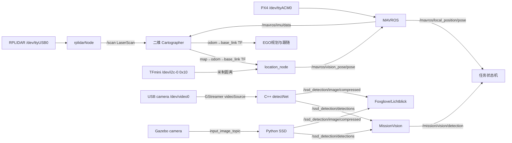

# 定位、建图、雷达与视觉源码分析

分析日期：初版 2026-10-12；本次按 version1018 源码复核更新。输入是 version1018 工作区的 `src/location`、`src/rplidar_ros`、`src/ssd_detection`（含 `models/`）以及 `tools/ssd_training`；旧版 1012 的结论保留为历史对照，与当前源码冲突处以当前源码、launch 和模型文件为准。本次未修改源代码、模型或归档，未启动 ROS、访问硬件、安装环境，也未执行编译或模型推理。

[总技术指南](../技术文档.md) · [飞行任务与舵机](飞行任务与舵机.md) · [EGO规划算法](EGO规划算法.md) · [电脑编译与实时显示](电脑编译与实时可视化.md) · [Gazebo仿真与场地](Gazebo仿真与场地.md)

本文路径记号：`S/` = `../../src`；`D/` = `../../src/ssd_detection/models`；`E/` = `../../nanooutput_origin/Nano补充导出/2026-10-11/源码分析副本/jetson-inference`。当前 1018 工作区没有 `E/` 目录，涉及外部库的结论只能引用 2026-10-11 的 version1012 归档副本，不能当作 1018 源码或实机安装库的当前状态；这类引用只写文件名与符号名，不写当前行号。其余 `文件:行号` 均按本次读取的当前源码核对。

## 1. 当前实际系统

默认定位链仍是 **RPLIDAR 二维扫描 + PX4 经 MAVROS 转出的 IMU → 在线二维 Cartographer → TF → location_node → MAVROS 外部位姿输入**。TFmini 直接提供高度。默认没有 T265、AMCL、地图加载定位或三维 SLAM。

视觉链在 1018 已从“usb_cam 发布 raw 图、检测与任务各订阅一次”改为“检测节点单路取图”：

- **真机**：`navigation_2d.launch` 传 `use_usb_cam:=true` 时选择 C++ 检测节点。节点自己用 `videoSource`/GStreamer 打开 `v4l2:///dev/video0`，取 RGB 帧送 detectNet，发布 `/ssd_detection/detections` 与 `/ssd_detection/image/compressed`。整条真机链不启动 usb_cam，也没有 `/camera/image_raw`。
- **仿真/台架**：`use_usb_cam` 默认 `false`，选择 Python 检测节点，订阅 Gazebo 相机或回放话题，发布同样两个话题。Python 节点优先 `onnxruntime`，不可用才回退 OpenCV DNN。

`MissionVision` 不再打开相机、不订阅图像、也不发 `/mission/video/compressed`，只消费检测数组并发布 `/mission/vision/detection`（`navigation_2d/TargetDetection`）。旧版 1012 曾为 `usb_cam → /camera/image_raw → C++ detectNet / MissionVision 两路订阅`，当前 1018 已改为上述结构。

当前检测模型是包内 `D/ssd-mobilenet.onnx`，32,193,674 字节；`D/labels.txt` 共 11 行，顺序为背景 + 9 类危险品 + `person_injured`（人员索引为 10）。1012 的 5 类模型（背景/人员/3 危险品）和“Keras MobileNet V1 图节点”判断不再适用于当前文件；当前导出器元数据是 pytorch 2.4.1、opset 17 / IR 8，`scores` 形状 `[1,3000,11]`。当前源码没有支持 MobileNet V2 的证据；默认训练脚本使用的是 MobileNet V1 SSD，不能反过来据导出器版本推断精度或实机性能。

图中是配置意图及静态调用关系，不是在线话题清单。TF 能否实时连通、PX4 是否接受外部位姿、相机协商结果与检测是否正常都尚未实测。尤其 C++ 订阅模式仍存在下文所列的 CPU 图像指针与 CUDA 内存契约问题，不能凭模型旁边存在 `.engine` 就认定检测已经可用。

证据：`S/location/launch/location.launch:2–94`、`S/location/launch/cartographer_2d.launch:21–32`、`S/location/param/ROSSLAM/cartographer_2Dlidar_mapping_location_params.lua:18–51`、`S/navigation_2d/launch/navigation_2d.launch:126–160,535–559`、`S/ssd_detection/src/ssd_detection_node.cpp:305–336,449–473`、`S/ssd_detection/src/jetson_detector.cpp:374–469`，以及本次对 ONNX protobuf 的只读解析。

## 2. 文件、目标及分析覆盖

| 包 | 本地普通文件数 | 项目主要文件与职责 | 实际构建目标 |
|---|---:|---|---|
| location | 31 | 5 个 C++ 源文件、3 个头文件、5 个 launch、5 个 Lua、URDF/Xacro、RViz | `location_node`、`tfmini_test` |
| ssd_detection | 16 | 2 个 C++ 源文件、1 个头文件、1 个 Python 脚本、2 个消息、2 个 launch、`models/` 4 个文件（ONNX、labels、engine、sha256sum）、2 个 `.pyc` 缓存 | 生成消息、安装 Python 节点；满足 Jetson 依赖时额外编译 `ssd_detection_node` |
| rplidar_ros | 114 | ROS 主节点、测试客户端、内置 SDK、28 个 launch、udev/脚本与 RViz | `rplidarNode`、`rplidarNodeClient` |

location、ssd_detection 的全部项目 C++/Python/头文件、消息、launch、CMake、package.xml 已阅读；location 的 Lua、Xacro/URDF、RViz 已核对；ssd_detection 的模型文件另作只读解析。rplidar_ros 的 ROS 主节点与客户端、CMake/package、全部型号 launch、README/CHANGELOG/规则脚本已核对；SDK 重点追踪 Linux 串口、异步传输、扫描模式、数据解包、整圈缓存、角度排序、频率控制与版本宏。SDK 内的 Windows/macOS 适配器及展示用网格文件没有作为当前 Linux 机载运行链逐行审计；它们不影响本文默认链判断。

`ssd_detection` 的 16 个文件包含 `__pycache__` 下两个 Python 缓存，缓存不是源码依据；`models/` 中的 `.engine` 是本地缓存，按项目约定由 Git 忽略，干净工作树可能没有它。

外部 jetson-inference 的只读分析副本没有随 1018 工作区提供：`E/` 在当前工作区不存在；该副本留在 2026-10-11 的 version1012 归档中，`../验证记录/nano_external_source_analysis_copy_2026-10-11.json` 记录了 512 个普通文件。因此本文涉及外部库的地方只按符号名引用，并明确其证据来自旧副本；不能把它当作 1018 源码或当前实机安装库的状态。

## 3. location 默认入口与参数实际覆盖

`location.launch` 本身同时带起 MAVROS；它不是纯显示定位数据的无副作用入口。雷达会启转，TFmini 会打开 I2C，MAVROS 会连接飞控。本文没有执行它。

| 配置项 | launch 默认/覆盖值 | 节点实际含义及证据 |
|---|---|---|
| `is_simulation` | false | false 时启动真实雷达与 MAVROS（`rplidar_location=false` 时改走 T265）；true 跳过硬件 group，location_node 收到 true 后强制不使用 TFmini；`location.launch:2,35–62`，`location_with_ftmini.cpp:268,323–345` |
| `rplidar_location` | true | 雷达 Cartographer 路径；false 才 include T265；`location.launch:7,36–56,87–89` |
| `S2` | true | 自定义雷达 wrapper 使用 1,000,000 baud、DenseBoost；false 使用 256,000 baud、Sensitivity；`launch/rplidar.launch:6–28` |
| 雷达端口 | `/dev/ttyUSB0` | 通过 arg 传入 rplidarNode；设备型号与实物接线尚需确认；`location.launch:14,52–56` |
| MAVROS | FCU `/dev/ttyACM0:57600`；GCS `tcp-l://0.0.0.0:5760` | 固定在 launch，未在该文件暴露 fcu_url arg；`location.launch:58–61` |
| `target_frame_id` | odom | lookup 的父/目标坐标系；`location.launch:10,71` |
| `source_frame_id` | base_link | lookup 的机体坐标系；`location.launch:9,72` |
| `publish_rate` | 20 Hz | launch 覆盖 C++ 默认 30 Hz；`location.launch:69`、`location_with_ftmini.cpp:274,320` |
| location_node 启动延迟 | 3.0 s | 纯 `sleep`；不检查传感器、TF、飞控估计是否就绪；`location.launch:16,65–66` |
| Cartographer 启动延迟 | 6.0 s | `cartographer_2d.launch` 自己的 arg 固定为 6.0，location.launch 没有覆盖它；`cartographer_2d.launch:7,11,22` |
| `use_tf_mini` | true | 主循环将 z 换成距离减安装高度；不创建 Range 话题；`location.launch:17,77`、`location_with_ftmini.cpp:137–208` |
| `tf_mini_type` | i2c | 字符串等于 i2c 用 I2C，其他任何值都走 UART；`location.launch:18,78`、`location_with_ftmini.cpp:249–257,304,328–336` |
| `bus` / `address` | 0 / 16 = 0x10 | 实际打开 `/dev/i2c-0`，I2C 从地址 0x10；`location.launch:26–27,79–80` |
| UART | `/dev/ttyTHS0`，115200 | 只有非 i2c 分支使用；`location.launch:30–33,83–84` |
| `tf_mini_height` | arg 写 0.09 | **没有 `<param>` 传给节点**，实际 C++ 默认是 0.1 m；`location.launch:19,65–85`、`location_with_ftmini.cpp:284` |
| 高度门限 | 0.05–6.0 m；单步 0.60 m；连续 20 个发布周期；z 限幅 -0.20–3.00 m | 都是 C++ 默认值，launch 没有显式传入；`location_with_ftmini.cpp:59–64,288–293` |
| XY 跳变门限 | 单周期 0.30 m；连续 10 个发布周期后重定位 | C++ 默认值，launch 没有显式传入；`location_with_ftmini.cpp:71–72,294–295` |
| `roll_obj/pitch_obj/yaw_obj` | 0 | 只在 T265 路径修正旋转，单位由 `setRPY` 决定为弧度；`location_with_ftmini.cpp:210–226,276–282` |
| `load_model` | false | false 用静态 base→laser TF；true 用 URDF 发布关节 TF；`location.launch:91–115` |
| `open_rviz` | false | true 才启动现有 RViz 配置，且只在 `rplidar_location=true` 的 group 内；`location.launch:117–120` |

独立运行 C++ 可执行文件而不经过 launch 时，默认 bus=1、address=0、串口 `/dev/ttyUSB0`、发布率 30 Hz；这些值与项目 launch 的 Nano 默认不一样。不能把 C++ 默认和最终 launch 覆盖混写成一套配置。证据：`location_with_ftmini.cpp:274,305–309`。

### 3.1 TF 图与地图/里程计的区别

默认 `cartographer_2Dlidar_mapping_location_params.lua` 设置 `map_frame=map`、`tracking_frame=base_link`、`published_frame=base_link`、`odom_frame=odom`、`provide_odom_frame=true`，二维 trajectory，1 个 LaserScan，0 个 PointCloud；启用 IMU 和在线相关扫描匹配，关闭外部里程计。配置见 `:18–51`。

由此期望 Cartographer 提供 `map → odom → base_link`。`odom → base_link` 表示局部连续位姿，`map → odom` 承担全局优化/回环修正；官方 ROS API 说明 `provide_odom_frame` 提供不受回环影响的连续 odom TF。[Cartographer ROS API](https://google-cartographer-ros.readthedocs.io/en/latest/ros_api.html#provided-tf-transforms)

`location_node` 只查询 **odom → base_link**（`location_with_ftmini.cpp:81–83`），并未查询 map → base_link，因此送给 PX4 的水平位置来自局部 TF，不直接叠加回环后的全局地图修正。默认任务状态机订阅 `/mavros/local_position/pose`（`rescue_mission.cpp:311`）；默认 EGO 用 `pose_source=tf`（`navigation_2d.launch:267`），查 odom→base_link。`/mavros/local_position/odom` 只在可选 EGO `pose_source=odom` 的重映射示例或 T265/Cartographer 备用分支中出现（`ego_planner_2d.launch:5–8`、`cartographer_2d.launch:17`），不是当前默认链的必需输入。地图/TF 和 PX4 本地估计不能凭同样数值或初始原点假定永远一致。

`base_link → laser_link` 默认静态值是平移 (0,0,0)，yaw≈π，周期 30 ms，来自 `location.launch:93–94`。这使用旧 `tf/static_transform_publisher`，周期参数是毫秒，它发动态 `/tf`；不能仅因名字 static 就要求该边一定在 `/tf_static`。打开 `load_model` 后 `iris_base.xacro:160–174` 改为平移 (0,0,0.04)，yaw≈π。两种外参高度不同，且均只是代码值，尚无实际测量证据。

TFmini 高度并没有广播成新的 `base_link` TF，只写入 PoseStamped 的 z。Cartographer 仍运行二维配置，地图默认为 0.05 m 栅格，来源 `cartographer_occupancy_grid_node`（`cartographer_2d.launch:31–32`）。所以界面中 Cartographer 的 base_link 高度、MAVROS 估计高度、TFmini 覆盖的视觉位姿高度不必相同。当前不能把它称为真实三维环境重建。

### 3.2 其他 Lua 是备用文件，不是默认功能

| 文件（`S/location/param/ROSSLAM/`） | 关键选项 | 默认入口使用情况 |
|---|---|---|
| `cartographer_2Dlidar_mapping_location_params.lua:18–51` | map/odom/base_link；provide odom=true；use_odometry=false；IMU=true | 默认激光定位使用 |
| `cartographer_2Dlidar_mapping_params.lua:18–49` | published_frame=odom；odom_frame=carto_odom；provide odom=false；use_odometry=true；IMU=false | cartographer_2d.launch 的 rplidar_location=false 分支；但 location.launch 只在 true 时 include 它，故该备用分支并不随默认 T265 一起启动 |
| `cartographer_2Dlidar_mapping_params1.lua:18–49` | published_frame=base_link；provide odom=true；use_odometry=true；IMU=false | 没有当前 launch 引用 |
| `cartographer_2Dlidar_location_params.lua:18–53` | tracking_frame=imu_link；odom=carto_odom；IMU=true；搜索 0.15 m / 35° | 没有当前 launch 引用；文件名包含 location 不等于地图加载纯定位 |
| `cartographer_3Dlidar_location_params.lua:18–59` | carto_map/carto_odom、imu_link、1 point cloud；3D builder | 没有当前 launch 引用；没有被默认启用的三维雷达链 |

Lua includes 的 `map_builder.lua` 和 `trajectory_builder.lua` 来自外部 Cartographer 安装，项目只覆盖部分参数；不能把未写出的范围、滤波/回环细节当作本项目自行实现。默认入口没有 `load_state_filename` 或 AMCL 节点；地图加载及纯定位若以后需要，是新设计选择。

`karto_params.yaml` 当前为空；`backpack_2d.urdf` 的 child 是 `2Dlidar_link`、平移 (0.1007,0,0.1814)、yaw=π（`:38–42`），与默认 `laser_link` 并非一套配置，也没有当前 launch 引用。`mocap-test.launch` 单独 include vrpn_client_ros、服务器 192.168.2.5（`:3`），不参与默认机载链。

### 3.3 T265 备用路径

将 `rplidar_location` 设为 false 时，location.launch include `rs_t265.launch`，传 base_frame_id=base_link、odom_frame_id=odom、publish_odom_tf=true，开启双鱼眼 848×800@30、gyro=200、accel=62（`location.launch:36–50`）。`rs_t265.launch` 在 `/camera` namespace 中 include 外部 `realsense2_camera/launch/includes/nodelet.launch.xml`，开启 pose、gyro、accel（`rs_t265.launch:19–21,35–66`）。

location_node 此时仍读 TF 的 x/y，使用 TFmini 时替换 z，姿态为 `q_source * q_install` 并 normalize；没有对安装平移/杆臂作位置补偿，也没有项目级 T265/雷达双源滤波（`location_with_ftmini.cpp:210–226`）。默认不开 T265。2026-10-11 环境核验报告还记录 `realsense2_camera` 查找失败，因此 T265 是 **有 launch 的备用实现但依赖尚未满足**，不能当作当前可用主定位源；见 `../项目资料/Nano环境核验与补备份_2026-10-11.md:71`。

## 4. location_node 的实际“融合”与时序

`location_with_ftmini.cpp:74–243` 的定时函数依次做：

1. `canTransform(target, source, Time(0))` 和 `lookupTransform(..., Time(0))` 获取最新可用 TF（`:81–83`）。
2. 将 stamp 写成当前时间，frame_id 取 lookup 的父坐标系（`:85–86`）；直接取 TF 平移 x/y（`:88–89`）。
3. XY 跳变门：相对上次接受位置超过 0.30 m 且连续拒收不足 10 个发布周期时，把 x/y 换回上次接受值；达到 10 个周期则接受新值并重建基准；正常接受时更新基准并清零计数（`:102–133`）。
4. 雷达路径直接复制 TF 四元数；T265 路径右乘安装姿态旋转并 normalize（`:210–226`）。
5. TFmini 开启时读取 `std::atomic<float> dist`。原始值在 0.05–6.0 m 内、且相对上次接受值跳变不超过 0.60 m（或连续拒收已达 20 个发布周期）才接受；接受后 `z=raw-tf_mini_height`，并夹紧到 -0.20–3.00 m（`:137–175`）。不合格时保持上一次有效 z；还没有有效值时 z 保留 Pose 对象的旧值（初始 0），但仍按周期发布（`:176–195`）。
6. 发布 `/mavros/vision_pose/pose`（`:227`）。`use_tf_mini=false` 时 z 取 TF 的 z（`:197–208`）。

这是 **字段拼接/高度替换**，没有项目级卡尔曼滤波、协方差权重、时间同步或统一传感器状态估计；1018 新增的量程/跳变/限幅门只是固定规则，不是概率融合或故障状态机。PX4 后续是否使用/如何融合该输入，必须查看飞控版本、参数与日志，不能由 PoseStamped 发布这一行为证明。

`height_listener` 是 one-shot timer 的回调，但回调内部 while 到 ROS 退出（`:245–259,327`）。I2C 每次读后 sleep 10 ms，UART 阻塞读；使用 `MultiThreadedSpinner(3)`，高度循环占用一条线程，另一条可运行位姿 timer/TF 回调（`:252,256,349–350`）。one-shot 并不代表只读一次。

新增门限按“位置发布周期”计数，不是按 TFmini 采样次数计数。20 Hz 下 20 个周期约 1.0 s、10 个周期约 0.5 s，均未与实际传感器和飞行过程标定；不能把“允许重定位”理解成已经验证过快速爬升或 SLAM 重定位。

### 4.1 已证实代码问题与已变化项

| 编号 | 问题及影响 | 证据/确认边界 |
|---|---|---|
| LOC-01 | 高度样本没有采集时间戳或新鲜度超时；如果 I2C/UART 采集线程停住、`dist` 仍保留最后一个合法值，位置线程会继续按 20 Hz 把旧高度当新测量转发。 | `location_with_ftmini.cpp:27,139–195,245–259`；静态确定，停线后的实际持续时间未测 |
| LOC-02 | 最新 TF 的原始 timestamp 被丢弃，改成 now；没有检查 TF 年龄。旧位姿可能持续被发布为新数据。 | `location_with_ftmini.cpp:81–86`；静态确定，实际 TF 更新停止后持续时长待测 |
| LOC-03 | 新门限是固定默认值，未与传感器/飞行标定；z 超界时是**限幅**而非报错，PoseStamped 也不携带“已限幅/已拒收”状态；TFmini 的 flux/temp 仍计算但不使用，无法区分低质量回波。 | `location_with_ftmini.cpp:59–64,140–195,288–299`、`tf_mini_i2c.cpp:118–125`；静态确定，误差大小待实测 |
| LOC-04 | `tf_mini_height` launch arg=0.09 没有传给节点，实际节点默认 0.1 m；改 launch arg 不改变安装高度。 | `location.launch:19,65–85`、`location_with_ftmini.cpp:284`；静态确定 |
| LOC-05 | 3 s 启动延迟仍是等待，不是就绪门禁；缺 TF 时静默跳过，缺 I2C 时构造异常不在 main 捕获；真实定位健康没有结构化状态话题。 | `location_with_ftmini.cpp:323–345`、`location.launch:16,65–66`；需后续就绪/失效策略设计 |
| LOC-06 | XY 门限对雷达和 T265 都生效，且固定为 0.30 m/10 个发布周期；真实快速位移或重定位时可能短暂保持旧值，门限未按来源或速度区分。 | `location_with_ftmini.cpp:71–72,102–133,294–295`；属设计取舍，未实测 |

旧版 1012 分析中的两项已发生变化：`dist` 已从普通 float 改为 `std::atomic<float>`（`:27`），针对 `dist` 的 float 撕裂读数据竞争不再成立；`dist<=0` 也不再只是改告警状态，而是进入量程/跳变门并尽量保持上次有效 z。但“没有采样时间/新鲜度”仍成立，首次没有有效高度时 z 仍可能是初始 0。旧 LOC-04 所说的“上下界/跳变检查缺失”已由新门限补上，残余问题变成质量字段未用、限幅不报错、倾斜投影补偿缺失和默认参数未标定。

另有一处日志与行为不一致：`use_tf_mini=false` 且 `rplidar_location=true` 时日志写 “TF mini is not using, height is 0!”，但代码实际把 TF 的 z 赋给 position（`:197–208`）。这句话只能当旧提示看，不能据此判断高度来源。

## 5. TFmini 驱动

### 5.1 I2C 路径

`TFMiniPro` 持有 `new I2C(address,bus)`，I2C 打开 `/dev/i2c-N` 并 ioctl I2C_SLAVE（`i2c.cpp:40–52`）。构造后向设备写一个 address 字节作存在检查（`tf_mini_i2c.cpp:3–8`）。这不是无写操作的被动读取。

`SendCommand` 将命令整数按小端拆成 reply length/command length/command id/参数，首字节替换 0x5A，累加发送校验和，使用 SMBus block 写寄存器 0；返回按寄存器索引逐字节读（`tf_mini_i2c.cpp:15–75`）。`ReadData` 使用命令 `0x01000509`，读 9 字节；`dist=data[2]+data[3]×256`，厘米转换米。零距离先转 -1，再除以 100，返回 -0.01 m；通信失败返回 -1。flux 和 temp 计算后没有使用（`:110–126`）。没有发布 `sensor_msgs/Range`，虽然头文件 include 了该消息。

已证问题：

- `SendCommand:79–88` 检测校验和不符时仍返回 true：非测距命令在错误分支直接 true，测距命令则落到函数末尾 true。校验机制实际上不拒绝坏帧。
- `sleep(0.5f)`、`sleep(0.2f)`、`sleep(0.5)` 都调用 POSIX sleep 的整数秒参数，小数截断为 0；声明的硬件处理等待没有执行（`:7,59,104`）。需要通过真实协议要求确定替换延时，不应机械改成任意值。
- 析构只 `i2c_dev_->close_device()`，没有 delete 持有的 I2C 对象（`:128–131`）；`unique_ptr<TFMiniPro>` 不自动释放内部裸指针。
- `I2C::open_device` 在 open 成功但 ioctl 失败时抛异常，构造未完成导致该 fd 未被析构关闭（`i2c.cpp:45–51`）；`close_device` 只关闭 fd>0，遗漏合法 fd=0（`:54–62`）。
- I2C typedef 的 `uint16` 实际是 `unsigned int`，不是固定 16 位（`include/i2c.h:25–27`）；常规距离拼接仍能得到值，但温度负值会受无符号计算影响，当前温度没有用于主链。

### 5.2 UART 路径与测试程序

`TFplus` 用 POSIX termios 打开串口，搜索 0x59/0x59 帧头，再读 7 字节，校验正确返回低/高位厘米÷100，校验失败返回 0，读失败返回 -1（`TFplus.cpp:89–111,113–149`）。主链使用阻塞循环，没有读超时或完整配置 VMIN/VTIME；断线/零字节读可能使 readData 长时间循环。串口配置错误用 exit(0) 退出，将失败标成成功退出（`:16,23,74,84`）。析构为空，不自动 close（`include/TFplus.h:19`）。

`tfmini_test` 是会直接访问硬件的独立测试：无参数只打印帮助；uart 默认 `/dev/ttyTHS0` 115200；i2c 默认构造 address 0、bus 1，与正式 launch 不同；SHELL 可给 bus/address（`tfmini_test.cpp:10–64`）。三参数 i2c 分支错误使用 `strcmp(argv[1],"i2c")` 而非 `==0`，后续可能解引用未初始化 `tf_mini_plus_`；未知参数的无限 while 也没有退出策略（`:36–47,68–85`）。结尾 close 无法正常抵达。本文未运行它。

TFmini 驱动文件与 1012 相比未见功能改动（对照报告记录 location 只改 3 个文件，驱动不在其中）；以上行号按当前文件复核。

## 6. rplidar_ros：扫描到 ROS 的全过程

包版本 2.1.5（`package.xml:4`），实际 SDK 宏 2.1.0（`sdk/include/sl_lidar.h:38–40`）。`sdk/README.txt` 的 2.0.0 自己注明可能过时，应以宏/代码为准。

ROS 主节点 `src/node.cpp`：

1. 读取 channel_type（serial/tcp/udp）、端口、波特率、frame_id、inverted、angle_compensate、scan_mode、scan_frequency（`:222–261`）。
2. 创建 LidarDriver 和 Channel，connect、设备信息与健康检查；可选 initial_reset 最多 15 秒（`:270–325`）。
3. 发布全局 `/scan`，注册 `/stop_motor`、`/start_motor`，启动电机/扫描（`:242,337–388`）。
4. 获取硬件支持的扫描模式，若指定模式按名称精确匹配；默认项目 S2 DenseBoost 不支持时不自动切换（`:346–388`）。
5. 根据每点采样时间/期望频率算点数与角度补偿倍数，最多一次获取 8192 点。采样成功后按角度排序、补齐规则角度表，再发布 LaserScan（`:375–466`）。
6. 正常 ROS 退出时设电机速度 0、stop、delete 驱动（`:473–477`）。

SDK 实际链为 Linux raw_serial/串口 channel → AsyncTransceiver 接收与解码线程 → lidarprotocol_codec → 对应测量协议 dataunpacker → HQ 点 → 整圈扫描缓存 → grabScanDataHq → ROS 消息。它不是 ROS 主线程逐字节直接解析所有雷达数据。

关键证据：`sdk/src/sl_serial_channel.cpp:43–104`；`sdk/src/arch/linux/net_serial.cpp:97–202`；`sdk/src/sl_async_transceiver.cpp:193–230`；`sdk/src/dataunpacker/dataunpacker.cpp:67–75,123–142`；`sdk/src/sl_lidar_driver.cpp:682–805,957–1020`。

### 6.1 LaserScan 字段及时间

| 字段 | 实际填法 | 影响 |
|---|---|---|
| header.frame_id | 默认项目 wrapper=`laser_link`；包自带型号 launch 通常=`laser`；裸节点=`laser_frame` | 三种名称不同，替换 launch 时必须匹配 TF |
| header.stamp | grabScanDataHq 调用前的 ROS now | 没用 SDK 带时间戳接口；代表主机取数起点，不保证精确首束采集时刻 |
| scan_time | grab 调用前后差值 | 受线程、缓存和阻塞等待影响；不是实测每圈硬件统一时间 |
| time_increment | scan_time/(node_count-1) | 固定均分；应检查≥2 点和非零时间 |
| 角度 | π-angle，并按 inverted/reversed 重新排列 ranges | 与实体雷达安装 yaw=π 共同决定朝向，需已知方位物体验证 |
| range | dist_mm_q2/4/1000 | 米；零测距改为正无穷 |
| range_min | 0.15 m | 是代码固定值 |
| range_max | 硬件模式回报 max_distance | 不是文件中历史注释 8 m 固定值 |
| intensity | quality>>2 | SDK 质量字段派生 |

证据：`src/node.cpp:56–111,395–466`。SDK 有 `grabScanDataHqWithTimeStamp`，但当前节点调用的无时间戳版本丢弃该信息（`sdk/src/sl_lidar_driver.cpp:783–805`）。后续定位时延评估应把这部分与 IMU/TF 时序一起测量。

### 6.2 默认配置与备用型号

项目实际使用 `location/launch/rplidar.launch`，不是 `rplidar_ros/launch/rplidar_s2.launch`。前者 frame=`laser_link`、S2 强制 DenseBoost；后者 frame=`laser`、未指定 scan_mode。S2 默认期望频率 10 Hz 来自 node.cpp，而实际帧率尚未验收。

当前包内共 28 个 launch。基础型号覆盖：A1、A2M8 为 115200；A2M7、A2M12、A3、S1 为 256000；C1 为 460800；S2、S3 为 1000000；S1 另有 TCP 192.168.0.7:20108；S2E/T1 使用 UDP 192.168.11.2:8089。`view_*` 只是型号 launch 加 RViz；`test_*` 另加测试客户端。它们都是厂商备用入口，不代表本机装了所有型号。对照报告记录 1018 相对 1012 只新增 A2M7、A2M8、S3 三个型号 launch，驱动主体未变。

`rplidar_ros/launch/rplidar.launch` 本身仍是 256000、frame=`laser`、未指定 scan_mode（`:2–9`）；项目默认参数由 location 的 wrapper 覆盖，不能把包自带 launch 当默认入口。

### 6.3 可定位的问题

| 编号 | 问题 | 证据 |
|---|---|---|
| LID-01 | SDK openChannelAndBind 内层 `Result ans` 遮蔽外层返回值；channel->open 失败时只改内层变量，最终返回外层 RESULT_OK，可能把端口失败误报为后续设备查询超时 | `sdk/src/sl_async_transceiver.cpp:198,204–208,230`；静态确定 |
| LID-02 | 扫描启动失败只 log 后继续 while；max_distance 仅成功分支初始化，启动/后续获取异常路径缺明确健康状态与退出 | `src/node.cpp:239,375–395`；未测失败序列 |
| LID-03 | `/start_motor` 在断开或 setMotorSpeed/startScan 失败时也返回 true；不会保留原 DenseBoost 配置，忽略结果；`/stop_motor` 同样不检查 setMotorSpeed 返回值 | `src/node.cpp:190–215`；接口反馈不是硬件执行确认 |
| LID-04 | publish_scan 没有 node_count≥2 守卫；count 0/1 会导致角度/时间分母问题；客户端自己用 scan_time/time_increment 算数量而非 ranges.size，数值异常时可越界 | `src/node.cpp:79–83`、`src/client.cpp:45–52`；属于异常输入边界 |
| LID-05 | angle_compensate=false 分支寻找首尾有效点无本地边界检查；常规 SDK 已先用 ascend 剔除全无效圈，仍应防 SDK 变更/异常 count | `src/node.cpp:442–449`；并非默认 true 分支必现问题 |
| LID-06 | 发布队列 1000，显示/网络消费慢时可能累积旧 scan；主循环服务回调必须等 grab 完成才 spinOnce | `src/node.cpp:242,399–400,470`；实际积压待测 |
| LID-07 | udev 规则按通用 CP210x VID/PID 10c4:ea60，权限 0777，没唯一序列号；多同芯片设备可别名冲突。默认 launch 仍用 ttyUSB0，没有使用别名 `/dev/rplidar` | `scripts/rplidar.rules:3`、`location/launch/rplidar.launch:3`；现有规则不证明现场命名稳定 |
| LID-08 | Linux serial 的 TCGETS2/TCSETS2 返回值未检查，配置失败仍可能标 `_is_serial_opened=true` | `sdk/src/arch/linux/net_serial.cpp:156,184,198`；需构建设备支持验证 |

SDK 源码会操作雷达电机，这些服务和 launch 不是只读可视化动作。本文未调用。

## 7. 视觉链：相机来源、检测后端与消息

### 7.1 图像源：真机直采，仿真订阅

`navigation_2d.launch` 的 `use_usb_cam` 默认 `false`（`:126`）。这个参数现在只做场景选择，不再表示“启动 usb_cam”：

- `false` → `ssd_detection.launch`（Python）。`input_image_topic` 默认空（`:141`），仿真包装 launch 必须显式传相机话题（`gc_2026_sim/launch/px4_sitl_field.launch:99` 默认传 `/camera/image_raw`，`gazebo_field.launch:51` 传 `/sim_camera/image_raw`）；单独按导航默认启动并不会自动得到图像源。
- `true` → `ssd_detection_trt.launch`（C++）。`camera_uri` 默认 `v4l2:///dev/video0`（`:131`），作为 `input_URI` 转发给检测节点（`:541–553`）。

真机链没有 usb_cam 节点，也没有 `/camera/image_raw`；`navigation_2d.launch:481–490` 明确记录了删除原因。C++ 节点在 `input_URI` 非空时用 `videoSource` 直采，`input_URI` 为空才订阅 `input_image_topic`（`ssd_detection_node.cpp:449–473`）。注意 `ssd_detection_trt.launch` 的 `input_image_topic` 默认也是空串（`:44,77`），所以台架回放时要把 `input_URI` 和 `input_image_topic` 都显式设置，不能只清 URI。

`MissionVision` 不打开相机、不订阅图像、不 advertise `/mission/video/compressed`；它只订阅 `/ssd_detection/detections`，按 zone 选候选、按框中心距画面中心最近选一个，累计稳定帧后发布 `/mission/vision/detection`（`mission_vision.cpp:9–31,102–183,185–290`）。旧版 1012 的“MissionVision 自己开相机/处理 HSV/发 mission JPEG”已不再是当前实现。

`src/navigation_2d/README.md:120–126` 仍写着 `/mission/video/compressed` 和旧视频参数，这是滞后文档；当前接口以 `mission_vision.cpp` 和 `navigation_2d.launch` 为准。

### 7.2 消息契约

`VisionDetectionArray` = `Header header` + `uint32 image_width` + `uint32 image_height` + `VisionDetection[] detections`（`msg/VisionDetectionArray.msg:11–20`）。单框字段：class_name、zone、confidence、xmin、ymin、xmax、ymax（`msg/VisionDetection.msg:13–19`）。约定坐标归一化 0..1、图像左上为原点；ONNX 两后端按左/上/右/下解码。

`image_width`/`image_height` 是 1018 新增字段。C++ 相机模式填实际采集尺寸，订阅模式填输入消息的 width/height；Python 填输入图 shape。`MissionVision` 在值为 0 时回退到自己的 `camera_width_/camera_height_` 参数并告警（`mission_vision.cpp:236–270`）。

zone 规则是区分大小写的 `person` 前缀→person，其他一律 hazard；当前标签中只有 `person_injured` 会得到 person。新增未知类别会自动成为 hazard，因此改标签/类别必须同步检查任务消费规则，而不仅看模型能否加载（`jetson_detector.cpp:91–95`；Python `zone_of` 在 `ssd_detection_node.py:70–77`）。

数组注释说“置信度降序”（`VisionDetectionArray.msg:19`）。Python 明确按 confidence 排序（`ssd_detection_node.py:438–439`）；C++ 在应用层没有再排序，顺序由 detectNet 返回（旧副本 `detectNet::postProcess` 在返回前按面积排序）。因此不能假定 C++ 消息的第 0 框就是最高置信度；任务端仍应自行筛选/排序。

**消息结构变化会改变 ROS1 消息 MD5**：1012 的发布/订阅二进制不能与 1018 的新消息混用。下游回退到 0 的尺寸只处理同一新结构中的缺省值，不能兼容旧消息类型。

### 7.3 C++ Jetson 后端

节点参数默认值：`input_URI=v4l2:///dev/video0`、640×480@15、`input_codec=mjpeg`、`input_image_topic=/camera/image_raw`、`output_topic=/ssd_detection/detections`、`image_topic=/ssd_detection/image/compressed`、`publish_image=true`、`video_width=640`、`jpeg_quality=70`、`score_threshold=0.5`、`max_rate=0`、`camera_frame_id=camera_link`（`ssd_detection_node.cpp:305–336`）。

`jetsonSetup`：检查 model/labels 非空、标签能读，构造命令行显式绑定 `--input_blob=input_0`、`--output-cvg=scores`、`--output-bbox=boxes` 并设置 confidence，调用 `detectNet::Create`；启动后按 glob 与 mtime 找模型旁最新 engine，仅作日志提示（`jetson_detector.cpp:173–252`）。该 glob 结果不证明它就是当前实际加载的 engine。

相机模式（默认）：`jetsonCameraOpen` 用 `videoSource::Create(uri, cmdLine)`，只把调用方真正给出的宽高/帧率/codec 传给 GStreamer；打开后检查 `GetWidth()/GetHeight()` 非零（`jetson_detector.cpp:374–442`）。`jetsonCameraCapture` 返回指向相机内部缓冲区的浅拷贝 `cv::Mat`，下一次 Capture 前必须用完（`:450–469`）。`runCameraLoop` 以 1000 ms 超时抓帧，流结束（`jetsonCameraIsStreaming()` 为 false）时打印 FATAL 并返回；源码注释的意图是让任务侧按 `vision_with_fallback` 退回写死航点，实际任务行为未验证；无帧但仍在流时告警后继续（`ssd_detection_node.cpp:349–376`）。检测数组每帧都发，空数组也是心跳（`:382–404`）；需要回传画面时 RGB→BGR、画框、缩放、JPEG 编码（`:406–413`、`:559–590`）。

订阅模式：`input_URI` 为空时订阅 `input_image_topic`，queue_size=1；回调里 `max_rate>0` 才主动丢帧，检测数组使用原图 header 与消息 width/height，回传图从 `cv_bridge` 的 bgr8 拷贝画框（`ssd_detection_node.cpp:449–473,495–557`）。`max_rate` 默认 0，所以默认不做额外限频；相机端 15 Hz 由 GStreamer 请求的 framerate 承担。阈值在 setup 时固定，运行中改 ROS 参数不会自动生效；C++ 没有 Python 的 `input_size`/`max_detections`/`nms_iou` 参数。

`jetsonInferRgb8` 把 detectNet 返回的框按类名分类、归一化/裁剪坐标、剔除退化框（`jetson_detector.cpp:313–368`）。`publish_image` 的 JPEG 质量限制在 20..95，`video_width` 只缩小不放大（`ssd_detection_node.cpp:559–590`）。离线预览 `--image/--dir/--out/--model/--labels/--score-threshold` 可在不启动 ROS 节点的情况下对图片跑同一模型，但仍走 `jetsonInfer` 的 CPU 图像入口（`ssd_detection_node.cpp:83–289`）。

**VIS-01（入口相关）：** detectNet 的接口要求输入是 CUDA 可访问内存（旧副本 `detectNet.h` 的 `Detect` 注释，`input image in CUDA device memory`）。相机模式的指针来自 `videoSource` 的 NVMM 映射缓冲区，从源码意图看更符合该契约；订阅模式和离线预览都把 `cv_bridge`/`cv::Mat` 的普通 CPU 指针交给 `Detect`，没有 `cudaAllocMapped`、`cudaHostRegister` 或显式 host→device 上传。Mat 连续只保证步长布局，不保证 GPU 可访问。旧版分析把这条列为所有入口的共同高风险；当前应改为：**相机直采路径可能符合契约，订阅/离线路径仍未解决**。实际表现需在匹配的 Jetson 库上验证，尚未复现。

**VIS-02：** `Detect` 返回 ≤0 时应用全部当空检测返回（`jetson_detector.cpp:331–334`）；接口错误的负值与正常零检出没有状态区分，ROS 消费者可能看到空数组而不知道后端失败。

另一处状态边界：相机流结束后主循环返回，`main` 仍以 0 退出（`ssd_detection_node.cpp:638–649`）；任务侧不能只看进程退出码判断视觉健康。

### 7.4 Python 后端

以 `.onnx` 后缀选择 `OnnxSsdDetector`，其余选择 TensorFlow `.pb` 备用路径（`ssd_detection_node.py:479–492`）。ONNX 后端先尝试 `onnxruntime` 的 `CPUExecutionProvider`，不可用或初始化失败才回退 `cv2.dnn.readNetFromONNX`；`run_ros` 会打印实际后端与 OpenCV 版本（`:289–332,663–664`）。`.pb` 分支保留 `readNetFromTensorflow`，当前项目 models 目录没有 `.pb/.pbtxt`，默认不走它。

ONNX 预处理：`mean=127.5`、`scalefactor=1/127.5`、`swapRB=true`、直接拉伸到 300×300（`:335–342`）。读取 scores/boxes 两个输出，按 `num_classes = scores.shape[-1]`、`num_boxes = scores.shape[-2]` 解码；每 anchor 取非背景最高类，阈值 0.5，裁剪框，按类分别 `cv2.dnn.NMSBoxes`、IoU 0.45，再按置信度降序最多 100（`:368–461`）。`input_size`、`max_detections`、`nms_iou`、`score_threshold` 均可由 ROS 私有参数覆盖（`:700–715`）。

ROS 模式先 `init_node`，从私有参数读模型路径、labels、阈值等，订阅 Image 并通过 `cv_bridge` bgr8 转换；检测数组和 JPEG 回传图都使用源图 header，回传图先按 `video_width` 缩放、JPEG 质量限制 20..95（`:572–668`）。`max_rate` 在回调里丢超额帧，queue_size=1 只是不积压，不是固定推理频率。Python 没有相机直采分支。

`.pb` 路径保留 `readNetFromTensorflow` 及独立/合并输出解码（`:86–193`）。旧路径 `_forward` 注释称 `blobFromImage` 先除 255，实际该 API 按 `(p-mean)*scalefactor`；传 255 会放大输入。此为备用分支疑点，不应影响当前 ONNX 判断，后续若复用 `.pb` 要用已知图核对。

Python 回调没有捕获 `detect`/`forward` 异常，非法模型输出或 DNN 运行错误不一定能转成受控节点失败；标签首行不是 `background` 时只打印警告，类数不符时 `detect()` 在 stderr 警告并跳过越界类别，不会让节点失败（`:54–66,398–402,618–634`）。部署前契约检查仍有价值，但现有节点不是完整的严格契约门禁。

### 7.5 两后端的差异

两个后端共享同一 `.onnx` 与消息，但不保证输出数值和框集合等价：C++ detectNet 跨类聚类（旧副本的 `clusterDetections`，默认重叠面积口径），Python 逐类 IoU NMS（0.45）；C++ 顺序由 detectNet 决定，Python 按置信度降序；预处理缩放采样与 TensorRT/OpenCV 算术也不同。文档“唯一实质差别只是 NMS/结果几乎一样”不能代替一致性实测。

## 8. 当前模型的本次独立只读核验

当前模型与标签都在包内：`D/ssd-mobilenet.onnx`、`D/labels.txt`。两个 launch 的默认路径是 `$(find ssd_detection)/models/ssd-mobilenet.onnx` 与 `.../labels.txt`（`ssd_detection.launch:37–41`、`ssd_detection_trt.launch:50–57`）。旧文档写的 `D/models/real4/...` 已不存在；`CMakeLists` 把 `models/` 下的 `*.onnx`、`*.txt` 随包安装（`ssd_detection/CMakeLists.txt:52–59`），`.engine` 不安装。

本次以 protobuf 只读方式读取 ONNX 顶层字段、GraphProto/ValueInfo 和标签文件，不加载 ONNX 执行器、不调用模型推理、不建 TensorRT 引擎。读取结果：

| 项目 | 值 |
|---|---|
| ONNX bytes | 32,193,674 |
| ONNX SHA256 | `de7d37abfd53bcc18fbc57a556e3f1402d77e2192274a11fff4a815af4ac335e`；与同目录 `.sha256sum` 一致 |
| producer / IR | pytorch 2.4.1 / 8 |
| opset | 默认域 17（仅 `ai.onnx`） |
| 输入 | `input_0`，float32 `[1,3,300,300]` |
| 输出顺序 0 | `scores`，float32 `[1,3000,11]` |
| 输出顺序 1 | `boxes`，float32 `[1,3000,4]` |
| 图节点 / 初始化张量 | 158 / 94 |
| 主要算子计数 | Conv 47、Relu 35、Constant 34、Transpose 12、Reshape 12、Concat 4、Slice 4、Mul 4、Add 2、Softmax 1、Exp 1、Div 1、Sub 1 |
| labels | 197 字节，11 行；SHA256 `a52d19e006c1db9bd025a08cc84d7e5eb97063b7d6c8d92888ab762a9ea38cba` |
| engine | `ssd-mobilenet.onnx.1.1.7103.GPU.FP16.engine`，21,587,397 字节；本地缓存，文件存在不等于本次执行验收 |

| 类 ID = 标签行号 | 原文 | 任务 zone | 对应图形（训练工具 `labels.py`） |
|---:|---|---|---|
| 0 | BACKGROUND | 忽略 | 背景占位 |
| 1 | hazard_flammable | hazard | 1-02 当心火灾 |
| 2 | hazard_explosive | hazard | 1-03 当心爆炸 |
| 3 | hazard_corrosive | hazard | 1-04 当心腐蚀 |
| 4 | hazard_toxic | hazard | 1-05 当心中毒 |
| 5 | hazard_biohazard | hazard | 1-06 当心生物危害 |
| 6 | hazard_ionizing_radiation | hazard | 1-27 当心电离辐射 |
| 7 | hazard_fissionable | hazard | 1-28 当心裂变物质 |
| 8 | hazard_oxidizer | hazard | 1-42 当心氧化物 |
| 9 | hazard_gas_cylinder | hazard | 1-43 当心高压气瓶 |
| 10 | person_injured | person | 受伤人员 |

图名为 `main_graph`。`scores` 由末端 `Softmax` 直接产生，`boxes` 由末端 `Concat` 产生；图中没有 1012 那组 `adapt/denorm_mul`、`adapt/denorm_add`、`Preprocessor/*` 节点。因此外部两个后端都必须自己做 `2*p/255-1` 的 RGB 归一化；不能把“图内曾经有 Preprocessor”当作当前事实。图内有 `Exp`，符合 boxes 已解码的静态契约；但静态形状相符不自动证明 xy 顺序、概率数值范围和检测精度都正确。

对照报告记录的 1012 模型是 22,312,402 字节、tf2onnx 1.14.0、opset 11 / IR 6、`scores [1,1917,5]`、背景+人员+3 危险品共 5 行标签，模型放在工作空间外层 `data/models/real4`。这些是历史对照，不是当前文件。

当前图节点命名是 `base_net.*`、`extras.*` 等，没有 1012 的 `ssd_mobile_net_v1_keras_feature_extractor`、`conv_dw_*`、`conv_pw_*` 前缀。`tools/ssd_training/train_pytorch_ssd.py` 的默认预训练权重是 `models/mobilenet-v1-ssd-mp-0_675.pth`，`--net` 缺省也落到 `mb1-ssd`；因此当前训练/导出链的默认骨干是 MobileNet V1 SSD，而不是 MobileNet V2。不能反过来由“PyTorch 2.4.1 导出”推断精度、数据集覆盖或实机性能；训练集、checkpoint 和本轮训练结果都不在本文可核验范围内。

### 8.1 项目注释、旧外部库副本与当前安装版本的边界

当前 `jetson_detector.cpp` 顶部和头文件注释称：detectNet 从张量读类数、从不核对 labels；少一行就静默零检出；越界 id 被 `GetClassDesc()` 判成 `void` 后逐条丢弃。这个说法要分三层看：

- 2026-10-11 保存的 jetson-inference 副本（当前 1018 工作区没有 `E/`，只能引用 version1012 归档）里，`tensorNet::LoadClassLabels` 最后调用 `validateClassLabels`，类数不符会打印错误并用 `Class #n` 补齐；`detectNet::GetClassDesc` 对越界返回 `Invalid`，不是 `void`；`postProcessSSD_ONNX` 只跳过 class 0，没有 `void` 检查（`void` 检查在 UFF 分支）。
- 当前应用只在 `jetsonInfer` 里过滤 `description == "void"` 或空串（`jetson_detector.cpp:343–348`），没有过滤 `"Invalid"`。所以标签/模型类数不符时，至少可能出现类名错位；如果 class id 超出标签表，应用还可能把 `"Invalid"` 当类别名发布（zone 会按 hazard 处理）。不能简单断言“必然零检出”；具体表现取决于实机安装的库版本。
- 即使这份旧副本，类数/标签也只是静态契约；`countLabelLines` 忽略空白行和前导空格（`jetson_detector.cpp:144–166`），外部 loader 的实现不完全相同。当前 `labels.txt` 11 行与模型 11 类一致，但这只是文件层面，不证明实机安装库/二进制就是这份副本。

因此不能把项目注释中的历史失败机制当作当前库的确定行为，也不能把“11 行标签能读”当作模型可用验收。真实二进制是否对应这份库源码，仍需要安装来源或编译指纹证据。

## 9. 构建依赖与电脑可覆盖的边界

| 包/路径 | 编译要求 | PC 容器影响 |
|---|---|---|
| location | C++14、catkin、roscpp、geometry/nav_msgs、tf2_ros、Eigen3、cmake_modules、libi2c 与 i2c/smbus.h | 源码 Linux 通用，可构建 x86_64；无 Nano I2C 设备时不运行硬件分支。CMake 显式尝试 ARM 路径也尝试 /usr/lib 等默认搜索，不能搬 ARM 库代替 x86 库 |
| ssd Python/消息 | catkin 消息生成、roscpp、sensor/std_msgs、cv_bridge；运行 Python3、rospy、numpy、cv2.dnn；`onnxruntime` 是可选但当前模型强烈依赖的运行时 | 能生成消息/安装脚本不等于 Python3 cv_bridge 运行正常。ROS Melodic 默认 Python2 与当前 Python3 shebang 要另核对；`onnxruntime` 未写入 package.xml |
| ssd C++ | OpenCV、jetson-utils、jetson-inference、CUDA、TensorRT，JetPack 多媒体 nvbuf_utils 链 | 普通 Windows Docker/WSL 容器缺 Jetson 栈时**会跳过 C++ 检测目标**；不能称七个包的全量机载重建 |
| rplidar_ros | C++11、catkin、roscpp、rosconsole、sensor_msgs，SDK 直接编进目标，Linux 串口/线程/网络 | 通常属于可在 x86_64 Linux 构建的通用驱动；运行还需设备透传/权限/网络，不由编译成功保证 |
| Cartographer | 独立外部 cartographer/cartographer_ros 与其 Lua 默认文件、消息、节点 | 不是 location 包内部库；location 构建通过仍可能 roslaunch 找不到它 |
| 可选 T265/模型显示 | realsense2_camera；xacro、joint_state_publisher、robot_state_publisher | 不在当前默认必须路径，但启用分支前需安装/匹配版本 |
| SSD 训练/导出工具 | `tools/ssd_training/` 单独使用：PyTorch 2.4.1、torchvision 0.19.1、onnx、numpy/Pillow/OpenCV 等；不在 catkin 构建链 | 与机载运行包分开；工具存在不等于本机已装齐或已训练/导出成功 |

`ssd_detection/CMakeLists.txt:76–84` 四个 `find_package` 使用 QUIET，可用条件只检查 jetson-inference、OpenCV、CUDA（`:82`）；条件失败日志统一写“jetson-inference not found”（`:121–125`），即使真正缺的是 OpenCV/CUDA 也会这样显示。`jetson-utils` 虽然被查找，但没有进入条件，不能只看这句日志定因，必须查看各 FOUND 变量和目标清单。

`ssd_detection/CMakeLists.txt:43–59` 用 `catkin_install_python` 安装 Python 节点，并把 `models/` 下的 `*.onnx`、`*.txt` 安装到 share；`ssd_detection_node` 只在 Jetson 依赖齐全时构建。Python 端 `onnxruntime` 通过 `import onnxruntime` 可选加载（`ssd_detection_node.py:296–312`），package.xml 没有声明它；源码注释/README 称 Noetic 自带 OpenCV 4.2 读不了 opset 17 的 Slice，因此 onnxruntime 不是单纯性能优化，而是旧 OpenCV 上读取当前模型的前提之一。本文未复测该兼容问题。

`location/package.xml` 声明 tf/sensor_msgs 但未完整声明实际 nav_msgs、tf2_ros、Eigen3/cmake_modules/libi2c 和 launch 运行依赖；还导出一个不存在于本包的 MoveIt 插件描述（`:14–34`）。rplidar package.xml 声明 std_srvs 而 CMake 没列入 catkin components（`CMakeLists:16–20`）；已安装环境可能靠传递头/库成功，新的 rosdep 最小环境不应依赖偶然传递。

location 没有启用 install(TARGETS/DIRECTORY launch)，而 CMake 注释安装段是旧项目目标；devel 运行与 install 工作空间部署不等价。rplidar 的 SDK Makefile 引用父目录 mak_def.inc/mak_common.inc，当前机载包 CMake 不走该 Makefile；不要把 SDK 独立 make 的材料缺口误记为 rplidarNode 的必需缺口。证据：`location/CMakeLists.txt:56–65,77–104`；`rplidar_ros/CMakeLists.txt:8–34`；`sdk/Makefile`。

当前 C++ 检测目标绑定 jetson-inference/CUDA/TensorRT，是 Jetson 专用实现；若目标机改为 TB-RK3399ProD 等非 Jetson 平台，需要另做 RKNN/其他后端适配，不能把本包 C++ 目标当作跨平台可编译目标。所述构建覆盖只是源码可移植性与依赖判断，本轮没有实际建容器或构建。

## 10. 适合 Lichtblick 的现有观测数据

以下是源码配置的候选话题，不是当前在线话题列表。显示端应通过独立桥接接入，不能为了看图自动启动完整飞行任务。

| 观测目的 | 话题/类型 | 当前源码证据与注意事项 |
|---|---|---|
| 二维地图 | `/map`，nav_msgs/OccupancyGrid | occupancy_grid node，0.05 m；需 scan/IMU/TF 链正常；不是 RGB 图像也不是完整 3D 地图 |
| 原始雷达 | `/scan`，sensor_msgs/LaserScan | rplidarNode；frame 默认 laser_link，需 TF 可达 |
| 坐标系 | `/tf` 及存在时 `/tf_static`，tf2_msgs/TFMessage | 默认 map→odom→base_link 及 base→laser；不能凭静态节点名字遗漏 `/tf` |
| 飞控估计 | `/mavros/local_position/odom`，nav_msgs/Odometry | MAVROS 外部包输出；是否连续及坐标需设备数据确认 |
| 外部位姿输入 | `/mavros/vision_pose/pose`，geometry_msgs/PoseStamped | location_node；图上含有 TFmini 高度，但 TF 本身不因此变 3D；当前 now stamp 掩盖原测量年龄 |
| 推理叠框图 | `/ssd_detection/image/compressed`，sensor_msgs/CompressedImage | 当前唯一的检测回传画面，默认缩到 640 宽（不放大）、JPEG 质量 70；C++ 相机模式 stamp=now、frame_id=camera_link，订阅模式用输入 header |
| 原始彩色视频 | 仿真相机话题（名称由包装 launch 指定：`px4_sitl_field` 默认 `/camera/image_raw`，`gazebo_field` 用 `/sim_camera/image_raw`），sensor_msgs/Image | **只在仿真/台架**由 Gazebo 或回放发布；真机链没有 raw 话题，不能按旧 usb_cam 配置去订阅 |
| 检测原始消息 | `/ssd_detection/detections`，ssd_detection/VisionDetectionArray | 自定义 ROS 消息，含 `image_width/image_height`；适合 Raw/Plot；要叠加为图像 annotation 需转换支持格式 |
| 任务检测 | `/mission/vision/detection`，navigation_2d/TargetDetection | 含 mode/found/stable/center_x/center_y/width/height/pixel_dx/pixel_dy/confidence/image_width/image_height；详情见任务导航报告 |

旧话题 `/ssd_detection/debug_image/compressed` 与 `/mission/video/compressed` 在当前源码中已不存在；旧 Lichtblick 布局若还选这两个话题，需要改到 `/ssd_detection/image/compressed`。`/mission/vision/mode` 是 `std_msgs/String` 输入（`hazard`/`person`/`idle`），可用于观察当前模式，但不是图像数据。

其他 Cartographer 话题（如 submap_list、trajectory_node_list）属于外部节点接口，应以实际安装版本/在线话题发现为准。官方 API 说明 occupancy_grid_node 从 submaps 生成标准地图。[Cartographer ROS API](https://google-cartographer-ros.readthedocs.io/en/latest/ros_api.html#published-topics)

现有 RViz 文件不是可靠的“当前在线接口清单”：它仍含 move_base/DWA/explore/initialpose 等旧规划显示（`location/rviz/ros_navigation.rviz:164–320`），但图像显示已经改到 `/ssd_detection/image/compressed`（`:289–299`）。Lichtblick 布局应根据上表与当前数据创建，不照搬全部旧 RViz 显示项。

## 11. 后续修复、离线与硬件验收的界线

先修复/验证高风险软件契约：C++ 订阅模式与离线预览的 CUDA 可访问图像缓冲、`Detect` 负返回的显式错误状态、相机流结束时的退出语义、location 测量时间戳/新鲜度/TF 年龄/失败 z 策略、TFmini 坏帧拒绝与正确延时、遗漏的 `tf_mini_height` 参数、标签/模型类数不符时的 `Invalid` 类名处理。每项代码修改应另开分支，保留导出基线。

随后可在电脑做通用目标构建与 Python 图像离线推理，使用已知类别、非对称框和不同光照样本核对类别/xy 顺序/阈值。`tools/ssd_training/check_onnx_contract.py` 在当前工作区存在，本次只读核对了它的 protobuf 字段定义；脚本能检查输入/输出名、形状、标签行数和 opset/IR 提醒，但不建 TensorRT 引擎、不证明目标机可解析。C++ 节点另有 `--image/--dir/--out` 离线预览入口（`ssd_detection_node.cpp:83–289`），可用于台架换模型后的静止对比，但仍受上述 CPU/GPU 内存契约限制。

受控台架再检查真实 /dev 节点映射、传感器型号和外参，采集 scan/IMU/TF/原始测量/外部 pose/飞控估计/图像与检测。刻意中断 TFmini、相机、雷达或 TF 来源，记录告警、时间戳年龄和任务行为；这些是未来验证，不是本次结果。

验收指标至少包括：真实频率与丢帧、传感器→外部位姿/规划延迟、map/odom/PX4 估计之间的漂移和坐标一致性、检测精度/框中心偏差、CUDA 错误、CPU/GPU/内存/温度及桥接带宽。仅有文档、静态阅读、原始 engine 或 catkin“成功”输出均不能替代这些数据。模型侧还应分别核对：ONNX 与标签哈希、TensorRT 建引擎日志、检测框轴序/类别、Python onnxruntime 与 OpenCV DNN 的一致性；不能把模型文件静态解析或缓存文件存在当作推理验收。

本次完成的是对 version1018 已保存源码的机制、接口、模型契约与静态缺陷分析；环境配置、干净编译、模型数值一致性、实机定位、视频回传性能及飞行验收仍分别未完成。
