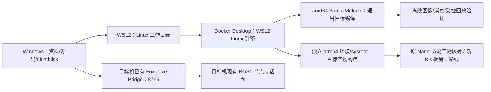

# 电脑 WSL＋Docker 编译与 Lichtblick 实时可视化评估

分析日期：**2026-10-12**（初版，基于 version1012 六包）；**2026-10-22 按当前源码 version1018（7 个 ROS 包）全文复核**。本轮复核只做静态读取：逐包读 `CMakeLists.txt`／`package.xml`、launch、消息、模型头与 `tools/` 脚本；**没有安装 WSL、Docker 或 Lichtblick，没有编译、没有启动 ROS/Gazebo/PX4，没有连接无人机、相机或舵机**。凡涉及“能不能跑”“跑得多快”“是否通过”的内容，本文只给条件与验收口径。

**路径约定：** 本文位于 `docs/源码分析/`。源码入口是 [`../../src`](../../src)，工具是 [`../../tools`](../../tools)，模型在 `../../src/ssd_detection/models/`，监看配置在 [`../监看`](../监看)。文中 `文件:行号` 均按本轮源码核对过；行号会随代码改动漂移，找不到时按文件名＋符号名检索（例如 `ssd_detection/CMakeLists.txt` 里的 `find_package(jetson-inference QUIET)`）。

[总技术指南](../技术文档.md) · [飞行任务与舵机](飞行任务与舵机.md) · [定位建图与视觉](定位建图与视觉.md) · [EGO规划算法](EGO规划算法.md) · [Gazebo仿真与场地](Gazebo仿真与场地.md)

本文是**可行性评估和后续操作方案**，不是构建或运行记录。旧设计、旧 README 与代码冲突时以当前源码为准；电脑路线首先服务现有 ROS1 Melodic 源码（在线 Cartographer、EGO 二维规划、SSD 检测、I2C 舵机），不要求先实现历史 AMCL 或旧仿真规划。

## 1. 可以直接采用的结论

1. **当前是 7 个包、11 个可执行目标。** 7 个包为 `ego_planner_2d`、`gc_2026_sim`、`location`、`navigation_2d`、`rplidar_ros`、`servo_control`、`ssd_detection`，顶层 [`src/CMakeLists.txt`](../../src/CMakeLists.txt) 是 catkin 的 toplevel 模板。11 个目标中 **10 个不依赖 Jetson 库**（可在 amd64 容器里准备构建），第 11 个 `ssd_detection_node` 是条件目标。另有 4 个 EGO 静态库和 1 个可选 gtest。
2. **“电脑通用部分编译成功”和“目标机全部目标重新构建”必须分别验收。** 本项目目标机已由 SHELL 于 2026-10-19 定为 **TB-RK3399ProD**（ARM64，视觉走 RKNN/NPU 另行适配）；原 Jetson Nano 的 L4T、CUDA 10.2、TensorRT 7.1.3、`jetson-inference`、多媒体库都只对“核对历史产物”有意义。即使实施机是带 RTX 3060 Ti 的 Windows 电脑，x86 的 CUDA 也只是训练/导出算力，既不等于 Jetson 运行环境，也不等于 RK NPU 环境。
3. **PC/仿真侧能跑的检测入口只有 Python3 节点。** `OnnxSsdDetector` 先试 `onnxruntime` 的 `CPUExecutionProvider`，不可用才退回 `cv2.dnn.readNetFromONNX`（旧 `.pb` 走 `readNetFromTensorflow`，只作对比）。它只验证模型契约与接口，不能替代 Jetson `detectNet` 或 RK NN 的推理、内存与延迟验收。
4. **模型本身是可用输入，不是“不兼容文件”。** 本轮直接读 `ssd_detection/models/ssd-mobilenet.onnx` 文件头：`ir_version=8`、`opset=17`、`producer=pytorch 2.4.1`、32,193,674 字节；标签 11 行（`BACKGROUND`＋9 类危险品＋`person_injured`）。`tools/ssd_training/check_onnx_contract.py` 按 TensorRT 7.1 的名义门限（opset>11、ir_version>7）会给出两项**警告**，并明确写了“警告不等于跑不了”，必须实际建一次 engine 才能下结论。
5. **Lichtblick 显示路线不变，但图像话题已经收敛成一路。** 当前源码只发布 `/ssd_detection/image/compressed`（Python 与 C++ 节点同默认值）；旧的 `/mission/video/compressed`、`/ssd_detection/debug_image/compressed` 已不在任何发布路径上。`../监看` 里保存的白名单仍是旧话题，属于**必须改**的配置，不是可用配置。
6. **仿真包提供了材料，但没有提供容器。** `gc_2026_sim` 带场地 world、卡片贴图、两种载具/传感器模型、4 个 launch、7 个脚本和 Cartographer 参数，并新增两个 C++ 目标；但 `scripts/start_px4_slam.sh` 在未指定时默认 `ROS_DISTRO=noetic`，引用 `/opt/ros/$ROS_DISTRO`，并依赖外部 PX4 与 Cartographer 工作空间。全仓库**没有 Dockerfile／Compose／镜像锁**，不能写成“已提供可复现容器”。
7. **版本控制：** 2026-10-22 起项目根已有 Git 仓库（`main` 分支，覆盖全部内容），此前复核期确实没有（`src/.git` 只是空目录，`git` 不在 PATH 上）。构建输入的锁定仍建议保留“文件清单＋SHA256”，不要只写“某个分支/某个 tag”。

## 2. 电脑状态：2026-10-12 的只读快照（须重查）

查询时间：2026-10-12 21:43 至 21:45（Asia/Shanghai），对象是当时操作的一台 AMD 笔记本。**2026-10-13 与 2026-10-21 的记录把实施对象写成 SHELL 另一台 Windows、RTX 3060 Ti、16 GB 内存电脑，并明确要求不得借用另一台电脑的硬件查询结果**（[配置提示词](../项目资料/另一台电脑_虚拟环境与Gazebo配置提示词_2026-10-21.md) 第 37 行）。所以下表只作**方法与历史样例**：真正安装前必须在实施机上重跑同一组只读查询，本节任何一格都不能当作该机现状。

| 项目 | 2026-10-12 查询结果 | 对方案的影响 |
|---|---|---|
| Windows | CIM：Microsoft Windows 11 家庭版 中文版；10.0.26200，64 位；注册表 DisplayVersion=25H2、UBR=9457 | 使用 Windows x86-64 安装包、WSL2 Linux 容器。注册表 ProductName 仍显示 Windows 10 Home China，不能据此否定 CIM 和 build 信息 |
| 机型 | XIAOMI REDMI Book 16 2025(AMD)，x64-based PC | amd64/x86_64 主机；实施机若为另一台机器需重新确认 |
| CPU | AMD Ryzen 7 7735H w/ Radeon 680M Graphics；8 核、16 逻辑处理器 | 通用 C++ 编译能力具备；并行度按内存压低 |
| 物理内存 | 16,312,639,488 字节，约 15.2 GiB；CIM 当时空闲约 4.29 GiB | 16 GB 是两台机器共同约束；建议 WSL 上限 6 GB、处理器 4、构建并行 2 起步 |
| GPU | AMD Radeon(TM) Graphics，驱动 32.0.13038.1；另有 GameViewer Virtual Display Adapter | 这台快照机没有 NVIDIA GPU。若实施机是 RTX 3060 Ti，则多一条 x86 CUDA 路线（`tools/ssd_training` 的训练/导出），仍不能运行 Jetson 库或 RK NPU 模型 |
| 虚拟化 | VirtualizationFirmwareEnabled=True；HypervisorPresent=True | 可继续 WSL2 安装与实际启动验收 |
| 虚拟化限制 | CPU 的 VMMonitorModeExtensions/SecondLevelAddressTranslationExtensions 返回 False；查询两项 Windows OptionalFeature 报“请求的操作需要提升” | 已存在 hypervisor 时不能把这些字段直接解释为 CPU 缺 SLAT。本轮未为查询提权 |
| 磁盘 | C: 空余 91,512,668,160 字节，约 85.2 GiB；D: 空余 203,884,138,496 字节，约 189.9 GiB，均 NTFS | 有初期容器/源码/构建空间。建议 Docker 数据盘放 D:；ARM64 sysroot 与 Gazebo 场景另估算 |
| WSL | `wsl.exe` 存在，但 `--status` 退出 50，`--version` 与 `--list --verbose` 退出 1；均报“未安装适用于 Linux 的 Windows 子系统” | 当时 WSL 未安装；存在 wsl.exe 不代表已有可用 WSL2 发行版 |
| Docker | `Get-Command docker.exe` 未找到；两个标准安装路径不存在 | 当时未发现 Docker Desktop；未调用 daemon |
| NVIDIA CLI | `Get-Command nvidia-smi.exe` 未找到 | 与这台快照机的 GPU 清单相符；不是一次 CUDA 容器运行结果 |

当时的只读查询命令（可作为实施机的复核清单，均为读取）：

```powershell
Get-CimInstance Win32_OperatingSystem |
  Select-Object Caption,Version,BuildNumber,OSArchitecture,TotalVisibleMemorySize,FreePhysicalMemory
Get-CimInstance Win32_Processor |
  Select-Object Name,Architecture,NumberOfCores,NumberOfLogicalProcessors,
    VirtualizationFirmwareEnabled,VMMonitorModeExtensions,SecondLevelAddressTranslationExtensions
Get-CimInstance Win32_ComputerSystem |
  Select-Object Manufacturer,Model,SystemType,TotalPhysicalMemory,HypervisorPresent
Get-CimInstance Win32_VideoController |
  Select-Object Name,DriverVersion,AdapterRAM,PNPDeviceID
Get-Volume | Where-Object DriveLetter |
  Select-Object DriveLetter,FileSystem,Size,SizeRemaining
Get-Command wsl.exe,docker.exe,nvidia-smi.exe -ErrorAction SilentlyContinue
wsl.exe --status
wsl.exe --version
wsl.exe --list --verbose
Get-Service LanmanServer
```

WSL 输出为 UTF-16 时需按 Unicode 回读，否则会把乱码误判为正常状态。本轮没有执行 `wsl --install`、`--update`、`--shutdown` 或任何发行版命令。Docker 官方当前页面列出 WSL≥2.1.5、64 位 CPU/SLAT、至少 8 GB RAM、固件虚拟化等要求，并说明 Home 可以运行 Linux 容器；该页的支持周期应在实际安装当天复核，最终以安装、WSL2 启动、daemon/基础容器测试为验收。[Docker Windows 安装说明](https://docs.docker.com/desktop/setup/install/windows-install/)

## 3. 原 Nano 快照与电脑不能混用的依赖

下表来自已保存的 2026-10-11 环境资料，**不是本轮登录无人机取得的当前状态**。采集时 Nano 时钟为 2025-10-24，原文件名/采集时间不用于排序项目版本。

| 层级 | Nano 已保存事实 | 电脑/目标机应采用的策略 |
|---|---|---|
| 操作系统/架构 | Ubuntu 18.04.6，AArch64；4.9.201-tegra；L4T 32.5.2 | 容器可用较新 WSL 宿主，但项目容器固定 Bionic/Melodic 编译原源码；amd64 与 arm64 分开构建。新 RK 板系统组合未定，不继承这条 |
| ROS | ROS1 Melodic；MAVROS 1.16.0；Cartographer/Cartographer ROS 1.0.0 | 通用编译先匹配 Melodic API；运行依赖版本另固定。默认是在线 Cartographer，不把 AMCL 当成已运行组成 |
| Jetson GPU | CUDA 10.2.89、TensorRT 7.1.3、cuDNN 8.0.0.180 | 保存的 ARM64 二进制/库不用于 amd64 链接；x86 上的 CUDA 也不是这套栈 |
| 外部视觉库 | `/usr/local` 的 `jetson-inference`、`jetson-utils`，及 `tegra/libnvbuf_utils.so` 等 | 通用镜像不冒充具备 Jetson 库；ARM64 构建必须用独立 sysroot 和匹配 ABI |
| OpenCV | 3.2/4.1 同时存在；opencv4 元数据 4.1.1；原 SSD ELF 同时含两个版本依赖 | 通用阶段先固定一套 C++ OpenCV/cv_bridge；不能靠“升级一切”解决原栈复现 |
| Python | Python2 实际 2.7.17；Python3 入口 3.7.15，系统另有 3.6.9；pip OpenCV 4.6.0.66、numpy 1.21.6 | C++/消息构建与 Python3 检测节点分别验收；避免 Python2 `cv_bridge` 与 Python3 混用 |
| 文件来源 | 原 catkin tar 和五个依赖分包已经校验；Windows 外部只读源码副本有 4 处大小写映射 | 分析副本用于阅读；Linux 构建从原 tar 或当前 `src/` 建立，保留符号链接/大小写，旧 build/devel 不复用 |

本地证据：[`Nano环境核验与补备份`第 26～71 行](../项目资料/Nano环境核验与补备份_2026-10-11.md)、[`材料评估`第 15～43 行](../项目资料/Nano程序分析与再编译材料评估_2026-10-11.md)，以及 [`report.txt`](../../nanooutput_origin/Nano补充导出/2026-10-11/环境采集/analysis_copy/nano_inventory_20251024_195237_8acNSP/report.txt) 第 1～30、173～175、338、687～695 行。

L4T 32.5.2 与 CUDA/TRT 组合应以实采为准；NVIDIA 的 JetPack 4.5.1 归档页面给出 CUDA10.2、TensorRT7.1.3、cuDNN8 和 OpenCV4.1.1，但列的是 L4T32.5.1，不能只凭近似版本就把原机精确标成某个 JetPack。[NVIDIA JetPack4.5.1归档](https://developer.nvidia.com/embedded/jetpack-sdk-451-archive)

TensorRT engine 绑定构建时的 OS、CPU 架构、GPU 与 TensorRT 版本。`../../src/ssd_detection/models/` 下确实有一个缓存 `ssd-mobilenet.onnx.1.1.7103.GPU.FP16.engine`（21,587,397 字节），但该包的安装规则只 `FILES_MATCHING PATTERN "*.onnx" PATTERN "*.txt"`（`CMakeLists.txt` 第 56～59 行），engine **不进安装空间**，属于本机缓存而非交付物；不能作为电脑推理输入，也不能反推 Nano 当前运行的就是它。可迁移的输入是 ONNX 与标签。[NVIDIA engine运行约束](https://docs.nvidia.com/deeplearning/tensorrt/latest/architecture/how-trt-works.html)

### 3.1 模型侧的静态事实（本轮直接读取文件）

| 项目 | 当前值 | 说明 |
|---|---|---|
| 文件 | `ssd_detection/models/ssd-mobilenet.onnx`，32,193,674 字节 | 与 `ssd-mobilenet.onnx.sha256sum` 成对存在 |
| 图元数据 | `ir_version=8`、`opset=17`、`producer=pytorch 2.4.1` | 由 protobuf 头部直接读出，不是文档转抄 |
| 标签 | `labels.txt` 11 行：`BACKGROUND`、9 类危险品、`person_injured` | 行 0 必须是背景；类数必须等于 `scores` 最后一维（11） |
| 检查器口径 | `check_onnx_contract.py` 对 opset>11、ir>7 报 WARN | 门限是 **TensorRT 7.1 名义值**；工具注释写明本项目实际飞过的模型就是 opset 17 / ir 8，警告只提醒“先建 engine 再信” |
| 结论边界 | 结构契约可查、名义告警可解释 | **不能写“模型不可用”，也不能写“Nano 已成功解析”**——两者都需要实际构建/推理证据 |

## 4. 各包可以编译到什么程度

当前 7 个包共定义 **11 个可执行目标**：10 个无条件生成，1 个（`ssd_detection_node`）只在找到 `jetson-inference`＋OpenCV＋CUDA 时才生成。按用途分：机载节点 7 个（含条件目标）、仿真节点 2 个、工具/自检 2 个（`tfmini_test`、`rplidarNodeClient`）。另有 `ego_planner_2d` 的 4 个静态库和 `navigation_2d` 的可选 gtest `ego_path_tracking_test`（`CATKIN_ENABLE_TESTING` 为真时才出现，不混入生产目标数）。

| 包 | 构建目标与关键依赖（按 CMake 实际内容） | 电脑 amd64 阶段 | 目标机阶段 | 运行/验收边界 |
|---|---|---|---|---|
| `location` | `location_node`（`location_with_ftmini.cpp`＋`TFplus.cpp`＋`i2c.cpp`＋`tf_mini_i2c.cpp`）、`tfmini_test`；catkin：`message_generation`、`roscpp`、`geometry_msgs`、`nav_msgs`、`tf2_ros`；`cmake_modules`、Eigen3、`find_library(I2C_LIBRARY …)`；C++14 | 可准备编译；需 amd64 的 libi2c，并核对 `I2C_LIBRARY` 实际解析路径 | 另建 ARM64 版本 | 无 TFMini/PX4/I2C 设备；编译通过不等于高度融合合格 |
| `navigation_2d` | `rescue_mission_node`（`mission_vision.cpp`＋`flight_control.cpp`＋`rescue_mission.cpp`）、`ego_trajectory_controller_node`；catkin 依赖含 `mavros_msgs`、`actionlib_msgs`、`tf`、**`ssd_detection`**；`cmake_modules`、Eigen3、`OpenCV REQUIRED`；自定义消息 `TargetDetection` | 可准备编译；消息生成与 `ssd_detection` 的构建顺序由 catkin 处理，需核对实际结果 | 另建 ARM64 版本 | 默认 launch 会起真实舵机（`use_real_servos=true`）并 include 检测节点；构建验收不启动它 |
| `ego_planner_2d` | `ego_planner_2d_node`＋4 个静态库（`bspline_opt`、`path_searching`、`grid_map_2d`、`plan_manage`）；`tf2`/`tf2_ros`/`tf2_geometry_msgs`、Eigen3；C++14、Release `-O3` | 适合电脑编译与隔离回放；无 CUDA 要求 | 另建 ARM64 版本 | 看见路径不等于控制/避障实机合格 |
| `rplidar_ros` | `rplidarNode`（`src/node.cpp`＋`sdk/` 内 glob 的 SDK 源）、`rplidarNodeClient`；`roscpp`、`rosconsole`、`sensor_msgs`；C++11 Release | 可准备编译 Linux amd64 | 另建 ARM64 版本 | 无雷达/串口只能做编译、样例消息或 bag 回放 |
| `servo_control` | `servo_controller_node`；`roscpp`、`std_msgs`；`linux/i2c-dev.h`＋`ioctl`；C++11 | 可编译，不需要本机接舵机 | 另建 ARM64 版本 | 启动即操作 I2C 硬件；不纳入普通编译后的 smoke 运行 |
| `ssd_detection` | 2 个自定义消息（`VisionDetection`、`VisionDetectionArray`）＋`catkin_install_python(scripts/ssd_detection_node.py)`＋`models/` 安装；`ssd_detection_node`（`src/ssd_detection_node.cpp`＋`src/jetson_detector.cpp`）**只在 `jetson-inference`＋OpenCV＋CUDA 全部找到时构建** | 可生成消息、安装 Python 入口与模型；C++ 目标预计被条件跳过并打印说明 | 用 CUDA 10.2＋TRT 7.1.3＋jetson 库构建 C++ 目标（历史对齐用） | Python CPU 后端可独立测试；C++ GPU 输入内存、推理与性能另验 |
| `gc_2026_sim` | `gazebo_simulation_vehicle_node`（`simulation_vehicle.cpp`）、`px4_sensor_rig_node`（`px4_sensor_rig.cpp`）；`gazebo_msgs`、`geometry_msgs`、`mavros_msgs`、`nav_msgs`、`roscpp`、`std_msgs`、`tf`、`visualization_msgs`；C++11 | 可准备编译：只需要 `gazebo_msgs` 等消息包，**不链接 Gazebo 库本体** | 一般不在目标机构建（仿真包与飞控机分离，见包 README） | 两个节点是仿真替身：`simulation_vehicle` 伪造 MAVROS 状态/位姿/解锁；`px4_sensor_rig` 从 Gazebo 真值发 `odom→base_link` 并代答 `/gpio_ack` |

构建依据（均位于 [`../../src`](../../src)）：`location/CMakeLists.txt` 的 `add_compile_options(-std=c++14)` 与 `find_library(I2C_LIBRARY …)`（第 5、18～29 行）以及两个 `add_executable`（第 56、62 行）；`navigation_2d/CMakeLists.txt` 的 `find_package(catkin …)`（第 8～19 行）、`find_package(OpenCV REQUIRED)`（第 23 行）、消息（第 26～29 行）与两个目标（第 61、67 行）；`ego_planner_2d/CMakeLists.txt` 第 4～5、12～23、47～68、73 行；`rplidar_ros/CMakeLists.txt` 第 8～20、30、33 行；`servo_control/CMakeLists.txt` 第 17 行；`ssd_detection/CMakeLists.txt` 第 14～31、43～46、56～59、76～84、86～124 行；`gc_2026_sim/CMakeLists.txt` 第 6～15、24、28、40～48 行。

**`ssd_detection` 的依赖要按实际写法读，别按印象写：**

- **onnxruntime 不是 CMake/package.xml 依赖。** 它只被 `scripts/ssd_detection_node.py` 以 `import onnxruntime` 尝试导入（`OnnxSsdDetector.__init__` 内），是 pip 包，必须在运行环境单独装并记录版本；`package.xml` 里声明的 Python 依赖只有 `python3-opencv` 与 `rospy`。
- **OpenCV** 在 C++ 分支用 `find_package(OpenCV QUIET)` 参与 `SSD_DETECTION_JETSON_AVAILABLE` 判定；PC 上 OpenCV 仍会经 `cv_bridge` 进入编译环境，但不是构建该节点的充分条件。
- **GStreamer 不在 CMake 里。** 真机相机走 `videoSource`（`jetson-utils` 提供），`jetson_detector.cpp` 只 `#include` 两种版本的 `videoSource.h`；GStreamer 是 `jetson-utils` 的内部实现。PC/仿真路径（Python 节点订阅 ROS 图像）完全不经过 GStreamer。
- **跳过是显式打印的。** 找不到 Jetson 依赖时 `ssd_detection/CMakeLists.txt` 走 else 分支打印 `skipping the detectNet node`。因此“`catkin_make` 退出 0”不等于 11 个目标都重建了；必须同时保存**包结果、目标列表、ELF 架构、链接库和完整日志**。

`location` 的库查找列了 aarch64 路径，同时保留 `/usr/lib`、`/lib` 默认路径，所以装 amd64 的 libi2c 后有机会找到本机库；但这必须核对 `I2C_LIBRARY` 的实际值，既不能断定“硬编码必然阻止电脑编译”，也不能让误找到的 ARM64 库混进 amd64 构建。

### 4.1 Python3 CPU 检测：可离线自检，不等于 ROS 里能跑

`scripts/ssd_detection_node.py` 首行是 `python3`，内部两条路径：

1. **推理后端**（`OnnxSsdDetector.__init__`）：先 `import onnxruntime as ort`，用 `providers=["CPUExecutionProvider"]` 建会话；异常则退回 `cv2.dnn.readNetFromONNX`，并在日志里打 `onnxruntime 起不来，退回 cv2.dnn（原因: …）`。源码注释给出的理由是：训练导出的图是 opset 17，而 Noetic 自带 OpenCV 4.2 读不了 opset≥10 的 Slice（报 `Required argument "starts" not found`）；注释同时声称两后端对同一张图输出逐元素等价——**这是源码/工具 README 的记录，本轮没有重跑验证**。
2. **离线自检**（`--image`／`--dir`／`--out`／`--dump`）：完全不碰 ROS，可以直接拿一张场地卡片图跑通“读图→推理→画框→写预览”。换模型后应先做这一步，再做 ROS 联调。

ROS 模式要同时满足三件事：解释器是 Python3、能 `import rospy`/`cv_bridge`、能 `from ssd_detection.msg import …`。前两项在 Melodic 二进制栈里默认是 Python2.7，第三项取决于构建时的 `PYTHON_EXECUTABLE`（`catkin_install_python` 会把脚本装到 `lib/ssd_detection/`，其 shebang 由构建配置决定）。所以有两条候选路线，都必须各自实测：

- **A. 编译容器用 Bionic/Melodic（对齐原机），Python3 检测节点另备环境**：容器只构建 C++ 与消息；检测节点要么在 Noetic 容器里跑（rosbag 回放/仿真话题跨界），要么在本机 Python3 环境只做离线自检。跨容器跑 ROS 通信要处理 `ROS_MASTER_URI` 与 TCPROS 回连地址。
- **B. 直接用 `ros:noetic-ros-base-focal`**：Python3、`cv_bridge`、`onnxruntime` 天然同栈，但要把它明确写成“API/OpenCV/Python 迁移”，不能称为原 Melodic 环境精确复现。

本轮没有离线测试图像集、结果基准或 CPU 延迟数据；`tools/ssd_training/README.md` 记录了 `pip3 install onnxruntime`、Python 3.8 上最高 1.16.3 等经验值，也只能作为待复核的参考。

### 4.2 `tools/` 现有脚本与依赖（按文件清单，不按旧文档）

`../../tools` 当前是 52 个文件：13 个顶层脚本/源文件、`assets/`（GB 2894 参考图与 `ssd_box_convention.png`）、`ssd_training/`（13 个 Python 脚本＋一份长 README）。

| 脚本 | 作用 | 额外依赖 |
|---|---|---|
| `check_config.py`（3610 行） | 重建/试飞前的静态门禁：YAML 解析与重复键、launch XML、Lua 解析与 define/use 顺序、坐标系一致性、EGO 栅格与航点、`cmd_vel` 旋转、轮次与投放、world 的 `model://` 与 `GAZEBO_MODEL_PATH`、生成 launch 的 `$(eval)` 语义等 | `PyYAML`（缺失则跳过 YAML 检查）、`luaparser`（缺失则只做 Lua 结构检查） |
| `check_route_corridor.py` | 逐条航线段在 EGO 膨胀半径下还剩多少带宽，并遍历随机障碍摆法 | 复用 `check_config` 的 world 解析 |
| `check_field_vs_drawing.py` | world＋航线与场地图纸尺寸对账 | 依赖 `render_field` |
| `render_field.py` | 把 world 与航线渲染成俯视图；`--check-vision` 按真实俯视尺度自检取景 | `numpy`、`Pillow`、`scipy` |
| `route_frame_report.py` | 按 `field_yaw_deg` 打印航线落到 odom 的坐标 | 标准库 |
| `make_task_markers.py` | 从 GB 2894-2025 附录 C 抽取警示图形生成任务卡片贴图 | `numpy`、`Pillow`、`PyMuPDF` |
| `find_gb2894_xrefs.py` | 重新推导贴图所用的 (page, xref) 表 | `PyMuPDF` |
| `list_launch_mtimes.py` | 列出 launch/param 修改时间，辅助判断“机上跑的是不是同一份” | 标准库 |
| `fmt_stub_diff.py`＋`fmt_check_2026_09_25.cpp` | 用 `format(gnu_printf)` 在无 ROS 头的情况下检查日志格式串；前者校验 stub 与真实源码逐字一致 | g++ |
| `servo_angle_calib.py` | 台架：把一个 PCA9685 通道驱到任意角度 | 直接操作 `/dev/i2c-*` |
| `servo_debug.py` | 交互式舵机调试前端（`/servo_debug_cmd`） | `rospy` |
| `servo_tick_check.cpp` | 用 g++ 复算“角度→脉宽→tick”，与 Python 工具对拍 | g++ |
| `ssd_training/` | 数据整理、合成数据、PyTorch SSD 训练、ONNX 导出适配、契约检查、框约定校验、高度评估 | `torch`（训练）、`onnx`/`onnxruntime`/`cv2`（评估）、`numpy`/`Pillow`（数据）；`check_onnx_contract.py`、`prepare_pytorch_voc.py`、`voc_split.py` 只需标准库 |

两点必须写清：

- **`verify_project_isolation.py`、`verify_git_baseline.py` 等“项目完整性一键核验脚本”在 `tools/` 里不存在**，不要再把它们当作可用工具或流程前置。`docs/验证记录/` 下的 `project_isolation_baseline.json`、`git_baseline_verification_2026-10-11_final.json` 是当时手工生成的**证据文件**，不是可执行脚本。
- **`.pyc` 是缓存，不是依赖凭证。** `src/` 内混有 4 个：`gc_2026_sim/scripts/__pycache__/`（cpython-313 两个）、`ssd_detection/scripts/__pycache__/`（cpython-311、cpython-313 各一个）；`tools/ssd_training/__pycache__/` 另有 4 个。它们只能说明当时用过什么解释器，不能证明目标环境装了什么。

2026-10-19 的静态核验曾在本机跑过其中三项，可作参考、**不是本轮复跑**：`check_config.py` 退出 0（PyYAML 未装，相关检查跳过）；`check_field_vs_drawing.py` 因缺 SciPy 在导入阶段退出 1；`check_route_corridor.py` 退出 1（三段航线的连线在至少一种障碍摆法下进入膨胀区）。详见外部对照报告 [version1018 与 version1012 更新分析](../../../../version1018与version1012更新分析_2026-10-19.md) 第 10 节（该文件在本工作区的上一级目录）。

## 5. 建议的电脑环境结构与执行顺序



**2026-10-13 的环境口径仍然有效：项目开发环境优先对齐原机的 Ubuntu 18.04/Melodic，固定在 Bionic 容器内。** 外层 WSL 发行版不必强行选 18.04：较新的 WSL Ubuntu 只负责编辑/工具和 Docker 入口，不代表项目迁移；Docker Desktop 也不要求单独装某个 Ubuntu 发行版。不要同时再装一套 WSL 内 Docker Engine，避免两套 daemon 和 CLI 混淆。[Docker WSL 后端说明](https://docs.docker.com/desktop/features/wsl/)

**2026-10-19 起目标机换成 TB-RK3399ProD，但这条不改变容器选择。** 容器对齐的是“原机源码能编”，不是“新板系统已定”；RK 板的系统、RKNN 工具链与模型转换属于独立范围，不能用这个 amd64 容器替代。

Windows 目录继续作为项目资料与源码入口。构建时把源码复制到 WSL ext4 目录或由 Linux 命名卷承载构建输出，避免在 NTFS 上丢权限/符号链接/大小写。**输入锁定采用“文件清单＋SHA256”**（2026-10-22 起可再用 Git 提交作第二重锚点）：复制后生成 `src/` 与 `tools/` 的逐文件哈希清单，与构建日志、镜像 digest 一起归档；不要只用“某个分支/某个 tag”描述输入。[Microsoft 文件系统建议](https://learn.microsoft.com/en-us/windows/wsl/filesystems)

### 阶段A：安装和基础容器验收（后续执行）

1. 按 Microsoft 正式说明准备 WSL2，若提示重启则完成重启；发行版名称先用 `wsl --list --online` 核对。
2. 安装 **Docker Desktop for Windows x86_64**，启用 WSL2 后端/Linux 容器与对应发行版 WSL Integration；把 Docker 数据盘位置评估迁到余量更大的盘。
3. 先验收“虚拟化/daemon/普通 Linux 执行”，再谈项目镜像。当前不能预填 WSL/Docker 版本或镜像 digest 为“已验证”。

```powershell
# 后续安装阶段；本轮未执行。安装 WSL 可能需要管理员权限和重启。
wsl.exe --install -d Ubuntu-24.04
wsl.exe --update
wsl.exe --set-default-version 2
wsl.exe --version
wsl.exe --list --verbose

# Docker Desktop 安装完成、手动启动后：
docker version
docker info
docker run --rm hello-world
docker run --rm --network none ubuntu:24.04 uname -m
```

基础容器预期返回 `x86_64`；这只验收虚拟化/daemon/普通 Linux 执行，不包括 ROS、项目目标、GPU 或无人机通信。可选的初始 `%USERPROFILE%\.wslconfig`（后续配置示例，当前未写入；16 GB 机器从 6 GB/4 处理器起步，与执行计划一致）：

```ini
[wsl2]
memory=6GB
processors=4
swap=4GB
```

6 GB 是初始预算，不是仿真或全量第三方编译的容量保证。配置变更通常要关闭 WSL 实例后生效；执行前保留已有配置并评估其他 WSL 任务，本轮没有执行 shutdown。

### 阶段B：固定 amd64 编译镜像、依赖来源和源码输入

初始候选镜像是官方 `ros:melodic-ros-base-bionic`。官方仓库保留对应 Dockerfile，但**本轮未通过 registry/daemon 验证该 tag 可拉取**。实施时先 `docker buildx imagetools inspect`／`docker pull`、记录 digest，再锁定 digest；不能把本篇草案称作可复现镜像。[OSRF 官方 Dockerfile](https://github.com/osrf/docker_images/blob/master/ros/melodic/ubuntu/bionic/ros-base/Dockerfile)

```bash
# 后续在 WSL 执行：先确定实际 tag/digest 与架构。
docker buildx imagetools inspect ros:melodic-ros-base-bionic
docker pull --platform linux/amd64 ros:melodic-ros-base-bionic
docker image inspect ros:melodic-ros-base-bionic \
  --format '{{.Architecture}} {{json .RepoDigests}}'
```

按当前 7 包 CMake 与 `package.xml` 反推的编译依赖（比六包时代多了新包的 `gazebo_msgs` 和 `rplidar_ros` 声明/使用的 `rosconsole`、`std_srvs`）：

`build-essential`、`cmake`、`pkg-config`、`git`、`file`、`binutils`、`libeigen3-dev`、`libi2c-dev`、`libopencv-dev`，以及 ROS 侧 `ros-melodic-cmake-modules`、`ros-melodic-message-generation`、`ros-melodic-message-runtime`、`ros-melodic-cv-bridge`、`ros-melodic-mavros-msgs`、`ros-melodic-gazebo-msgs`、`ros-melodic-tf`、`ros-melodic-tf2`、`ros-melodic-tf2-ros`、`ros-melodic-tf2-geometry-msgs`、`ros-melodic-nav-msgs`、`ros-melodic-sensor-msgs`、`ros-melodic-visualization-msgs`、`ros-melodic-actionlib-msgs`、`ros-melodic-rosconsole`、`ros-melodic-std-srvs`。

以下是**尚未保存为 Dockerfile、尚未构建的草案**，只用于解释起点：

```dockerfile
ARG ROS_BASE=ros:melodic-ros-base-bionic
FROM ${ROS_BASE}
ENV DEBIAN_FRONTEND=noninteractive
RUN apt-get update && apt-get install -y --no-install-recommends \
    build-essential cmake pkg-config git file binutils \
    libeigen3-dev libi2c-dev libopencv-dev \
    ros-melodic-cmake-modules ros-melodic-message-generation \
    ros-melodic-message-runtime ros-melodic-cv-bridge \
    ros-melodic-mavros-msgs ros-melodic-gazebo-msgs \
    ros-melodic-tf ros-melodic-tf2 ros-melodic-tf2-ros \
    ros-melodic-tf2-geometry-msgs ros-melodic-nav-msgs \
    ros-melodic-sensor-msgs ros-melodic-visualization-msgs \
    ros-melodic-actionlib-msgs ros-melodic-rosconsole ros-melodic-std-srvs \
    && rm -rf /var/lib/apt/lists/*
WORKDIR /ws
```

Melodic 已于 2023 年结束官方发行版支持，旧镜像 APT 可能遇到密钥、仓库或包版本问题；要选择并保存官方历史源/快照与匹配签名密钥，记录来源和版本，不预设旧源今天全部正常，也不通过关闭签名校验把失败掩盖成安装成功。若改用 Noetic，必须声明为 API/Python/OpenCV 迁移并独立验证。

本阶段只为编译 7 包自定义目标；Cartographer、MAVROS 可执行程序、Gazebo、PX4 SITL、`foxglove_bridge` 等**运行依赖**另在回放/仿真/台架阶段加入并锁版，不要先把全部第三方库从源码重建。`rosdep` 可用于缺口检查，但现有 `package.xml` 声明不完整（例如 `location` 的 CMake 用 `tf2_ros`、`nav_msgs` 而 `package.xml` 只声明 `tf`、`geometry_msgs`），不能只凭 `rosdep` 退出 0 验收头文件/系统库齐全。Python 工具链（`onnxruntime`、`PyYAML`、`luaparser`、`scipy`、`Pillow`、`PyMuPDF`、`torch`）建议**单独一层可选依赖**，不要混进编译必需层。

### 阶段C：实际构建和覆盖检查

把当前 `src/`（必要时加 `tools/`）复制到 WSL 的独立目录，例如 `~/低空消防构建输入/catkin_ws/src/`，并在复制后生成哈希清单。**不复制任何旧 `build/`、`devel/`、`logs/`、`.catkin_tools`，也不要复制 `.git` 目录。** 以下命令假定输入已准备、阶段B镜像已命名为 `drone-melodic-build:20261022-amd64`；两者目前都未完成。

```bash
docker volume create drone-build-amd64-20261022
docker volume create drone-devel-amd64-20261022
docker volume create drone-evidence-amd64-20261022

# 依赖已装进镜像后，编译容器不接真实 ROS 网络/设备。
docker run --rm -it --network none \
  --mount "type=bind,src=$HOME/低空消防构建输入/catkin_ws/src,dst=/ws/src,readonly" \
  --mount type=volume,src=drone-build-amd64-20261022,dst=/ws/build \
  --mount type=volume,src=drone-devel-amd64-20261022,dst=/ws/devel \
  --mount type=volume,src=drone-evidence-amd64-20261022,dst=/evidence \
  drone-melodic-build:20261022-amd64 bash
```

进入**电脑隔离编译容器**后：

```bash
set -o pipefail
source /opt/ros/melodic/setup.bash
cd /ws
uname -m
cat /etc/os-release
g++ --version
cmake --version
dpkg-query -W > /evidence/dpkg-installed.txt
catkin_make -j2 -l2 -DCMAKE_BUILD_TYPE=RelWithDebInfo 2>&1 \
  | tee /evidence/catkin_make-amd64.log

# 逐个验证 10 个无条件目标是否新生成、架构是否 x86-64；不运行任何硬件节点。
file devel/lib/location/location_node devel/lib/location/tfmini_test \
  devel/lib/navigation_2d/rescue_mission_node \
  devel/lib/navigation_2d/ego_trajectory_controller_node \
  devel/lib/ego_planner_2d/ego_planner_2d_node \
  devel/lib/rplidar_ros/rplidarNode devel/lib/rplidar_ros/rplidarNodeClient \
  devel/lib/servo_control/servo_controller_node \
  devel/lib/gc_2026_sim/gazebo_simulation_vehicle_node \
  devel/lib/gc_2026_sim/px4_sensor_rig_node
find devel/include/ssd_detection devel/include/navigation_2d -type f
ls -l devel/lib/ssd_detection src/ssd_detection/models
grep -E 'I2C_LIBRARY|OpenCV_DIR|PYTHON_EXECUTABLE' build/CMakeCache.txt
ldd devel/lib/navigation_2d/rescue_mission_node
grep -n 'skipping the detectNet\|building the detectNet\|error:' /evidence/catkin_make-amd64.log
```

`PYTHON_EXECUTABLE` 这里刻意不再预设 `python2`。是否用它、以及用 `python2` 还是 `python3`，直接决定 Python 检测节点装出来的 shebang 与消息模块版本，**属于要显式决定并记录的一项**（见 §4.1 的两条路线），不能靠改一个变量“顺手混装”。`grep` 没有命中时可能返回 1，只说明该文本未出现，不是构建失败/成功的总判据。

首次发现缺依赖、编译错误或未声明消息生成依赖，应记录精确错误，在**独立的代码改动**中受控修复，并在当天日志写清文件、原因与对应提交。本篇不写虚构的成功构建日志。

通用阶段完成标准：**10 个无条件目标确实新生成**；`ssd_detection` 与 `navigation_2d` 的自定义消息可查；Python 入口与 `models/` 已安装；所有 ELF 为 x86-64、`ldd` 无 `not found`；选中的 OpenCV/I2C/Python 路径已记录；日志如实保留“跳过 detectNet 节点”的状态。此时可以称“电脑通用模块构建通过”，**不能**称“目标机 11 目标完整重建通过”。

### 阶段D：ARM64 / Jetson 条件目标的独立方案

| 方式 | 可取得的结果 | 本项目限制和建议 |
|---|---|---|
| amd64 原生编译 | 电脑可运行的通用 Linux 目标（10 个） | 推荐先做；输出不能上传目标机直接运行 |
| Docker `--platform linux/arm64`＋QEMU | ARM64 用户空间的 CPU 编译/构建工具执行 | 可构建 ARM64 通用包，通常较慢；不仿真 GPU、I2C、相机、多媒体内核 |
| x86-64 交叉编译器＋ARM64 sysroot | 面向原机 ABI 的 ARM64 ELF，可链接目标库 | 更适合长期目标构建；需要完整 sysroot、toolchain 文件、ROS 消息生成宿主/目标工具区分与路径修正 |
| 原生 Jetson 构建机 | 最接近同架构编译环境 | 当前未提供；不恢复已取消的“在无人机上独立重编译”安排 |
| 带 NVIDIA GPU 的 x86 电脑（如 RTX 3060 Ti） | 可做独立 CUDA/TensorRT 或 PyTorch 训练/导出 | 不是 L4T 环境，不解决原 ARM64 多媒体库原样运行，也不等于 RK NPU |
| TB-RK3399ProD 板端 | RKNN/NPU 推理路线的唯一有效环境 | 与 Jetson 目标不是同一条工具链；`jetson-inference` 在 RK 板上不存在，SSD 的 C++ detectNet 目标在那里同样不会被构建 |

Docker 多架构是 CPU 用户空间策略，官方明确 QEMU 编译可能比原生慢；`--platform linux/arm64` 只是选择平台，不自动建立完整 Jetson sysroot，也拿不到 Tegra 内核。[Docker 多架构构建](https://docs.docker.com/build/building/multi-platform/)

补档保存了 ROS/CUDA/系统/Jetson 安装库与主要头文件，为构造 sysroot 提供输入，但仍需在 Linux 文件系统中按原 tar 准确恢复并审核：不要用 Windows 大小写改名的只读副本做构建根，也不要把原机 `/usr` 覆盖电脑 `/usr`。

目标阶段的具体未决项：aarch64 交叉编译器与原 GCC/glibc ABI；链接与绝对路径/符号链接；原 OpenCV 双版本依赖；`jetson-utils` 导入所需的 nvbuf_utils/EGL/GStreamer；CUDA 头与目标库；ROS 生成器跑在宿主还是 QEMU；ARM64 镜像能否解析原 CUDA CMake 配置；第三方库来源版本与许可证。**列有归档不等于每项已验收。**

ARM64 阶段通过标准：11 个目标逐项新构建、`readelf -h` 为 AArch64；SSD 的 CMake **必须**进入 `building the detectNet node` 分支；动态依赖路径在目标 sysroot 内且没有错误混入 amd64；日志/工具链/sysroot 清单/源码哈希保存。engine 生成与真实硬件运行是后续独立验证，不计入“电脑编译是否完成”。若目标已转为 RK3399ProD，这一节的意义是**核对历史产物**，不是新板部署前置。

### 阶段E：可选回放/仿真

隔离 bag 回放、合成消息和规划核心测试可以先行。`gc_2026_sim` 现在确实提供了项目仿真材料（材料清单与两条入口见该包 [`README.md`](../../src/gc_2026_sim/README.md)），两条路径的能力不同：

| 入口 | 实现 | 能检查什么 |
|---|---|---|
| `roslaunch gc_2026_sim gazebo_field.launch` | `gazebo_simulation_vehicle_node` 伪造 MAVROS 状态/位姿/解锁/模式服务并驱动可视模型；`sim_quadrotor` 模型自带 10 Hz 激光与 640×480@15 Hz 下视相机（`/sim_camera/image_raw`）；`auto_start` 默认 **true** | 任务状态机与话题控制流的快速冒烟；**不含** PX4 飞行动力学闭环 |
| `scripts/start_px4_slam.sh` → `px4_gazebo_slam.launch` → `px4_sitl_field.launch` | 外部 PX4 SITL（Iris）＋Gazebo＋MAVROS＋传感器架＋Cartographer＋任务链；`auto_start` 默认 **false** | PX4 控制、模拟传感器、地图、规划与任务集成；仍需实际运行验收 |

两条链都向 `navigation_2d.launch` 传 `use_real_servos=false`，由仿真节点产生 `/gpio_ack`，避免启动实体舵机节点。传感器架是独立模型：从 `/gazebo/model_states` 取真值、发布 `odom→base_link` 与 `/simulation/ground_truth/odom`，并在收到投放命令时于机体下方 0.30 m 生成 80 mm 立方体、发 `/simulation/payloads`；相机固定下视，`CAMERA_FRONT`/`CAMERA_DOWN` 都回 ACK。

必须写明的限制：

- **`start_px4_slam.sh` 默认 `ROS_DISTRO=noetic`**（第 5 行），随后 `source "/opt/ros/${ROS_DISTRO}/setup.bash"`（第 9 行）。这与阶段B 的 Bionic/Melodic 容器**不一致**：要么显式 `ROS_DISTRO=melodic` 并自证兼容，要么把仿真环境单独定到 Noetic。脚本还要求 `PX4_ROOT`（默认 `$HOME/PX4-Autopilot`）下已有 `build/px4_sitl_default/bin/px4`，并要求 `gazebo_ros`、`mavros`、`cartographer_ros`、`foxglove_bridge` 四个包可 `rospack find` 到；`Tools/sitl_gazebo` 这类 PX4 历史路径也在 `ROS_PACKAGE_PATH` 里。**包内没有锁定的 PX4 tag/commit、子模块或二进制**，不能推断确切兼容版本。
- **本包不提供容器。** 全仓库没有 Dockerfile、Compose、`.repos` 或镜像锁；WSL、Docker、图形/渲染、ROS、MAVROS、Cartographer、桥和外部 PX4 都要另行建立并记录版本。
- **PX4 总入口不转发 `field_yaw_deg`。** 该参数在 `px4_sitl_field.launch`（第 26 行）与 `navigation_2d.launch` 中声明，但 `px4_gazebo_slam.launch` 没有声明/透传它；从最外层传这个参数不能假设生效。
- **仿真入口自带一个 8765 桥。** `px4_sitl_field.launch` 在 `start_foxglove_bridge`（默认 true）时直接起一个 `address=0.0.0.0`、`port=8765` 的 `foxglove_bridge` 节点，**没有**只读白名单/能力限制。它和 `../监看` 的只读桥设计是两套东西，不要同时启动。
- **仿真与真机必须分库记录。** ROS Master、`ROS_MASTER_URI`、端口、坐标系（仿真 `odom` 即场地系）与真实无人机明确分开保存，`/use_sim_time` 只在仿真侧为 true。

## 6. Lichtblick：Windows 实时查看现有 ROS1 系统

### 6.1 软件和发行版本

正式项目名称是 **Lichtblick**，官方仓库 `lichtblick-suite/lichtblick`，提供 Windows/Linux/macOS 桌面版与 Web 版。2026-10-12 查询 GitHub `releases/latest` 结果为 **v1.29.1**（发布 2026-09-08），Windows 资产 `lichtblick-1.29.1-win.exe`，282,004,508 字节。

[`client_installation.json`](../验证记录/Lichtblick安装_2026-10-13/client_installation.json) 里保存的是 2026-10-13 的一次 Windows 安装**记录**（安装器 SHA256 与官方 digest 一致、产品版本 1.29.1.0、导入布局成功但界面为 “No data source”）。那条记录来自当时的另一个 Windows 用户目录，**不构成本文对任何一台电脑“已安装”的结论**；本轮没有启动客户端、没有复核那台机器，也没有任何 ROS 连通性证据。

官方入口：[仓库](https://github.com/lichtblick-suite/lichtblick)、[v1.29.1发布页](https://github.com/lichtblick-suite/lichtblick/releases/tag/v1.29.1)、[Web应用](https://lichtblick-suite.github.io/lichtblick/)。实施时重新核对发行版本与资产，不在本文伪造安装包 SHA 或签名结果。

**推荐 Windows 桌面版。** 客户端在电脑渲染，目标机只运行 ROS 数据桥；Web 版适合回放或已配好安全 WebSocket 的环境，HTTPS 页面连局域网 `ws://` 可能被浏览器 mixed-content/本地网络权限拦下——那是客户端限制，不是 ROS 故障。[官方平台说明](https://lichtblick-suite.github.io/docs/docs/visualization/introduction/)、[官方 ROS1 连接说明](https://lichtblick-suite.github.io/docs/docs/connecting-to-data/frameworks/ros1/)

### 6.2 连接方式：协议必须和服务端一致

| Lichtblick 连接类型 | 对应服务端/默认端口 | Desktop/Web | 本项目选择 |
|---|---|---|---|
| **Foxglove WebSocket** | ROS1 `foxglove_bridge`；常用 8765 | 二者均有协议支持 | 首选：原机已保存 0.6.3；无需电脑装 ROS 发行版 |
| Rosbridge | ROS1 `rosbridge_server`；常用 9090 | 二者均有 | 备用；需核实 Melodic/arm64 匹配版本，不能在 Foxglove 连接项里填 9090 冒充同协议 |
| Native ROS1 | ROS Master XML-RPC 11311＋各节点动态 TCPROS 端口 | 仅桌面 | 可备选，但要求双方可达与正确地址宣告；经 WSL/Docker/NAT 更复杂 |

Lichtblick 官方支持上述 ROS1 能力与自定义消息 schema；Foxglove WebSocket 与 rosbridge 是不同协议，端口可配置，默认值只是常见配置。[Lichtblick Live Data](https://lichtblick-suite.github.io/docs/docs/connecting-to-data/live-data/)、[Rosbridge 文档](https://lichtblick-suite.github.io/docs/docs/connecting-to-data/frameworks/rosbridge/)

官方 rosbridge 示例是 `ros-noetic-rosbridge-suite`，**不能照抄给 Melodic 目标机**；当前优先使用已有 Foxglove 桥，不为可视化擅自升级机载 ROS。

### 6.3 目标机上已有的兼容桥（历史归档事实）

从原 `02_opt_runtime.tar.gz` 只读查看的成员显示：manifest 版本 **0.6.3**，ROS1 依赖含 nodelet、ros_babel_fish、roscpp、roslib；原 launch 默认 `address=0.0.0.0`、`port=8765`、`tls=false`，topic/client/param/service 白名单均为 `['.*']`，capabilities 含 clientPublish、parameters、parametersSubscribe、services、connectionGraph。环境安装清单记为 `ros-melodic-foxglove-bridge 0.6.3-1bionic.20230620.181421 arm64`。[官方 0.6.3 Melodic 发布记录](https://github.com/foxglove/ros_foxglove_bridge-release#foxglove_bridge-melodic---063-1)、[ROS 官方 Melodic distribution.yaml](https://github.com/ros/rosdistro/blob/master/melodic/distribution.yaml)

当前新的 ROS1 桥官方 README 面向 Noetic＋Ubuntu22.04 源码构建，其 SDK 远程网关要求 glibc≥2.35；这不是 Bionic/Melodic 的现成升级方案，也不是安装 Lichtblick 必须使用的云端/账号路线。[新 ROS1 桥构建条件](https://github.com/foxglove/foxglove-bridge-ros1/blob/main/README.md)

**源码侧还要注意两点：** ① `navigation_2d.launch` 里 `start_foxglove_bridge` 默认 **false**（第 95 行），为真时在文件末尾起一个只设 `port=8765` 的桥节点（第 593～596 行）——它没有只读配置。**不要为了看图直接执行整个 navigation launch**：该入口还会初始化真实舵机（`use_real_servos` 默认 true）并启动任务节点。② 首次实时显示应单独启动一个只读桥，连接**已经受控运行**的数据源。

### 6.4 只读桥与白名单：必须按新话题重写

原桥默认开放客户端发布、参数修改和服务调用，因此后续配置要限制这些能力，只开放显示需要的话题。下面是与**当前源码**对齐的示例（基于 0.6.3 launch 参数，**本轮没有执行**）：

```bash
# 后续在目标机、ROS 数据源已受控运行时单独执行；不是启动飞行任务的命令。
source /opt/ros/melodic/setup.bash
roslaunch foxglove_bridge foxglove_bridge.launch \
  address:=0.0.0.0 port:=8765 \
  capabilities:="[]" client_topic_whitelist:="[]" \
  param_whitelist:="[]" service_whitelist:="[]" \
  topic_whitelist:="['^/tf$', '^/tf_static$', '^/map$', '^/scan$', '^/visual_global_path$', '^/visual_local_trajectory$', '^/trajectories$', '^/visual_obstacles$', '^/visual_local_obstacles$', '^/ssd_detection/image/compressed$', '^/ssd_detection/detections$', '^/mission/vision/detection$', '^/servo_ready$', '^/gpio_ack$', '^/mavros/local_position/pose$', '^/mavros/local_position/odom$', '^/mavros/state$']"
```

**与 `../监看` 保存配置的差异（这是本轮最需要处理的配置不一致）：**

| 位置 | 保存的内容 | 与当前源码的关系 |
|---|---|---|
| `../监看/README.md`（第 44～48 行）与 `validation_2026-10-13.json` 的 `image_selections` | 三选一：`/monitor/camera/image/compressed`、`/mission/video/compressed`、`/ssd_detection/debug_image/compressed` | 后两个**当前源码不再发布**：`MissionVision` 连 advertise 都不做（`mission_vision.cpp` 第 27 行注释），SSD 侧唯一话题是 `/ssd_detection/image/compressed` |
| 同一目录的文件清单 | README、`monitor_layout.json`、两个 JSON、`layout_schema_notes.md` | **`bridge_readonly.launch`、`start_monitor_bridge.sh`、`camera_preview.launch` 不在本工作区副本里**（验证记录只留了它们的哈希），所以“直接用现成只读桥”不成立：要么按哈希从别处取回，要么按本节示例重写 |
| `monitor_layout.json`（第 162 行） | Image 面板 `imageTopic=/monitor/camera/image/compressed` | 那是独立相机预览的话题，不是检测画面；要显示检测结果需改选 `/ssd_detection/image/compressed` |

白名单只限制“可桥接范围”，实际带宽仍由客户端打开的面板/订阅决定；capabilities 空列表要在启动日志、握手和客户端界面上实际核对。旧白名单的后果是**静默空白**：桥不报错，Image 面板只是永远收不到数据。也不要同时运行两个监听 8765 的桥（仿真入口自带一个）。

Windows 后续步骤：

1. 核对目标机当前 IP 与使用的网链；既有 USB RNDIS 记录 `192.168.55.1`／电脑 `192.168.55.100/24` 只是旧记录，本轮没有复测。
2. 用 `Test-NetConnection <目标机IP> -Port 8765` 确认桥端口；能 SSH 不代表 8765 已监听。
3. 在 Lichtblick `Open connection` 选 **Foxglove WebSocket**，填 `ws://<目标机IP>:8765`。
4. 在 Topics 页先确认话题类型/频率，再建立 3D/Image/Raw/Plot 布局并保存到项目配置目录；`../监看/monitor_layout.json` 需要在图像话题与 `camera_link` 帧上按当前源码调整。

这条路线客户端只需到达桥端口；桥在目标机本地订阅 ROS，电脑不需要装 MAVROS、Cartographer 或 ROS Master。把桥放到 WSL/Docker 侧则需要双向访问各节点并宣告可达地址，ROS1 动态端口与 NAT 会增加配置量，不作为首次方案。[Microsoft WSL 网络模式](https://learn.microsoft.com/en-us/windows/wsl/networking)

可选 SSH 隧道：把独立桥 `address` 改为 `127.0.0.1`，在 Windows 已准备 SSH 认证的终端执行下列命令，Lichtblick 改连 `ws://127.0.0.1:8765`；此时只需到达目标机 SSH 端口，不要求 8765 对局域网开放。隧道增加一层 TCP，仍要测延迟。

```powershell
# 后续单独启动 SSH 隧道，-N 不运行远端 shell 命令；关闭该进程即断开转发。
ssh -N -L 127.0.0.1:8765:127.0.0.1:8765 <用户名>@<目标机IP>
```

## 7. 应显示哪些话题，怎样解释画面

Lichtblick v1.29.1 的 renderer 源码登记了本项目用到的 ROS1 `OccupancyGrid`、`LaserScan`、`Path`、`MarkerArray`、`PointCloud2`、`TFMessage`、`Image` 与 `CompressedImage`。[官方 ROS schema 注册源码](https://github.com/lichtblick-suite/lichtblick/blob/v1.29.1/packages/suite-base/src/panels/ThreeDeeRender/ros.ts)

| 观察内容 | 话题/类型 | 建议面板 | 本项目证据与注意事项 |
|---|---|---|---|
| 在线二维地图 | `/map`，`nav_msgs/OccupancyGrid` | **3D 面板切 2D 俯视** | `location/launch/cartographer_2d.launch` 的 `cartographer_occupancy_grid_node` 用 `-resolution 0.05`。实际话题/尺寸/频率用 `rostopic` 核对 |
| 二维激光 | `/scan`，`sensor_msgs/LaserScan` | 同一 3D 面板 | 有 scan 不代表 TF 正确；需能从激光 frame 变到显示 frame |
| 坐标轴/机体 | `/tf`、`/tf_static` | 3D Transforms | 保留静态与动态 TF，确认父链与时间覆盖；不靠编辑显示 TF 掩盖机载 TF 问题 |
| 全局/局部轨迹 | `/visual_global_path`、`/visual_local_trajectory`，`nav_msgs/Path` | 3D | `ego_planner_2d_node.cpp` 第 64、66 行 `advertise(..., true)`（latched）；launch 把规划器 `global_frame` 设为 `odom` |
| A* 等规划标记 | `/trajectories`，`visualization_msgs/MarkerArray` | 3D | 第 65 行 latched；不等于飞行器实际轨迹 |
| 障碍点云 | `/visual_obstacles`、`/visual_local_obstacles`，`sensor_msgs/PointCloud2` | 3D | 第 67～68 行**未** latched；晚连接客户端要等新消息（节点日志里“all latched”的说法覆盖不到这两条） |
| 检测画面（唯一 JPEG） | `/ssd_detection/image/compressed`，`sensor_msgs/CompressedImage` | Image | 由 `ssd_detection` 的 Python 或 C++ 节点发布（`image_topic` 同默认值）；`publish_image` 默认 true，`jpeg_quality` 默认 70，`video_width` 默认 640。红框=危险品，蓝框=人员 |
| 检测字段 | `/ssd_detection/detections`（`ssd_detection/VisionDetectionArray`）、`/mission/vision/detection`（`navigation_2d/TargetDetection`） | Raw Messages、Plot | schema 可解析，但不会自动成为标准 bbox 图层；要框图就看上面那一路 JPEG |
| 状态/位置 | `/mavros/state`、`/mavros/local_position/pose`、`/mavros/local_position/odom` | Raw、Plot、标准位姿 3D | 以实际话题类型选择；不把可视化状态当飞控闭环验收 |
| 机构通知 | `/servo_ready`（`std_msgs/Bool`，latched）、`/gpio_ack`（`std_msgs/String`） | Raw | 是软件初始化/动作计时通知，不是物理到位传感器 |
| 仿真专用 | `/simulation/ground_truth/odom`、`/simulation/payloads` | 3D / Raw | 只在 `px4_sensor_rig_node` 运行时存在，目标机上没有 |

**室内栅格地图不放 Lichtblick 的 Map 面板。** Map 面板面向 GPS `NavSatFix`、LocationFix 或 GeoJSON 世界地图；Cartographer 的局部占据栅格用 3D 面板平面显示。[Map 面板用途](https://lichtblick-suite.github.io/docs/docs/visualization/panels/map-panel/)

### 7.1 TF 与显示坐标系

只看默认 EGO 规划可先选 **Display frame=odom、Follow=Fixed、2D 俯视**。参数见 `navigation_2d.launch`：规划器 `global_frame=odom`、`pose_source=tf`、`base_frame=base_link`、`output_traj_height=$(arg fly_height)`（第 266～269 行），跟随器同样 `global_frame=odom`、`base_frame=base_link`（第 278～279 行），`fly_height` 默认 1.5 m（第 2 行）。轨迹在固定高度显示，是机载规划参数的表达，不是地图变成 3D。

要叠加 `/map`、轨迹、scan 和机体，必须有时间相符的 `map↔odom↔base_link↔laser_link` 完整 TF 路径；具体树以源码当前选择的 Cartographer 分支与后续 `tf_echo` 输出核对。用 map 显示需要轨迹能在 odom→map 变换；用 odom 显示需要地图能变到 odom。失配表现为对象不出现、错位或 Missing transform，不能仅凭连接成功认定 SLAM 失败。[3D 面板 TF/时间要求](https://lichtblick-suite.github.io/docs/docs/visualization/panels/3d/)

Lichtblick 3D 文档把 “Display frame” 作为可选字段，fixed frame 可由父链自动确定；这与 RViz 的 “Fixed Frame” 术语并不完全相同。配置时选实际 frame 并检查父链。

**图像的时间与坐标系要分开看：** 检测消息与回传画面共用同一个 `header`——C++ 相机直采模式下是 `ros::Time::now()`（`ssd_detection_node.cpp` 第 387 行，随后传给第 412 行的编码发布），订阅模式下沿用输入帧 header（第 556 行）；Python 节点用输入帧 header 覆盖自己 `now()` 生成的戳。`camera_frame_id` 默认 `camera_link`（第 336 行），但真机没有相机 TF。所以单独 Image 面板可以看画面，3D 投影/标记叠加还需要正确的 CameraInfo、光学坐标 TF 与采集时间契约。[Image 面板输入/标定](https://lichtblick-suite.github.io/docs/docs/visualization/panels/image-panel/)

## 8. 带宽、画质与机载开销

以下均为**公式/条件估算**，不是设备吞吐。现场以 `rostopic bw`、客户端接收/渲染率及机载 CPU/GPU/温度测量修正。

| 数据 | 假设和计算 | 估算净载荷 | 含义 |
|---|---|---|---|
| raw BGR 图像 | 640×480×3 字节×15 Hz | 13.824 MB/s，约 110.6 Mbps | 真机已不再发布 raw 话题（相机直采）；只有另起 `usb_cam` 或回放时才存在 |
| 唯一一路 JPEG | 每帧 20～100 KB、15 Hz | 0.3～1.5 MB/s，约 2.4～12 Mbps | 大小取决于画面细节与质量；`jpeg_quality=70` 不等于固定码率 |
| 额外第二路 JPEG | 只有再启独立相机预览（`/monitor/camera/...`）时才有 | 约 2.4～12 Mbps | 不是“同一帧双发”；旧文档的“任务图＋调试图”组合已不存在 |
| LaserScan | 360～720 点、`ranges`＋`intensities` float32、10 Hz | 28.8～57.6 KB/s，约 0.23～0.46 Mbps | 仿真模型是 360 点/10 Hz；实机取决于 RPLidar 型号与配置 |
| 20 m×20 m 栅格 | 0.05 m、400×400、每格 int8、假设 1 Hz 整幅 | 160 KB/s，约 1.28 Mbps | 地图尺寸增长/更新周期决定负载 |
| 100 m×100 m 栅格 | 2000×2000、假设 1 Hz 整幅 | 4 MB/s，约 32 Mbps | 大地图不能仍按小地图预算；RGBA 渲染缓冲还有内存开销 |

编码参数在检测节点一侧：`video_width=640`、`jpeg_quality=70`（`navigation_2d.launch` 第 155～156 行转给 `ssd_detection` 的 `image_topic`/`video_width`/`jpeg_quality`）；检测始终在原图上跑，缩小只影响回传画面。`max_rate`（推理限速）默认 0，即“来多少算多少”，在图像源更快时要显式设它，不要让积压决定丢帧。桥不会把这份 JPEG 变成硬件 H264。

建议验证顺序：仅 map/scan/TF → 加规划 → 加一路 JPEG → 必要时加点云。出现持续延迟时先减少订阅、降低专用回传宽度/频率/质量，并测量控制/定位频率是否受影响。`camera_fps` 还参与相机采集与推理节奏，不宜仅为回传省带宽直接大幅降低整个视觉输入。

TCP/WebSocket 在丢包链路上可能积压；“每帧都送到”也可能得到越来越旧的画面。桥的 send buffer、JPEG 编码耗时、Wi-Fi 有效吞吐和电脑渲染都应记录。实时查看不承担飞行控制闭环，客户端掉线时机载任务不能依赖界面继续存在。

目标机时钟与电脑时钟不一致，未经同步与采集时间校正，不能用“电脑现在减 `header.stamp`”宣称端到端相机延迟；本项目的部分图像戳还是编码时刻（见 §7.1）。可先用同屏计时器/LED 事件或可追踪采集时间测可见延迟，并记录方法。

## 9. 后续可视化验收与故障定位

以下检查只在后续受控数据/台架环境执行；它们本身不解锁、不起飞、不初始化舵机。若 ROS 图未启动，只读命令不能自动补出地图或画面。

```bash
# 目标机侧：确认现有 ROS 与桥包，不改变源码。
source /opt/ros/melodic/setup.bash
rospack find foxglove_bridge
rosversion foxglove_bridge
rostopic list
rostopic type /map
rostopic info /map
rostopic hz /scan
rostopic hz /ssd_detection/image/compressed
rostopic bw /map
rostopic bw /ssd_detection/image/compressed
rostopic echo -n 1 /ssd_detection/image/compressed/format
rostopic hz /ssd_detection/detections
rostopic echo -n 1 /ssd_detection/detections/image_width
rostopic echo -n 1 /map/header
rosrun tf tf_echo map odom
rosrun tf tf_echo odom base_link
```

| 层级 | 最低通过证据 | 失败时先检查 |
|---|---|---|
| 网络/桥 | 8765 可达、Foxglove 协议握手成功、server 信息正确 | 当前 IP、监听 address、端口占用、防火墙；不要用 SSH 成功替代桥验收 |
| ROS 数据 | map/scan/tf/检测话题类型正确且持续更新 | Master 地址、topic whitelist、传感器/Cartographer 是否受控运行、相机走哪个入口 |
| TF/时间 | 在正确 Display frame 看见地图/scan/机体，变换链完整、无持续 Missing transform | frame_id、静态 TF、map/odom 父链、消息时间、`/use_sim_time` 与 `/clock` |
| 规划 | Path/Marker 显示正确，晚连接 latched 路径可见，障碍等新消息 | 未触发规划、消息被清空、输出 frame 与显示 frame 不一致、误把晚接当丢包 |
| 图像 | JPEG 可解码，接收率/分辨率已记录，长时间不出现递增延迟 | 话题名是否为 `/ssd_detection/image/compressed`、`publish_image` 是否为真、检测节点是否真的起了、CPU 编码与网络质量 |
| 检测链 | `/ssd_detection/detections` 的频率与 `image_width/height` 非 0，`/mission/vision/detection` 随之更新 | 模型/标签是否成对、`score_threshold`、检测节点日志里的后端与 engine 路径、`require_vision_ready` 门 |
| 只读边界 | 界面不能发布/改参数/调服务，桥参数与日志已保存 | 沿用了默认 capabilities，或另有一个宽权限桥（含仿真入口自带的那个）在跑 |
| 负载与掉线 | 桥接前后定位/控制/视觉频率、CPU/GPU/RAM/温度记录；断线/重连结果可解释 | 多客户端与点云订阅、缓冲积压、热降频/内存不足 |

建议保存约 10 分钟基线与开启可视化后的记录，并写明测试姿态/网络/话题集合；“USB 或 Wi-Fi 能打开一次画面”只完成连接层，不能称飞行无线实时性已验收。产生 bag 时保留 `/tf_static` 与时间来源，否则离线重放与现场不同。

## 10. 当前缺口及推荐下一步

| 项目 | 当前状态 | 下一项具体产出 |
|---|---|---|
| 本机 WSL/Docker 能力 | 仅 2026-10-12 在另一台机上只读评估，未安装 | 实施机上重跑只读清单、WSL 版本/发行版、Docker 版本/daemon、amd64 基础容器实测 |
| 通用编译（7 包） | 源码/依赖可追溯，**未编译** | 固定镜像与依赖清单、**10 个 amd64 目标**、两个包的消息生成、Python 入口与模型安装、链接日志 |
| 条件目标（第 11 个） | 仅存在条件分支，未构建 | 目标机同架构构建方案；`readelf`/`ldd`/engine 构建日志；RK 板另行 RKNN 路线 |
| CPU 模型验证 | 代码有 onnxruntime/OpenCV 双后端与离线入口，**未运行** | 固定 Python/OpenCV/onnxruntime 版本、同一 ONNX+labels 哈希、图像集结果与延迟 |
| 仿真 | 有场地/传感器/脚本，**无容器、无 PX4 版本锁、无运行验收** | 确定 ROS 发行版（脚本默认 noetic）与 PX4/Gazebo 组合；先 `gazebo_field.launch` 冒烟，再 `start_px4_slam.sh` |
| Lichtblick | 官方发行资产与协议能力已核实；另有 2026-10-13 的安装记录（非本轮核验） | 在实施机上安装并记录版本；按当前话题重写只读白名单与布局；连接受控数据源并测延迟/带宽/掉线 |
| 监看配置一致性 | 白名单与布局仍是旧话题，launch/脚本文件缺失 | 以 `/ssd_detection/image/compressed` 重建白名单；补齐或重写只读桥三件套 |

### 10.1 本轮核对发现的不一致

| 位置 | 现存的旧说法或缺口 | 本文件的处理 |
|---|---|---|
| `../技术文档.md`（第 3、132 行）、`../项目资料/任务状态.md`（第 98～100 行）、`../项目资料/另一台电脑_虚拟环境与Gazebo配置提示词_2026-10-21.md`（第 81、137 行）、`../项目资料/RK板系统迁移_eMMC部署与配网指南_2026-10-21.md`（第 35 行） | 仍按“六包”“8 个通用目标”“第 9 个 Jetson 目标”计数 | 当前应为 **7 包、11 个可执行目标（10 无条件／1 条件）**；那些文档需要单独更新，本文不代为改动 |
| `../../src/gc_2026_sim/CMakeLists.txt`（第 40～48 行） | `install(PROGRAMS …)` 列了 6 个脚本，**漏了 `scripts/check_slam_topics.sh`** | 源码内不一致；安装空间里不会有这个脚本，`check_slam_topics.sh` 只能从源码树直接跑 |
| `../../src/gc_2026_sim/launch/px4_gazebo_slam.launch` | 未声明/透传 `field_yaw_deg` | 从最外层传该参数不生效；需要改 launch 或在更内层传 |
| `../../src/gc_2026_sim/scripts/start_px4_slam.sh`（第 5 行） | 默认 `ROS_DISTRO=noetic` | 与 Bionic/Melodic 容器计划冲突，须显式指定或另立 Noetic 仿真环境 |
| `../../src/location/package.xml` | CMake 用 `tf2_ros`、`nav_msgs`，`package.xml` 只声明 `tf`、`geometry_msgs`（另有历史 `moveit_core` 导出项） | 依赖声明不完整，`rosdep` 不能作为依赖齐全的证明 |
| `../监看/` | 白名单/布局按旧图像话题编写；README 引用的 `bridge_readonly.launch`、`start_monitor_bridge.sh`、`camera_preview.launch` 不在本工作区 | 见 §6.4：要么按验证记录哈希取回，要么重写 |
| `../项目资料/仿真测试方案与设备分工_2026-10-13.md`（第 159 行） | 写“`gc_2026_sim` 不在当前六包开发源码，不是现成可运行仿真交付” | 该结论对 version1018 已过时：包已随源码提供场景、模型、launch 与检查脚本（仍需运行验收） |
| `../../src/`、`../../tools/` | 混有 8 个 `.pyc` 缓存（cpython-311/313） | 缓存不是依赖凭证；不作为目标环境已装某版本的证据 |

实施优先顺序建议：**Lichtblick 的白名单/布局更新与已受控数据的只读连接可以独立推进；电脑编译按 WSL/Docker 基础验收 → amd64 通用 10 目标 → CPU 离线模型 → 目标机/ARM64 条件目标逐层推进；仿真放在它们之后，先冒烟再上 PX4。** 两条路线互不等待，也不把“容器启动”“画面出现”“CMake 退出 0”扩大解释为原无人机飞行链或新板视觉链已经验收。
