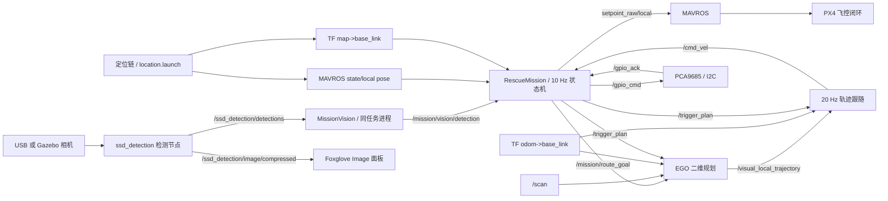

# 飞行任务、任务视觉、轨迹跟随与舵机源码分析（version1018）

分析日期：2026-10-21。输入是 version1018 当前工作树（7 个 ROS 包）；本轮只做静态阅读，未修改源码、连接硬件、启动 ROS、安装依赖或编译。本文替代 2026-10-12 基于 version1012 的旧分析：DWA/TEB、move_base、HSV 色窗、`/mission/video/compressed` 等内容已按当前源码删除或改写；旧版中的“已实现/已验证”措辞不复用。

[总技术指南](../技术文档.md) · [定位建图与视觉](定位建图与视觉.md) · [EGO规划算法](EGO规划算法.md) · [电脑编译与实时显示](电脑编译与实时可视化.md) · [Gazebo仿真与场地](Gazebo仿真与场地.md)

**路径与坐标约定：** 本文位于 `docs/源码分析/`，源码入口是项目根 `src/`，所以文件链接统一写成 `../../src/...`（例如 [navigation_2d.launch](../../src/navigation_2d/launch/navigation_2d.launch)）。下文 `M:行号`、`N:行号` 等均指当前工作树中该文件的行号；无法稳定定位到单行时，改引文件名加函数名/参数名。工作树里的 README 和源码注释保留了大量历史描述，正文只把当前 launch 参数、话题和代码路径当作现状。

这份程序的具体形式是 **ROS 1 C++ 任务状态机 + EGO 二维规划/跟随 + MAVROS 原始位置/速度设定值 + PCA9685 I2C 舵机**。任务视觉与状态机在同一进程，SSD 检测是独立进程；任务侧只消费检测消息，不再打开相机。默认入口采用 EGO、SSD 检测和真实舵机，在线定位在 `location.launch` 另行启动。它有一条自动起飞、危险品投放、人员区巡飞、可选救助物资投放、返航、自动降落的代码链，但不能据此认定整个实机系统已验收。

## 1. 阅读范围与证据索引

已逐文件阅读 `navigation_2d` 的 14 个文件和 `servo_control` 的 4 个文件：全部第一方 `.cpp`、`.h`、launch、消息、CMake/package、README、GTest 及 Python 台架工具；并核对 `ssd_detection/msg` 的 `VisionDetectionArray.msg` 与 `VisionDetection.msg`。当前 `navigation_2d` 目录中已没有 `param/`、`scripts/`、`move_base.launch`、六份 costmap/局部规划 YAML；`servo_control` 目录中已没有 `script/` 子目录。没有把 README 中那些已删除的规划后端/话题当作本文的构建证据；`gc_2026_sim` 与 `tools/` 的当前文件只在与本文路径直接相关时引用，未展开分析。

| 代号 | 文件 | 职责 |
|---|---|---|
| N | [navigation_2d.launch](../../src/navigation_2d/launch/navigation_2d.launch) | 默认启动配置、航线、EGO、检测、舵机和桥接 |
| M | [rescue_mission.cpp](../../src/navigation_2d/src/rescue_mission.cpp) | 参数、任务状态转换、控制循环、规划/舵机/检测接口 |
| MH | [mission_with_move_base.h](../../src/navigation_2d/include/mission_with_move_base.h) | 15 个状态、两类投放任务、运行数据；文件名是历史遗留 |
| F | [flight_control.cpp](../../src/navigation_2d/src/flight_control.cpp) | MAVROS 设定值及解锁/切模式服务 |
| FH | [flight_control.h](../../src/navigation_2d/include/flight_control.h) | 飞控封装 API |
| V | [mission_vision.cpp](../../src/navigation_2d/src/mission_vision.cpp) | 检测消息、候选选取、稳定判定、`TargetDetection` 发布 |
| VH | [mission_vision.h](../../src/navigation_2d/include/mission_vision.h) | 视觉模式、稳定帧状态和检测缓存 |
| E | [ego_trajectory_controller.cpp](../../src/navigation_2d/src/ego_trajectory_controller.cpp) | 将 EGO 的 Path 转为平面速度 |
| EH | [ego_path_tracking.h](../../src/navigation_2d/include/ego_path_tracking.h) | 最近投影与按弧长前视点 |
| ET | [ego_path_tracking_test.cpp](../../src/navigation_2d/test/ego_path_tracking_test.cpp) | 跟随几何的八项单元测试 |
| TD | [TargetDetection.msg](../../src/navigation_2d/msg/TargetDetection.msg) | 任务视觉输出消息 |
| VD | [VisionDetectionArray.msg](../../src/ssd_detection/msg/VisionDetectionArray.msg) | 检测节点输入消息（新增帧尺寸字段） |
| S | [servo_controller_node.cpp](../../src/servo_control/src/servo_controller_node.cpp) | Linux I2C/PCA9685、命令、软件完成通知 |
| SB | [servo_bench.launch](../../src/servo_control/launch/servo_bench.launch) | 真实舵机台架角度标定入口 |
| SD | [servo_debug.py](../../tools/servo_debug.py) | ROS 字符串命令、单角度/扫角/交互前端；已从包内移到 `tools/` |

源码注释中描述的旧仿真事故、测量数字、已修复问题，属于作者留下的说明。本次可确认代码的当前结构和逻辑，未独立复现那些历史运行结果。**README 不是现状清单**：它仍写着 `planner_backend:=dwa/teb`、`hazard_target_index/person_target_index`、`/mission/video/compressed`、仿真启动 move_base 等已删除内容（`navigation_2d/README.md:50–55,106–109,117–126,152`），这些只能当历史说明。

## 2. 构建与节点形式

`navigation_2d/CMakeLists.txt:5–24,61–87` 要求 C++11、catkin 消息生成、Eigen、OpenCV，以及 `roscpp / geometry_msgs / mavros_msgs / nav_msgs / sensor_msgs / std_msgs / actionlib_msgs / tf / ssd_detection`；已经没有 `cv_bridge`、`move_base`、DWA/TEB 相关依赖。其构建目标为：

| 目标 | 源文件 | 默认是否启动 |
|---|---|---|
| `rescue_mission_node` | `mission_vision.cpp + flight_control.cpp + rescue_mission.cpp` | 是，`N:305–479` |
| `ego_trajectory_controller_node` | `ego_trajectory_controller.cpp` | 是，`N:271–303` |
| `ego_path_tracking_test` | `test/ego_path_tracking_test.cpp` | 仅 `CATKIN_ENABLE_TESTING` 时构建，不是运行节点 |

两个节点都无条件启动，不再有 `planner_backend` 分支。`navigation_2d` 只安装两个可执行文件和 `launch/`（`CMakeLists.txt:79–87`）；`param/` 与 `scripts/` 已随 DWA/TEB/move_base/HSV 一起删除（`CMakeLists.txt:83–84`）。

`servo_control` 只构建 `servo_controller_node`，依赖 `roscpp / std_msgs` 和 Linux 的 `linux/i2c-dev.h`、`open / ioctl / write / close`。当前 C++ 节点没有 Python ServoKit、Jetson.GPIO、wiringPi 依赖。`servo_control/CMakeLists.txt:17–29` 安装可执行程序和 launch；包内已没有 `script/servo_debug.py`，台架前端位于项目根 `tools/servo_debug.py`，因此不能假设安装空间提供 `rosrun servo_control servo_debug.py`。

`navigation_2d/package.xml:14–45` 已把 `ssd_detection` 列为 build/exec 依赖，并把 `ego_planner_2d`、`servo_control` 列为 exec 依赖；当前 package.xml 中已没有 MoveIt 插件导出，也没有 `cv_bridge`/`move_base` 依赖。但 `CMakeLists.txt:21–23` 仍 `find_package(cmake_modules REQUIRED)` 并直接找 Eigen3/OpenCV，而 `package.xml` 没有声明 `cmake_modules`、OpenCV、Eigen 对应的 rosdep 键；全新容器用 `rosdep` 不能保证这些系统依赖自动齐全。`MissionVision` 仍 include OpenCV 头，但只用于矩形/点类型和 `cv::norm` 的像素距离，不做图像读取或编码。

## 3. 默认与可选入口

默认由两个 launch 组成：先 `location location.launch` 建立 MAVROS、传感器/定位，再 `navigation_2d navigation_2d.launch` 建立任务；后者不自行启动 MAVROS 或 Cartographer（`navigation_2d/README.md:3–8`）。当前参数以 `<arg default>` 为准：

| 启动选项 | 实际默认 | 当前代码行为 |
|---|---|---|
| `auto_start` | `false`（`N:79`；节点内部默认 `true`，`M:128`） | false 时不自动请求 OFFBOARD/解锁；已解锁且 OFFBOARD 会进入任务 |
| `require_vision_ready` | `true`（`N:91`） | auto_start=true 时，最近 2 s 内要有 `/mission/vision/detection` 才允许 OFFBOARD/解锁 |
| `vision_ready_timeout` | `60.0`（`N:92`） | 超过 60 s 只打印一次“拒绝起飞”并继续等待，不自动放弃 |
| `stage` | `1`（`N:52`） | 危险品投放一次、遍历人员区、返航 |
| `rescue_drop_enabled` | `false`（`N:78`） | 与 stage 在节点内协调；true 会使 stage1 按 stage2 处理 |
| `rescue_drop_x/y` | `999.0 / 999.0`（`N:60–61`） | stage2 未给有效场地坐标时拒绝开始 |
| `drop_align_mode` | `vision_with_fallback`（`N:70`） | 先视觉，再在靠近预置投放点条件下回退 |
| `enforce_safe_field` | `false`（`N:96`） | 默认不执行任务节点的矩形场地越界检查 |
| `use_real_servos` | `true`（`N:162`） | 启动真实 I2C 节点，启动即写相机前向和投放停放角 |
| `start_foxglove_bridge` | `false`（`N:95`） | 开启时起 `foxglove_bridge`，端口 8765（`N:593–596`） |
| `fix_heading_deg` | `0.0`（`N:10`） | odom 中的机头设定值，0 表示机头指 +x |
| `field_yaw_deg` | `0.0`（`N:40`） | 机头在场地系的朝向；航线按 `-field_yaw_deg` 旋进 odom，默认不旋转 |

图像与检测入口已经合并成一套，**没有 `vision_backend` 参数，也没有 `usb_cam` 节点**：

| 参数 | 实际默认 | 说明 |
|---|---|---|
| `use_usb_cam` | `false`（`N:126`） | 只用来选检测 launch：false 选 Python 检测器（订阅 Gazebo 图像），true 选 C++/detectNet（GStreamer 直采相机）；它不再启动 usb_cam 节点（`N:541–542`） |
| `input_image_topic` | 空串（`N:141`） | 仿真/台架的图像话题必须由外层 launch 显式传入；单独启动本 launch 时 Python 检测器没有图像源 |
| `camera_uri` | `v4l2:///dev/video0`（`N:131`） | 只有真机 C++ 检测器使用 |
| `camera_width/height/fps/codec` | `640 / 480 / 15 / mjpeg`（`N:135–138`） | 只有检测节点使用 |
| `vision_detection_topic` | `/ssd_detection/detections`（`N:148`） | 任务视觉订阅的检测数组 |
| `ssd_score_threshold` | `0.5`（`N:151`） | 检测节点和任务侧各滤一次 |
| `vision_image_topic` | `/ssd_detection/image/compressed`（`N:154`） | 唯一的回传画面，由检测节点发布；任务视觉不再发布视频 |
| `vision_video_width` | `640`（`N:155`） | 检测节点回传画面的宽度 |
| `vision_jpeg_quality` | `70`（`N:156`） | 检测节点回传画面的 JPEG 质量 |
| `vision_max_rate` | `0`（`N:160`） | 检测节点推理限速，0 表示不限 |

`N:142–147` 的注释明确写着“视觉前端只有 ssd 一条路（2026-10-17：HSV 色窗后端已删除）”。`use_usb_cam=false` 且 `input_image_topic` 为空时，本 launch 不会提供任何图像源；仿真包装 launch 会传入 Gazebo 相机话题，单独启动导航时必须显式设置，或改 `use_usb_cam=true` 让检测节点直采相机。`use_real_servos=false` 仅关闭实体舵机节点、把 `require_servo_ready` 置 false（`N:586–587`）；任务仍发 `CAMERA_DOWN`/`CAMERA_FRONT` 并等待 `/gpio_ack`，单独启动本 launch 不会自动生成仿真完成通知。`gc_2026_sim` 的仿真包装会自行提供 ACK，但不在本文范围内。

`auto_start=false` **不是只看数据入口**。`M:756–762` 持续发当前位置设定值；一旦发现飞控已解锁且 OFFBOARD（`M:1001–1034`）即进入 TAKEOFF。这条手动路径**不拦截视觉门**：即使视觉心跳不新鲜，也只把“解锁时视觉还没起来”写进日志，然后照常进入 TAKEOFF（`M:1012–1031`）。N 默认真实舵机开启，S 在构造期间即执行 PWM 写入（`S:94–105`）。因此仅查看地图/视频时应使用单独的传感器/桥接启动配置，不能把本导航 launch 当作监看命令。

## 4. 数据与控制链



任务节点并不直接输出推进电机 PWM，不是自己实现 PX4 的姿态/角速率控制。它决定阶段和目标，将二维规划速度与高度、固定航向合成原始设定值；飞控负责后续低层闭环。`/ssd_detection/image/compressed` 只是检测节点的回传画面，不参与任务控制。

| 接口 | 类型 | 方向/语义 | 时序/证据 |
|---|---|---|---|
| `/mavros/state` | `mavros_msgs/State` | 任务订阅 FCU connected、armed、mode | `M:307–308,547–558` |
| `/mavros/local_position/pose` | `geometry_msgs/PoseStamped` | 任务订阅 PX4 本地位置与 yaw | `M:311–313,565–593` |
| TF `map → base_link` | TF | 任务启动门槛和 SLAM 诊断；不参与控制 | `M:595–625,984–991` |
| TF `odom → base_link` | TF | EGO/跟随器的规划位姿 | `E:138–149`；`N:267–268,278–279` |
| `/mission/route_goal` | `geometry_msgs/PoseStamped` | 任务发布航点，frame=`odom`；EGO 的 `goal` 重映射到它 | `M:300,1518–1526`；`N:184`；队列 1、非 latched |
| `/move_base/cancel` | `actionlib_msgs/GoalID` | 任务仍 advertise，但 EGO 不订阅，实际是空操作 | `M:301,2231–2241` |
| `/trigger_plan` | `std_msgs/Bool` | 任务启停 EGO 规划/跟随 | `M:305,2243–2255`；`E:60–88`；latched |
| `/visual_local_trajectory` | `nav_msgs/Path` | EGO 到跟随器 | `N:274`；`E:27–28` |
| `/cmd_vel` | `geometry_msgs/Twist` | 跟随器到任务；统一按 odom 平面速度 | `E:31,199–207`；`M:314–316,628–679` |
| `/mavros/setpoint_raw/local` | `mavros_msgs/PositionTarget` | 任务到 MAVROS 位置/位置+速度+yaw | `F:16,83–139`；名义 50 Hz |
| `/mavros/cmd/arming` | `mavros_msgs/CommandBool` | 解锁/上锁服务 | `F:24–43`；任务自动流程只解锁 |
| `/mavros/set_mode` | `mavros_msgs/SetMode` | OFFBOARD/AUTO.LAND 服务 | `F:45–59` |
| `/mission/vision/mode` | `std_msgs/String` | `idle / hazard / person` | `M:303`；`V:19–20` |
| `/ssd_detection/detections` | `ssd_detection/VisionDetectionArray` | 检测节点到任务视觉缓存 | `V:21–22`；`N:148` |
| `/mission/vision/detection` | `navigation_2d/TargetDetection` | 视觉目标/像素偏差/稳定标志 | `V:17–18,318–365`；`M:318–319` |
| `/ssd_detection/image/compressed` | `sensor_msgs/CompressedImage` | 检测节点的带框回传画面 | `N:154`；任务进程不发布、不订阅 |
| `/gpio_cmd` | `std_msgs/String` | 相机/投放命令 | `M:302`；`S:115–116` |
| `/gpio_ack` | `std_msgs/String` | 软件完成通知 | `M:317,681–703`；`S:117,256–264` |
| `/servo_ready` | `std_msgs/Bool` | 初始化完成且启动等待已过 | `S:118–121,244–254`；latched，之后每秒继续发 true |
| `/servo_debug_cmd` / `/servo_debug_ack` | `std_msgs/String` | 仅 `angle_debug=true` 的台架前端 | `S:124–133,396–443` |

没有专门的 ROS 任务状态输出消息/服务，也没有任务 start/stop/pause 接口；状态主要写日志。修改运行中的私有 ROS 参数不会自动改变已经读入的字段或 route，当前参数在构造时读取。`/mission/route_goal` 只在航点派发时发布一次，不 latched；若 EGO 在派发之后才启动，该目标不会补发，只能等任务侧超时重试。

## 5. 状态机及具体行为

`M:321–322` 建立 50 Hz 控制 timer 与 10 Hz 任务 timer，`M:2494` 使用 `AsyncSpinner(3)`。`MH:31–48` 定义 15 个状态。任务在 `missionCallback` 入口先要求 `have_pose_`、`have_home_` 和 `have_map_pose_`（`M:980–991`）；因此即使控制只用 odom，没有 `map → base_link` 时任务也不会推进状态。

| 状态 | 行为 | 进入下一阶段条件 |
|---|---|---|
| `WAIT_FCU` | 捕获第一帧 local pose 为 home，发当前位姿 hold；等待 FCU、map TF 和可选 servo ready | auto=false：已 armed 且 OFFBOARD 即进入 TAKEOFF；auto=true：先过视觉门（最近 2 s 有检测）和累计 100 次设定值（约 2 s），再逐秒请求 OFFBOARD/解锁，状态确认后进入 TAKEOFF |
| `TAKEOFF` | 纯位置设定值：x/y 取捕获 home，z 从进入时的当前值按 `max_velocity` 速率抬到 `fly_height`，yaw 固定 | 达位且阶段经过 `waypoint_dwell` 0.6 s，发 CAMERA_DOWN；收到完成通知并额外 `camera_down_post_move_settle` 0.3 s 后开始 hazard route |
| `NAV_HAZARD` | EGO 驱动 hazard 逐航点，任务维持飞行高度 | x/y 距当前目标 ≤0.12 m、z 差 ≤0.40 m、该航点派发后 >0.6 s；全部完成进入 HAZARD_HOVER |
| `HAZARD_HOVER` | 固定当前 x/y，下降到 `task_height`；切 hazard 检测 | 0.8 s 相机 settle 且高度到 ±0.08 m 后：视觉稳定→一次位置修正进 ALIGN；waypoint 模式直接核对预置点；fallback 在 5 s 未稳定时按位置决定“就地对齐”或“先靠近写定航点” |
| `HAZARD_ALIGN` | 位置控制去一次计算的修正点/原悬停点 | 在 0.08 m 平面/0.08 m 高度窗口连续 0.7 s 后 DROP；进入后 5 s 未到即中止 |
| `HAZARD_DROP` | 发 DROP_FIRE，维持 task 高度，随后升 fly 高度 | 1.5 s 已过且收到任一种 DROP_DONE，或无 ACK 也在 2.5 s 后继续；升到 fly 高度 ±容差后人员区航线 |
| `NAV_PERSON` | 六点航线覆盖三张人员区卡片，不在每卡片投放 | stage1→RETURN_HOME；stage2→NAV_RESCUE |
| `RESCUE_HOVER` | 规划到本次抽签 rescue_drop_x/y，一点航线；person 视觉 | 同 hazard hover 的等待/修正/保底流程 |
| `RESCUE_ALIGN` / `RESCUE_DROP` | 同一悬停/一次修正流程，发 DROP_RESCUE | 对齐成功后投放；完成后 RETURN_HOME |
| `RETURN_HOME` | 执行固定 return_route，视觉 idle | 全部航点结束→LANDING |
| `LANDING` | hold 当前位置，发 CAMERA_FRONT；等待软件完成通知 + 0.3 s | 一次请求 AUTO.LAND 即停止 setpoint，观察 `armed=false`→COMPLETE；20 s 未上锁仅告警 |
| `COMPLETE` | 视觉 idle，不再发飞行设定值 | 无重启/下一轮转换 |
| `ABORT` | 取消规划、清速度；未请求降落前若仍 OFFBOARD 且 armed 则 hold | 若仍 OFFBOARD+armed 且距 captured home ≤0.25 m，走正常相机前向/landing；更远则 stabilise 0.5 s 后请求就地 `AUTO.LAND`，每 2 s 重试；`armed=false`→COMPLETE |

证据：`M:994–1406,1408–1656,1701–1961`。以下几点容易误读：

- 航线到达后的 `waypoint_dwell=0.6` 是**从航点派发时刻计算**，并不要求连续在容差范围 0.6 s；飞行已经 >0.6 s 时，单次检测“进入容差”就可递增航点。相比之下 ALIGN 中超出容差会重置 `alignment_started_at_`，而 `align_entered_at_` 永不重置，5 s 总超时仍然有效（`M:1907–1922,1946–1949`）。
- 导航超时有三层：每个目标 6 s 内从未收到“有速度”（>0.03 m/s）的规划指令即直接中止（`M:1201–1216`）；10 s 规划停滞会重发，最多 2 次（`M:1218–1238`）；30 s 单航点超时会重发，最多 2 次（`M:1243–1255`）。只看到规划器仍发 >0.03 m/s，并不说明车辆实在向目标前进。
- stage2 的位置校验即便 `enforce_safe_field=false` 也执行：`rescue_drop_x/y` 须有限且在构造读到的 `safe_field_*` 范围内（`M:166–181`）。N 覆盖后的范围为 x[-0.60,3.30]、y[-3.30,0.60]，比注释中的物理场地略小；stage 非法值先回退 1，但旧 `rescue_drop_enabled=true` 又会使其最终按 2 处理（`M:142–158`）。
- `abort_on_offboard_loss` 默认 true：在非 WAIT/LANDING/COMPLETE/ABORT 状态离开 OFFBOARD 会直接 `abortMission`（`M:547–558,252`）。

## 6. 航线、坐标系与飞控设定值

### 6.1 固定航线、`field_yaw_deg` 与 `fix_heading_deg`

N 的三条固定航线现在是**场地系**数字，z 均写死 1.50 m；stage2 一点航线 z 取 `fly_height`（`N:316–363`）：

| 航线 | 顺序 x/y（m） |
|---|---|
| hazard | (-0.25,-1.80) → (1.40,-1.80) → (1.40,0.00) |
| person | (1.50,-0.90) → (1.50,-2.20) → (2.70,-2.20) → (2.70,-2.65) → (2.70,-1.85) → (2.70,-1.05) |
| return | (2.70,-2.20) → (0.00,-2.20) → (0.00,0.00) |
| stage2 rescue | (rescue_drop_x,rescue_drop_y)，z=`fly_height` |

危险品三点未变；人员航线由 5 点改为 6 点，先从 y=-0.90 南下到 y=-2.20，再沿 y=-2.20 向东到 x=2.70、自南向北覆盖三张卡；返航横向走廊也从 y=-2.00 改为 y=-2.20（`N:321–358`）。这些数字在节点构造时由 `loadRoute` 读入，随后 `applyRouteFrameYaw()` 按 `field_yaw_deg` 一次性旋转（`M:266–269,456–545`），stage2 的抽签点也按同一角度旋转（`M:496–504`）；之后 `publishNextGoal` 直接以 `frame_id="odom"` 发布（`M:1518–1526`）。默认 `field_yaw_deg=0` 时旋转是恒等，所以航线数字与 odom 点逐字相同。

`field_yaw_deg` 与 `fix_heading_deg` 是两件事：

- `field_yaw_deg` 描述**起飞/开始定位时机头在场地系里的朝向**（0=场地 +x，90=+y，180=-x，-90=-y）。节点把每个场地航点按 `-field_yaw_deg` 旋进 odom（`M:431–454`），默认 0 不改变任何数字；它只处理旋转，**不补偿起点平移误差**。非 0 时启动日志会打印安全场在 odom 中的矩形（`M:515–544`），用来人工核对角度是否填对；默认 0 时 `applyRouteFrameYaw()` 直接返回、只打印恒等说明（`M:458–463`），launch 注释所说的“启动打印方框/逐航点场地→odom 对”并不发生（非 0 时也只打印每条航线的首末点对）。之所以需要这个方框，是因为 odom 的 yaw 在开机时按构造为 0，读回 yaw 不能证明参数正确。
- `fix_heading_deg` 是 **odom 中的机头设定值**，默认 0，表示机头指 odom +x；它被写进每个 `PositionTarget.yaw`，不再取“起飞瞬间实测 yaw”（`M:50,575–592,751`；`MH:195–211,392–397`）。改变它不会旋转航线，只改变飞控保持的机头。

安全场是场地系数字：x[-0.60,3.30]、y[-3.30,0.60]（`N:423–426`），节点内部缺省值更小（`M:120–123`），以 launch 覆盖值为准。`insideSafeField()` 先把 odom 位置转回场地系再比较（`M:2341–2366`）；视觉修正目标则用 `clampAlignTarget()` 在场地系把安全场再缩进 `align_body_clearance=0.35 m` 后夹紧（`M:2368–2441`）；若缩进后矩形退化，则原样返回并报错（`M:2390–2402`）。这两个矩形回答不同问题：前者是“飞机现在可以在哪”，后者是“允许命令它去哪”。

航线数字、z 和原点还有几项事实：`publishNextGoal` 在航点 z≤0.05 时回退到 `fly_height`（`M:1444–1447`）；返回 (0,0) 与捕获 home 不是同一概念，启动时 local pose 并非 (0,0) 时，起飞保持 captured home，而返回 route 仍到固定原点。`poseCallback` 未检查消息 `frame_id`，home 由第一帧位置直接捕获，未要求定位稳定或飞控未解锁（`M:565–593`）。默认 EGO 与跟随器用 TF `odom → base_link`，任务到达与 setpoint 却用 `/mavros/local_position/pose`；需要验证两个系统的原点、朝向、尺度、延迟、重置行为一致。只把 frame 名字都写成 odom 无法完成对齐。`map → base_link` 仍在任务入口被要求存在（`M:984–991`），但只用于启动门槛和诊断日志（`M:595–625,772–809,1069–1092`）。

### 6.2 速度和固定机头朝向

`/cmd_vel` 只有 **odom** 一种约定：跟随器在 odom/plan 帧下发，任务原样转发；任务侧不再按当前 yaw 旋转（`M:628–679`，尤其 `642–656` 的注释和 `674–678` 的日志）。跟随器侧的 `output_frame` 与任务侧的 `cmd_vel_frame` 已一起删除（`E:47–56`；`N:297–302`；`M:255–264`），所以整条链不再做 body→world 转换；跟随器输出的就是 odom 速度。任务收到速度后只做平面模长限幅 0.35 m/s，忽略输入 z 速度及 `angular.z`（`M:658–669`）。

任务向 PX4 始终要求 `mission_heading_ = fix_heading_deg`，默认 0 rad，即 odom +x，不是“保持当时真实起飞朝向”（`M:575–592`）。注意**视觉修正**仍按 `current_yaw_` 把机体系修正旋到世界系（`M:1842–1872`）：相机固定在机体上，这个旋转是图像轴到世界轴的换算，不是 `/cmd_vel` 的 body→world 转换；两者不要混为一谈。

### 6.3 真正输出的是位置设定值或位置+速度联合目标

任务当前调用两条 `FlightControl` 路径：

| 阶段 | 调用 | `type_mask` | 语义 |
|---|---|---|---|
| TAKEOFF | `setpoint_raw_local_pos`（`F:83–100`） | 3064（忽略三轴速度、三轴加速度、FORCE、yaw_rate） | 纯位置；速度字段不参与 |
| 其余飞行阶段 | `setpoint_raw_local_pos_vel`（`F:120–139`） | 3008（忽略三轴加速度、FORCE、yaw_rate） | 位置和速度同时有效 |

两条路径都使用 `coordinate_frame = FRAME_LOCAL_NED`（1）、`yaw = mission_heading_`，并在消息里填 `ros::Time::now()`。`setpoint_raw_local_pos_vel` 的 `position`/`velocity` 在任务侧的含义是：

- 导航移动时 x/y 取当前 PX4 估计位置，z 取 `fly_height`，速度取规划器速度；规划零速或过期后捕获当时位置并用位置+零速 hold（`M:826–860`）。
- 非导航的悬停/ALIGN/DROP 状态按每轴 `clamp(gain × error, ±0.35)` 计算速度，再设 `position = current + velocity × 0.2`（`M:942–955,2443–2447`）。因此非导航平面总速度可能达到 √2×0.35≈0.495 m/s，未像导航速度那样作平面模长限幅。
- TAKEOFF 的 x/y 是捕获 home，z 从 `min(当前 z, fly_height)` 起按 `max_velocity`（默认 0.35 m/s）斜坡上升；它不经过位置+速度组合控制（`M:904–941,1615–1620`）。

使用 MAVROS ROS 接口时，`FRAME_LOCAL_NED` 是发送到 MAVLink 的帧枚举，并不要求上层把 ROS 数据手动预先变成 NED。作为接口参考，官方 MAVROS 1.5.2 `setpoint_raw` 的 `local_cb` 对非 body 坐标的位置/速度执行 ENU→NED 转换；ROS 侧 z 正向上，手动再次翻转会造成两次转换。这里不是对本机 MAVROS 版本的认定，最终需与保存的版本/插件配置核对。[MAVROS官方源代码](https://raw.githubusercontent.com/mavlink/mavros/1.5.2/mavros/src/plugins/setpoint_raw.cpp)

PX4 官方说明 MAVLink OFFBOARD 要持续提供生命信号与 setpoint，丢流由配置的 Offboard-loss 策略处理；这里名义 50 Hz 及 100 次预发送符合持续流的设计意图，但节点调度、服务调用、CPU 争用后的真实频率尚未测量。[PX4官方OFFBOARD说明](https://docs.px4.io/main/en/flight_modes/offboard)

F 还提供纯速度、位置+速度+加速度、yawrate 等封装，当前任务不使用。部分备用函数未填 `header.stamp`；`setpoint_position_local` 也未填有效姿态/时间。`set_arm`/`set_mode` 现在会检查服务响应并打印失败原因，但函数返回 void，调用方拿不到结果；并且 `serviceClient.call()` 未设置超时（`F:24–59`）。构造参数 `mavros_ns` 只影响服务名，publish 仍硬编码 `/mavros/...`，当前空命名空间可用，但多机命名空间扩展需改完整路径。

## 7. EGO 轨迹跟随（DWA/TEB 已删除）

**旧版的第 7 节“DWA/TEB 备选”已失效。** 1018 删除了 `move_base.launch`、六份 costmap/局部规划 YAML、`planner_backend` 开关和相关包依赖（`N:163–167`；`CMakeLists.txt:83–84`），当前规划后端只有 EGO 一条路。`mission_with_move_base.h` 仍保留历史文件名，但内容已改为 EGO 任务状态机；`rescue_mission.cpp` 仍 advertise `/move_base/cancel`，但 EGO 不订阅它，`cancelPlannerGoal()` 实际只清本地时间戳（`M:301,2231–2241`）。**文件名和话题名不代表在用机制**，判断规划后端要看 CMake target 与 launch 实际启动的节点。

跟随器以 20 Hz 读取 EGO `nav_msgs/Path`，TF 查询 `odom → base_link`。它不是跟随 B 样条时间导数的控制器，而是**路径几何前视跟随**（`E:90–235`；`EH:28–136`）。跟随器的 `global_frame` 代码缺省是 `map`（`E:29`），launch 覆盖为 `odom`（`N:278`）；以 launch 为准。跟随步骤：

1. 找车辆在各路径线段上的最近投影。
2. 沿折线路径弧长向前 `lookahead_distance` 取追踪点，末端不足则钳到末端。launch 取 0.45 m（`N:292`），代码缺省 0.40 m（`E:35`）。
3. 速度指向该点；距**局部 Path 末端**不足 `goal_slowdown_distance=0.60 m` 时按直线距离比例降速；0.10 m 以内输出零（`E:192–198`；`EH:46–54`）。
4. 平面速度上限 0.35 m/s，按固定 `dt=1/20 s` 将每周期速度矢量增量限为 `max_acceleration×dt=0.50×0.05=0.025 m/s`（`E:208–218`）。
5. 在 odom 直接发布速度、z 与 `angular.z` 为 0（`E:199–207`）。

`remaining_distance` 是车辆到局部 Path 末端的**直线距离**，不是剩余航线弧长，也不一定是任务最终目标。EGO 窗口末端距最终目标还远而没有有效续规划时，跟随器会停止，任务再等待/重试。路径前视连线可能跨越折线拐角；现有 GTest（`ET:26–127`，八项）只核对前视点处于弧长路径、跨航迹距离和拒绝非有限输入，没有检查“载具到前视点的直线”是否穿过膨胀障碍，不能认为测试证明实机完全不切角。

已实现的防护：规划被 `/trigger_plan` 关闭、空 Path、接收 Path 超过 `command_timeout=0.60 s`、frame 不匹配、TF 查不到或非有限坐标，跟随器立即发零速；这些出口还清 `previous_command_`（`E:104–189`）。实际加速度按固定周期算，真实回调延迟/抖动未进入 dt。

**定位新鲜度和规划有效性覆盖不足：** TF 查 `Time(0)` 成功就使用，未检查 `transform.stamp` 年龄；Path 超时基于收到时间，未检查 Path header 年龄或生成序号（`E:122–149`）。当规划器把一条旧路径重新发送，这个超时被刷新。1018 的 EGO 已加强旧轨迹处理：起点在膨胀区会清空计划，重规划失败时若旧轨迹也被判碰撞则清空，只保留仍被判安全的旧轨迹（`src/ego_planner_2d/src/ego_planner_2d_node.cpp:511–549,688–742`）。但“仍判安全”的旧轨迹会被 `publishAll()` 每周期以 `header.stamp = now` 重发（`ego_planner_2d_node.cpp:885–889`），跟随器只按收到时间刷新，任务只按新 `/cmd_vel` 刷新（`M:2257–2261`），所以旧计划仍可能被当成新计划执行；这条链不能仅靠跟随器的超时发现。

跟随器同时订阅 `/trigger_plan`（`E:60–88`），默认 true；任务在构造时 latched 发布 false（`M:305,374`），只在 NAV_* 状态置 true（`M:1590–1611,1408–1419`）。因此“落地后仍在规划”的旧现象已从任务侧加了开关，但 EGO 自身的 `should_plan_` 和发布逻辑仍需单独核对。

## 8. 任务视觉（检测消息驱动）

MissionVision 与 RescueMission 同进程，是一个普通 C++ 对象，不是另一个 ROS 执行目标。它先构造，任务随后建立订阅（`M:43`；`V:6–32`）。与 1012 最大的区别是：**V 不再打开相机、不订阅图像、不做 HSV 候选检测、不做 JPEG 编码**，只消费 `ssd_detection/VisionDetectionArray`（`VH:13–21`；`V:27–31`）。因此“任务侧图像处理”已经不存在，OpenCV 只用于矩形/点类型和 `cv::norm` 的像素距离。

### 8.1 检测消息、候选与稳定判定

`VisionDetectionArray` 含 `image_width`、`image_height` 和 `VisionDetection[] detections`；每个检测框是归一化 `xmin/ymin/xmax/ymax`、`confidence`、`class_name`、`zone`（`VD:11–20`；`VisionDetection.msg:13–19`）。C++ 与 Python 发布方都填帧尺寸（`src/ssd_detection/src/ssd_detection_node.cpp:389–390,517–518`；`src/ssd_detection/scripts/ssd_detection_node.py:640–641`）。**新增字段改变 ROS1 消息 MD5，1012 与 1018 的发布/订阅二进制不能混用**；任务侧只在同一新消息结构内把 0 当作“发布方没给”，回退到 `camera_width_/camera_height_`（默认 640×480，`V:257–270`），不能兼容旧消息类型。

处理流程（`V:185–290`）：

- `detectionCallback` 先按 `ssd_score_threshold` 过滤，再把归一化坐标夹到 [0,1]，按 `zone=="person"` 分入 person，其余全部算 hazard（`V:192–208`）。没有“只接受 hazard”的显式类别检查；接入新检测器/新类别时要注意这个契约。
- 检测缓存用独立的 `detection_mutex_`，锁只包住一次 swap，不跨越 `processDetections`（`V:210–229`）。这是 2026-10-18 自死锁的修复点；锁的粒度不能改回函数级。
- `processDetections` 一帧只读一次 `mode_` 快照，模式切换时在检测线程清稳定计数（`V:240–255`）；模式本身是 `std::atomic<Mode>`，`setMode()`/`mode()` 不拿锁（`VH:99–116`；`V:34–54`）。
- 每个检测框按消息里的 `image_width/height` 换算成像素矩形；宽高 <1 的丢弃；**贴边的框也丢弃**，因为被裁掉后框中心偏向画面中心，会算出方向对但幅度偏小的修正（`V:129–149`）。丢弃数量用 WARN_THROTTLE 报出（`V:159–166`）。
- 候选不再按 `hazard_target_index/person_target_index` 取第几个；`selectCandidate` 取**离画面中心最近**的候选（`V:292–316`）。检测数组按置信度降序排列（消息注释），所以“最近”是几何选择，不是检测顺序。
- 稳定判定只看相邻处理帧的中心移动 ≤`stable_pixel_tolerance` 12 px，连续 `stable_frames_required` 5 帧；不考察框尺寸、类别一致性、物理世界位置或推理帧序号（`V:343–354`）。`TargetDetection.confidence` 现在是模型分数（`V:153–155`），不再是 HSV 时代的轮廓面积/矩形面积。
- 模式为 IDLE 时仍每帧发布一条 `found=false` 的 `TargetDetection`（`V:272–284`）；这条心跳是起飞前 `require_vision_ready` 门的存活证据，不能因为“IDLE 不检测”而停发。
- 检测节点每帧发一条数组（空数组也算心跳，`N:84–87`），任务侧 `detectionCallback` 在 HOVER/ALIGN 状态统计 `task_frames_seen_/matched_/task_frame_at_`，供 `visionWaitReport()` 区分“没消息”“模式不对”“检测器报 found=false”（`M:705–735,2047–2072`）。

`TargetDetection.msg` 包括 `mode、found、stable、center_x/y、width/height、pixel_dx/dy、confidence、image_width/height`（`TD:1–13`）。`pixel_dx = 框中心x − 图像中心x`，`pixel_dy` 同理（`V:330–341`）。任务只在对应 hover/align 状态接受 expected mode 且 found/stable 结果（`M:714–734`）。

### 8.2 像素到机体修正

处理稳定框后只计算一次位置目标（`M:1842–1896`）：

```text
body_dx = sign_x × pixel_dx × max(0.2, current_z) / max(1, fx)
body_dy = sign_y × pixel_dy × max(0.2, current_z) / max(1, fy)
body_dx/body_dy 各轴夹到 ±0.15 m
world = current_xy + R(current_yaw) × (body_dx, body_dy)
target = clampAlignTarget(world)
```

`fx/fy` 默认 874，`pixel_to_body_x_sign/y_sign` 默认 +1（`N:448–451`；`M:74–77`）。随后 ALIGN 只检查能否抵达这个位置，不持续视觉闭环检查卡片是否居中，也不要求 drop 前检测仍新鲜（`M:1899–1960`）。ALIGN 的 5 s 总超时从进入状态起算，超出容差只重置驻留计时，不重置总超时（`M:1907–1922,1946–1949`）。

视觉保底不是“无条件原地盲投”：5 s 无稳定检测后，若已在写定航点 0.20 m 内，以当前位置进入 ALIGN；否则把目标设为写定航点、继续靠过去，直到进入 0.20 m 或 `task_timeout` 12 s 中止（`M:1783–1838`）。这条分支只在 `vision_with_fallback` 模式执行；`waypoint` 模式不依赖检测结果，`vision` 模式没有 5 s 保底、等到 `task_timeout` 12 s 才中止（`M:1727–1840`）。

这里用 `current_z` 当相机离地高度，没有减地面高度/相机安装偏移；没有 roll/pitch 补偿、镜头畸变或相机光轴/机体之间完整旋转矩阵，CameraInfo 也不参与。只用两个符号无法表达相机实际安装存在的 x/y 交换、90° 旋转或偏置。它依赖下视角标定到位、近似平坦地面、相机轴映射正确、内参匹配分辨率，需要台架地面标定证明。源码不能确认当前两个 +1 和 874 就适用于真实机体。

### 8.3 实时画面已移出任务进程

任务进程不再发布 `/mission/video/compressed`，也不再对图像做缩放/JPEG 编码。唯一的回传画面由检测节点发布到 `/ssd_detection/image/compressed`（`N:154–156`）；本任务视觉只发布 `/mission/vision/detection`。Foxglove 的 Image 面板应选 `/ssd_detection/image/compressed`，不要再用旧 `/mission/video/compressed`。README 第 117–126 行仍写旧话题、15 fps、JPEG 55 和“mission frame is resized”，这是历史文本，不是当前代码。

这一变化也意味着：画面上的红/蓝框由检测节点绘制，任务侧看不到原图；当任务报“no stable detection”时，框仍可能存在，因为框和任务判定是两条独立的输出。排查时必须同时看 `/ssd_detection/detections`、`/mission/vision/detection` 和检测节点日志，不能只看回传画面。

## 9. 真实舵机控制

与 version1012 相比，`servo_controller_node.cpp`、`servo_bench.launch`、`CMakeLists.txt`、`package.xml` 四个文件字节相同（SHA256 核对）；唯一变化是 `servo_debug.py` 从包内移到项目根 `tools/`。因此下面描述的是当前 C++ 节点的实际行为，不是“新版舵机算法”。

### 9.1 启动、脉宽与硬件接口

S:23–45 读参数，S:47–57 检查 I2C 地址 0x03–0x77、通道 0–15 且不同、PWM 频率 40–1000 Hz、正脉宽范围；失败即 shutdown。S:59–92 还对三个投放角做范围/间距警告：角度超出 0–180、`fire_drop_angle` 与 `rescue_drop_angle` 相差 <5°、停放角与某个投放角相差 <5° 都会 WARN，但不会拒绝启动。S:94–105 **启动立即**开 `/dev/i2c-1`、选从地址 0x40，写 PCA9685 PWM 配置，移动 camera 通道 0 到 170°、drop 通道 1 到 30°。没有等待/gating 任务授权才写硬件。

PWM 基准假定 PCA9685 振荡器 25 MHz，`prescale = round(25MHz/(4096×freq) − 1)`；进入 sleep、写 totem-pole/prescale、wake auto-increment、500 μs 后 restart（`S:185–199`）。角度在换算前先夹 0–180°，脉宽用参数化的 `pulse_us = min_pulse_us + (max_pulse_us − min_pulse_us) × angle/180`，tick=`round(pulse_us × freq × 4096 / 1e6)`，向通道 LED 寄存器写 ON=0、OFF=tick（`S:210–242`）。launch 取 `min_pulse_us=750`、`max_pulse_us=2250`、`pwm_frequency=50`（`N:567–569`），所以下表数值与旧版一致；但公式已不是硬编码 750/1500，改脉宽范围会改变同一角度的实际脉宽。它没有物理角度传感器读回或机构行程测量。

| 默认动作 | 通道 | 角度 | 对应脉宽（μs） | tick（理论 50 Hz） |
|---|---:|---:|---:|---:|
| 相机前向 | 0 | 170° | 2166.7 | 444 |
| 相机下向 | 0 | 55° | 1208.3 | 247 |
| 投放停放 | 1 | 30° | 1000 | 205 |
| 火灾/危险品投放 | 1 | 90° | 1500 | 307 |
| 救助物资投放 | 1 | 140° | 1916.7 | 393 |

这些是程序算出的命令脉宽，不是实测真实角度或已标定开锁角。源码 README 明确称占位参数需要真实机构标定。PWM 分辨率约 4.88 μs，振荡器误差/供电/舵机型号可使物理角度不同。

### 9.2 命令与通知

| `/gpio_cmd` | 兼容旧别名 | 动作 | `/gpio_ack` |
|---|---|---|---|
| `CAMERA_FRONT` | `Front` | 写 `front_angle`，等待运动估时 | `CAMERA_FRONT_DONE` |
| `CAMERA_DOWN` | `Down` | 写 `down_angle`，等待运动估时 | `CAMERA_DOWN_DONE` |
| `DROP_FIRE` | `Drop` | 写 `fire_drop_angle`，保持 `drop_action_seconds` | `DROP_FIRE_DONE` |
| `DROP_RESCUE` | 无 | 写 `rescue_drop_angle`，同上 | `DROP_RESCUE_DONE` |

相机等待时长：相同角度直接等 `servo_motion_seconds`（默认 0.8 s）；不同角度取 `max(servo_motion_seconds, max(0.1, 角差×0.006))`（`S:445–470`）。170→55 为 115°，估时 0.69 s，最终取 0.8 s。投放默认等待 `drop_action_seconds=1.0 s` 后 ACK，`restore_after_drop=false` 保持最后开锁角，不回 30°；避免从 90/140 反向经过另一仓开锁位置是作者意图，但实际机构方向/途中是否经过另一锁仍须验证（`S:480–509`）。证据 `N:570–584`。

ACK 含义仅为“Linux write 返回指定字节数且软件 timer 结束”。它不表示舵机真实到位、已释放物资或机构无阻滞。初始 ready 也是启动 timer 结束，之后每秒发 true；运行中写失败没有将 `initialized_/ready` 变 false（`S:244–254`）。S 析构只 close I2C fd，不关闭 PCA9685 输出、不回安全角；节点退出后 PCA9685 仍可能持续产生最后 PWM（`S:141–144`）。

相机与投放共用一个 `action_timer_` 和 `pending_ack_`，新命令会 stop 上次动作 timer；正常任务按序执行可以规避，但两个 ROS 发布者或标定/飞行节点混用时不能并发确认两通道动作（`S:452,490`）。节点也没有“一种投放只能一次”的状态锁、请求 ID 或完成结果失败码；任务侧 `gpioAckCallback` 对 `DROP_FIRE_DONE` 和 `DROP_RESCUE_DONE` 都置同一个 `drop_acknowledged_`（`M:699–702`）。

### 9.3 台架工具边界

SB 启用 `angle_debug=true`（`SB:82`），其余默认硬件参数与飞行配置相同（`SB:32–57`），接受 `SET_DROP`、`SET_CAMERA`、`PARK`、`STATUS`；debug ACK 在 write 后立即返回，没有对应运动 settle 等待（`S:396–443`）。`navigation_2d.launch` 没有声明 `angle_debug` 参数，所以命令行传 `angle_debug:=true` 会被 roslaunch 静默丢弃；台架标定只能用 SB，且不能与飞行 launch 同时跑（`SB:2–29`；`tools/servo_debug.py:30–34`）。

`tools/servo_debug.py` 已从 `servo_control/script/` 移到项目根 `tools/`，与 1012 包内文件字节相同（SHA256 相同，属于搬家）。用法是 `python3 tools/servo_debug.py ...`（`tools/servo_debug.py:64–80`），支持单角度、扫角、交互、只打印命令；扫角会真实开仓；默认交互退出会 PARK，而 PARK 的回程也可能穿过开锁角，所以只能在空载或机构隔离后标定。脚本一次发一条再等下一个 String，依然无请求 ID；`running_node_names()` 从 `rosgraph` 导入 `rosnode`（`tools/servo_debug.py:242–250`），而 ROS 中 rosnode 通常是独立包，该诊断辅助路径可能返回 None；不影响基本消息联接，但会降低错误分层质量。脚本提示 `source /opt/ros/noetic/setup.bash`（`tools/servo_debug.py:436–440`），与原 Nano Melodic 环境不一致；现有脚本不能代替 I2C 接线/供电检查。`0..180` 的软件夹角不是任意舵机和机构的机械安全行程。

## 10. 静态分析发现的缺陷与影响

优先级定义：P1 应在受控任务验证前修正/证伪；P2 影响可靠性或参数可用性；P3 属于工程说明/工具问题。以下是源码中的可追溯逻辑缺陷或缺少的契约，**未声称已经在真实无人机发生事故**。

| 编号 | 优先级 | 触发条件与实际后果 | 精确证据 | 建议验收 |
|---|---|---|---|---|
| FM-01 | P1 | 相机 ACK 一直没有；每 1.5 s 重发把首次开始时间也重置，5 s 超时永远达不到。下视等待和降落前向等待均可能无限悬停 | `M:1110–1121,1309–1331,2012–2031` | 将 first-request 时间与 last-send 时间分开；注入无 ACK，5 s 后应走确定失败分支且不无限重试 |
| FM-02 | P1 | AUTO.LAND 服务失败/未发送/飞控仍 OFFBOARD，任务仍置 `landing_requested_=true`，下一控制回调停止 setpoint；LANDING 不重试；ABORT 每 2 s 重发但同样不检查响应；`serviceClient.call()` 无超时 | `M:1338–1344,1393–1401,872–875`；`F:45–59` | 服务结果回传调用方；状态确认 AUTO.LAND 后才撤 setpoint；模拟失败应保持/重试并有期限 |
| FM-03 | P1 | DROP 无 ACK 或 I2C 写失败仍在 2.5 s 后继续任务；任一种 `DROP_*_DONE` 都可当当前投放成功 | `M:699–702,1263–1266,1289–1292,1963–1977` | 完成事件按任务/请求 ID 匹配；区分 success/failed/timeout，验证掉 ACK/I2C 失败不得默认为成功 |
| FM-04 | P2 | 使用 `last_detection_` 前不检查消息年龄；检测链在最后一条 `stable=true` 后停住时，任务仍可用该帧做一次修正；ALIGN 不复查目标是否仍存在 | `M:1758–1840,1842–1846,2047–2072`；`V:318–365` | 保存检测/帧时间戳并检查最大年龄；停检测时 stable 应撤销，修正前要求新鲜帧 |
| FM-05 | P1 | MAVROS local pose/state 或 TF 停更；`have_pose_/have_map_pose_` 一直 true，`Time(0)` 旧 TF 可继续成功；任务用旧位置/模式持续发布新设定值 | `M:565–626,737–961,984–991`；`E:138–149` | 给 pose/state/TF 分别 watchdog、有限数与有效估计检查；停输入测试不得沿旧位置移动 |
| FM-06 | P1 | EGO 新规划失败但旧轨迹仍被判安全时保留，并按 `now` 重发；跟随器仅按收到时间刷新，任务仅按新 `/cmd_vel` 刷新，当前防护链不能辨别旧计划 | `ego_planner_2d_node.cpp:688–742,885–889`；`E:122–149`；`M:2257–2261` | 规划失败清有效路径、原生成 stamp/版本/有效期限，跟随器/任务明确停；新障碍+规划失败测试 |
| FM-07 | P1 | 任务用 `AsyncSpinner(3)`，Timer/Subscriber 共享 `state_`、`current_position_`、`target_position_`、`fcu_state_`、`last_detection_`、`task_detection_received_` 等无共同锁，C++ 读写数据竞争；仅 map_pose、视觉原子量和检测 swap 做了局部保护 | `M:284,322–324,733–735,2494`；`VH:99–128` | 采用单线程任务队列或状态快照/一致锁；线程检查及并发事件测试证明状态/目标一致 |
| FM-08 | P1 | hazard route 为空/缺失时仍起飞并直接进入 hover；`task_reference_` 退化为默认 `rescue_drop_point_(0,0)`，fallback 在 home 附近可投放 | `M:1428–1432,1684–1686,1783–1807` | 起飞前强制 route 非空/点合法/reference valid；空 route 要拒绝开始，不得把 zero Point 当投放目标 |
| FM-09 | P1 | 绝对场地 route/TF odom 与 MAVROS local 原点/姿态未核对；`field_yaw_deg` 只旋转不平移；返航固定 (0,0) 却起飞 home 来自第一帧；数字对不上就飞错点 | `N:316–363`；`M:431–454,565–593,1518–1526` | 无动力台架记录两位置/TF，在场地已知点核原点、轴、比例、重置；建立显式场地变换 |
| FM-10 | P2 | 多张人员/危险品卡同帧时，按距画面中心最近选目标；该选择未与抽签点/任务区 ID 关联，可能把飞机修正到另一张卡 | `V:292–316`；`M:1842–1896` | 多卡片图像+不同抽签点，检测目标必须与抽签对象关联，不以“最近”代替 ID |
| FM-11 | P2 | HOVER 等待下降到 `task_height` 无总超时；TAKEOFF 只有 2 s 后的告警、无总超时；ALIGN 已有 5 s 总超时 | `M:1713–1719,1066–1154,1907–1922` | 高度/位置不能到达时，在阶段总期限内 abort；覆盖悬停、起飞各阶段 |
| FM-12 | P2 | `fly_height` 参数改 2.0 等，但 route z 仍固定 1.50；导航控制保持 `fly_height`，arrival 仍核 route z≤0.40，造成永不达位 | `N:2,316–363`；`M:834,1170,2153–2156` | route 高度统一由 `fly_height` 推导或明确只比 xy；测试非默认高度任务 |
| FM-13 | P2 | 图像左右/上下到 body 只用两个符号，`current_z` 作离地高度且无 roll/pitch/外参；安装不一致会朝错方向修正 | `M:1842–1850`；`N:448–451` | 台架已知偏移/相机朝向/高度和轻微倾斜验证；标定完整外参及地面高度 |
| FM-14 | P2 | 视觉只修正一次，ALIGN 不确认新图像居中或检测仍存在，失准/延迟检测也可到旧目标后投放 | `M:1842–1896,1899–1960` | 持续闭环或 drop 前再次核新鲜稳定居中目标，受控目标运动/丢失验证 |
| FM-15 | P2 | 死参数/旧名：`use_position_hint` 读取后未使用，`task_pixel_to_meter_scale_` 未使用；`/move_base/cancel` 无订阅者；头文件名仍为 `mission_with_move_base.h` | `M:251,301`；`MH:158–161,439` | 删除或接线死参数；改名并同步注释/文档；避免把历史参数当可用开关 |
| FM-16 | P2 | 未对全部 route 数值、range、stage 参数/速度增益/高度作强校验；route 点缺 x/y 会静默补 0；高频 PWM 接受到 1000 Hz 但 2250 μs 超过周期，tick 可超 4095 | `M:421–425`；`S:47–52,210–220` | 配置拒绝非有限数/缺 x/y/不合法脉宽周期；配置错误必须拒绝启动 |
| FM-17 | P2 | ready 只表示启动曾成功，运行 I2C 失败不撤 true；ACK 不是角度/开仓传感反馈，且相机/drop 共用 timer 易互相取消 | `S:244–254,445–509` | ready 改健康状态，物理限位/反馈或明确软件估时；乱序/并发命令应拒绝或排队 |
| FM-18 | P2 | 非导航每轴 0.35 限幅导致平面可 0.495 m/s；视觉修正目标有场地夹紧，但 waypoint fallback/起飞目标不经过该夹紧，且没有规划避障检查 | `M:944–947,2368–2447` | 所有阶段统一平面限幅和任务修正范围/可行性；斜向大误差速度应≤约定上限 |
| FM-19 | P2 | `enforce_safe_field=false` 默认，无机体包络校验；只在导航分支检查越界，起飞/悬停/ALIGN/投放/landing 不受该门槛；视觉对齐夹紧只覆盖视觉目标 | `N:96`；`M:810–824,2368–2441` | 场地检查按完整飞行阶段与机体尺寸实施；不要把中心点矩形当飞控 geofence |
| FM-20 | P3 | README/源码注释和实际默认、话题、规划器名称不一致：`planner_backend`、`target_index`、`/mission/video/compressed`、move_base 仍写在 README；launch 注释承诺的“启动打印安全场方框/逐航点对”在默认 `field_yaw_deg=0` 时不发生；`package.xml` 缺 `cmake_modules`/OpenCV/Eigen 声明 | `navigation_2d/README.md:50–55,106–109,117–126,152`；`N:27–34`；`M:458–463`；`package.xml:14–45`；`CMakeLists.txt:21–23` | 后续在独立代码分支整理文档及 package 声明，并用全新环境验证 |
| FM-21 | P2 | 任务仍以 `map → base_link` 存在作为所有状态的启动门槛，尽管控制链只用 odom；没有 SLAM 的台架/仅 MAVROS 环境无法进入任务 | `M:984–991` | 把 map TF 降为诊断或按模式可关；无 SLAM 台架应能验证 odom 任务链 |

FM-01 算例：初发 t=0，t=1.5 重发使 started=1.5，t=3 又重置为 3……超时检查差值一直≤1.5 而不是>5。除回调被阻塞长于 5 s 等额外故障，正常重试流程无法达到源码宣称的 5 s 失败路径。

FM-12 算例：默认 route z=1.50，若把 `fly_height` 改为 2.00，控制高度为 2.00，而 `atRoutePosition` 拿 2.00 与 route 的 1.50 比较，差 0.50 > `route_altitude_tolerance` 0.40；该航点永不满足到达条件，30 s 后进入重试/中止。这是静态算术，不是运行结果。

## 11. 参数修改与后续验收建议

当前报告不建议直接飞行验证这些逻辑。先保留基线，在独立分支修正并建立分层验证；本日没有执行下列操作。

1. **离线消息/状态验证：** 用假的 MAVROS 状态/pose、TF、舵机消息和 `VisionDetectionArray` 验证两轮任务、三种 drop 模式、stage2 缺坐标、空/非法 route、mode 丢失、pose/TF 停更、检测停更、相机无 ACK、投放失败、降落模式失败、视觉就绪门（从无消息到 2 s 内有消息、再到 60 s 超时）。要求每个等待有明确最大期限，无法确认成功时不默认为成功。
2. **几何与坐标验证：** 无推进动力情况下，在已知场地原点/轴方向采样 TF odom/base_link 和 MAVROS local pose；比较平移、yaw、尺度、更新时间、重启前后原点。分别用 `field_yaw_deg=0/90/-90/180` 启动：非 0 时核对日志中的安全场矩形与地图一致，0 时按已知场地角点单独核对；确认 `fix_heading_deg` 只改机头、不改航线。将 return_route 与 captured home 含义统一，并覆盖非默认 `fly_height`。
3. **视觉台架：** 直接注入带 `image_width/height` 的检测消息，覆盖多卡片、贴边框、`image_width=0` 回退、`zone` 混报、模式错误和消息 MD5 不匹配；在已知偏移、倾斜、光照下验证最近中心选择与修正方向。记录目标像素/地面实际偏移、预测与实测误差、失败退出。不要再按 HSV/相机直采方式测试本任务节点。
4. **独立舵机台架：** 螺旋桨/推进动力隔离、物资机构空载；只启动 `servo_bench.launch`，用 `tools/servo_debug.py` 确认 I2C 从地址与电气连接，测量安全/前/下/两释放角，测试整个移动路径会否误开另一仓；记录电压电流、负载、PWM 和真实测角。不将旧 Python 空载测试自动作为当前 C++ 控制节点验收。
5. **可选仿真：** 当前执行链不依赖 `gc_2026_sim`。若后续选择仿真验证，可另建/取得受控配置；先状态流模型，再 PX4 SITL 动力学，避免使用 ground-truth 定位通过后就宣称真实 SLAM/PX4 定位正确。README 中“仿真启动 move_base”是旧描述，不能作为当前仿真配置。
6. **受控实机：** 以上阶段通过后再按批准的台架/飞行配置进行。记录 setpoint 实际 hz/最长间隔、任务/规划/视觉延迟、模式/解锁拒绝原因、PX4 参数、位置误差、日志、CPU/GPU 温度内存、负载舵机动作。只有这些结果才能把“静态代码支持”升级为“该硬件已验收”。

最低验收资料应包括：实际 PX4 型号与固件/参数，MAVROS 版本及插件配置，I2C/相机/雷达设备映射，场地坐标标定与 `field_yaw_deg`/`fix_heading_deg` 记录，机体包络，舵机/物资机构角度表，视觉内外参，检测消息版本/MD5，网络画面流量与延迟，以及每类故障的预期/实际响应。默认 launch、台架 launch 和未来仿真 launch 应分别保存，不能用一个“编译成功”结论代替各层验收。

## 12. 静态与实测边界

本报告确认了默认入口、参数值、ROS 接口、航线数字、状态和控制公式、检测消息处理、投放形式与可定位的逻辑缺陷。没有验证新编译产物，没有改变任何模型/源码字节，没有证明飞控固件、定位融合、相机朝向、实际舵机角、飞行性能或通信带宽。

作者 README 和代码中有关仿真的过去运行描述不构成本日实测；学长起飞指南的硬件/遥控操作应在总技术指南中保留并与上述任务入口分清阶段。已有飞行启动步骤并不会替当前程序补齐定位新鲜度、超时、检测年龄和 ACK 契约。后续修复应在独立代码分支进行并保留本导出基线，不直接改写原件。
