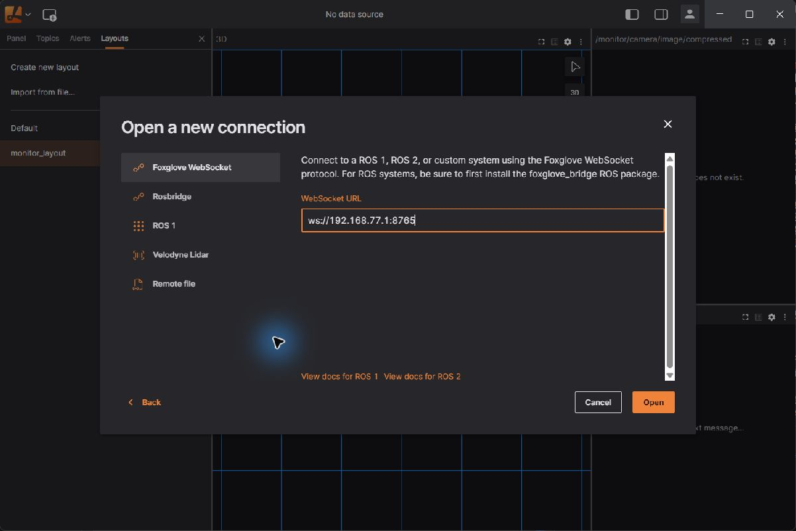
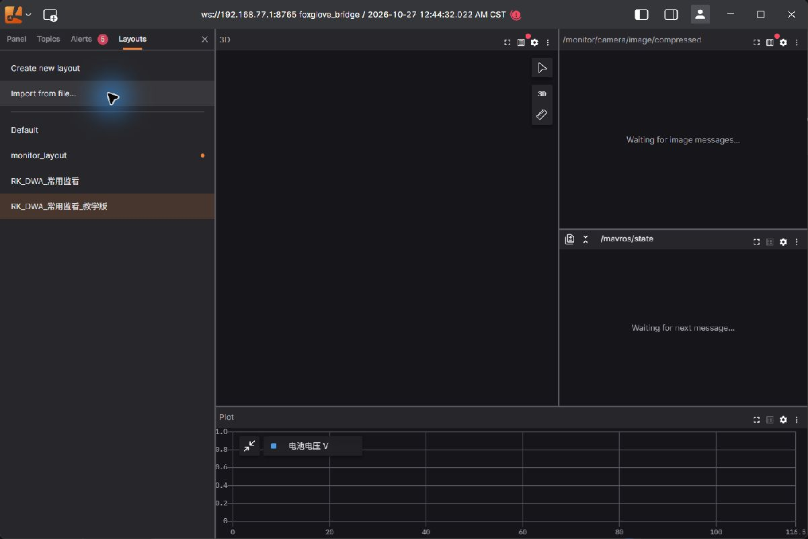
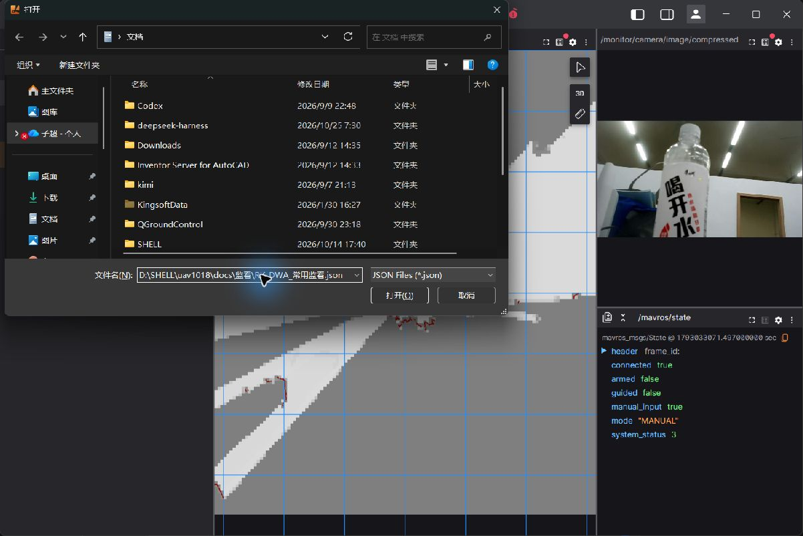
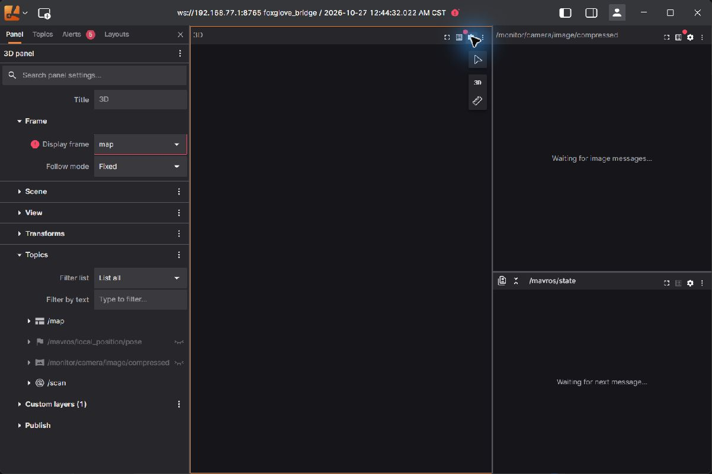
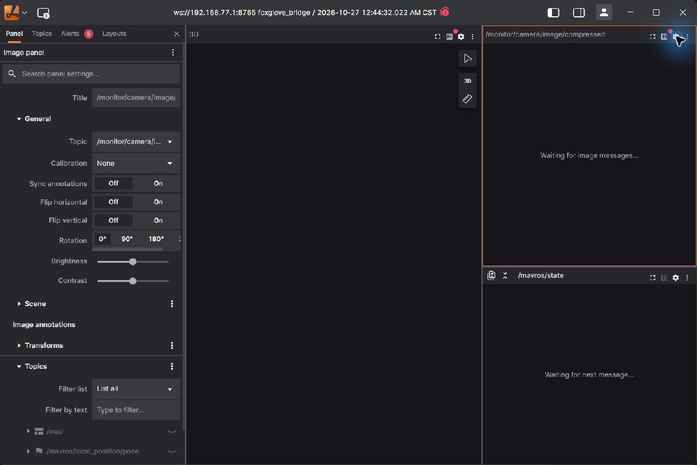
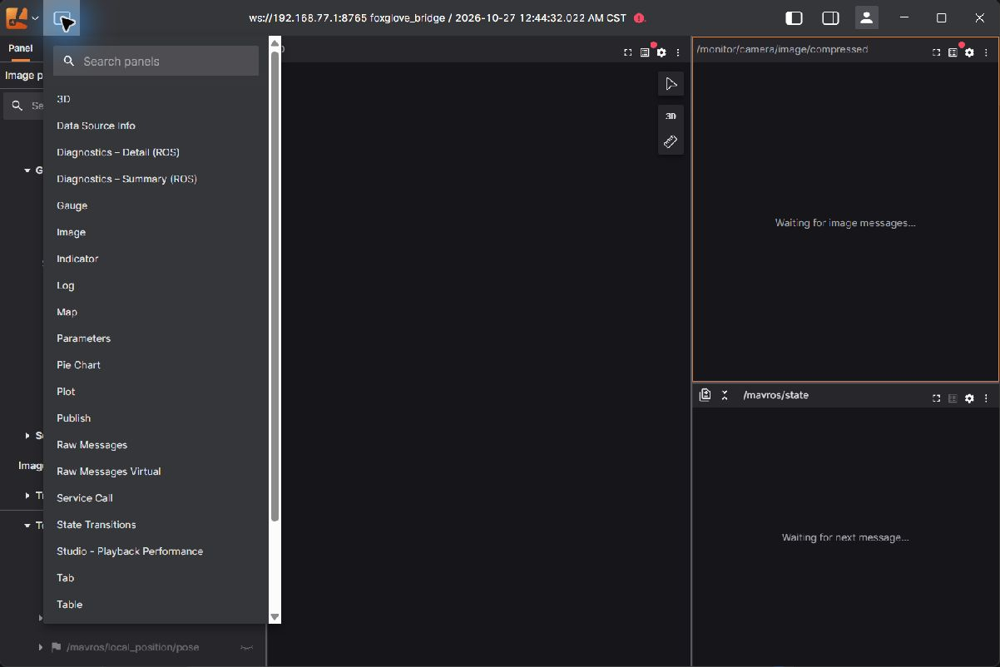
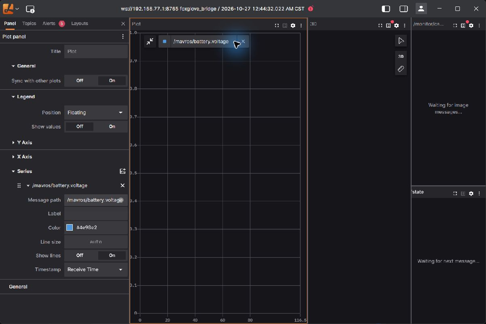
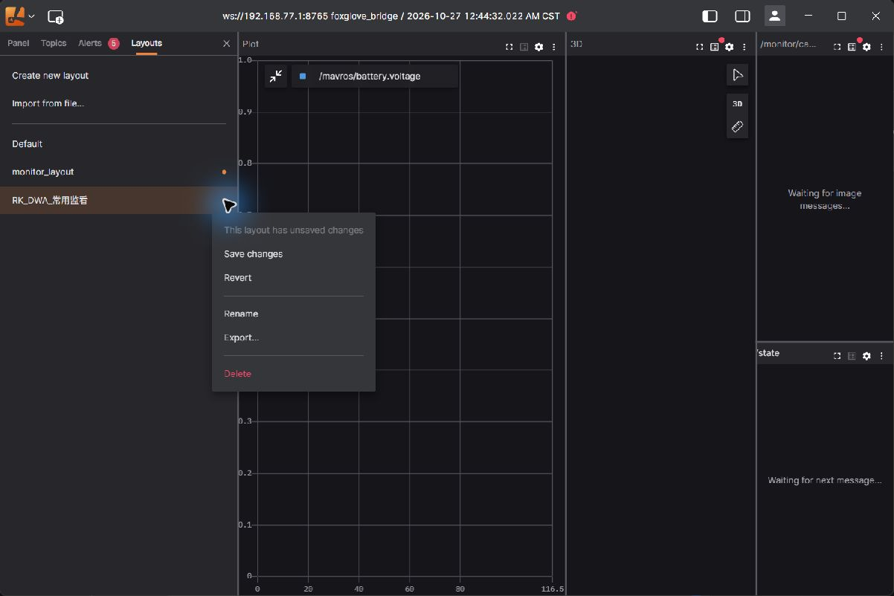
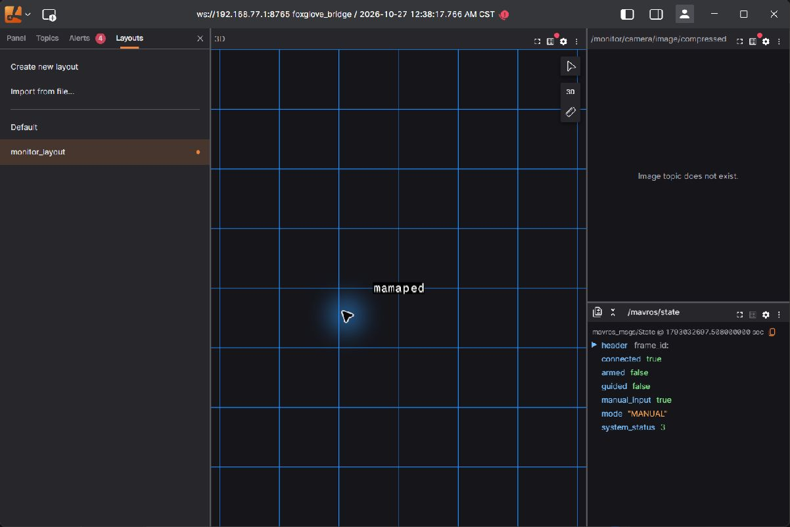

# SHELL 的 Lichtblick 连接与常用功能教学

适用环境：本机 Windows Lichtblick 1.29.1、RK3399ProD、ROS Melodic、Foxglove Bridge 0.6.3。实际操作从北京时间 2026-10-27 00:34 开始，按项目规则归入 10 月 26 日。

本教程只保留地面练习及飞行监看会用到的功能。截图来自本机实际操作；实时连接、断线示例与地面录制回放会分别标明。地面数据显示成功不等于定位、投放或实飞验收通过。

**本次交付状态：** 已实测连接、相机／地图／遥测及 GUI 布局操作。随后 USB 再次中断，短录制尚未完成，板端最终进程释放与最新版同步仍待恢复连接；本教程不将它们记为已完成。正式布局可以先在本地打开学习。

## 1. 先理解三部分各做什么

| 部分 | 做什么 | 是否随 Lichtblick 打开而自动启动 |
|---|---|---|
| RK 上的数据源 | 相机、识别、雷达、建图、飞控遥测产生 ROS 消息 | 否 |
| RK 上的只读桥 | 把允许查看的话题通过 8765 端口送到电脑 | 否，需启动 |
| Windows 的 Lichtblick | 接收、显示或回放消息，保存显示布局 | 这是当前要学习的软件 |

**能 SSH 登录 RK，不代表 Lichtblick 已连接；Lichtblick 已连接，也不代表所有传感器都在发布数据。** 地图为空时，先检查数据源和坐标系，不能为了填满界面就启动飞行任务。

本轮新增入口已经放到 RK：`/home/jcfh/start_lichtblick_monitor.sh`。它有两个用途：

- `ground`：地面教学。启动独立感知、建图、限定 MAVROS 遥测和只读桥，使用隔离 ROS Master `http://127.0.0.1:11333`。不会启动任务、move_base、location_node 或舵机，不发布 vision pose。
- `bridge`：已有系统数据时使用。只连接当前终端选中的 ROS Master，启动只读桥及 JPEG 显示转发，不替 SHELL 启动飞行程序。

两种入口都在前台运行。桥端关闭客户端发布、参数和服务能力，使用逐条精确话题白名单。布局里的发布目的地指向禁用占位名，真正的只读限制由桥承担。

## 2. 第一次练习：先接 USB，再开板端预览

### 2.0 本次断线恢复后的版本同步

前面的真实显示使用了已上传的监看入口。断线后本地又补了 `bridge` 模式自动 JPEG 转发和精确路径名称，尚未再次上传。下一次恢复连接后，先确认旧预览进程已结束，再从 **项目根目录的 Windows PowerShell** 同步以下文件；这是复制显示配置／脚本，不需要重新训练或编译 C++：

```powershell
ssh rk-uav 'mkdir -p /home/jcfh/catkin_ws/src/location/scripts'
scp src/location/launch/lichtblick_bridge_readonly.launch src/location/launch/lichtblick_ground_preview.launch rk-uav:/home/jcfh/catkin_ws/src/location/launch/
scp src/location/scripts/monitor_jpeg.py rk-uav:/home/jcfh/catkin_ws/src/location/scripts/
scp src/navigation_2d/launch/detect.launch rk-uav:/home/jcfh/catkin_ws/src/navigation_2d/launch/
scp tools/start_lichtblick_monitor.sh rk-uav:/home/jcfh/
ssh rk-uav 'chmod +x /home/jcfh/catkin_ws/src/location/scripts/monitor_jpeg.py'
```

任何一条失败先停止并查原因，不把后面的启动成功当成前面已经复制成功。当前板上已有同版的四类模型和相关业务包；这些步骤不是任意新刷系统的完整安装教程。

本轮实际地址如下，不能沿用旧 Nano 的 `192.168.55.1`：

| 用途 | 当前地址 |
|---|---|
| Windows USB 网卡 | `192.168.77.2/24`，本次名称“以太网 4”，名称可能变化 |
| RK USB 网卡 | `192.168.77.1` |
| Lichtblick USB 连接 | `ws://192.168.77.1:8765` |
| RK 已配置无线地址 | `192.168.1.102`；每次使用前仍须核验 |
| 无线连接候选 | `ws://192.168.1.102:8765` |

### 2.1 在 Windows PowerShell 执行

1. 给 RK 可靠供电，接好 USB 数据线。地面练习保持飞控未解锁；整机上电时先拆桨，舵机不参与本练习。
2. 打开 Windows PowerShell，检查网络与 SSH：

```powershell
Get-NetAdapter
Test-NetConnection 192.168.77.1 -Port 22
ssh rk-uav
```

`rk-uav` 是这台电脑已配置的 SSH 别名。另一台电脑不能默认直接用它；需要先建立自己的 SSH 登录方式。不要把本机私钥拷进教程或 Git。

### 2.2 在 SSH 登录后的 RK 终端执行

确认没有其他 ROS／相机／雷达／飞控串口程序正在使用设备，然后运行：

```bash
bash /home/jcfh/start_lichtblick_monitor.sh ground
```

终端会持续输出日志，这是正常现象；不要关掉这个终端。启动后给建图和识别留出几十秒。脚本发现已有 ROS／相关设备占用或 8765 端口占用时会拒绝启动，不会自动杀掉别的程序。

本轮相机采用已有 USB 相机入口，识别使用现有四类 RKNN 原模型，未训练、未替换模型。图像显示转发将 `/detect_result` 压缩为显示宽度不超过 960 像素的 JPEG，质量 65、发送上限 5 帧／秒；实测速率约 4 帧／秒。**这是显示图像频率，不是模型推理频率。**

### 2.3 回到 Windows 检查桥端口

另开一个 Windows PowerShell：

```powershell
Test-NetConnection 192.168.77.1 -Port 8765
```

`TcpTestSucceeded : True` 说明 TCP 端口可达；之后还需在 Lichtblick 检查 WebSocket 连接和实际消息。

## 3. 在 Lichtblick 建立实时连接

1. 从开始菜单或已有快捷方式打开 **Lichtblick**。
2. 欢迎界面点击 **Open connection**。若已进入主界面，可从左上角菜单进入 **Open connection**。
3. 左侧选择 **Foxglove WebSocket**。
4. 在 **WebSocket URL** 输入 `ws://192.168.77.1:8765`。
5. 点击右下角 **Open**。



不要选择 Rosbridge，也不必给这台 Windows 电脑额外安装 ROS 来完成本教程。地址里的 `ws://`、RK 的 IP 和 `:8765` 都要保留。

连接后检查三件事：顶部的数据源是目标地址；时间和消息继续更新；Topics 中有真实数据。只看到旧的 `connected=true` 文字不能证明当前连接仍正常，见第 10 节。

## 4. 导入准备好的常用布局

无需从空白逐一搭建面板。项目已经提供 [RK_DWA_常用监看_教学版.json](RK_DWA_常用监看_教学版.json)。

正式布局上方左侧是地图，上方右侧为相机与飞控状态，下方是电压 Plot。导入后电压曲线已预设，可直接跳到第 8 节学习如何修改；没有电池消息时曲线为空。



1. 左侧点击 **Layouts**。
2. 点击 **Import from file…**。
3. 选择本项目 `docs/监看/RK_DWA_常用监看_教学版.json`，点击“打开”。在原生文件框中也可按 `Alt+N` 聚焦文件名，粘贴完整路径后按 Enter。
4. 布局列表出现 **RK_DWA_常用监看_教学版** 后，点击该布局。



布局用于安排面板、话题和显示方式，不会给无人机启动传感器或发起任务。旧 `monitor_layout` 是 Nano／EGO 阶段的布局，新练习使用本节提供的文件。

## 5. 看地图、激光和路径

### 5.1 最常用的地图检查

点击 **3D 面板右上角齿轮 Settings**，左侧会切到该面板设置：

1. **Frame → Display frame** 选择 `map`，与本轮 `/map.header.frame_id` 一致。
2. **Follow mode** 选择 `Fixed`，先固定观察整个场地。
3. 展开 **Topics**，确认 `/map` 和 `/scan` 可见。点话题旁的眼睛切换显示；只影响电脑画面。
4. 鼠标移到地图里滚动滚轮缩放。需要放大地图时点面板右上角 **fullscreen**，完成后再点该按钮返回。
5. 使用本布局预置的俯视显示；不要为了改变地图视角去改无人机姿态或任务参数。



栅格通常用白色表示空闲、深色表示占用、灰色表示未知，具体以面板颜色设置为准。激光点是当下扫描观测；栅格是建图结果，两者含义不同。地面静止时出现地图，不能据此认定比例、外参、定位融合和飞行净空已验收。

### 5.2 以后实际导航时看什么路径

当前代码是 move_base／DWA，旧 `/visual_global_path`、`/visual_local_trajectory` 属于 EGO 阶段。现在优先检查：

| 话题 | 用途 |
|---|---|
| `/move_base/DWAPlannerROS/global_plan` | DWA 使用的参考全局路径 |
| `/move_base/DWAPlannerROS/local_plan` | DWA 当前局部轨迹 |
| `/move_base/NavfnROS/plan` | 默认全局规划器的路径候选；以实际话题和规划器配置为准 |

**本轮地面入口不启动规划器、不发目标，因此没有路径是正常的。** 后续已由独立操作启动导航、且规划器收到有效目标时，再在 3D Topics 中开启相应路径。实际发布名称不同，应先核对 ROS 话题，再更新精确白名单和布局，不用全话题通配掩盖问题。

## 6. 看相机画面和识别框

本轮选用 **Image** 面板，显示 `/monitor/camera/image/compressed`。

1. 点击 Image 面板右上角齿轮。
2. **General → Topic** 选择 `/monitor/camera/image/compressed`。
3. **Calibration** 暂用 `None`：当前只是二维看图，不能声称相机已经标定或在三维地图中定位正确。
4. 如画面占地太小，点击 **fullscreen** 临时放大。
5. **Flip horizontal／Flip vertical／Rotation** 只改变本机显示；不会改变相机安装、舵机位置或识别算法的几何参数。平时保持布局默认值，避免画面方向与任务坐标混淆。



本轮 JPEG 来自独立 detectnet 输出图，若有识别框，框已画进图像，不需要再手动添加一个标注话题。**没有框不等于没有图像，也不等于识别链正确识别了所有目标。** 当前四类模型仍有误报和推理延迟边界；画面能显示不代表业务识别通过。

遇到 **Image topic does not exist**：先查该话题是否存在／是否在桥白名单。遇到 **Waiting for image messages…**：话题可能已登记但没有收到新的图像，也可能链路已断。先看顶部连接状态和 Topics 数据，不要反复启动第二套相机驱动。

## 7. 看飞控模式、是否解锁及任务状态

右下角是 **Raw Messages Virtual**。它将 ROS 消息字段直接展开，最适合先学会判断状态。

在面板顶部消息路径框输入 `/mavros/state`，按 Enter 确认，观察：

| 字段 | 读法 |
|---|---|
| `connected` | MAVROS 是否收到飞控连接；另需确认显示仍在更新 |
| `armed` | `true` 为已解锁，`false` 为未解锁；本轮观测为 false |
| `mode` | 飞控当前回传模式；本轮稳定后为 `MANUAL`，启动早期曾出现 `CMODE(65536)` 原始模式字符串，不自行解释为某飞行模式 |
| `header.stamp`／面板消息时间 | 辅助判断新鲜度，不只盯着状态文字 |

用小三角展开／收起嵌套字段。若要临时看电池，把路径改为 `/mavros/battery`；看完再改回 `/mavros/state`。

以后已有任务运行时，也可查看 `/mission/status`、`/mission/readiness`、`/location/status`。本轮地面入口没有这些节点，不能要求这些话题出现。readiness 是软件条件状态，不是起飞许可，也不能替代外设、定位与实飞验收。

`/mavros/local_position/pose.pose.position.z` 是飞控本地坐标高度字段，不直接等于已经标定的 TFmini 离地高度。当前真实测高／融合仍有未验项目，不从一条曲线推断无人机已经具备安全定位。

## 8. 用 Plot 看电压或高度变化

日常常用的是电压随时间变化，以及有可靠定位后的高度变化。先练习一个字段，避免把单位不同的量挤在同一轴上。

1. 点击窗口左上角 **Add panel**（小面板加号）。
2. 选择 **Plot**。
3. 点击 **Click to add a series** 旁的 `+`，或在齿轮设置里点击 **Series → Add series**。
4. 在 **Message path** 输入 `/mavros/battery.voltage`。
5. **Label** 可写“电池电压 V”，Timestamp 初学先用 **Receive Time**。
6. 有持续数据后观察曲线；没有数据、NaN、0 或固定值时先核对飞控是否实际接入电池测量，不能把空曲线补成一个猜测电量。





后续需要高度曲线时，添加独立 Plot，字段用 `/mavros/local_position/pose.pose.position.z`，单位为米。曲线抖动可能来自数据源或时间问题，先检查消息，不把它直接归因于板卡性能。

## 9. 保存布局、下次恢复

显示缩放、选题或面板位置有改动后，Layouts 中布局名旁会出现橙色小点。

1. 打开 **Layouts**。
2. 将鼠标移到当前布局名称一行，点击右侧三点菜单。
3. 点击 **Save changes** 保存本机布局。
4. 点击 **Export…** 将布局另存为 JSON；这份 JSON 可以随项目搬到另一台电脑。
5. 下次用 **Import from file…** 恢复。保存布局不保存相机录像或 ROS 数据，也不保存板端进程。



为了保持操作范围，本教程不使用 Publish、Teleop、Service Call 或 Parameters 面板来控制无人机。

## 10. 断线时先看哪里，如何恢复

本轮实际发生了 USB 网卡消失和 SSH 超时。**断线时界面可能还留着最后收到的图像、地图和 `connected=true`。这些是旧值。**



按下面顺序排查，每一步确认后再往后走：

| 现象 | 先做什么 |
|---|---|
| Windows 中 USB 网卡都没有 | 检查供电／USB 数据线和枚举；本项目当前按 SHELL 要求不扩展断连原因排查 |
| 网卡有，SSH 22 不通 | 先恢复 RK 网络／SSH，暂不调整面板 |
| SSH 通，8765 不通 | 查只读桥终端、端口占用和 ROS Master；不要启动第二个桥 |
| 8765 通，但界面等待 | 查看连接地址、Alerts、Topics 和新消息；需要时重新 Open connection |
| 相机有图，地图没有 | 检查 `/map`、`/scan`、`/tf` 和 Display frame；不启动飞行任务来“修地图” |
| 地图有，路径没有 | 地面练习本来未启动规划器；实际导航时再查 DWA 的计划话题 |
| 重连后数据时间明显倒退 | 核对 RK 启动后时钟，本轮冷启动曾恢复旧日期；不要把显示端改日期当成传感器时间修复 |

可以在 Windows 重新检查：

```powershell
Test-NetConnection 192.168.77.1 -Port 22
Test-NetConnection 192.168.77.1 -Port 8765
```

连接恢复后先核对已有进程。若原地面入口还在运行，复用它；若 RK 已重启、入口已退出，再按第 2 节启动。本轮不会给 RK 设置监看自启。

## 11. 飞行时如何切到无线监看

USB 是地面练习链路，飞行时需要无线网络。当前 RK 配置的无线 IP 为 `192.168.1.102`，先核对地址与同网连通性，再使用 `ws://192.168.1.102:8765`。本轮不能用 USB 结果证明无线距离、带宽和延迟合格。

当飞行系统已由单独的操作流程启动时，在 RK 新开终端：

```bash
source /opt/ros/melodic/setup.bash
source /home/jcfh/catkin_ws/devel/setup.bash
# 必须与现有业务使用同一个 Master；本例为默认 11311。
export ROS_MASTER_URI=http://127.0.0.1:11311
bash /home/jcfh/start_lichtblick_monitor.sh bridge
```

如果现有业务 Master 不是 11311，应使用它的真实地址。`bridge` 模式会附着现有 ROS 数据，并从现有 `/detect_result` 转发 JPEG；没有该图像源时会等待，不会替 SHELL开启相机或任务。不要同时再运行 `ground`，也不要同时让导航入口再开第二个桥。

飞行监看以 **地图／激光、一路相机、飞控状态、电压趋势** 为起点。无线卡顿时先减少同时打开的图像面板与订阅量，再结合实测带宽、频率和图像延迟判断。Lichtblick 不替代飞行控制和现场安全操作。

## 12. 练习结束，如何关闭

1. 在地面练习的 RK 终端按 **Ctrl+C**，等待 roslaunch 的退出信息。
2. 确认本轮相机、雷达、detectnet、建图、MAVROS 与桥已退出，再断电。关闭电脑上的 Lichtblick 不会保证 RK 上所有程序自动退出。
3. 飞行时使用的 `bridge` 模式，Ctrl+C 只关闭这次监看桥／JPEG 子进程；不要借此关闭其他独立启动的飞行程序。
4. 再次启动练习时重复第 2～4 节即可；布局可直接复用。

本教程配套的原始观测、界面证据与实际边界见 [验证记录](../验证记录/Lichtblick教学_2026-10-26/README.md)。
