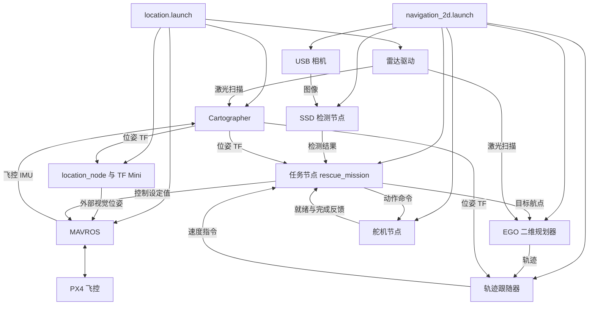

# Nano 程序归档检查与项目分析

检查日期：2026-10-11。分析对象是从 Nano 导出的 `catkin_ws`，不是整台无人机的系统镜像。

> 本文保留首次归档的分析结果。程序及依赖材料拷贝现已完成；最新需求为完整项目分析、技术栈/环境缺口、电脑 WSL＋Docker 编译准备和详细无人机技术指南，见 [2026-10-11 编号的需求修订](当前需求与分析交付计划_2026-10-11.md)。本轮先只对齐文档，不开展新的源码分析，取消 Nano 独立再编译；下方首次分析阶段的待办不作为当前执行安排。

同日后续：已取得并核验 Nano 环境清单，实际系统版本、外部依赖位置及补备份状态见 [环境核验与补备份](Nano环境核验与补备份_2026-10-11.md)。下文“本轮”指首次工作空间离线分析阶段。

**结论：电脑上的压缩包与SHELL在 Nano 上报告的 SHA256 完全一致，归档可以完整读取。定位、导航、规划、视觉、雷达与舵机六个 ROS 包，以及默认视觉模型和编译产物，均已保存。工作空间之外的运行环境、系统配置和 PX4 资料还没有完成备份。**

本轮只读取本地副本，没有运行归档中的程序，没有连接或修改无人机。学长截图提供分析线索，截图中的启动和飞行命令没有作为本轮操作指令执行。

## 1. 备份核验结果

原始文件：[nano_catkin_ws_20251024_201602.tar.gz](D:/SHELL/低空消防/ChatGPTworkingenviroment/Nano导出/2026-10-11/nano_catkin_ws_20251024_201602.tar.gz)。

| 检查项 | 结果 |
|---|---|
| 压缩文件大小 | 38,345,031 字节，约 36.57 MiB |
| SHA256 | `5764ea536dcb4d6b4d18d564e7ea430b21c2f3f015e0d3198628d17c0d0b3eb8` |
| 与 Nano 端SHELL提供的校验值比较 | 一致 |
| gzip 压缩流 | 完整读到末尾，通过 CRC/长度校验 |
| tar 归档 | 3,993 个条目：3,093 个普通文件、821 个目录、79 个符号链接 |
| 符号链接 | 79 个目标均存在于本次归档中；本轮检查未发现指向归档外的目标或断链 |
| Windows 分析副本 | 普通文件已解出；Linux 符号链接不在 Windows 副本中创建，其原始信息保存在压缩包和清单中 |
| 已发现的可执行文件 | 9 个 AArch64 ELF 文件，包含主要节点和测试工具；不能直接在 Windows 上执行 |

校验一致证明这份文件与 Nano 端那份归档相同；不证明打包范围已经覆盖所有依赖，也不证明归档中的源码与当前板上的运行程序完全对应。

保留原始压缩包，不要只留下 Windows 解压文件。Linux 权限、链接和时间信息以压缩包为准。本轮没有进行 Linux 恢复、重新编译、模型推理或飞行验收。

检查证据：[归档核验](D:/SHELL/低空消防/ChatGPTworkingenviroment/Nano导出/2026-10-11/archive_verification.json)、[归档逐项清单](D:/SHELL/低空消防/ChatGPTworkingenviroment/Nano导出/2026-10-11/archive_manifest.json)、[包、启动文件、模型与源码哈希清单](D:/SHELL/低空消防/ChatGPTworkingenviroment/Nano导出/2026-10-11/workspace_inventory.json)。

## 2. 各目录的用途

以下目录相对于 Nano 的 `/home/jcfh/catkin_ws`。

| 目录 | 本次实际内容与用途 | 是否已保存 |
|---|---|---|
| `src/` | 六个 ROS 包的源码、启动文件、参数、消息定义和部分 README；雷达包带驱动 SDK | 是 |
| `data/models/real4/` | ONNX 模型、类别标签、TensorRT engine 缓存及模型校验文件 | 是 |
| `build/` | CMake 配置、依赖路径、目标编译信息；可用于追查当时的构建环境 | 是 |
| `devel/` | 已编译节点、生成的消息代码、ROS 环境入口与链接 | 是；链接保存在原始归档中 |
| `logs/` | catkin 构建日志；不能把它当成完整飞行日志 | 是 |
| `.catkin_tools/` | catkin 工作空间的构建配置及包记录 | 是 |
| `install/` | 本次构建配置为 `install: false`，归档中没有此目录 | 本次不适用 |

`devel` 是编译后可使用的成果，`src` 是便于理解和修改的源文件。两者第一次都保留是合理的；复制它们仍需要原来的 ROS 和系统库才能在 Nano 上运行。

## 3. 六个 ROS 包分别做什么

| 包 | 实际职责 | 优先阅读的文件，相对于该包目录 |
|---|---|---|
| `location` | 启动雷达、Cartographer、MAVROS；组合水平定位与 TF Mini 测高，向飞控提供外部位姿 | `launch/location.launch`、`launch/cartographer_2d.launch`、`src/location_with_ftmini.cpp`、`param/ROSSLAM/` |
| `navigation_2d` | 任务状态机、航点、视觉对齐、路径跟随及 MAVROS 控制接口 | `launch/navigation_2d.launch`、`src/rescue_mission.cpp`、`src/flight_control.cpp`、`src/mission_vision.cpp`、`src/ego_trajectory_controller.cpp` |
| `ego_planner_2d` | 二维避障规划，生成供跟随器使用的轨迹；源码包含栅格地图、A* 与 B 样条优化 | `src/ego_planner_2d_node.cpp` 及规划器相关源码 |
| `ssd_detection` | 默认使用 C++、jetson-inference/detectNet 和 TensorRT 做目标检测，向任务节点发布结果 | `launch/ssd_detection_trt.launch`、`src/ssd_detection_node.cpp`、`src/jetson_detector.cpp` |
| `rplidar_ros` | 驱动激光雷达并发布激光扫描 | `src/node.cpp`、`launch/`、`sdk/` |
| `servo_control` | 通过 I2C/PCA9685 驱动相机舵机和投放舵机，提供动作完成和就绪反馈 | `src/servo_controller_node.cpp`、`launch/servo_bench.launch` |

本次 `servo_control` 的默认节点是 C++ 程序。2026-10-01 旧记录中的 Python `servo_controller.py` 不在本次工作空间中；旧空载测试结果不能直接作为这份 C++ 程序的验收证据。

## 4. 默认启动关系

以下关系按这份归档的 launch 默认参数解析；在 Nano 上另传参数、加载其他工作空间或使用自启动服务时，实际运行链可能改变。

`navigation_2d` 并不在默认入口内再次启动 MAVROS 或 Cartographer，它依赖定位入口提供这些服务及数据。默认规划器是 EGO；DWA/TEB 的配置保存在包内，属于可选分支。

### 定位入口的实际行为

- 默认采用 RPLIDAR S2 路线：雷达端口 `/dev/ttyUSB0`。MAVROS 的飞控串口为 `/dev/ttyACM0:57600`。
- TF Mini 默认走 I2C，总线 `0`，地址十进制 `16`，即 `0x10`。这与舵机驱动的 I2C 总线和地址不同。
- Cartographer 读取本包内的 Lua 参数，订阅雷达和 `/mavros/imu/data`，输出 TF 和占用栅格。
- 定位节点读取 `odom → base_link` 的位姿；使用 TF Mini 时，高度由测距及安装高度处理，向 `/mavros/vision_pose/pose` 发布。
- 默认链没有启动 AMCL 或 map_server，也没有看到加载保存地图、`.pbstream` 的参数。它目前体现的是在线 Cartographer 建图与定位。

这与 2026-09-22 确认的“预先 Cartographer 建图、运行时 AMCL 定位”目标存在差异。本次只记录当前导出程序的实现，不据此更改此前目标架构。后续应核实学长是否另有 AMCL 入口，以及这份导出是否就是他所说的稳定版本。

### 导航入口的实际行为

- `planner_backend=ego`，规划器和跟随器使用 `odom` 坐标系；任务节点接收 `/cmd_vel` 并转换、发布 MAVROS 控制设定值。
- `vision_backend=ssd`，`use_usb_cam=true`：默认打开 `/dev/video0`，以 640×480、15 fps 发布 `/camera/image_raw`。
- 默认启用真实舵机，I2C 设备 `/dev/i2c-1`，PCA9685 地址 `0x40`；相机舵机通道 `0`，投放通道 `1`。
- 舵机节点初始化成功时会直接设置相机舵机到 `170°`、投放舵机到 `30°`。启动导航入口已经可能产生舵机动作。
- 默认 `stage=1`、巡航高度 `1.5 m`、任务高度 `1.2 m`，包内保存危险品任务区、人员任务区和返航航点。
- 默认 `drop_align_mode=vision_with_fallback`。视觉超时后，源码包含基于预设航点的投放对齐分支；实际是否投放还取决于位置容差、状态机及动作反馈。
- `require_servo_ready=true`。默认 `auto_start=false` 时，任务仍会在飞控已连接、已有位姿/地图 TF、舵机就绪且飞控已解锁并处于 OFFBOARD 等条件满足后进入起飞状态。它不等于“仅看数据”的模式。
- 源码构造函数的 `auto_start` 默认值是 `true`，正常 launch 显式覆盖成 `false`。脱离 launch 直接运行任务节点，会失去这份启动参数设置。
- `start_foxglove_bridge=false`、`open_rviz=false`：可视化不是当前默认链的必需部分。

任务参数中，`stage=1` 表示先执行危险品区投放，再飞越各人员任务区并返航；`stage=2` 在此基础上增加一次人员救助物资投放，需提供 `rescue_drop_x/y`。这是代码中的任务定义，本轮未取得比赛规则原文，也没有验收实际任务结果。

这些是静态代码行为，尚未做实际动作、定位误差、推理性能或完整任务的验证。

### 如何理解学长的“两个窗口、不能同时启动”

根据这份默认依赖关系，应理解为先启动定位链，待数据与初始化正常后，再启动导航链，并让定位链继续运行。关闭定位链会使导航失去 MAVROS、雷达或 TF 等默认依赖。源码 README 也要求两个入口处于同一 ROS Master 下运行。

这个判断来自代码依赖，不代表已经确认学长当时那句说明的全部含义。固定等待 6 秒也不保证 IMU、模型和定位真正就绪；后续启动手册应以实际状态为依据。在继续备份时无需运行这两个入口。

## 5. 视觉模型已经保存到什么程度

| 文件 | 实际大小 / 检查结果 |
|---|---|
| `data/models/real4/ssd-mobilenet.onnx` | 22,312,402 字节，已归档 |
| `ssd-mobilenet.onnx.1.1.7103.GPU.FP16.engine` | 12,308,891 字节，已归档；实际加载版本仍需实机确认 |
| `labels.txt` | 5 行：`BACKGROUND`、`person_injured`、`hazard_toxic`、`hazard_flammable`、`hazard_explosive` |
| `ssd-mobilenet.onnx.sha256sum` | 与本次读取的 ONNX 哈希一致 |

ONNX SHA256：`1dd972a8b7485baafc14480065bf36b2fc3cb503a28dfc052601f5433e43bda3`。

静态读取 ONNX 元数据得到输入 `input_0`，尺寸 `[1,3,300,300]`；输出 `scores` 为 `[1,1917,5]`，`boxes` 为 `[1,1917,4]`。标签行数与类别维度吻合，名称与默认检测代码的输入输出名称对应。顶层图初始化张量中未发现外部权重文件引用。

因此，默认推理所指向的模型文件没有因为只复制 `src` 而遗漏。这些检查不等于 ONNX 完整规范校验或实际识别效果验收；不能只根据文件名确认 MobileNet 的具体版本、训练来源或类别准确率。训练数据、原始训练权重和训练工具没有在本次归档中发现。

## 6. 还缺哪些依赖和备份

历史构建缓存显示 ROS 路径为 `/opt/ros/melodic`，CUDA 路径为 `/usr/local/cuda-10.2`，存在 jetson-inference/jetson-utils、OpenCV、TensorRT 及系统 I2C 库的链接信息。这些是当时构建的证据，不能替代当前 Nano 的版本清单。

| 内容 | 本次状态 | 下一次开机需要做什么 |
|---|---|---|
| 六个自有/随项目 ROS 包、当前参数、模型、编译产物 | 已保存并校验 | 保留原始包，后续补稳定版本来源和实际运行验证 |
| 默认外部 ROS 包：MAVROS、Cartographer、usb_cam、ROS 基础包 | 不在本次工作空间归档中 | 用 `rospack find` 定位，记录包版本与安装来源；自编译工作空间和自改文件另行备份 |
| CUDA、TensorRT、jetson-inference、jetson-utils、OpenCV、系统库 | 未作为依赖本体保存 | 记录 L4T/包版本/库路径，自编译源码与安装成果另行保存；最终纳入完整系统备份 |
| 可选分支：T265/RealSense、DWA/TEB、Foxglove、RViz 等 | 部分启动配置已保存，外部程序未保存 | 只在确认实际使用后纳入恢复要求，同时记录构建依赖 |
| `.bashrc` 等环境选择、自启动服务、设备权限与系统标定 | 工作空间外内容未知 | 先定位和记录，再备份相关配置；需要确认是否选择了其他工作空间 |
| 地图、录像、ROS bag、其他权重 | 本包默认模型已保存；未发现默认加载的保存地图 | 检查实际启动参数和外部目录；没有看到地图不能直接判定当前默认入口缺文件 |
| 仿真包、训练工具、校验/标定工具 | README 引用的一部分资源不在归档中 | 向学长索取完整开发工程或查找其他目录，不能用未核验的新仓库替代稳定版本 |
| SD 系统盘及 eMMC/启动相关存储 | 尚未制作可恢复镜像 | 等正常关机后按确认的存储/载板方案备份，保留分区表和恢复资料 |
| PX4 固件、参数、飞控任务/校准信息 | 不属于 Nano 的这个归档 | 另从飞控/QGC 导出并记录版本；是否纳入整机备份按恢复目标处理 |

`ssd_detection` 的构建链接记录同时出现 OpenCV 3.2.0 和 4.1.1，应在环境采集中记录实际库文件及来源。这只是构建记录里的混用线索，本轮没有证据认定它造成运行故障。

部分缺少的开发资源示例：`gc_2026_sim`、`tools/check_config.py`、`tools/ssd_training/check_onnx_contract.py`、`tools/servo_angle_calib.py`。README 说明仿真包不放在机载电脑，因而这些资源缺少并不自动说明当前机载入口无法运行。

### 为什么不能把 37 MB 叫作“无人机全部备份”

SHELL此前在 Nano 上提供的 `findmnt` 输出表明根目录和工作空间均在 `/dev/mmcblk1p1`，系统盘约使用 17 GB；37 MB 压缩包的打包范围是其中的 `catkin_ws`。系统依赖保存在其他目录，需要分层保存或制作可恢复的系统备份。

SHELL提供的设备类型是 `mmcblk0=MMC`、`mmcblk1=SD`。SD 上有根文件系统，并不能推出 eMMC 中的启动相关内容可以不备份。具体启动布局、载板型号与恢复方式还需下一次采集确认。本轮没有执行镜像、刷机、分区或挂载操作。

文件名含 `20251024`，目录和代码中又出现 2026 年时间。本轮以电脑收到文件的日期记录归档，不靠 Nano 时钟或文件名判定版本先后；下次采集记录两端时间，不自行校时覆盖证据。

## 7. 接下来的顺序

1. **当前可以继续关机充电。** 本轮源码和备份范围分析已完成，电脑有互联网即可继续阅读本地文件。
2. 下次开机先采集环境与目录清单，不启动飞行或舵机节点。[采集脚本](D:/SHELL/低空消防/ChatGPTworkingenviroment/Nano导出/2026-10-11/collect_nano_inventory.sh) 只写自己的报告目录，不改项目或硬件配置；目前仅经本地静态检查，尚未在 Nano 执行。
3. 根据清单补齐外部工作空间、自己编译的依赖、环境/设备配置；核对默认入口是否被实际启动命令覆盖。依赖版本清单是恢复线索，不是依赖本体的备份。
4. 再安排正常关机后的系统存储备份和 PX4 资料导出。在确认启动介质与恢复方案之前，不给出会覆盖磁盘的操作。
5. 具备版本和恢复资料后，才整理与当前实现对应的启动手册、台架检查及任务验证。此前目标架构与现有代码的差异单独确认，不直接改稳定程序。

采集脚本的使用和下载方式见 [本日工程日志](../../logs/2026-10-11_程序导出、补档与项目隔离基线.md)。

## 8. 证据范围

- **本轮本地实测：** 文件大小与哈希、gzip/tar 可读性、逐项清单、链接目标、源码/launch 参数、ONNX 元数据及 ELF 架构。
- **SHELL提供：** Nano 用户名/包路径、Nano 端哈希、磁盘挂载及类型输出、学长“稳定程序在 Nano 上”的说明。
- **历史记录：** 2026-10-01 的 Ubuntu、USB 连接及 Python 舵机测试；2026-09-22 的目标架构。历史设备结果没有冒充本轮实机结果。
- **尚未验收：** 依赖完整恢复、源码与已编译节点的一致性、实际生效参数、定位质量、识别质量/延迟、舵机机械行程和完整飞行任务。
