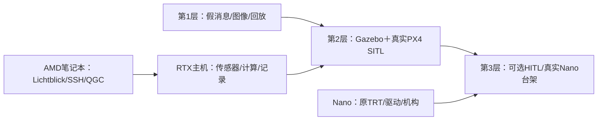

# 仿真测试方案与设备分工

日期：**2026-10-13**。依据10月12日总技术指南、当前开发源码和本轮查阅的PX4/Gazebo/ROS/NVIDIA/Microsoft官方资料。SHELL已确认另一台RTX3060Ti电脑为**Windows、16GB内存**；Windows版本、CPU、SSD剩余空间、显存和驱动尚未查询。Nano正在返修，暂不能开机；本方案供SHELL后续自行操作，电脑仿真前两层可在设备返修期间准备。

本文交付方案，**没有安装或配置RTX电脑、编译或运行仿真、修改项目源码、连接飞控或测试硬件**。当前源码和模型优先于旧规划；推荐的仿真不要求恢复已淘汰的AMCL/MobileNetV2方案。电脑编译仍遵循[原环境评估](../源码分析/电脑编译与实时可视化.md)，不在无人机上建立新的独立重编译工作空间。

## 1. 推荐选择

**把RTX3060Ti电脑作为主要仿真/编译主机，当前AMD笔记本负责Lichtblick、SSH、文档和地面显示；Nano留作原Jetson视觉和真实传感器/舵机的后续台架验收。** 前两层仿真不需要真实飞控、雷达、舵机、相机或无人机供电。

**当前主推荐保留RTX电脑的Windows，先用WSL2＋Docker做单机轻场景，不要求购买设备、重装系统或立即升级内存。项目开发/测试环境优先对齐Nano的Ubuntu18.04与ROS Melodic，放在Bionic容器内。** Docker Desktop使用WSL2后端，不要求另装一个Ubuntu发行版；若为文件和终端操作另装WSL Ubuntu，其版本只属于外层工具环境，不改变项目开发基线。16GB条件下先限资源、逐层加负载。原生Ubuntu留作后续旧图形/GPU容器确实遇阻时的选项。

### SHELL问题澄清｜2026-10-13

SHELL强调Nano难以更新且无整机镜像计划，开发应优先对齐现有Nano版本。当前项目基线继续采用Ubuntu18.04/Melodic，不要求迁移至Ubuntu24.04/ROS2。此前“WSL Ubuntu24.04＋Bionic容器”是外层工具环境与项目环境的分工建议，不是需要维护两套项目程序；独立WSL Ubuntu也不是Docker Desktop的必需前置。

RTX电脑可以作为独立仿真主机，但Docker、Gazebo和PX4 SITL安装后首先具备基础仿真条件；本项目完整任务还须编译ROS节点、配置MAVROS并补齐场景、雷达/相机/高度、TF/时间和机构响应适配，见第5节。原Jetson视觉后端无法在PC原样运行，不阻止导航、建图、任务流程及采用PC检测后端的视觉联动仿真。源码已有Python/OpenCV ONNX检测入口，仍需验证其依赖、预处理/后处理和与原后端的结果差异；PC通过不能代替Nano原TensorRT后端的运行、性能及资源验收。

最省迁移的顺序是：

1. **假消息/离线图像/ROS回放**：沿用ROS1 Melodic接口，先复现已经发现的状态机、TF、旧轨迹、检测和ACK问题。这一层可在当前笔记本开展，不依赖RTX GPU。
2. **PX4 SITL＋Gazebo传感器闭环**：优先用冻结的 **Ubuntu18.04/Melodic/Gazebo Classic9/PX4 v1.13.3/MAVROS1.x** 兼容环境，重用现有节点、接口和参数；原项目未交付仿真场景/适配层，需要补建并逐层验收。
3. **可选HITL或Nano伴飞电脑台架**：前两层通过后，再按实际飞控型号/固件验证。HITL当前是社区维护路线，不能承诺现有Pixhawk和任意新版PX4即插即用。

如果计划长期持续维护，另一条清晰路线是 **Ubuntu24.04＋ROS2 Jazzy＋Gazebo Harmonic＋PX4 v1.17.0**。它有更好的维护基础，但把现有Melodic工程接上去需要传感器适配/跨ROS桥或节点迁移，不宜把“搭新仿真平台”和“验证原程序”混成一个未经区分的任务。

建议先形成短期兼容测试基线，尽快得到原程序的失败场景和修复回归结果；长期平台是否迁移，在已知测试集和实际工程量基础上决定。

## 2. 设备条件和分工

| 设备 | 建议职责 | 需要的软件/资源 | 能证明什么、不能证明什么 |
|---|---|---|---|
| 当前AMD笔记本 | Windows Lichtblick、SSH/文件管理、QGC显示；小型消息测试/回放/通用编译 | 已知约15.2GiB物理内存；WSL/Docker状态按后续安装记录更新 | 适合地面显示和一般开发；无NVIDIA GPU，不能原样跑Jetson CUDA/TRT |
| RTX3060Ti电脑 | Gazebo渲染/传感器、PX4 SITL、ROS计算、编译/录包；可选x86 GPU推理 | SHELL确认Windows＋16GB；先WSL约6～8GB/4CPU，CPU/SSD/版本/驱动待读取 | 可验证仿真闭环和x86软件；GPU型号不能单独保证实时率，也不等于Nano性能 |
| Nano | 返修完成后的原Jetson TensorRT、真实传感器/机构、桥接负载台架 | 当前不能开机；已保存Ubuntu18.04/ARM64/L4T32.5.2/CUDA10.2/TRT7.1.3资料 | 返修期间不要求连接；目标机依赖/性能待恢复后验收，不在机上另建重编译空间 |
| 实际飞控 | 后续地面融合/模式与可选HITL | 型号、固件、参数和机架配置先核实 | SITL初期无需接入；实物控制器行为必须后续单独验收 |

### 2.1 RTX主机的OS和容量建议

**使用现有Windows＋WSL2＋Docker Desktop Linux容器。** 先核对Windows/WSL版本和NVIDIA Windows驱动；项目Melodic/Gazebo9放Bionic兼容容器，独立WSL Ubuntu按工具操作需要选择，不在较新Ubuntu里直接安装Melodic旧脚本。CPU编译、假消息和回放先行；Gazebo相机/图形加速单独验证，不承诺安装Docker后零配置跑通旧GUI。

只有旧图形依赖、WSLg/GPU容器或持续性能问题确实阻塞时，才评估原生Ubuntu24.04＋隔离旧环境，或下表Noetic/Classic11过渡方案。传统虚拟机若没有GPU直通，可能退回软件渲染；不作为现阶段默认替代。尚未在RTX电脑实测。

容量建议属于本项目的起步预算，**不是官方最低规格或性能承诺**：

- CPU：先按现有CPU，在WSL初期限4个逻辑处理器、编译并行度2（例如catkin_make的`-j2 -l2`），不要按16线程直接满载。PX4、物理仿真、Cartographer/EGO主要还消耗CPU。
- RAM：现有**16GB先用起来**，WSL初始6GB，Windows空闲足够且出现需求时再调至8GB；关闭游戏、重浏览器/其它高内存程序。不要同时编译、运行完整SLAM和GPU检测；内存升级由实测决定。
- SSD：先读取剩余空间，只建一个兼容环境并控制rosbag长度。完整旧/新双栈和长期录包可按150～250GB预算，但不要求先购买新SSD或建立全部环境。
- 网络：RTX主机先用有线连接路由器，笔记本经同一局域网/SSH访问；跨机尽量只传Lichtblick需要的JPEG、地图和状态，主要ROS计算/传感器流留在仿真主机。

建议SHELL后续在RTX电脑 `%USERPROFILE%/.wslconfig` 配置以下起始上限，保留已有配置再合并；修改后关闭正在运行的WSL任务并按Microsoft流程重启WSL生效。本轮未写入配置或执行shutdown。

```ini
[wsl2]
memory=6GB
processors=4
swap=4GB
```

swap可缓解瞬时内存不足，但频繁换页会破坏实时率，不能以“没有OOM”作为SLAM性能合格。先做一架飞机、简单场地、一路CPU检测/一路JPEG显示，图像5～10FPS起步，必要时降低到320×240；后续再提高到原640×480/15Hz并测全感知负载。降低的是独立仿真配置，不修改原机基线。仅凭3060Ti型号没有理由要求另购飞控、Nano或GPU。

### 2.2 3060Ti的四种用途要分开

| 用途 | 可行性 | 注意事项 |
|---|---|---|
| Gazebo的3D画面、虚拟相机/部分激光渲染 | 适合 | 验证实际OpenGL/EGL渲染器确为NVIDIA，不是llvmpipe软件渲染；实时率取决于场景、CPU、分辨率和传感器频率 |
| 当前Python OpenCV DNN CPU ONNX检测 | 适合，GPU不是前置 | 先固定Python/OpenCV与相同ONNX/labels做基线；普通opencv-python安装不会自动使用CUDA |
| 独立x86 CUDA/TensorRT或ONNX Runtime CUDA后端 | 可选，后续另做 | 需要支持Ampere的CUDA/TRT/驱动和接口适配；这是x86推理后端，不是原Nano C++视觉目标原样运行 |
| 直接运行Nano的ARM64库/原engine | 不适用 | CPU架构、GPU及TensorRT版本均不同；使用ONNX重新构建各平台产物，缓存分目录保存 |

NVIDIA官方将RTX3060Ti列为compute capability **8.6**。原Nano的CUDA10.2/TRT7.1.3环境不应原封不动搬来作为3060Ti软件栈；按支持矩阵选择新x86后端，并保持模型输入/输出契约一致。[NVIDIA GPU能力表](https://developer.nvidia.com/cuda/gpus)

TensorRT engine默认绑定OS、CPU架构、GPU型号和TensorRT版本；**不要复用Nano engine，也不要把3060Ti生成的engine回传Nano当部署文件**。[NVIDIA engine兼容约束](https://docs.nvidia.com/deeplearning/tensorrt/latest/architecture/how-trt-works.html)

容器能运行CUDA不意味着能渲染Gazebo。NVIDIA Container Toolkit区分`compute`、`graphics`、`display`等能力；图形应用还要处理X11/Wayland或EGL。新版Gazeboheadless相机仍需要渲染后端，无界面不等于无GPU图像计算。[NVIDIA容器图形能力](https://docs.nvidia.com/datacenter/cloud-native/container-toolkit/latest/docker-specialized.html)、[Gazebo Headless Rendering](https://gazebosim.org/api/sim/8/headless_rendering.html)

### 2.3 WSLg与旧Bionic容器的图形验收

Windows/WSL2的CUDA compute通路、WSLg的OpenGL图形通路和旧Gazebo容器是**三项独立检查**。`nvidia-smi`或CUDA样例成功，仅证明计算侧条件；不能据此宣布Gazebo硬件OpenGL已通。WSLg支持X11/Wayland，并通过Mesa D3D12等用户空间渲染栈使用Windows GPU，依赖匹配的Windows驱动/WSL版本。[Microsoft WSL GUI说明](https://learn.microsoft.com/en-us/windows/wsl/tutorials/gui-apps)、[Microsoft WSLg实现](https://github.com/microsoft/wslg/blob/main/README.md)、[Docker Windows计算GPU要求](https://docs.docker.com/desktop/features/gpu/)

后续先在WSL宿主，再在实际Gazebo容器内各执行`glxinfo -B`（需对应环境安装mesa-utils），保存OpenGL renderer/version、Gazebo渲染日志和相机输出频率。WSLg预期可看到`D3D12 (NVIDIA GeForce RTX 3060 Ti)`等实际适配器，而非`llvmpipe`/`softpipe`；不同驱动实现文字可能不同，以实际日志为准。`DISPLAY`/`WAYLAND_DISPLAY`存在和窗口能打开都不足以证明硬件渲染。

Bionic旧Mesa/图形库并不会自动具备较新WSL宿主的D3D12能力，容器还要处理显示socket、WSLg路径、用户空间驱动库和旧OGRE/Gazebo兼容性。原生Linux的NVIDIA graphics注入命令也不能直接视为Windows Docker Desktop下已验证的等效方案。这部分需要额外环境工程，当前未提供已验收图形镜像。

明确后备顺序：**先完成无GUI假消息/回放和SITL控制 → 旧容器图形小样/低帧率传感器 → 若软件渲染还能满足小场景，记录限制继续 → 若持续遇阻，评估Noetic/Classic11过渡或原生Ubuntu → 最后另做现代Gazebo/ROS2迁移。** 不以升级GPU/重装系统作为首次操作。

## 3. 版本组合：短期验证与长期维护

| 方案 | 明确组合 | 当前源码迁移量 | 适用决策 |
|---|---|---|---|
| A：兼容基线，首选验证原程序 | 仿真用户空间Ubuntu18.04；ROS1 Melodic；Gazebo Classic9；PX4 **v1.13.3**；MAVROS1.x，优先与原1.16.0接口对照 | 最少：新增仿真launch/模型/传感器/ACK适配，原节点先不迁ROS版本 | 尽快复现当前工程的状态机、SLAM/EGO和MAVROS控制问题 |
| B：ROS1过渡 | Ubuntu20.04；ROS1 Noetic；Gazebo Classic11；PX4 **v1.14.4**；匹配MAVROS1.x | 较低至中等：Python3/cv_bridge/OpenCV和构建适配；仍需建仿真场景 | 旧Bionic构建/图形依赖难以取得时备选；不等于长期受维护方案 |
| C：长期新栈 | Ubuntu24.04；ROS2 **Jazzy**；Gazebo **Harmonic**；PX4 **v1.17.0** | 较高：ROS接口/传感器桥/坐标和时间适配；或迁移节点与消息 | 长期平台，须另保存迁移基线/测试结果 |

**本轮已核实三个PX4 tag存在**：v1.13.3、v1.14.4、v1.17.0；GitHub官方`releases/latest`查询返回v1.17.0，发布于2026-05-13。这是仿真建议版本，不是已经读取到的实际飞控固件；实际飞控版本仍待核实，不能用不同版本SITL代替实物参数/模式验收。[v1.13.3](https://github.com/PX4/PX4-Autopilot/releases/tag/v1.13.3)、[v1.14.4](https://github.com/PX4/PX4-Autopilot/releases/tag/v1.14.4)、[v1.17.0](https://github.com/PX4/PX4-Autopilot/releases/tag/v1.17.0)

官方依据和限制：

- PX4 v1.13文档明确Ubuntu18.04＋ROS Melodic，默认Gazebo9；不能把旧Melodic安装脚本执行在Ubuntu20/22/24宿主上。实施时按v1.13.3 tag锁定源码/子模块/安装脚本，而不是下载今天的main脚本套到旧环境。[PX4 v1.13 Ubuntu环境](https://docs.px4.io/v1.13/en/dev_setup/dev_env_linux_ubuntu)
- PX4 v1.14文档提供Noetic/Ubuntu20.04路线，Gazebo Classic最高支持到Ubuntu20.04；因此B方案合理，但不是A方案的零迁移升级。[PX4 v1.14 Ubuntu/Noetic组合](https://docs.px4.io/v1.14/en/dev_setup/dev_env_linux_ubuntu)、[Classic仿真](https://docs.px4.io/v1.14/en/sim_gazebo_classic/)
- Gazebo9于2023-01-25结束支持，Classic整体于2025-01-29结束支持。Melodic和Noetic也已结束发行版支持；旧栈适合作为冻结的兼容测试基线，来源/签名/镜像digest/包版本要保存，仓库可用性须实施时验证。[Gazebo Classic官方版本表](https://classic.gazebosim.org/)、[ROS平台与生命周期](https://github.com/openrobotics/reps/blob/main/_posts/rep-0003.md)
- Gazebo官方推荐Ubuntu24.04＋ROS2 Jazzy＋Harmonic这一配对；本轮查到的当前发行表将Harmonic的LTS支持期列至**2029年5月**。PX4 v1.17支持现代Gazebo，Ubuntu24.04可用Harmonic等多个版本，建议明确固定Harmonic而不依赖“自动选最新”。[Gazebo ROS组合](https://gazebosim.org/docs/harmonic/ros_installation/)、[Gazebo发行周期](https://gazebosim.org/docs/harmonic/releases/)、[PX4 v1.17 Gazebo](https://docs.px4.io/v1.17/en/sim_gazebo_gz/index)

**实施A方案的宿主/容器支持边界：** 当前推荐Windows＋WSL2 Ubuntu24.04＋Bionic容器是本项目提出的隔离方式，非PX4 v1.13当年的原生官方平台。先验证旧依赖可安装、WSLg/旧容器OpenGL和传感器输出；如遇阻按2.3节后备顺序处理，并如实标出Python/ROS适配，不能为了“最少代码迁移”承诺零环境工程。

### 3.1 新Gazebo不强制把控制器立刻改成ROS2

PX4 SITL仍能通过MAVLink/UDP与MAVROS通信，所以“换Gazebo”与“把任务节点改成ROS2”是两个不同变化。可保留ROS1任务/规划/控制，先单独连接MAVROS控制新SITL；难点在**Gazebo传感器/clock/TF怎样可靠送进ROS1**。

现代Gazebo常用 `ros_gz_bridge` 对接ROS2。若接现有Melodic，可选：

1. 独立Gazebo Transport→ROS1传感器适配层，保留控制接口；需要新增并维护相机、LaserScan、TF和clock转换。
2. Gazebo→ROS2 `ros_gz`→`ros1_bridge`→ROS1；需要额外兼容环境和QoS/时间测试。
3. 逐模块迁移ROS2，复用EGO纯C++数值核心，但ROS封装、消息、参数、launch、MAVROS服务/设定值、Cartographer接入和线程模型分别验证。

不能在Ubuntu24.04执行一次`apt install ros1_bridge`就连接Melodic。官方桥README明确24.04不提供ROS1支持；Ubuntu22.04属于非官方ROS1兼容、需要源码构建；自定义消息要两侧先构建，再从源码编译桥。[ros1_bridge官方兼容说明](https://github.com/ros2/ros1_bridge/blob/master/README.md)

本项目优先只桥标准传感器和clock，把 `VisionDetectionArray`、`TargetDetection`留在原ROS1域内，可降低自定义消息桥工程量。若要桥路径/检测/服务，记录编译时支持的类型、方向、队列、QoS及`/tf_static`的latched/transient_local语义。`ros1_bridge`是ROS1↔ROS2转换桥，**Foxglove Bridge是显示连接桥**，两者不能互相替代。

若最终改为ROS2直接控制PX4，还需匹配 `px4_msgs` 与PX4版本，使用uXRCE-DDS/所选中间件及Offboard消息接口；原 `/mavros/...` ROS1话题和服务不会自动变成uORB消息。[PX4当前ROS2指南](https://docs.px4.io/main/en/ros2/user_guide)

## 4. 三层验证的具体内容



### 第1层：假消息、图像和回放，不接真实飞控

目标是验证当前程序的接口和失败分支，不模拟气动力。需要后续创建隔离ROS测试空间，提供可控的TF/激光/位置/检测、模拟MAVROS状态与服务响应、机构ACK；或者用已有/后续录制的bag做可重复输入。

建议先做四类：

| 测试 | 输入/过程 | 结果记录 |
|---|---|---|
| EGO路径测试 | 固定map/odom/base_link TF、参考航线、合成LaserScan；逐步增加/移动/封堵障碍 | 全路径/末段碰撞、重规划失败、停TF后的输出，规划日志和路径数据 |
| 任务状态机 | 简化运动学位置，响应arming/set_mode服务；可拒绝模式/丢状态 | stage1/2流程、返航、超时、无效坐标/空航线、AUTO.LAND拒绝分支 |
| 视觉 | 固定真实图像/录制图像＋当前ONNX/labels；旧框、漏检、多目标、错序检测 | 类别/框/前处理对照、稳定帧时序、目标选择，不以HSV代替当前SSD完整验收 |
| 机构协议 | 模拟servo_ready、camera前/下姿态ACK、投放ACK；可迟到/重复/错误内容/缺失 | 只核验命令时序与状态机；不证明舵机角度、电气或物资掉落成功 |

第1层的假服务只模拟PX4接受/拒绝行为，不能证明EKF、OFFBOARD动力闭环或真实失败保护。假运动学节点即使能完成航线，也不能写为“PX4 SITL已通过”。bag回放只重放已有运动，不能提供控制反馈闭环；控制命令记录到测试输出，不能发给真实设备。

当前 `navigation_2d/test/ego_path_tracking_test.cpp` 是已保存的跟随器测试入口之一，可在通用构建后使用；完整假MAVROS、ACK、传感器场景尚未交付。本轮只设计这些测试，不新增源码。

### 第2层：SITL传感器/控制闭环

**PX4 SITL是真实PX4飞控软件在电脑运行，Gazebo提供物理和传感器。** 建议拆成两步，避免一开始同时调所有模块：

- **2A 控制闭环基线：** 单四旋翼＋PX4默认估计来源/MAVROS，验证解锁、OFFBOARD、起飞高度、速度/yaw设定值、返航和降落。可以用仿真GPS/真值作为这一层输入，但明确它没有验证室内SLAM定位。
- **2B 感知闭环：** 加二维LaserScan、PX4 IMU、Cartographer、TF/高度适配、EGO和相机SSD。规划控制使用估计位置；仿真真值仅用于计算定位/追踪误差。再选择与原机对应的外部视觉融合/无GPS场景，不能把真值偷偷注入当作SLAM结果。

建议同一RTX主机运行Gazebo、SITL、MAVROS及被测节点，客户端只显示结果。16GB下首次使用一架飞机、简单4m量级场地、一路5～10FPS相机/CPU检测/JPEG，必要时320×240；先控制闭环，再加Cartographer/EGO，最后加视觉及复杂纹理/障碍。达到可测的实时运行后再恢复640×480/15Hz，不能一次全开便认为GPU不足。

原README提到的 `gc_2026_sim`、场景world、`px4_sensor_rig`和检查脚本不在当前六包开发源码。它们是旧参考，**不是现成可运行仿真交付**。需要新建/取得场景和适配，但不强制恢复旧move_base实现；当前基线用EGO。

### 第3层：可选HITL和真实Nano台架

HITL使用真实飞控CPU运行固件，电脑模拟传感器/物理，适合验证目标飞控时序和部分接口；不是初学/排逻辑错误的前置。当前PX4官方标为社区支持，支持性取决于版本/机架/接口，可能不支持任意当前版本。[PX4 HITL说明](https://docs.px4.io/main/en/simulation/hitl)

Nano接收模拟/录制ROS输入、运行原视觉和任务接口，是**伴飞电脑台架/处理链测试**，不能自动称PX4 HITL。后续还要在真实相机、I2C测距和机构上验证硬件行为。HITL/台架与飞行配置分开，最开始不接推进输出；当前没有进行任何实物动作测试。

## 5. 现有源码与仿真的接口/适配清单

| 当前接口/模块 | 仿真应该提供或消费什么 | 必须处理的具体问题 |
|---|---|---|
| MAVROS状态/位姿 | `/mavros/state`、`/mavros/local_position/pose`、odom、IMU | 第一层假服务；第二层只由连接SITL的真实MAVROS提供，不能同时保留假状态发布者 |
| 飞控控制 | `/mavros/setpoint_position/local`、`/mavros/setpoint_raw/local`；arming/set_mode服务 | 现有PositionTarget含position/velocity/yaw组合，核对type_mask、ENU/NED和模式反馈；不只查看QGC已连上 |
| Cartographer | `/scan`＋`/mavros/imu/data`，现有Lua配置 | 建图x/y/yaw来自传感器；场地原点、TF、时间和激光朝向与实际入口一致 |
| EGO和跟随器 | 默认global_frame=odom、pose_source=tf、base_link；Path→cmd_vel→FlightControl | 统一帧，保留实际固定heading/高度参数；没有3D避障能力，不能只让飞机越过障碍宣称避障成功 |
| 外部视觉位姿 | `/mavros/vision_pose/pose` | 仿真里同样应验证融合设置、来源和年龄；不能重复发布或把模拟真值和Cartographer混在一个话题 |
| 相机 | 发布 `/camera/image_raw`/CameraInfo；模型相机前/下视姿态 | 禁用usb_cam实体设备；通过input_image_topic订阅模拟图像，沿用当前SSD和输出消息 |
| SSD | 当前ONNX/labels，输出VisionDetectionArray | 在x86先选PythonOpenCV CPU launch；默认TRT launch不适用于原样电脑仿真 |
| 相机/投放机构 | 接命令、发servo_ready/cameraACK/gpioACK；可驱动虚拟关节 | use_real_servos=false避免I2C；严格测试ACK内容/超时，不能一律立即成功掩盖源码问题 |
| TFmini高度 | 向感知链提供独立的下向测距或可控高度 | 当前location没有现成订阅模拟Range的入口，需要后续适配或专门高度位姿组合，不是发布一个Range就自动生效 |
| `/clock` | 所有仿真ROS节点统一use_sim_time；桥接方向/暂停重置一致 | 开始无clock时timer可能等待；混用墙钟导致TF/超时失真；暂停/加速/重置都要验收 |

源码依据：

- `location/launch/location.launch:2,35～62`：`is_simulation=true`跳过实体雷达/T265/MAVROS串口入口，**不自动创建SITL或模拟传感器**；第87～95行仍可启动Cartographer/静态雷达TF。
- `location/src/location_with_ftmini.cpp:73～75,180～204`：simulation分支强制use_tf_mini=false，z取TF；二维Cartographer通常不能提供真实飞行高度，故须单独验证高度来源。原机真实z来自I2C/串口测距，仿真发布Range没有对应订阅契约。
- `navigation_2d/launch/navigation_2d.launch:78,94～104,109,182～185,385～420`：当前use_usb_cam=true、vision_backend=ssd、use_real_servos=true、SSD默认TRT。仿真配置必须显式覆盖；只设auto_start=false不消除设备初始化/setpoint发布。
- `navigation_2d/src/flight_control.cpp:15～16,29～50`：当前位置/raw设定值和arming/set_mode接口；相关消息/模式确认问题见[飞行任务附录](../源码分析/飞行任务与舵机.md)。

上述路径均位于 [`开发源码`](../../src)，本轮未改动这些文件。

### 5.1 仿真launch的配置设计要求

后续单独建立仿真目录保存独立入口与记录（原 `开发工作区/配置/仿真` 已随开发工作区移除），不直接把飞行launch改成仿真默认。入口需要：

1. 独立ROS Master/网络；MAVROS只指向本机SITL的UDP端点，不挂真实串口、USB飞控或I2C设备。
2. 禁用实体usb_cam/舵机/TFmini，模拟图像话题非空；显式用 `ssd_detection.launch` CPU后端或另立x86GPU后端。
3. 加模拟机构响应节点；是否要求servo_ready/ACK分别按被测场景配置，保留失效注入能力。
4. 所有TF来自统一方案：仿真laser实际姿态与现有静态TF若重复，会造成多个父/冲突。雷达默认180°安装旋转不能盲目叠加到已经匹配朝向的模型上。
5. 用同一 `/clock`、同一坐标原点/heading；时间重置清理旧检测/旧路径，保存clock来源。
6. stage1/2、抽签坐标/航点、fly_height/task_height、速度/加速度/碰撞膨胀、相机参数按当前代码分别设置，不靠旧README描述补出不存在的场景。

MAVROS在ROS侧处理ENU，而PX4使用NED；现有代码的MAVROS转换契约和机体轴必须保持一致。若迁移ROS2直接uORB控制，需要自行承担更多frame转换，不能把同一数值直接写进新接口。[PX4 MAVROS Offboard示例](https://docs.px4.io/v1.17/en/ros/mavros_offboard_cpp)、[外部定位/坐标说明](https://docs.px4.io/v1.17/en/ros/external_position_estimation)

PX4 Offboard要求持续的证明活跃/设定值流，不能把“服务请求成功”当持续进入OFFBOARD；断流、模式拒绝和降落确认是必须测的场景。[PX4 v1.13 Offboard要求](https://docs.px4.io/v1.13/en/flight_modes/offboard)

## 6. 仿真场景应直接服务当前缺陷验收

下表是后续测试设计，**不是本轮已通过的测试**。具体源码证据在[总指南问题表](../技术文档.md)、[EGO附录](../源码分析/EGO规划算法.md)、[飞行任务附录](../源码分析/飞行任务与舵机.md)和[定位/视觉附录](../源码分析/定位建图与视觉.md)。

| 场景 | 注入/条件 | 要验证的结果 | 最早可在哪一层做 |
|---|---|---|---|
| TF/位置停止更新 | TF发布停掉但节点继续运行 | 旧位置不能长期伪装为新鲜；输出进入明确hold/停止策略 | 第1层 |
| 障碍封死现有路径 | 动态障碍进入旧路，重规划故意失败 | 旧碰撞路径作废、跟随零速度/hold，不靠重发now时间戳继续运动 | 第1层，再第2层碰撞统计 |
| 轨迹末1/3有障碍 | 把障碍放在样条尾段/离散点之间 | 发布前完整路径复检；refine失败不能仍称成功 | 第1层算法/合成输入 |
| 旧检测反复使用 | 停相机/检测流，保持最后一个框 | 稳定帧必须来自新图像/新检测，不以旧框触发投放 | 第1层 |
| 相机ACK丢失/错序 | 不回应、迟到、重复/错误方向ACK | 重试不重置总体超时；任务清晰退出/hold，不无限等待 | 第1层 |
| 投放ACK缺失/错误 | 错序或错误类型/角度ACK | 按当前命令匹配；超时结果不能当投放成功继续 | 第1层 |
| 空航线/非法抽签点 | 空危险路线、stage2缺坐标/越界 | 启动/投放受到严格配置校验，不能在home附近错误投放 | 第1层 |
| 多目标选择 | 多张卡片、抽签目标不居画面首位 | 选择与任务目标关联，stage2不因候选index投错 | 第1层图像，第二层场景 |
| AUTO.LAND拒绝 | 模拟服务失败/模式反馈不切换 | 请求与实际模式确认、重试/保持设定值策略符合预期 | 第1层，再第2层 |
| OFFBOARD失流/切手动 | 停设定值/切模式/丢通信 | 验证任务异常分支和所选PX4版本failsafe，记录ULog | 第2层 |
| 高度失效/偏置 | 模拟下向距离无效、地板/障碍不平、传感器偏移 | z来源/高度回退符合设计，不把2D定位z=0当1.5m飞行高度 | 第1/2层；I2C校验另台架 |
| 原点/yaw偏移 | 旋转出生heading、平移odom原点、激光反装 | 固定odom航点/旋转关系与实际场地一致，误差可解释 | 第2层 |
| 资源和显示 | 增加相机/点云/客户端、网络延迟/断开 | 控制和定位时序不依赖Lichtblick存活；延迟/掉帧量化 | 第2层，再Nano台架 |

GPU输入CPU/CUDA指针契约、TFmini坏帧/I2C等待、电气/舵机角度及真实机构反馈不能只靠电脑Gazebo通过。原Jetson `detectNet`修复/推理必须在目标运行环境验收；模拟开仓ACK不能证明物资真实落下。

## 7. 分阶段交付和通过条件

| 阶段 | 需要交付 | 可以怎样表述完成 |
|---|---|---|
| 0：设备/版本核对 | RTX主机OS、CPU/RAM/剩余SSD、nvidia-smi/驱动、渲染器；所选版本tag/依赖来源 | “硬件条件和软件组合已核实”，尚非仿真通过 |
| 1：消息/回放测试 | 独立ROS域、合成输入/固定图像、失败注入脚本、日志/输出、回归结果 | “接口/某失败场景验证通过”，不称飞行动力学通过 |
| 2A：SITL控制 | PX4参数/airframe、MAVROS端点、模式和ULog、起降/路径误差 | “SITL控制闭环通过”，不称室内SLAM/视觉全链通过 |
| 2B：传感器闭环 | 场景/模型/卡片纹理、SLAM估计对真值误差、路径和碰撞、检测/ACK、完整任务日志 | “所列仿真场景通过”，不称原机硬件/无线飞行验收 |
| 3：台架/可选HITL | 原机依赖/模型哈希、传感器/机构/固件参数、资源、真实接口证据 | 单独列目标机通过项与未覆盖项 |

每次记录场景seed、出生位置/yaw、航线、模型哈希、代码提交、镜像digest、版本、真实/仿真时间、CPU/GPU/RAM、real-time factor、控制/定位/检测消息率及最大间隔。不要只保存一张“Gazebo飞起来”的截图。

性能观察按源码请求频率对照：位置约20Hz、跟随器20Hz、EGO重规划请求约5Hz、原图像目标15Hz；本阶段图像先5～10FPS。这些是配置/定时请求，不是实际频率。16GB条件下分别测“控制”“控制＋SLAM/EGO”“再加CPU检测/JPEG”，每层在单机简单场景、实时倍率1运行约10分钟，记录平均/p95/最大延迟、换页和误差，再约定验收阈值。CPU/场景未核和无测量时，不能保证3060Ti能稳定同时运行所有模块。

## 8. 后续实施的最小顺序与命令入口

这些命令只说明**选定组合后的入口**，本轮未执行。全部依赖、图形、项目编译、场景和隔离网络还需实施；不能现在在Nano终端执行。

```bash
# A方案：在已准备的独立Bionic/Melodic仿真环境内。
git clone --branch v1.13.3 --recursive https://github.com/PX4/PX4-Autopilot.git PX4-v1.13.3
cd PX4-v1.13.3
make px4_sitl gazebo
# 这是默认Iris/PX4基线，不包含本项目卡片/二维雷达/机构适配。
```

```bash
# C方案：在已准备的Ubuntu24.04/Harmonic环境内。
git clone --branch v1.17.0 --recursive https://github.com/PX4/PX4-Autopilot.git PX4-v1.17.0
cd PX4-v1.17.0
make px4_sitl gz_x500
# 之后可分别测试官方2D激光、相机模型，再组合成项目模型。
# make px4_sitl gz_x500_lidar_2d
# make px4_sitl gz_x500_depth
```

`gz_x500_lidar_2d`和`gz_x500_depth`是本轮官方v1.17文档列出的不同模型入口；实施时再核对固定tag及模型资源版本的目标列表。不能同时运行两架不同模型就当一架无人机有全部传感器。项目需要一架机体同时具备水平2D激光、前/下向相机或可变相机姿态、下向测距和正确TF。旧Classic也需相应ROS传感器插件/模型，默认Iris不会自动产生本项目`/scan`和卡片图像。

具体建议顺序：**读取RTX电脑规格 → 选并冻结兼容环境 → 完成通用目标编译 → 第1层缺陷回归 → 单机SITL/MAVROS控制 → 添加传感器/场景与CPU SSD → 完整感知闭环 → 再决定ROS2迁移、x86GPU后端和HITL。** 原机Lichtblick回传安装/连接与电脑仿真方案可以独立推进，仿真不阻塞地面显示。

RTX电脑Windows和16GB已由SHELL确认；后续自行读取Windows版本、CPU、可用SSD、WSL/NVIDIA驱动与渲染结果，再决定实施细节。Nano返修后再核飞控固件和原机台架，不把当前开机/连接作为电脑准备前置。本轮未给出已运行镜像、场景、实测帧率或通过记录。
