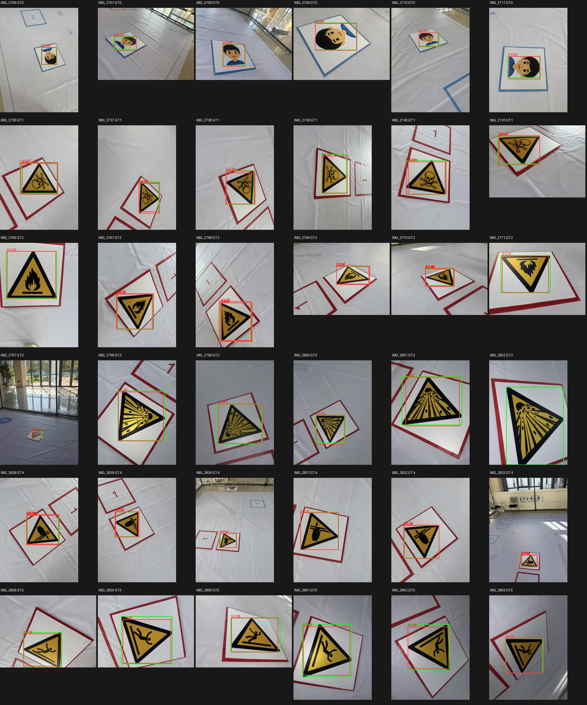

# YOLO异机训练成果本地验收

**后续实板验证（2026-10-25凌晨，工程归10月24日）：** NPU初始化恢复后，本地交回六类RKNN已在RK3399Pro完成原冻结36张图，平均API推理47.575ms，mAP50=0.7465／mAP50–95=0.6447；与下文ONNX同协议比较mAP50低1.664个百分点。目标机加载／运行已通过，业务识别仍未通过，收尾SSH异常及稳定性边界见[实板报告](../RK_NPU实板上电_2026-10-24/README.md)。下文“未上板／NPU阻塞”保留为本报告初次验收时状态，当前以本条后续证据为准。

[任务状态](../../项目资料/任务状态.md)｜[当天日志§12](../../../logs/2026-10-24_外设接入、NPU排查与YOLO验收.md#12-yolo异机训练成果本地验收)｜[训练方案](../../项目资料/YOLO重训与RK离线部署方案_2026-10-23.md)

真实核验时间：2026-10-25 01:03起，Asia/Shanghai；按08:00前规则归2026-10-24。SHELL反馈训练成果已从另一台电脑取回，要求验收。机器记录保留各次实际生成时间。

**验收结论：成果完整性、训练过程证据及本地浮点导出可用性通过，可接收为首轮试验基线；业务识别、RK量化精度及目标机部署验收未通过／未完成，不能用于自动任务触发。** 发现交回评估和解码实现错误，原“有毒0/6、干扰误触发5/12 @0.25”不作为有效验收结论。本报告保存原件证据并另行复测，没有改写交回包、训练权重、原始素材或飞行源码。

## 1. 接收位置、完整性与训练证据

接收ZIP位于项目内`yolov5training/YOLO异机训练交付_2026-10-24.zip`，解压根为同名双层目录。ZIP为76,878,302字节，SHA256：

```text
144d47c4655e31e3ede30315beaefe57b6af191c867954cbe6f2e9a96bc469fa
```

核验结果见[机器记录](integrity_audit.json)：

- ZIP全量CRC通过；100个文件（含SHA256SUMS本身）与解压目录逐字节一致。
- SHA256SUMS所列99项全部一致，无缺失或清单外文件；四个模型的大小及哈希与model_manifest一致。
- 本地原始素材`D:/SHELL/TargetDelection1.1.zip`大小866,460,635字节，SHA256仍为`6a9d4537ce546ae5bb0c429f565edaf3f0e44c6e0bd628b7faf5a061c9666b41`。
- 180张JPEG和180份XML的哈希均与交回split_manifest吻合。本轮完整解码并推理冻结测试集36张；训练端“180张全解码”的记录保留，本轮没有重复宣称全量像素人工审阅。
- train／val／test为108／36／36，每类18／6／6；无同名或相同JPEG字节跨集合。48张校准来源及哈希全部属于训练集，每类8张，无验证／测试来源。
- `group_independent=false`：仍是同一采集场景族、每类连续采集块内顺序划分；独立场景泛化、空场景、多目标、实际机载高度未验收。
- 主训练CSV确有200行，epoch按0起始为0–199；fitness最优为epoch185，P=0.84374、R=0.84700、mAP50=0.90158、mAP50–95=0.77668。末轮mAP50=0.87999、mAP50–95=0.76110。最优指标不是测试集成绩。
- 原生`val.py`日志记载测试mAP50=0.722、mAP50–95=0.634。这是交回训练端证据；不能与下述固定640方形ONNX复测视为完全相同协议。
- 结构为YOLOv5s-ReLU六类；使用SiLU COCO权重作形状匹配初始化后重新训练的事实已披露，不能称“匹配ReLU预训练权重”，也没有证据表明训练后才替换激活。

原始交回资料的精选副本存于[交回原始证据](交回原始证据/README_交回说明.md)，名称及字节保持不变，含评估脚本、模型清单、训练CSV、测试日志、分割和校准清单等。完整ZIP、checkpoint和部署二进制保留在接收目录，没有因本轮验收批量加入Git。

## 2. 模型结构与浮点一致性

| 文件 | 字节 | 本轮实际检查 |
|---|---:|---|
| best.pt | 14,426,920 | 哈希、容器CRC和pickle静态结构；epoch=-1，属于剥离训练状态的checkpoint；本轮未反序列化完整训练模型 |
| best.torchscript | 28,418,284 | 哈希、容器CRC、CPU加载及36张实际推理 |
| best.onnx | 28,136,557 | 哈希、onnx.checker、CPU加载及36张实际推理 |
| sixclass_yolov5s_relu_rk3399pro.rknn | 7,174,523 | 哈希与RKNN头；转换报告记载成功，本轮没有加载到RK运行 |

[ONNX结构记录](onnx_structure.json)：opset12；输入`images=[1,3,640,640]`；输出`output0=[1,33,80,80]`、`286=[1,33,40,40]`、`288=[1,33,20,20]`；57个Relu、3个Sigmoid，六类对应`3×(5+6)=33`通道。

使用**交回的最终文件**，在同一36张测试图、同一RGB输入、CPU fp32下比较TorchScript与ONNX三头，最大绝对差为**0.000030547380447387695**，见[最终导出对拍](delivered_torchscript_onnx_parity.json)。本轮证明这两个导出文件相互一致；没有把它扩大为best.pt全链对拍或RKNN量化一致。

## 3. 交回实现中发现的问题

| 项目 | 可复查位置 | 影响与处置 |
|---|---|---|
| RGB被再次反转 | [05_eval_test.py](交回原始证据/scripts/05_eval_test.py)第93–98行：PIL已convert RGB，随后又`[:,:,::-1]` | 实际送入BGR；自写混淆表与标准训练输入不一致。独立RGB／BGR对照确认影响，不能据此判定有毒类本身“绝对置信度校准差” |
| 工作阈值未应用 | 同脚本第103、130–138行：NMS用0.001，工作表选top1前未再按args.conf过滤 | 自称conf0.25，实际工作表仍使用低阈值候选。按交回detections.csv以0.001重建，36张全部吻合；改为0.25时测试有7张、验证有2张不吻合。阈值扫描和“无框即漏检”的文字解释也不能直接采信 |
| 网格漏减0.5 | [06_infer_onnx.py](交回原始证据/scripts/06_infer_onnx.py)第62行、[08_rknn_compare.py](交回原始证据/scripts/08_rknn_compare.py)第58行及[集成说明](交回原始证据/docs/integration_notes.md) | 应为`cx=(2*sx+grid_x-0.5)*stride`，cy同理。漏项使三尺度框在640输入坐标均向右下偏4／8／16像素。不是仅NMS取舍；原“放心移植”结论撤回。见[逐图偏移证据](decode_offset_diagnostic.json) |
| 对拍证据不足 | [onnx_parity_summary.json](交回原始证据/reports/onnx_parity_summary.json)及06脚本 | 路径指向临时snapshot；`matched=0`等字段仅初始化未更新；共用错误解码只能证明双方共用计算接近。原NMS比较还没有按类别一一匹配，不能排除坐标公式错误。本轮补做最终TorchScript／ONNX原始头对拍 |
| 量化脚本没有板端入口 | 08脚本第143行固定`init_runtime(target=None)` | 没有target／device_id参数，无法按交回说明直接连接本板；且只比较top1／计数，不能替代带GT的逐类量化精度与业务误报验收。未到运行步骤不证明后续对比流程可用 |
| 人工说明中的哈希笔误 | [交回说明](交回原始证据/README_交回说明.md)、[导出记录](交回原始证据/docs/export_quantization.md) | TorchScript人工哈希尾部写成`...dc1adde5e...`，实际为`...dc1adee5e...`；机器SHA256SUMS和model_manifest正确，文件没有因此损坏 |

解码公式依据固定[上游Detect源码](https://github.com/airockchip/yolov5/blob/d25a07534c14f44296f9444bab2aa5c601cdaaab/models/yolo.py#L108-L123)：`_make_grid`已经在索引上减0.5；导出三头保留sigmoid而未包含该网格。RGB依据同版本[数据加载代码](https://github.com/airockchip/yolov5/blob/d25a07534c14f44296f9444bab2aa5c601cdaaab/utils/dataloaders.py#L663-L681)：OpenCV读取BGR后才转RGB；PIL起始RGB不应照抄通道反转。

## 4. 本轮独立复测

本轮没有更改权重、数据划分、anchors或优化测试阈值。使用冻结test的36张原图及原XML，只作纠错核验；由于已经用于诊断，后续训练仍应建立新的场景独立测试集。CPU环境及版本见onnx_structure.json；PyTorch仅安装CPU推理版本2.5.1+cpu到项目外临时目录，没有训练。

统一RGB、OpenCV双线性缩放、114灰填充、固定640方形letterbox；按空间尺度排序输出；含−0.5网格偏移，撤销padding并按原图裁剪。AP按conf0.001、**multi-label**、逐类NMS IoU0.6，十个匹配IoU阈值0.50–0.95及101点积分计算；每图一个GT，匹配一一对应。该协议与原生PyTorch验证的缩放插值、矩形batch及浮点路径不同，下面mAP不是对原0.722的直接更正。

| 类别 | 测试GT | 本轮ONNX AP50 | 本轮ONNX AP50–95 | 部署式工作点：存在正确框 | 部署式工作点：最高分框正确 |
|---|---:|---:|---:|---:|---:|
| 人员 | 6 | 0.9950 | 0.8988 | 6/6 | 6/6 |
| 有毒 | 6 | 0.8063 | 0.6810 | 3/6 | 2/6 |
| 易燃 | 6 | 0.6340 | 0.5706 | 2/6 | 1/6 |
| 易爆 | 6 | 0.8670 | 0.6922 | 5/6 | 5/6 |
| 干扰1 | 6 | 0.8850 | 0.8210 | 5/6 | 3/6 |
| 干扰2 | 6 | 0.3913 | 0.3464 | 6/6 | 6/6 |
| 宏平均 | 36 | **0.7631** | **0.6683** | — | — |

“部署式工作点”明确为：每anchor候选只取最高分类分数（best-class）、score=obj×class，conf≥0.25、逐类NMS IoU0.6，正确框要求类别正确且与GT IoU≥0.5；不是业务验收阈值承诺。“存在正确框”允许同图同时还有错误类别，不能等同该图任务判断正确。

**干扰图仍然产生业务类框：** best-class方式为**3/12**，图为IMG_2829、IMG_2832、IMG_2833；multi-label方式为**4/12**，另加IMG_2828。仅取整图最高分框会只统计出2/12，遗漏非top1业务框，不能替代“任一业务框可能触发”的检查。原报告的5/12来自有缺陷的另一套评估，三者不可混用。

同一固定方形管线故意改为BGR的诊断mAP50降到0.4235；该结果只用于确认输入通道影响，不作为另一种候选模型成绩。CPU时间也不作为RK帧率或延迟证据。

机器明细见[复测指标](independent_evaluation.json)、[RGB全部预测](rgb_predictions.json)、[best-class工作点预测](rgb_bestclass_working_point_predictions.json)、[BGR诊断](bgr_diagnostic_predictions.json)。绿色GT、红色预测；图中文字数字为类别ID：



## 5. RK、恢复性及后续验收边界

- 交回RKNN文件及转换报告可接收为**待上板的转换产物**。`rknn_convert_report.json`记载load／build／export均返回0，配套环境记录toolkit1.7.5、目标rk3399pro；报告自身toolkit字段仍为unknown，未附完整转换stdout及实际张量量化参数。本轮未重跑旧SDK转换，不用文件头或报告返回码代替硬件兼容验收。
- 板端仍须确认运行库／代理／固件配套、NPU设备发现、模型可加载、输入输出布局与量化参数、逐类精度／误报、延迟／结果年龄、内存温度和持续运行；最新项目[NPU枚举记录](../RK_NPU枚举排查_2026-10-24/README.md)仍有阻塞，本轮没有SSH复测、刷机或改GPIO。
- 原“模拟器不支持”的情况保留为训练端记录；不将本次要求解释成项目强制锁定1.7.5，也不擅自更换SDK来宣称已验收。08脚本修正前不能直接承担上板量化验收。
- 未交回可恢复优化器状态的last checkpoint／获取哈希；best.pt静态epoch=-1。可用作后续微调起点不等于可从原优化器状态精确恢复。脚本还依赖原工作目录结构和部分绝对路径，换机需要显式重定位；交回包不是开箱完整恢复环境。
- 从零训练对照仅完成40个epoch且异常结束，旋转增强轮仅到epoch13；不能由此证明“从零训练不可行”或“增强无效”。SiLU初始化限制需保留，但不能仅凭它归因全部识别错误。
- 后续先修正并统一评估／解码，再在**异机**补采与训练，尤其区分有毒／易燃／干扰1；新增独立场景测试、空场景及多目标图。阈值标定只能用验证／标定集；当前没有SHELL确认的数字门槛，不虚构业务合格阈值。
- 解决NPU初始化后可做隔离图片小试；ROS视觉包、任务适配、相机及并行负载分别验收。即使NPU跑通，也不自动放行任务触发、投放或飞行。

## 6. 复现与保存

独立核验工具：[verify_yolo_delivery.py](../../../tools/verify_yolo_delivery.py)。本机运行示例（PowerShell，路径可按本机改写）：

```powershell
$package = (Get-ChildItem yolov5training -Recurse -Filter README_交回说明.md | Select-Object -First 1).DirectoryName
& 'C:/Users/alexh/.cache/codex-runtimes/codex-primary-runtime/dependencies/python/python.exe' `
  tools/verify_yolo_delivery.py --package $package `
  --source D:/SHELL/TargetDelection1.1.zip `
  --out docs/验证记录/YOLO训练成果验收_2026-10-24 `
  --runtime C:/Users/alexh/AppData/Local/Temp/uav-yolo-acceptance-runtime `
  --torch-runtime C:/Users/alexh/AppData/Local/Temp/uav-yolo-acceptance-torch
```

核验运行时位于项目外临时目录；关键版本：numpy1.26.4、onnx1.17.0、onnxruntime1.20.1、opencv4.10.0.84、torch2.5.1+cpu。它们是本机验收CPU依赖，不是RK目标运行包。仅核完整性可加`--integrity-only`；仅补最终两种浮点导出对拍可加`--parity-only`。

本轮只新增核验工具、报告、必要原始证据副本并同步当天日志／任务状态／总索引；未训练，未连接或改变RK、相机、飞控、舵机、launch及业务接口，未将待验收模型替换进src。
