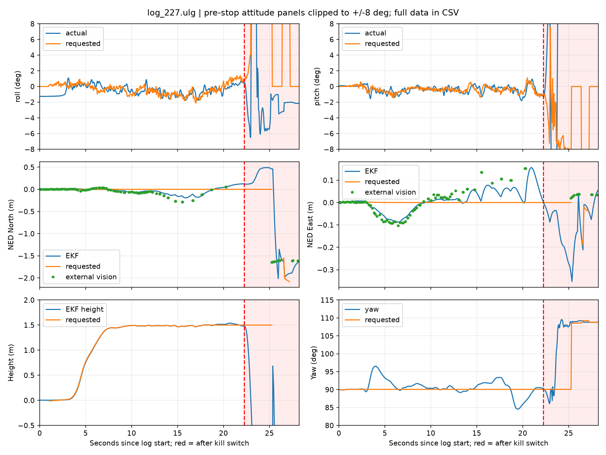

# 10月28日约13:00起飞摇晃与靠墙事件：只读排查

**现场补充已确认（10月28日下午）：** SHELL确认启动时机头朝所说地图−Y、实际向−X偏移，事后重启全部设备，QGC先选OFFBOARD再点Takeoff；锁桨导致起落架损坏、当前机体可能倾斜。QGC操作与记录及PX4源码相符，取代下方初轮“具体操作待确认”；起飞后的真实轨迹和振动根因仍无完整外部证据。已授权加入轻量日志和修正起飞入口，后续实现／部署状态见[轻量日志与起飞入口验证](../轻量机载日志_2026-10-28/README.md)及[当日日志§4–5](../../../logs/2026-10-28_起飞排查、轻量日志与GitHub归档.md)。以下“只读、未部署”描述的是首轮取证阶段。

## 1. 结论与证据强度

**最有证据支持的异常是：外部定位在锁桨前已间断，实际起飞控制进入PX4 AUTO.TAKEOFF，且机体存在明显振动。当前不能唯一确定靠墙的根因，更不能直接判成`--yaw -90`写反、某一电机损坏或RK性能不足。**

- **[已核验] 定位连续性存在问题。** ROS出现`location: TF_STALE; vision pose withheld`及任务`BLOCKED_TF_STALE`；PX4主EKF在锁桨前多次进入惯性推算状态。此时即使PX4本地位姿仍连续发布，也不表示雷达定位仍在正常校正漂移。
- **[已核验] 实际飞行没有按任务程序自己的起飞阶段推进。** ULog记录外部`MAV_CMD_NAV_TAKEOFF(22)`后解锁，起飞至锁桨期间为AUTO.TAKEOFF，`flag_control_offboard_enabled=0`。ROS任务有起飞前OFFBOARD模式，但没有`status: TAKEOFF`、TRANSIT或航点下发证据。来源系统255／组件190符合地面站常见标识，**具体是QGC哪个操作仍待SHELL确认**。
- **[已核验] 振动需要按动力／机械优先排查。** 锁桨前加速度各轴峰峰值约10.35／11.74／9.97m/s²，gyro FFT的Y／Z主峰约105Hz。记录支持存在明显高频振动，不能据此区分桨叶不平衡、机架／飞控／雷达固定、电机／电调一致性或滤波／控制参数问题。
- **[待确认] 靠墙方向与真实运动。** 锁桨前PX4估计的水平位置偏差仅约分米量级，与SHELL看到的靠墙现象不能直接等同。失去外部校正时估计值可能低估真实运动；目前没有完整ROS录包和视频，无法还原真实轨迹或认定哪一坐标轴反向。

本轮只读取设备，不改飞控参数、PID、定位门限、默认动作门或板端启动功能，不解锁、不切模式、不发动力／舵机命令。不把SHELL报告“已起飞”扩展为自动导航或实飞验收通过。

## 2. 取证、时钟与原件

2026-10-28经`rk-uav` USB密钥SSH连接，读取时RK日期约为2026-10-24 02:14、启动约6分钟；未在任务运行中校时。真实日期按电脑北京时间，板端和飞控文件时间仅作原始证据，不能作为现场真实时刻。

先复制`~/.ros/log`、实际`uav_start.py`和定位源码；再确认FCU未解锁，使用NSH只读命令核验PX4 **1.13.3**、logger运行、`SDLOG_MODE=0`、`SDLOG_PROFILE=1`、`EKF2_AID_MASK=24`、`EKF2_HGT_MODE=3`、`SENS_BOARD_ROT=0`。随后用MAVLink日志列表／数据请求取回最新两份ULog，没有改日志配置或删除飞控SD卡文件。

| 本地原件 | 飞控原路径 | 字节数 | SHA256 |
|---|---|---:|---|
| `log_227.ulg` | `/fs/microsd/log/2026-10-27/21_26_53.ulg` | 1357134 | `c5cbab8d2fdc88366aa69a8e42dc28f66359d5e24afda2c0733b6929fe27d15a` |
| `log_226.ulg` | `/fs/microsd/log/2026-10-27/20_10_42.ulg` | 1420582 | `f775b7d57a4a37ddf36eff369298902b3baf50b5987675cd44a73d42a176cf2a` |

本次以**含Kill-switch事件的最新227**为主要对象，关联ROS运行`acff1fce-cf0c-11f1-96d2-14f5f9e6cd08`。226为此前不同运行，其姿态几乎静止、后续自动降落；不能仅凭“Takeoff detected”把它认作同一次真实离地，也不把两轮数据拼成一次飞行。两份ULog均可完整解析，未报告ULog dropout。

原始数据在本地Git忽略目录[recordings/incident_20261028](../../../recordings/incident_20261028/)，不是云端备份。精选指标、参数、CSV及图纳入本轮文档。见[来源与SHA](证据来源与校验.json)、[下载核验](ULog下载核验.txt)及[ROS关键事件](本次ROS关键事件.txt)。复制的实际启动脚本哈希与昨夜回退记录一致；导航逻辑使用Git `8aa597c`恢复的源文件，其SHA与昨夜板端回退核验一致，**因随后断连，未重新读取本次板端导航源码／二进制SHA**。

## 3. 本次时间线：必须区分锁桨前后

下表以227号ULog起点为0秒。日志起点接近解锁，ROS接收时间不能直接当作飞控微秒时钟。

| 相对时间 | 证据与含义 |
|---:|---|
| −34.426s | 外部模式命令176，选择OFFBOARD；ROS也记录到OFFBOARD。 |
| −0.157s | 外部`MAV_CMD_NAV_TAKEOFF(22)`。 |
| −0.041s | 外部解锁命令400；随后实际控制为AUTO.TAKEOFF。 |
| 1.791s | FCU报告Takeoff detected。 |
| 约8s | 高度估计到约1.45m，之后主要维持约1.5m。 |
| 约14–20s | 外部定位记录出现0.7–1.5s间断；主EKF在16.493s、19.746s进入惯性推算，短暂恢复后再次断续。 |
| 20.295s | 一次外部定位更新；随后至25.244s才再次记录，间隔4.948s，**该间隔跨越锁桨**。 |
| 21.303s | 主EKF再次进入惯性推算，发生在锁桨前。 |
| **22.241s** | **Kill-switch engaged**，符合SHELL手动锁桨。此时距上次记录外部定位已约1.95s。 |
| 25.299–25.308s | no local position failsafe／DESCEND，发生在锁桨后约3.06s。 |
| 25.99s以后 | EKF实例切换、位置／高度／航向重置；不能当作锁桨前的漂移实测值。 |
| 27.243s | Disarmed by kill-switch。 |

主EKF最初为实例1。`estimator_visual_odometry_aligned`在默认日志中降频保存，不能据其计数计算原始ROS发布频率；但长间断同时得到ROS的TF_STALE和EKF惯性推算标志支持。PX4 v1.13.3源码仅在收到新外部观测时发布该对齐话题，见[EKF2.cpp](https://github.com/PX4/PX4-Autopilot/blob/v1.13.3/src/modules/ekf2/EKF2.cpp#L584)。

## 4. 摇晃、振动与位置数据

**只取1.791–22.241s，即离地检测之后、锁桨之前：**

| 指标 | 结果 | 判断边界 |
|---|---|---|
| 横滚估计 | −1.77°～+1.09°；跟踪误差RMS约0.66° | 未显示锁桨前几十度的低频翻滚；姿态话题20Hz，不排除更高频振动。 |
| 俯仰估计 | −1.83°～+0.94°；跟踪误差RMS约0.45° | 暂不支持直接断言姿态环严重失控。 |
| 航向估计 | 84.56°～96.53°，期望约90.06° | 约12°范围的变化需要检查真实机头摆动与SLAM航向反馈；估计航向不是真实外部测量。 |
| 加速度峰峰值 | X约10.35、Y约11.74、Z约9.97m/s²（2s至锁桨） | 明显振动线索；不能用该值推定某只电机故障。 |
| IMU裁剪／设备错误 | 两组IMU锁桨前均无裁剪增量或设备错误 | 锁桨后另一组IMU出现裁剪，不混为先前故障。 |
| 飞控自身CPU | 锁桨前约34.9%～36.3% | 这是PX4，不是RK负载；本次没有RK CPU／温度／磁盘性能连续记录。 |
| 飞控水平位置设定值 | 主要维持起点附近 | 不是向1.95m路线航点飞行。 |

高频振动与缓慢航向摆动可能同时存在。PX4官方建议同时检查参考值跟踪与传感器振动，并把2–3m/s²以上峰峰值作为强振动线索；这不是本机机械合格阈值，见[官方日志分析](https://docs.px4.io/v1.13/en/log/flight_log_analysis)。现有数据不能证明振动一定导致TF断流，二者之间仍需独立验证。

图中位置均是PX4 **NED估计坐标**，没有独立真实轨迹校验。红线后的高度／位姿发散受停转下落、观测间断和EKF重置影响；不能把其中“27m”等极值解释为飞机真实飞行距离。完整数据见[227分析JSON](log_227_analysis.json)、[227逐样本CSV](log_227_trace.csv)与[按时间分段指标](最新架次分阶段指标.json)。

## 5. `--yaw -90`与任务控制的解释

本机`--yaw`传入`field_yaw_deg`，表示**场地坐标到SLAM地图坐标的路线旋转依据**，不是要求飞机把飞控yaw改为−90°。任务起飞航向取当前PX4本地姿态；源码转换使用`R(-field_yaw_deg)`。

本次实际打印的首点为`field=(0,-1.95) → map=(1.95,0)`。如果SHELL所说“地图−Y”是场地图上的−Y、起始机头按该方向摆放，则SLAM以初始机头建立自身坐标，这个转换可能正是原设计；不能只见地图+X就认定符号错误。需要把场地图、ROS map、PX4本地ENU/NED分别核对。

更直接的问题是控制路径：任务`auto_start=false`，仅在同时看到**armed且OFFBOARD**时`beginTakeoff()`，再向1.5m起飞并转入路线；本次解锁后为**AUTO.TAKEOFF**，因此任务没有开始。旧版等待阶段仍可能发布保持设定值，但AUTO模式使用飞控自动控制，不据“ROS仍在发设定值”声称任务拥有控制权。

所以，本次不能通过盲改yaw到+90或直接重试导航来验证原因。QGC自动起飞和任务OFFBOARD起飞不能混为一步；具体触发操作仍等SHELL补充。确认控制权问题是必要修正，但**改正起飞模式本身不保证振动和定位问题已解决**。

**后续已查明触发路径：** SHELL确认使用QGC Takeoff。PX41.13.3的[NAV_TAKEOFF处理代码](https://github.com/PX4/PX4-Autopilot/blob/v1.13.3/src/modules/commander/Commander.cpp#L1056)明确切入MAIN_STATE_AUTO_TAKEOFF。ULog中命令22在离地检测前约1.95s，因此此处不是已经证实的“离地后OFFBOARD超时掉出”，而是起飞指令主动改变模式。修正入口应在OFFBOARD中只发正常解锁，由任务已有高度设定值起飞；不通过自动抢回模式覆盖人工接管。

## 6. 昨日记录器是否恢复

**建议补回关键证据能力，采用轻量版；本轮只评估，未重新安装。** 飞控ULog本次已经成功保留，因此飞控模式／姿态／锁桨顺序可查；缺少的主要是RK侧“为什么定位过期”和任务／定位实时输入的关联证据。

昨夜数据已重新核对：[性能报告](../机载飞行记录_2026-10-27/README.md)。无图像核心版额外约**7.72个百分点整机CPU／100MiB**；完整版约**9.70个百分点／170MiB**，均超预设预算。昨日记录器已撤下，不能作为今天起飞故障的运行负载来源，也不能直接原样恢复后称为性能通过。

推荐最快可评审的实现顺序：

1. **继续保留飞控SD ULog，落地后按架次取回。** 当前无需修改飞控日志参数；保存ULog、实际参数和对应机载运行ID。
2. **先做无需重编译飞行节点的独立小白名单录包。** 记录`/mavros/vision_pose/pose`、`/mavros/local_position/pose`、`/mavros/setpoint_raw/local`及反馈、`/mavros/state`、`/mavros/statustext/recv`、`/mavros/rc/in`、`/location_node/status`、`/mission/status`、`/mission/readiness`；旁存启动stdout和一次参数／版本快照。不要录相机、整张地图、全量雷达扫描、全量TF或在线生成报告。独立记录器失败不得停止飞行节点。
3. **若仍不能定位断流，再加定向诊断。** 每秒约2–5次保存SLAM TF原始时间／年龄、IMU／测高年龄及拒收原因、关键进程CPU／RSS，必要时追加低频路径／扫描。不能仅靠本地位姿持续发布判断定位健康，也不要为取日志先修改TF超时门限。
4. **先禁动地面对照再决定常驻。** 使用相同相机／识别／SLAM／监看负载，开关各做稳定窗口，测整机CPU、关键话题间隔、TF新鲜度、设定值节拍与磁盘写入；保留昨日预算作为初始筛查。小白名单预计更轻，但未实测，不能许诺“零负载”或飞行安全。

即便完整图像版已有实现，本次最缺的是小数据控制／定位证据。先恢复这一层比重新部署图像存档、推理源帧和全量场景更直接；不需要重新训练模型或恢复旧视觉路线。

## 7. 下一步与本轮收尾

按项目排障顺序：

1. SHELL先检查桨叶／电机转向与编号、机械固定／减振、供电和校准实际结果，结合约105Hz振动线索；不能仅凭本次软件分析签认动力通过。
2. 恢复USB后，只做禁动地面观测，关联TF、原始测距／IMU时间、Cartographer处理队列、MAVROS时钟与RK资源；检查为什么0.25s门限频繁被触发。现有ROS日志在事件末段不完整、缺连续资源记录，尚不能区分CPU排队、传感器时间、SLAM或通信问题。
3. 地面核对“沿各真实方向移动／转动时，SLAM map与PX4本地反馈的符号、航向和延迟”，再核对场地路线旋转。保持动作门关闭，不通过试飞猜轴向。
4. 分清QGC自动起飞与任务OFFBOARD接管；先验证明确的控制权／模式状态。当前不建议带着定位间断继续同样的自动飞行重试。

约13:40 USB SSH出现超时，无线别名也超时。助手未关机、未重启、未改变板端任务；下载进程此前已结束并关闭飞控串口。仅在RK `/tmp/`保留本轮只读诊断脚本和下载副本，无自启或常驻记录器。因断连未再次执行板端最终资源审计，不声称当前设备连接状态已恢复。

离线分析工具为[analyze_px4_takeoff.py](../../../tools/analyze_px4_takeoff.py)，依赖`numpy`、`pyulog`，绘图另需`matplotlib`；本轮依赖只装入本机Git忽略的`tmp/`，没有向RK安装Python包。工具同时解析两份ULog并验证本次NAV_TAKEOFF、AUTO模式和kill时序；完整日志与分段数字另交叉核对。下一步等待现场信息及恢复连接，不把本报告列为根因已完全闭环或实飞放行。
