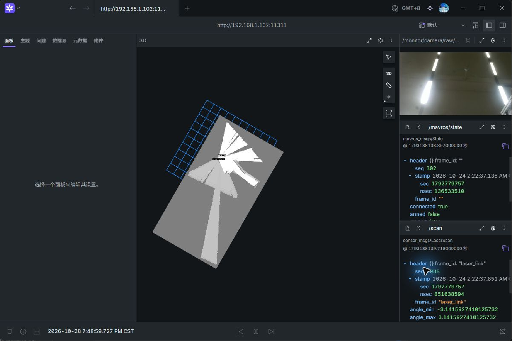

# 三米隔墙Wi-Fi禁动续验与闲置JPEG订阅回收

实际核验：2026-10-28约19:24–19:53，北京时间。SHELL确认路由器约3m、隔墙，授权接续；起落架／舵机损坏、机体不能平放及TFmini不作判断的条件沿用。板钟仍为10月24日，未在ROS运行中调时。

## 1. 当前结果与边界

**重启后的分级静止禁动与原生监看验证通过；首轮整机联查启动后无线失联尚未闭环，正式定位／解锁／飞行未验收。**

本轮修复一项此前加入的可选显示开销：JPEG转发器无人查看时仍订阅完整图像。现已改为有压缩图像客户端才订阅源、最后一个客户端离开后注销；不改相机解码、RKNN、SLAM、DWA、飞控参数或日志禁用开关。旧版无人查看时转发器约45.64%单核CPU，修正版约2.96%；同轮整机约52.90%→42.84%。这是有限地面对照，不能外推为飞行性能保证。

## 2. 首轮失联与SHELL恢复

初始Wi-Fi SSH成功，RK为192.168.1.102，电脑WLAN为192.168.1.100；RK信号约−42dBm、2.4GHz／2412MHz，协商发送速率150Mbit/s。初始12次ping全通，5–162ms，平均46ms。协商速率不代表实际吞吐或实时保证。

首轮诊断将传感器、相机、禁动识别及JPEG转发并行启动；随后SSH与ping超时，ARP邻居无法解析。当时Foxglove尚未连接数据源，不能归因为原生监看流量。电脑到路由器仍为4–8ms可达。电脑当时唯一USB网卡属于手机，**没有RK USB后备链路**，不把USB别名超时当成第二条RK故障证据。

SHELL确认未移动接线，电源灯／风扇等仍在工作；随后手动重启RK并断电恢复。boot ID由`78d8d200-3f1d-4d29-ab20-597a4e2eb7f0`变为`d22514f4-584b-4d45-99ce-cec9ae4778d6`。诊断`/tmp`为tmpfs，首轮临时日志随重启丢失，持久journal未取到失败boot的内核条目。**不能从现有证据认定为CPU、隔墙距离、供电、无线驱动或某一个节点导致；后面的通过也不抹去这次失联。**

后续改用持久目录`/home/jcfh/shell_acceptance_20261028/wifi-wall/`，诊断工具[逐级启动并采样](../../../tools/wifi_ground_probe.py)。当前工具要求显式`--staged`，不再提供默认全开路径；实际执行版本另保存在原件包内。原件取回到本地Git忽略的`recordings/wifi_20261028_wall/`，并在测试过程中分段取回，降低再次重启造成证据丢失的风险。

## 3. 分级负载与实际原生监看

MAVROS只启传感器／反馈白名单，没有cmd／set-mode／setpoint插件；定位`use_tf_mini=false`，不打开TFmini，不输出vision pose。导航`enable_actuation=false`、`auto_start=false`、`use_real_servos=false`。使用同一真实相机、雷达、Cartographer及RKNN，观察器不订阅完整相机图像。两轮正常采样共349＋445条，均未观察到armed、设定值、vision pose、GPIO或舵机节点；计数与限定范围见[负载／TF摘要](分级负载与TF摘要.json)。

下表CPU为整机百分比，转发器CPU另按单核100%计。每个阶段舍去最初10条过渡样本；暂时运行真实启动检查的高负载样本剔除。阶段时间有限、SLAM有初始化差异，不把小幅差异当作确定收益。

| 工况 | 有效样本 | 整机CPU均值 | TF最大年龄 | WLAN发送均值 |
|---|---:|---:|---:|---:|
| 定位／雷达／IMU | 48 | 23.11% | 71.64ms | 0.02Mbit/s |
| 加相机，无图像客户端 | 35 | 26.69% | 65.74ms | 0.05Mbit/s |
| 加禁动RKNN／DWA | 42 | 42.50% | 54.86ms | 0.07Mbit/s |
| 旧JPEG转发，无查看者 | 30 | 52.90% | 88.51ms | 0.14Mbit/s |
| 旧JPEG转发，原生监看 | 144 | 60.58% | 92.15ms | 6.05Mbit/s |
| 修正版JPEG，无查看者 | 103 | 42.84% | 70.66ms | 0.05Mbit/s |
| 修正版JPEG，原生监看 | 83 | 59.04% | 78.85ms | 5.87Mbit/s |
| 修正版监看关闭并回收 | 65 | 43.64% | 65.85ms | 0.17Mbit/s |

上述有效窗口没有采到map→base_link TF年龄超过250ms，IMU／scan保持约50／10Hz；模型加载、相机新鲜度和推理就绪为true。开启监看时仍有正常的编码／传输开销，本轮**不声称已消除实时显示开销，亦不调整主功能性能**。静止地面不覆盖机体运动、振动、飞行控制输出及实际航点推进。

Computer Use实际在已安装Foxglove中选择**ROS 1原生连接**，Master为`http://192.168.1.102:11311`、ROS_HOSTNAME为电脑IP`192.168.1.100`，看到真实地图、JPEG相机、scan和connected=true／armed=false。没有用WebSocket代替这项验收，也没有向远程服务上传数据或发送飞行指令。地图出现不表示倾斜机体下地图几何已合格。

[修复前同一原生监看](../../../logs/附件/2026-10-28/隔墙WiFi_修复前原生监看.png)作为对照。修复后监看开启期间45次ping全通，3–120ms，平均31ms；另一轮覆盖闲置／门控过程的45次ping全通，4–310ms、平均30ms。短窗口无丢包不意味着链路不会再断。

## 4. 修复与功能验证

[monitor_jpeg.py](../../../src/location/scripts/monitor_jpeg.py)原版在构造时就订阅`/camera/image_raw`及`/detect_result`。虽然无人查看时不编码JPEG，rospy仍持续收取／反序列化完整RGB图像；它独立于`UAV_LOG_DISABLED`，所以关闭录包不能去掉这项负载。

修正版由原有发布定时器管理源订阅：有live或archive客户端则建立订阅，无客户端则注销并清空旧帧。图像尺寸、JPEG质量、显示fps上限、archive-only约2Hz、新鲜度拒绝和源时间戳保持原样。仅后台显示辅助程序变化，无相机／模型／规划器主功能优化。

通过[隔离测试工具](../../../tools/monitor_jpeg_probe.py)在私有`127.0.0.1:11344`发布小幅合成ROS图像，验证7项行为：[空闲无源订阅、实际JPEG与原始header、关闭回收、重连新帧、旧帧拒发、archive-only限速、archive断开回收](JPEG订阅生命周期回归.json)。隔离回归没有相机、飞控、舵机或硬件服务。实际监看退出到控制台后，板端[节点订阅实读](监看关闭后节点订阅.txt)为`Subscriptions: None`，真实原生连接、退出回收与CPU下降已验证；同一转发进程的断开／重连另由隔离回归覆盖。

部署前原件备份为`~/shell_acceptance_20261028/wifi-wall/monitor_jpeg_before.py`。Python2编译通过，本机与RK源码SHA均为`e47db19089e04e0405cdfe40db3c3bb5081ef4563eb35d96d184cc41f7016c84`。无需重编译，任务C++二进制仍为`e1c5e29da9ce687f067867a3c3c12a1eeee83080a0d3d3f0a4da7dd3eb5a5d28`。

## 5. 启动门控的真实输入验证

在真实Wi-Fi传感器图上调用当前实际入口的`wait_ready(6)`，正确返回`Startup timed out; missing vision, location READY`，见[门控结果](真实输入启动门控结果.json)。返回后检查工作进程继续短暂存活，但不再保持图像／地图／TF订阅；没有伪造高度或vision数据来制造成功就绪。

另实际执行了**只读**`uav arm --check`，结果为拒绝，具体列出MANUAL、pose_fresh／tf_fresh、任务动作门关闭、pose／vision缺失、`HEIGHT_DISABLED`及设定值缺失。没有运行不带`--check`的解锁命令。任务readiness中的tf_fresh依赖map／local对齐；当前缺PX4 local pose时为false，不能把它直接等同本轮独立观测的SLAM TF过期。

因此本轮不验收`uav a`／正式mission已可运行，不放宽定位、模式或动作门。上一轮成功路径的合成订阅回收回归仍见[USB事故排查报告](../再次起飞失败_2026-10-28/README.md)。

## 6. 原件完整性与收尾

最终原件`recordings/wifi_20261028_wall/wifi-wall-final.tgz`在RK／本机SHA均为`bd18df8d8a30afbe38d89ee4818552af1a52d906326b100ca8c9377c90c9bb8c`。162个普通文件逐项哈希一致，3个Windows未展开的latest符号链接仍保留在tar中，见[完整性核验](原件完整性.json)。未修改用户原始飞行日志。

部分旧版ROS XML-RPC总字节统计超过32位上限，返回`int exceeds XML-RPC limits`；记录为诊断缺口，未造成节点退出，不用缺失的统计伪造图像帧率。后续工具将连接信息与可溢出的字节统计分开保存。本轮程序退出过程首个资源快照仍见串口句柄，故待所属进程组完全退出后重新核验；仅最终结果作为收尾依据。

[最终资源核验](最终资源核验.json)确认本轮ROS／监看／门控／隔离回归进程已退出，飞控、雷达、相机、I²C句柄无人占用；NPU电源、固件、代理与target四项active。日志INACTIVE，`UAV_LOG_DISABLED=1`未改；末尾5个1秒空闲整机CPU样本约0.34%–0.51%。未关机，未重启／更改飞控，未修改运行时钟或无线配置。

主要交付提交`17f2b16`保留在当前任务分支，未推送。已按SHELL此前授权通过Gmail向shell05117@outlook.com通知续验结果，消息`1a1826144a6fc5d9`返回SENT；邮件明确首轮失联未查明及飞行未验收，不等同收件端已读。

## 7. 尚未完成的验证

- 首轮失联原因仍未查明；不能把分级重试稳定写成已修复无线掉线。以后复现时先通过可用后备链路保存当前boot的内核／网络和持久诊断证据，再重启。
- 机体不能平放、TFmini不作高度依据且舵机损坏。完整定位READY、物理方向／yaw正负、测高融合、正常解锁、航点执行及飞行均未验收；不以QGC Takeoff绕过门控。
- 后续须在恢复机械支撑与可靠测高后，禁动核对机体真实前／后／左／右移动与SLAM／PX4 local反馈，再决定是否要改坐标；当前不凭静态图或公式盲改符号。
