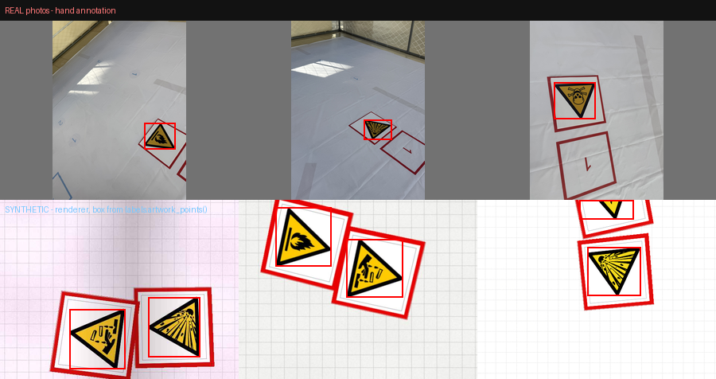

# SSD 危险品 / 人员识别 —— 训练方法与脚本

替代原来的 HSV 色窗方案。目标：在机载 **Jetson Nano / TensorRT 7.1.3.0** 上跑，  
识别 **9 类危险品图案 + 1 类受伤人员（共 10 类）**，并按比赛规则在回传画面里画  
红框（危险品）/ 蓝框（人员）。

推理端沿用 `ssd_ros`（<https://github.com/borongyuan/ssd_ros>；UFF + graphsurgeon  
⇒ TRT 7.1.3 仍然可用，TRT 8 才移除）。注意它**不在本工程的 `src/` 里**，是独立的  
catkin 包 —— 见第 7 节。

---

## 0. 一句话流程

```
labels.py  ──类别体系唯一真相源（10 类、标注框几何）
   │
   ├─ build_dataset.py          ← 一条命令做完本机半边（= 下面四步）
   │     │
   │     ├─ check_box_convention.py   门禁：两半的"框"必须指同一个物体
   │     ├─ gen_synth_dataset.py      → 合成集（预训练，9 类危险品，几何精确）
   │     ├─ prepare_real_dataset.py   → 实拍集（微调，4 类，真实域）
   │     └─ voc_split.py                  → 报出划分与每类框数（划分的唯一决策点）
   │
   ▼
data/task_ds/                 images/ + annotations/（就是 VOC，只差目录名）
   │
   ├─ prepare_pytorch_voc.py  ← 铺成 pytorch-ssd 的布局 + 写 labels.txt
   │                            （**复用上面那个划分函数**，两条路线同一批图）
   ▼
data/voc_task/                JPEGImages/ Annotations/ ImageSets/Main/ labels.txt
   │
   ▼   ── 以下在有 PyTorch 的机器上（你本机 conda）──
train_pytorch_ssd.py
   ├─ train_ssd.py       （jetson-inference 自带，原样调用）
   ├─ onnx_export.py     （同上）
   └─ check_onnx_contract.py   ← **门禁**：判定这个 .onnx 能不能用
   ▼
data/models/task/ssd-mobilenet.onnx  +  labels.txt
   │
   ▼   ── 拷进包内：src/ssd_detection/models/（运行时就读这里）──
$(find ssd_detection)/models/ssd-mobilenet.onnx  +  labels.txt
   │
   ▼   ── 以下在目标 Jetson 上 ──
detectNet 读 ONNX，首帧自己建 engine 并缓存到模型旁边
   │
   ssd_detection 节点  (输入 300×300、RGB、2*p/255-1)
```

**没有 frozen graph、没有 UFF、没有 graphsurgeon、没有 `.plan`、Jetson 上不装
TensorFlow、没有任何自定义插件。** 拷到飞机上的东西只有两个文件。

**改任何类别名、增删类别、改贴图 ⇒ 之前所有产物作废，必须重跑整条链。**
这是设计如此：类 id 与权重漂移会产出"自信的胡话"。

**分清哪一步在哪台机器上跑**（这是最容易白折腾一晚上的地方）：

| 步骤                                | 在哪跑                  | 需要什么                      |
| --------------------------------- | -------------------- | ------------------------- |
| 生成合成集、转实拍集、划分报告              | 本机（Windows 也行）       | Pillow + numpy + scipy    |
| 铺 `pytorch-ssd` 布局 + 写 `labels.txt` | 本机                | 只用标准库                    |
| 训练 + 导出 ONNX + 门禁              | **有 PyTorch 的机器**（你本机 conda） | torch（**实测版本 2.4.1**） |
| 推理                                | 仿真 PC 走 OpenCV DNN / **Jetson 走 detectNet** | 同一个 `.onnx` |

`.onnx` 是与体系结构无关的 protobuf，在 PC 上导出、拷到 Jetson 即可。
**别在飞控机上装 TensorFlow。**

训练脚本会先替你查三件容易白跑一夜的事（torch 版本、预训练权重在不在、
数据集布局对不对），然后把 `train_ssd.py`、`onnx_export.py`、门禁串成一条命令。

---

## 0.1 一条命令做完数据准备

```bash
python3 tools/ssd_training/build_dataset.py --out data/task_ds
```

它按**唯一安全的顺序**跑：门禁 → 渲染合成集 → 转并追加实拍集 → 报划分与类别均衡。  
门禁失败就**直接中止**，绝不合并。

```bash
# 合成集想要更多（10 类，默认 4000 出的大约是 440 个危险品框/类）
python3 tools/ssd_training/build_dataset.py --out data/task_ds --synth-count 8000

# 只把新拍的实拍集并进已有数据集（不重渲染）
python3 tools/ssd_training/build_dataset.py --out data/task_ds --real-only

# 实拍集不在本机 / 暂时只要合成集
python3 tools/ssd_training/build_dataset.py --out data/task_ds --synth-only
```

跑完会在 `data/task_ds/` 下留一个 `dataset_info.txt`，记着这批数据是**怎么来的**  
（合成帧数、seed、实拍张数、真实集缩放比、val 比例、类别表）。数据集自己描述自己，  
省得两周后问"这堆图是哪一版"。

> **为什么单独要这个脚本**：手动那四步的顺序有讲究（门禁必须在合并之前），而且  
> `__NUM_VAL_EXAMPLES__` 是个"猜错了不报错"的数字。脚本把这两件事都变成自动的。

---

## 1. 类别体系（`tools/ssd_training/labels.py`）

| id | 名称                          | 区域     | 贴图                               | GB 2894-2025 |
| -- | --------------------------- | ------ | -------------------------------- | ------------ |
| 1  | `hazard_flammable`          | hazard | `gc_sign_flammable.png`          | 1-02 当心火灾    |
| 2  | `hazard_explosive`          | hazard | `gc_sign_explosive.png`          | 1-03 当心爆炸    |
| 3  | `hazard_corrosive`          | hazard | `gc_sign_corrosive.png`          | 1-04 当心腐蚀    |
| 4  | `hazard_toxic`              | hazard | `gc_sign_toxic.png`              | 1-05 当心中毒    |
| 5  | `hazard_biohazard`          | hazard | `gc_sign_biohazard.png`          | 1-06 当心生物危害  |
| 6  | `hazard_ionizing_radiation` | hazard | `gc_sign_ionizing_radiation.png` | 1-27 当心电离辐射  |
| 7  | `hazard_fissionable`        | hazard | `gc_sign_fissionable.png`        | 1-28 当心裂变物质  |
| 8  | `hazard_oxidizer`           | hazard | `gc_sign_oxidizer.png`           | 1-42 当心氧化物   |
| 9  | `hazard_gas_cylinder`       | hazard | `gc_sign_gas_cylinder.png`       | 1-43 当心高压气瓶  |
| 10 | `person_injured`            | person | `gc_sign_person.png`             | 无标准图案，自绘人像   |

九个危险品类必须分开，不能合成一个"黄色卡片"类：规则要求对**正确**的危险品  
投放，而"正确"是图案属性（任务书点名某一个）。靠位置判断在任务指派变化时立刻  
失效 —— 同一次飞行里两张危险品卡就并排在 0.45 m 之外，猜错就是投错。

> **1-27 与 1-28 是唯一容易混的一对**：素色三叶 = 1-27，三叶 + 下方弧线 = 1-28。  
> 拿不准就看 `tools/assets/gb2894/reference/` 里的原图归档，别凭记忆。  
> GB 2894-2025 附录 C 表 C.1 的警告标志全集是 1-01 ~ 1-52，本项目用其中 9 个。

自检：

```bash
python3 tools/ssd_training/labels.py
python3 tools/ssd_training/labels.py --check-alias 识别项-易燃
python3 tools/ssd_training/labels.py --ssd-ros-labels     # 11 行，第 0 行 background
python3 tools/ssd_training/labels.py --label-map          # label_map.pbtxt
```

### 1.1 标注框到底框多大 —— 这是本项目最容易错的一处

一张卡片有三层嵌套尺寸：

| 尺寸                  | 是什么                 |
| ------------------- | ------------------- |
| 0.450 × 0.450 m     | 四根红（或蓝）边框 bar 的外沿   |
| 0.400 × 0.400 m     | bar 围住的有贴图的卡面       |
| **0.336 × 0.291 m** | 卡面上**印着的标志本体**（危险品） |
| **0.248 × 0.251 m** | 卡面上**印着的人像**（人员）    |

**标注框必须是第三层，不是第一层。** 依据不是偏好，是实拍数据集已经这么做：  
`TargetDelection1.1` 里每一张危险品照片，标注框都是黄色掩膜包围盒的 **1.24 倍**，  
而 1.24 正是标志自身黑边在黄色三角外再撑出的那一圈。  
人工标的是"印出来的标志"，这也是比赛说的"目标"。

危险品用的是**三角形**（GB 2894 警告标志就是三角形），不是矩形 —— 这点有后果：  
矩形的轴对齐包围盒在旋转时按 `w|cosθ| + h|sinθ|` 变化，三角形不会。  
若把标志建成矩形，渲染出来的框会是黄宽的 1.33–1.70 倍，而照片上稳定在  
**1.22–1.26**，等于教网络一个随航向漂移的长宽比。

`labels.py` 里存的是贴图坐标系下的顶点（`FACE_ARTWORK`），  
`artwork_points()` 换算到米，渲染端投影顶点后取包围盒 —— 和人标注的做法一致。



上排是实拍照片的人工标注，下排是渲染帧按 `labels.artwork_points()` 生成的框。  
两边都紧贴黄色三角；照片里纸上的红框在标注框**外**，说明人工标的是"印出来的  
标志"而不是那张纸。

验证（**改完必跑**）：

```bash
python3 tools/ssd_training/check_box_convention.py
```

它做三件事，任一不成立就 `exit 1`：

1. `labels.FACE_ARTWORK` 必须等于贴图里真实存在的图案范围（±0.02 贴图宽，  
   即 0.40 m 卡面上 8 mm）。**逐类检查**，所以它同时守着"九个警告标志共用  
   一组顶点"这个假设 —— 哪个图案一旦不是标准三角形，这里会立刻报出来。
2. 渲染帧上量到的 `框宽/黄宽` 必须等于照片上量到的。实测 **1.228 vs 1.243，  
   差 1.2%**，分布 p10–p90 分别为 1.20–1.24 与 1.22–1.26。
3. `--box-extent card` 必须真的把框换成整张 0.45 m 卡（比 artwork 大），  
   防止 `--box-extent` 根本没接上。

> 量这个指标时踩过两个坑，都产出"看起来完全合理的数字"而非报错：
>
> - 贴图边缘内侧 1–3 px 画了一圈装饰细线，且是**闭合环**、位于 23..489 px，  
>   既不碰图像边界也不碰图案。"所有非白像素"的包围盒量到它，会给出  
>   0.910 × 0.910 —— 正方形、大了 8%、长宽比也不对。正确做法是腐蚀到细线消失、  
>   取最大种子做形态学重构。
> - 人员的衣服是蓝色，黄掩膜和暗色掩膜都找不全人像，只有非白测试可以。
> - 用"框外扩 20%"的矩形窗口去找黄色区域，会把**相邻卡片**的三角一起圈进来，  
>   把黄宽翻倍、比值压到 1.0 附近。必须按连通域隔离，只取落在框内的那一块。

---

## 2. 合成预训练集 `gen_synth_dataset.py`

> 一般不用手敲这一节：`build_dataset.py` 已经按正确顺序替你跑。单独列出来是为了  
> 知道它到底在做什么、以及出问题时能单独重跑哪一步。

```bash
# 先看再生成
python3 tools/ssd_training/gen_synth_dataset.py --preview /tmp/prev --preview-count 8
# 正式生成
python3 tools/ssd_training/gen_synth_dataset.py --out data/task_ds --count 4000 --seed 20261006
```

它做真针孔投影（相机位姿 = 悬停误差 ±0.22 m、高度 1.20±0.12 m − 0.15 m、  
yaw 随机、pitch/roll ±5°），把"卡片"按 world 文件的方式合成（外框纯色 + 内嵌贴图），  
再用单应映射到投影四边形上。随后做增强：亮度/对比度/饱和度/白平衡、运动模糊、  
轻微失焦、传感器噪声、阴影带、JPEG 往返（质量 38–88）。

- `--box-extent artwork|card|<米>`：`artwork`（默认）框标志本体，`card` 框整张  
  0.45 m 卡片。留着是为了万一要回退，正常不要动。
- 刻意**不做水平翻转**：镜像的 GB 2894 图案在现实里不存在。
- 合成集几何精确、**10 类齐全**，负责教类别体系、尺度、构图；实拍集负责教真实  
  外观（印刷偏土黄、黑边更粗、反光、更斜的透视）。
- 两张危险品卡上站的是哪两个标志，从九个里**均匀抽**。world 文件目前只发  
  Flammable / Explosive 两张，但当天出哪个标志由任务书决定，只见过这两个的  
  检测器对另外七个是全盲的。
- `--count` 默认 **4000**：约一半的帧带那两张危险品卡，所以默认出的大约是  
  4000 个危险品框摊在 9 个类上（≈440/类）+ 4000 个人员框。类别从 4 个变 9 个  
  之后，同一个 `--count` 摊到每类的样本数是原来的 1/2，别再用旧的数字。

---

## 3. 实拍微调集 `prepare_real_dataset.py`

> 同样，`build_dataset.py` 会自动带上正确参数跑这一步。手敲时唯一容易漏的是  
> `--fit-box-fraction`（漏了实拍就只有部署尺度的 0.76x）。

```bash
python3 tools/ssd_training/prepare_real_dataset.py \
    --src ~/Desktop/TargetDelection1.1 --out data/task_ds \
    --fit-box-fraction 0.234 --preview 12
```

`--fit-box-fraction` 的正确值由 `labels.deployment_box_fraction()` 算出  
（当前 **0.234**：0.336 m 标志 ÷ 1.05 m 高度下 445 px/m ÷ 640 px），  
`build_dataset.py` 直接调用它，所以不存在抄错的可能。

当前这批实拍集的真实状态（脚本会自己报，这里是快照）：

| 项              | 值                                                  |
| -------------- | -------------------------------------------------- |
| 张数             | 120（`Annotations/` 与 `JPEGImages/` 各 120，**无缺配对**） |
| 每张几个框          | 全部 **1 个**，没有空标注                                   |
| 类别             | `人员` 30 / `识别项-易燃` 30 / `识别项-易爆` 30 / `识别项-有毒` 30  |
| 原始尺寸           | 4284×5712（104 张）/ 5712×4284（11 张）/ 3024×4032（5 张）  |
| `truncated` 标记 | 118 张为 0，**2 张为 1**（原样保留到输出，见下）                    |
| `difficult`    | 全部 0                                               |
| EXIF 方向        | 全部 1                                               |

也就是 **10 类里只有 4 类**有真实样本，另外 6 类（`hazard_corrosive` /  
`hazard_biohazard` / `hazard_ionizing_radiation` / `hazard_fissionable` /  
`hazard_oxidizer` / `hazard_gas_cylinder`）**完全靠合成集**。

### 那 2 个 `truncated=1` 是什么

不是裁窗裁坏的，是**照片本身没拍全** —— 标注者如实标了，脚本必须如实带走：

| 来源         | 类别       | 原始框                       | 切在哪                  |
| ---------- | -------- | ------------------------- | -------------------- |
| `IMG_2802` | `识别项-易爆` | 660,1021 → 2875,**4032**  | 照片**下**边缘（4032 = 图高） |
| `IMG_2686` | `人员`     | 1796,2145 → **4284**,5243 | 照片**右**边缘（4284 = 图宽） |

两张都**保留**：标志半个在画面外是飞行中真会发生的事，2/4120 不足以带偏检测器。  
要注意的是别把事实弄丢 —— 输出 XML 曾经把 `truncated` 硬编码成 `0`，等于抹掉标注者  
特意标的信息。现在它**原样透传**，而且脚本自己的变换也会把它抬起来：  
`clamp_and_filter()` 报告"这个框是我裁的"，`crop_to_fraction()` 则**拒绝把窗口裁到  
会切框的尺寸**（窗口是 4:3，比 4:3 更瘦高的框本来会被上下切掉，现在会把窗口放大到  
装得下为止）。这两条在报告里各占一行：

```
truncated     : 2 box(es) left the photograph's edge, 0 of them clipped by this script
```

`clipped by this script` **必须是 0**；不为 0 说明窗口或 letterbox 吃进了框，  
要放大 `--fit-box-fraction` 或去掉 `--allow-upscale`。

> 顺带一条判据：`框贴画面边 ⟹ truncated=1` 成立，**反过来不成立**。`IMG_2686` 的框  
> 落在画面内（291,180 → 500,441）却仍是 truncated —— 因为照片的右边落在了 letterbox  
> 灰边之内，被切的是标志、不是画面。写校验时只查单向。

做的事：

- **中文标注名 → 类别名**，经 `labels.resolve_class()`。认不出的名字  
  **只丢那一个框并报告**，不中断整轮（也不会流到 TFRecord，那里会直接拒绝）。
- **4284×5712 → 640×480**，即飞行相机的真实分辨率。六百万像素训练、VGA 推理  
  是白白浪费唯一昂贵的资源。
- **letterbox 而非拉伸**：手机是竖幅、相机是 4:3 横幅，GB 2894 图案又规定了边框  
  比例，压扁等于教一个现实里不存在的形状。
- `--fit-box-fraction 0.234`：环绕标注框裁一个窗口再放大，把实拍拉到**部署尺度**。  
  窗口保持目标长宽比，所以标志与背景的比例不变、构图仍匹配，同时把 letterbox  
  的灰边裁掉（那是画面里唯一在真实场地不存在的东西）。不加这个参数时实测是  
  **0.76x 部署尺度**，脚本会直接把建议的命令打出来。  
  报告里的 `landed on ... min / ... mean` 是**实际落到的比例**（实测 0.233 / 0.253），  
  并会说明有几张（实测 25 张）**标志本来就比部署尺度大**、窗口只能取整幅画面  
  —— 窗口只能往里裁，不可能比画面还宽，所以那几张会留着灰边。
- 文件名加 `real_` 前缀，合进合成集目录不会撞名。
- EXIF：当前 120 张方向标记都是 1，但仍调用 `exif_transpose()` 并**硬校验**标注  
  声明的尺寸与实际像素尺寸一致；不一致就跳过并报错。将来换一批竖持手机拍的照片  
  会带方向 6/8，而 labelImg 写的是它**显示时**的尺寸 —— 事后把旋转混进数据集是  
  静默的：框看起来依旧合理，只是压在画面错误的位置。

> 当前实拍集 120 张：`人员` 30 / `识别项-有毒` 30 / `识别项-易燃` 30 / `识别项-易爆` 30。  
> **没有 `识别项-腐蚀`**，1-06 / 1-27 / 1-28 / 1-42 / 1-43 更是完全没有 —— 也就是  
> 10 类里有 **6 类只有合成样本**。这正是两集合并训练、而不是分别训练的理由。  
> 想补真实样本就再拍一批，用 labelImg 标成 `识别项-腐蚀` 等名字，重跑本脚本即可  
> （别名已备好，含 `识别项-` 前缀的三种写法）。

---

## 4. train/val 划分：`voc_split.py`

整条链上**只有这一处**决定"哪张图进验证集"：

```
val  ⟺  sha256("<seed>:<图片主干>")[:4] / 2**32  <  --val-fraction
```

`prepare_pytorch_voc.py` 把它写进 `ImageSets/Main/trainval.txt` 与 `test.txt`，
`build_dataset.py` 用它报出每类的 train/val 框数。哈希**名字**而不是打乱列表是故意的：
合成集重新渲染（`--count` 变大）、实拍集再追加进来时，划分**不会动**。用洗牌的话
每次重建数据集都会悄悄换掉验证集，于是新旧两条路的精度数字不可比，而那种退化没人
说得清。

```bash
python3 tools/ssd_training/voc_split.py \
    --images data/task_ds/images --annotations data/task_ds/annotations \
    --label-map data/task_ds/label_map.pbtxt --val-fraction 0.12
```

**只依赖标准库**（读一遍 XML、数一下框），所以它在本机和在训练环境里跑出来完全一样。

> 这一节的前身是 `voc_to_tfrecord.py` 的上半段。那个脚本的下半段用 TF 1.15 写
> `train.record` / `val.record`，随 TF 训练链一起退役（2026-10-07 删除，备份在
> `.workbuddy/removed_tf_chain_2026-10-07/`）。划分那一半留下来，就是本文件。
> `build_dataset.py` 报的 `truncated` 也是从这儿出来的 —— 它当初被写死成 0，
> 于是"有 2 张照片本身被切"这条事实在整条链路里消失了；现在这个数是数出来的。
---

## 5. 训练与导出：PyTorch → ONNX → detectNet

这条路只有一条，不存在第二条，也不需要 `.plan`：

```
data/task_ds/            （build_dataset.py 的产物，本机）
    │  prepare_pytorch_voc.py          ← 铺布局 + 写 labels.txt
    ▼
data/voc_task/           （Pascal VOC，ImageSets/Main/ 已就位）
    │  train_ssd.py + onnx_export.py   ← jetson-inference 自带，不改一行
    ▼
data/models/task/ssd-mobilenet.onnx  +  labels.txt
   │  check_onnx_contract.py          ← 静态门禁，拷贝前必须过
   │  train_pytorch_ssd.py            ← 上面三步一条命令
   │  拷进 src/ssd_detection/models/  ← 运行时就从这个路径读
   ▼
$(find ssd_detection)/models/  ⇒  Jetson：detectNet 读 ONNX，首帧自己建 engine 并缓存到模型旁边
```

**没有** frozen graph、**没有** UFF、**没有** graphsurgeon、**没有** `trtexec`、
**没有** `.plan`，Jetson 上**不装 TensorFlow**，也没有任何自定义插件。
拷到飞机上的东西只有两个文件。

### 5.1 一条命令

#### 先把环境备好（这一步只做一次）

```bash
conda create -n ssd python=3.12 -y
conda activate ssd
# torch 必须是 **2.4.x**：≥2.6 的 torch.onnx.export 默认走 dynamo 导出器，
# 它常把常量表达式编成 com.microsoft::* 的 contrib 算子，TensorRT 不认。
pip install torch==2.4.1 torchvision==0.19.1 \
    --index-url https://download.pytorch.org/whl/cu121
pip install numpy pillow opencv-python pandas tensorboard onnx
python -c "import torch;print(torch.__version__, torch.cuda.is_available(), torch.cuda.get_device_name(0))"
```

最后一行必须打出 `2.4.1+cu121 True <你的卡>`。五个容易漏的依赖：

| 项 | 为什么 |
| --- | --- |
| **`opencv-python` 要装** | `vision/transforms/transforms.py` 顶层 `import cv2`，缺了 `train_ssd.py` 直接 ImportError |
| **`tensorboard` 要装** | `train_ssd.py` 顶层 `from torch.utils.tensorboard import SummaryWriter` |
| **`pandas` 要装** | `vision/datasets/open_images.py` 顶层 `import pandas`，而 `train_ssd.py` **无条件** import 它 —— 即使你只训 VOC |
| **`onnx` 要装**（2026-10-07 实测更正） | 我先前说"`torch.onnx.export` 不需要 onnx 包"，**是错的**。torch 2.4.1 的 TorchScript 导出路径会走到 `torch/onnx/utils.py:_export → _add_onnxscript_fn`，那里 `import onnx`。**它只在导出那一步被 import** ⇒ 缺了它训练能跑完、几个钟头的 GPU 白花，然后报 `OnnxExporterError: Module onnx is not installed!` |
| 不需要 `boto3` | `ssd/requirements.txt` 里列了，但源码里没用到 |

Python 3.12 有 cp312 wheel；3.13 没有（torch 2.4.1 最高支持 3.12）。

`train_pytorch_ssd.py` 会在开工前把这五件事挨个查一遍并各自给出修法 —— 缺 `onnx`
这种"要到最后一步才炸"的尤其值得提前拦。

#### 跑

```bash
# ① 铺布局（本机；复用 TF 路线同一个划分函数）
python3 tools/ssd_training/prepare_pytorch_voc.py --out data/voc_task

# ② 训练 + 导出 + 门禁（用上面那个 conda 环境）
python tools/ssd_training/train_pytorch_ssd.py \
    --data data/voc_task --model-dir data/models/task --epochs 100
```

`--allow-cpu` 只在你想先用 2 个 epoch 烟测时加（CPU 上 100 epoch 是数小时到数天，
GPU 上是几十分钟）。

`train_pytorch_ssd.py` 做四件上游脚本不做的事：

| 它做的 | 为什么必须有人做 |
| --- | --- |
| 用 `sys.executable` 跑训练 | 你在哪个 python 里跑它，就用哪个 python 训。写死 `python3` 会静默跑到别的环境里去 |
| 开工前查预训练权重在不在，并**校验它完整** | `train_ssd.py` 默认去 wget 一个 **已失效** 的 `nvidia.box.com` 地址，失败它**不报错** ⇒ 从随机权重开始训，loss 照降、什么都检不出来。论坛里这个文件最多的故障是"下了一半"（`EOFError: Ran out of input`），所以脚本会 `torch.load` 一次并确认 `base_net.*` 与 `classification_headers.*` 两组键都在 |
| 开工前查 torch 版本 | torch ≥ 2.6 把 `torch.onnx.export` 默认换成 dynamo 导出器，生成的图 detectNet 未必读得了。本项目**实测跑通**的是 **2.4.1** |
| 训完逐行比对 labels | `train_ssd.py` 把 `BACKGROUND` + 根 `labels.txt` 写成模型目录那份。**类 id 就是行号**，顺序错了模型不报错，只是每个类号都换了含义 |

#### 预训练权重从哪拿（2026-10-07 实测）

`mobilenet-v1-ssd-mp-0_675.pth`（PASCAL VOC 预训练，mAP 0.6755）。**两个流传的地址都死了**：

| 地址 | 状态 |
| --- | --- |
| `nvidia.box.com/shared/static/djf5w54rjvpqocsiztzaandq1m3avr7c.pth`（`train_ssd.py` 里的默认） | **失效**。NVIDIA 论坛上多年 "EOFError / re-download the base model" 就是它 |
| `storage.googleapis.com/models-hao/mobilenet-v1-ssd-mp-0_675.pth` | **403 AccessDenied**（"or it may not exist"） |

**还能用的**是上游 fork（`qfgaohao/pytorch-ssd`，`dusty-nv/pytorch-ssd` 的来源）的
Google Drive，实测 HTTP 200、四个权重文件都在：

```
https://drive.google.com/drive/folders/1pKn-RifvJGWiOx0ZCRLtCXM5GT5lAluu
```

```bash
pip install gdown
gdown 1pSPLnWGGNs3kV_YSxr4vsmSvDCLpUsEr \
    -O jetson-inference/python/training/detection/ssd/models/mobilenet-v1-ssd-mp-0_675.pth
```

或者直接让脚本替你拉（它会顺带 `torch.load` 校验完整性）：

```bash
python tools/ssd_training/train_pytorch_ssd.py --fetch-pretrained ...
```

**2026-10-07：两份权重已经放到 `ssd/models/` 了**（`ssd/.gitignore` 里有 `models`
与 `*.pth`，所以 submodule 不会被弄脏）：

| 文件 | 架构 | 本项目建议 |
| --- | --- | --- |
| `mobilenet-v1-ssd-mp-0_675.pth` (38.0 MB) | `mb1-ssd` = SSD-Mobilenet，**纯 ReLU** | ✅ **用它** |
| `mb2-ssd-lite-mp-0_686.pth` (13.8 MB) | `mb2-ssd-lite` = MobileNetV2-SSD-Lite | ⚠️ 见下 |

两者都是 legacy torch 序列化格式（`80 02 …`），里面是
`collections.OrderedDict` + `base_net.*` / `classification_headers.*`，
结构对得上 `pytorch-ssd`。

#### 为什么默认推荐 mb1-ssd 而不是更小的 mb2-ssd-lite

上游 README 当年说 mb2 "**not ONNX-Compatible, as it uses Relu6**"。那句话在这个
fork 里**仍然成立**，源码可证：

```python
# vision/nn/mobilenet_v2.py
ReLU = nn.ReLU if onnx_compatible else nn.ReLU6      # 默认 False
# vision/ssd/mobilenet_v2_ssd_lite.py
def create_mobilenetv2_ssd_lite(..., onnx_compatible=False, ...):
# onnx_export.py:83
net = create_mobilenetv2_ssd_lite(len(class_names), is_test=True)   # 没传 ⇒ ReLU6
```

较新的 torch 会把 `nn.ReLU6` 展成 `Clip(0,6)`（TensorRT 能解析），所以**可能**没事 ——
但本机没有 torch、验不了，而 mb1-ssd 那条是**你实机已经跑通过的**（纯 ReLU，
零风险）。`train_pytorch_ssd.py` 会在选到 mb2 时把这件事打在输出里。

要试 mb2 就 `--pretrained-ssd .../mb2-ssd-lite-mp-0_686.pth`（`--net` 会按文件名
自动跟着切），导完**跑门禁** —— 它会直接告诉你图里有没有 TensorRT 7.1 解析不了的
算子。

代码里**没有** ImageNet 骨干权重的内置下载（`vision/nn/mobilenet.py` 里没有 URL），
所以 `--base-net` 那条路在这个仓库里也不可用。**没有 VOC 预训练 checkpoint 就意味着
从随机权重开始**，每类只有 ~800 个合成框，那基本学不出能用的检测器。

#### `--net` 会跟着权重走

`init_from_pretrained_ssd()` 会剥掉检测头、但**骨干是整个 `load_state_dict` 灌进去
的** ⇒ `--net` 与权重必须同一个架构，否则会在几十层下面炸成一片 `size mismatch`，
看起来像文件坏了。所以不给 `--net` 时脚本按**权重文件名**推断，并且两者冲突时
**直接拦住**并告诉你该改哪一个。

### 5.2 detectNet 对 ONNX 的契约（读自源码，不是猜的）

`detectNet` 用 **implicit batch** 建网络，于是 ONNX 的 `[1, N, C]` 到 C++ 里是
`dims=[N, C]`，而 `tensorNet.h` 的宏**按位置**取：

```c
#define DIMS_C(x) x.d[0]
#define DIMS_H(x) x.d[1]
#define DIMS_W(x) x.d[2]
```

`postProcessSSD_ONNX()` 因此得到：

```
mNumClasses = DIMS_H(scores) = scores 的最后一维      ← 类数从张量读，不来自任何参数
numBoxes    = DIMS_C(boxes)  = boxes 的第一维
numCoord    = DIMS_H(boxes)  必须是 4

for m in 1 .. mNumClasses-1:      # 第 0 类是 BACKGROUND，永远不报
    score = scores[n * mNumClasses + m]        # 拿原始值直接比阈值，不 sigmoid 不 softmax
Left = boxes[n*4+0]*width   Top = boxes[n*4+1]*height
Right= boxes[n*4+2]*width   Bottom=boxes[n*4+3]*height
```

| # | 要求 | 错了会怎样 |
| --- | --- | --- |
| 1 | `scores` 已经是**概率**（图里有 `Softmax`） | 若是 logits，任何阈值都形同虚设，所有框报同一类 |
| 2 | `boxes` 已经**解码**（角点式、归一化 0..1，图里有 `Exp`） | detectNet 不做 anchor 枚举；喂原始偏移量则框全是垃圾，而置信度看着正常 |
| 3 | `labels.txt` 行数 == `scores` 的类维 | **类名整体错位**。这条分支**不**像 UFF 那样用标签数覆盖 `mNumClasses`，两者从不比较 |
| 4 | 输出**顺序** = `scores`, `boxes` | `--output-cvg` 绑 index 0、`--output-bbox` 绑 index 1；对调则框全乱 |

第 3 条的后果值得单说：`GetClassDesc()` 对越界 id 返回 `"void"`，下一行
`strcmp(...)=="void" → continue` 把每条检出**静默丢掉** ⇒ **engine 正常、帧率正常、
永远零检出、不打印任何东西。**

### 5.3 静态判据（拷上机之前跑）

```bash
python3 tools/ssd_training/check_onnx_contract.py \
    --onnx data/models/task/ssd-mobilenet.onnx \
    --labels data/models/task/labels.txt
```

零依赖（自己解 ONNX 的 protobuf wire format，不需要 `onnx` / `protobuf` / TF /
TensorRT），所以**在本机就能判**，不用等上机才发现模型有问题。查上面那张表的
每一条，外加两条只能静态看出的语义（有没有 `Softmax`、有没有 `Exp`）、算子是否
都是 TensorRT 7.1 能解析的。**退出码 1 = 别往飞机上拷。**

拿旧工程那份实测跑过的模型（`catkin_ws_bak/.../detect_mode/letter_abc/`）：

| 输入 | 结果 |
| --- | --- |
| `ssd-mobilenet.onnx` + 它自己的 `labels.txt` | **PASS**（2 warning：opset 17 / ir_version 8 高于 TRT 7.1 名义值，但实测能建 engine） |
| 同一模型 + 我们 11 行的标签 | **FAIL**：`labels.txt has 11 lines, scores's last dim is 4` |
| 同一模型 + 4 行但首行写 `A` | **FAIL**：`line 0 is BACKGROUND` |

### 5.4 为什么这份 ONNX 是对的（而不是"碰巧能用"）

那份跑通的模型是 `dusty-nv/pytorch-ssd` 的 `onnx_export.py` 产出的，而它写死了：

```python
input_names  = ['input_0']
output_names = ['scores', 'boxes']
```

加上 `SSD.forward(is_test=True)` 里的

```python
confidences = F.softmax(confidences, dim=2)                      # → 要求 1
boxes = box_utils.convert_locations_to_boxes(locations, self.priors, ...)
boxes = box_utils.center_form_to_corner_form(boxes)              # → 要求 2
```

⇒ 契约不是我们猜的，是那份导出**天生满足**。所以 `train_pytorch_ssd.py`
**原样调用、不打补丁**：改它去迁就别的导出器，就是把"模型加载成功但什么都不报"
重新造一遍。

`init_from_pretrained_ssd()` 还会显式丢掉 `classification_headers` /
`regression_headers` 再 `load_state_dict` ⇒ **换类数用预训练权重是安全的**，
检测头会重新 Xavier 初始化。

### 5.5 预处理：数值范围一样，通道序**相反**

`detectNet::preProcess()` 按模型格式分支：

| 模型格式 | CUDA 函数 | 范围 | 通道序 |
| --- | --- | --- | --- |
| UFF（**已弃用**） | `cudaTensorNormBGR(..., (-1,1))` | [-1,1] | **BGR** |
| **ONNX（现在）** | `cudaTensorNormMeanRGB(..., (0,1), mean .5, std .5)` | [-1,1] | **RGB** |
| Caffe | `cudaTensorMeanBGR` | 减均值 | BGR |

数值范围**完全相同**（`2*x/255 - 1`），**通道序相反**。所以两个检测节点都必须按
**RGB** 喂：Jetson 侧是 `cv_bridge` 的 `"rgb8"`，仿真侧是 `blobFromImage` 的
`swapRB=True`。喂 BGR 不报错，只是模型看到红蓝互换的图 —— 而 GB 2894 图案恰恰
靠颜色区分安全黄与蓝。

⚠️ `boxes` 没有做 `[0,1]` 之外的裁剪，贴边卡片上框会略微探出画面。两个节点都在
交给下游之前裁到 `[0,1]`，因为消息契约是归一化值而 `MissionVision` 直接拿它算中心。

### 5.6 engine 是 detectNet 建的，不是我们建的

首次运行时 `detectNet` 自己把 ONNX 解析、建 TensorRT engine，**缓存到模型旁边**：

```
<model>.onnx.<设备>.<精度>.engine
```

换 TensorRT 版本会自动重建。所以**没有"plan 该放哪""plan 过期了怎么办"这类问题**。
启动日志与离线预览都会把这个缓存路径打出来 —— 它证明 engine 真的建成了，而
"模型加载成功"只说明文件读到了。

要留意的是**精度**：FP16 与 FP32 的差别在 Nano 上是数倍，而 MobileNet 类网络对
FP16 的精度损失可忽略。`letter_abc` 那份的缓存名尾部是 `FP16`，说明 detectNet 在
那台机器上默认选了 FP16。

### 5.7 训练集布局：我们已有的 VOC 差一点点

`VOCDataset` 要的是：

```
<VOC根>/
  Annotations/<id>.xml      <name> = labels.py 的类名（hazard_flammable …）
  JPEGImages/<id>.jpg
  ImageSets/Main/trainval.txt   每行一个 id，**不带扩展名**
  ImageSets/Main/test.txt
  labels.txt                    10 行，**不含** BACKGROUND
```

`build_dataset.py` 产出的是 `<out>/images/*.jpg` + `<out>/annotations/*.xml` ——
**文件名与内容都是 VOC，只是目录名不同、缺 `ImageSets/Main/`**。所以适配只有
目录改名 + 两个划分文件 + 一份 10 行 `labels.txt`，`prepare_pytorch_voc.py` 一条命令
做完（4120 张图走**硬链接**，不占额外磁盘）。

**划分函数不是重写的**，是 `import voc_split.pick_split` —— 同一个
`sha256(seed:stem)`、同一组默认值。**实测与 `voc_split.py` 的报告逐项对齐**（3602 / 518 张、每类 train+val 框数逐个相同），所以两条路线训在同一批
图、同一个划分上，换训练器不会被误读成一次无法解释的"回退"。

**两份 `labels.txt` 是不同的东西，别混**：

| 文件 | 行数 | 首行 | 谁写 |
| --- | --- | --- | --- |
| `<VOC根>/labels.txt` | **10** | `hazard_flammable` | `prepare_pytorch_voc.py`（`labels.py` 顺序） |
| `data/models/task/labels.txt` | **11** | `BACKGROUND` | `prepare_pytorch_voc.py` 预写，`train_ssd.py` 复核 |
| `<model-dir>/labels.txt`（随 `.pth`） | **11** | `BACKGROUND` | `train_ssd.py` 的 `store_labels()` |

`VOCDataset.__init__` 读到根 `labels.txt` 后**自己 `insert(0,'BACKGROUND')`**。
这就是那个"11 不是 10"的老坑在两条路上的形态。

⚠️ **1 px 偏移已自动补偿**：`VOCDataset` 按 Pascal VOC 习惯做 `xmin - 1`，而我们的
XML 存 **0-based 像素**。转换时默认写 `bndbox + 1`，读取时那个 `-1` 正好减回来
⇒ **两条路线看到同一批坐标**。不想要就 `--no-shift-compensation`，代价是每个框
偏 1 px（445 px/m 下约 2 mm）。

### 5.8 `prepare_pytorch_voc.py` 顺手挡掉的四件事

`VOCDataset` 丢东西时不失败，每一件的表现都是"模型just不太好"。所以转换前就判：

| `VOCDataset` 的行为 | 本脚本 |
| --- | --- |
| 划分文件里的 id 缺 XML 或缺图 ⇒ 静默跳过 | **FAIL** |
| `<object><name>` 不在 `class_dict` ⇒ **那个框被丢掉**，只 print 一行 | **FAIL** |
| 训练划分里某类 0 框 ⇒ 那个类永远学不到 | **FAIL** |
| 验证划分里某类 0 框 ⇒ 无法评估 | WARNING |

第二条最阴险：类名在 `labels.py` 改过但 XML 没跟上，那个类的框就全没了，
而 loss 照样降。

还有一个**真实踩到过**的坑值得留着：源数据集换了而 `<out>` 还在时，脚本曾经
"跳过已存在的文件"。图片是硬链接、源图原地覆写 ⇒ 它们**自动**变成新的；XML 与划分
文件却还是旧的 ⇒ **新数据集配旧标注**（实测 1931 个 XML 仍带 `person_injured`，
而新源数据集里一张人物卡都没有）。训练照跑、loss 照降、模型学到错的东西。
现在写入前会比一份 `prepare_manifest.json`，不一致就**拒绝写**并给出
`--rebuild` 的命令。

---

## 6. 推理端契约（源自 `ssd_ros`）

> **现状（2026-10-07）**：引擎 I/O 契约已被本工程自己的包
> `src/ssd_detection/` **吸收**（C++ 版见 §6.5，Python 版见 §6.4），
> **不再需要**把上游 `ssd_ros` 编进 workspace。下面保留 `ssd_ros` 的说明，
> 因为它是"契约从哪来 / 每条值为什么是它"的唯一出处。

沿用 `ssd_ros`。**注意它不在本工程的 `src/` 里** —— 本机在  
`~/Desktop/fsdownload/ssd_ros`，是一个独立的 catkin 包（`src/` 3 个源文件 +  
`include/ssd_ros/` 4 个头文件 + `cfg/`+`launch/`+`data/`）。要编它得单独放进一个  
workspace 的 `src/`。必须逐条匹配，任一条错都是静默失效：

| 项    | 值                                           | 出处                                  |
| ---- | ------------------------------------------- | ----------------------------------- |
| 输入尺寸 | `300 × 300`，**非等比拉伸**                       | `trt_infer.cu`                      |
| 颜色顺序 | **RGB**                                     | `cv_bridge::toCvShare(..., "rgb8")` |
| 归一化  | `tensor = 2.0 * (x/255 - 0.5)` ⇒ `[-1,1]`   | `utils.h`                           |
| 输出   | `object_msgs/ObjectsInBoxes`，坐标为归一化值 × 原图尺寸 | `bbox.roi = det[k] * imsize`        |
| 阈值   | `visualize_threshold: 0.5`                  | `cfg/*.yaml`                        |

### 6.1 上机要改的四处

`ssd_ros` 是**两文件制**：`cfg/*.yaml` 给参数，`launch/*.launch` 给话题重映射。  
两处都容易漏，而且漏了都是"节点正常启动、就是什么都不出"。

**① 参数文件** —— 复制 `cfg/ssd_mobilenet_v1_coco.yaml` 为 `cfg/ssd_task.yaml`  
（原文件只有 4 行）：

```yaml
label_filename: <ws>/src/ssd_ros/data/ssd_task_labels.txt
plan_filename:  <ws>/src/ssd_ros/data/ssd_task.plan
num_classes:    11              # 含背景。COCO 那份是 91
visualize_threshold: 0.5
```

这里的 `11` 是**含背景**的数，和训练配置里的 `10` 不是同一个 —— 见第 6 节。

**② 标签文件** `data/ssd_task_labels.txt`：`labels.py --ssd-ros-labels` 直接打出来  
（11 行，第 0 行必须是 `background`）。

**③ 话题重映射** —— 默认值是**错的**：

| launch 里的默认                             | 本工程实际                                                        |
| --------------------------------------- | ------------------------------------------------------------ |
| `/camera/color/image_raw`（RealSense 命名） | **`/camera/image_raw`**（`px4_sensor_rig` 的 `imageTopicName`） |

`ssd_infer.launch` 写死了加载 `cfg/ssd_mobilenet_v1_coco.yaml`，所以要么改那一行，  
要么另写一个 `ssd_task.launch`：

```xml
<launch>
  <rosparam command="load" file="$(find ssd_ros)/cfg/ssd_task.yaml" ns="ssd_infer"/>
  <node pkg="ssd_ros" name="ssd_infer" type="ssd_node" output="screen">
    <remap from="/ssd_infer/input_topic" to="/camera/image_raw"/>
    <remap from="/ssd_infer/output_topic" to="/ssd_infer/bounding_boxes"/>
  </node>
</launch>
```

**④ 数据文件** 放进 `data/`：`ssd_task.plan` + `ssd_task_labels.txt`。  
`.plan` 是**设备相关**的 —— TensorRT 引擎绑定构建时的 GPU 与 TRT 版本，  
必须在目标 Jetson 上（或完全同型号 + 同 TRT 版本）构建，不能从别的机器拷过来。

**⑤ 依赖与构建**：上游仓库是 <https://github.com/borongyuan/ssd_ros>  
（本机 `~/Desktop/fsdownload/ssd_ros` 就是它的克隆，clean，HEAD `a990894`）。  
`CMakeLists.txt` 要求 `roscpp` / `nodelet` / `pluginlib` / `image_transport` /  
`cv_bridge` / **`object_msgs`** + `OpenCV` + **`CUDA`**，并链接 `nvinfer` /  
`nvinfer_plugin`；用 `cuda_add_library`/`cuda_add_executable` 编译  
⇒ **只能在装了 CUDA + TensorRT 的机器上编（也就是 Jetson 本体）**，PC 上编不了。


三个包都要放进同一个 workspace 的 `src/`：

```bash
cd <ws>/src
git clone https://github.com/intel/object_msgs                 # 消息定义
git clone https://github.com/borongyuan/ssd_ros                # 推理节点
git clone https://github.com/borongyuan/ros_object_detection_viewer   # 看框用（可选）
cd <ws> && catkin_make
```

> 上游 README 写的是"在 **Jetson Nano + TensorRT 5.0.6** 上测过"。本项目是  
> **TRT 7.1.3.0**，比它新。UFF + graphsurgeon 在 TRT 8 才被移除，所以这条路仍成立；  
> 但 TRT 7 的插件参数校验比 5 严，`config.py` 里那几个 `NMS_TRT` 参数（`topK=100`  
> / `keepTopK=100` / `nmsThreshold=0.6`）如果 TRT 报插件参数不合法，先怀疑这里。  
> `object_msgs` 缺了编不过，而且报的是"找不到头文件"，不是"缺依赖"。

### 6.2 看框：目前**没有现成的 viewer**

`launch/ssd_viewer.launch` 依赖 `ros_object_detection_viewer` 这个**外部包**，  
本机**不存在**（找过了，`~/Desktop` 下没有）。所以"看到框"有三条路：

1. 自己写个订阅节点，读 `ssd_infer` 发的 `ObjectsInBoxes`（就是一组归一化的  
   `bbox.roi`）画框 —— 最简单，二三十行；
2. 任务节点起来之后，直接看检测节点发的那一路回传画面
   `/ssd_detection/image/compressed`（红=危险品，蓝=人员）。框本来就是
   `cv::rectangle` 画的，所以这一路既是"检测器有没有在工作"的证据，也是投放到
   哪张卡的证据；
3. 另找 `ros_object_detection_viewer` 的源码自己编一份。

推荐 1 → 2：先用 1 独立验证检测器，最后落到 2。

### 6.3 接到任务流程里 —— 已实现（2026-10-07；2026-10-17 开关已删）

结论先说：**接好了，而且没有开关了**。2026-10-17 之前任务侧有一个
`vision_backend`（`hsv` | `ssd`），默认 `hsv`。删它的理由不是"ssd 更好"，
而是：两套类别、两个开相机的人、两种"看不到框"的分诊路径，而每一种切错的
配置都是静默失败（切错话题 ⇒ 没有消息也没有报错；切错实现 ⇒ 节点根本不启动）。
真正飞过的是学习出来的检测器，所以另一套连同开关一起删了。
现在 `navigation_2d.launch` **无条件** include 检测器的 launch。

| 位置 | 内容 |
| --- | --- |
| 任务侧 | `navigation_2d/src/mission_vision.{h,cpp}` 只消费 `/ssd_detection/detections`；**没有 `vision_backend`**，include 无条件 |
| 检测包 | **独立包 `src/ssd_detection/`**（刻意不放进 `navigation_2d`） |
| 消息 | `ssd_detection/VisionDetectionArray` → `VisionDetection{class_name, zone, confidence, xmin,ymin,xmax,ymax}` |
| 后端 A（仿真 PC） | `scripts/ssd_detection_node.py`，OpenCV DNN 读**同一个 `.onnx`**，**Python**，不需要 TF/CUDA |
| 后端 B（实机 Jetson） | `src/ssd_detection_node.cpp` + `src/jetson_detector.cpp`，**C++ / jetson-inference detectNet** |
| 图像源 | 真机：检测节点用 GStreamer 直采相机（`use_usb_cam:=true` ⇒ `camera_uri`，MJPEG 硬解 + NVMM 零拷贝，**raw 图不进 ROS**）；仿真：订阅 Gazebo 相机话题。`MissionVision` **永远**不开相机、不订阅图像、不发视频 |
| 回传画面 | 只有一路：`/ssd_detection/image/compressed`（红=危险品，蓝=人员） |
| 门禁 | `tools/check_config.py` 第 **13** 项 |

`MissionVision` 消费检测框，**下游一个字没改** —— 红框/蓝框配色、
`TargetDetection` 的全部字段、稳定帧判定、投放时序（`drop_vision_timeout`
< `task_timeout`）全部共用。它自己只多做两件与检测器无关的事：丢掉贴到画面
边缘的框（被裁的框中心偏向画面中心，修正永远偏小），以及选**离画面中心最近**
的那个（相机朝下、飞机悬在目标上方 ⇒ 最近的就是脚下那张）。

两条启动命令，区别只是**这台机器有没有 CUDA**：

```bash
# 仿真（默认 use_usb_cam:=false）：Gazebo 相机 ⇒ Python + OpenCV DNN
roslaunch navigation_2d navigation_2d.launch
# 真机：相机由检测节点 GStreamer 直采 ⇒ C++ detectNet
roslaunch navigation_2d navigation_2d.launch use_usb_cam:=true
```

> ⚠️ **`use_usb_cam` 选的不是后端，是机器。** 真机上相机的 raw 图像
> **不进 ROS**：`use_usb_cam:=true` 时检测节点用 GStreamer 直采（`camera_uri`，
> MJPEG 硬解 + NVMM 零拷贝），一帧 raw 图从头到尾不经过 ROS，所以既没有
> `usb_cam` 节点也没有 `/camera/image_raw`。同一个参数还把检测实现切到 C++
> detectNet 那份（仿真 PC 上没有 CUDA，那份编不出来也跑不起来）。完整步骤见
> **§6.6**。

两条路发**同一个消息类型**，所以 `MissionVision` 侧不区分平台：

* **仿真（PC）**：`ssd_detection/scripts/ssd_detection_node.py`，读
  **同一个 `.onnx`**（先试 onnxruntime，没装退回 `readNetFromONNX`），
  **不需要 TF/CUDA**（原因见 §6.4）。
* **实机（Jetson）**：`ssd_detection/src/ssd_detection_node.cpp` +
  `ssd_detection/src/jetson_detector.cpp`，**C++ / jetson-inference detectNet**，
  读同一个 `.onnx`、自己建并缓存 engine，直接出 `VisionDetectionArray`
  （见 §6.5）。**不再需要** `object_msgs/ObjectsInBoxes` → `VisionDetection`
  的桥接节点 —— 那个桥接方案已经作废。

**两个实现读同一个模型文件**，所以"仿真里过的那套权重"与"飞的时候用的哪套权重"
不可能是两件东西。选哪份 launch 由 `use_usb_cam` **推出来**，不靠人记（见上面
两条命令）。要临时换另一份，显式传 `ssd_detection_launch:=...` 仍然有效
（它照旧是个普通 arg）。

两者由 `CMakeLists.txt` **条件编译**：只有找到 CUDA + `nvinfer`/`nvinfer_plugin`
才编 C++ 节点，PC 上自动跳过（否则整个 workspace 编不过）。

门禁 13 守这条链路上"不报错"的几种坏法：两侧话题不一致（发了没人收，且无任何
报错）；真机上 `input_URI` 为空 ⇒ **没人开相机**，而 `MissionVision` 也不开，
整条视觉链静默、每次投放都落保底航点；仿真被指到 C++ 那份 / 真机被指到 Python
那份（`cannot launch node of type`，整条视觉链跟着启动失败一起消失）；launch
设了而节点从来不读的参数（值躺在参数服务器上，节点用自己的默认值，看起来像
调参问题）；label 文件第 0 行不是 `background`（类号整体错位一格，而框还在原地）；
label 里没有任何 `person*`（人员那轮永远没有候选）。

#### 落地的两步做法

1. **先单独验证检测器**（飞行前必做）：起检测节点 + 看框，对着场地看框是否贴在
   印出的标志上、各类别是否认得出来。这一步不改任何任务代码。
   * 仿真：`ssd_detection.launch`（或 §6.4 的离线 `--dir` 自检）。
   * 实机：`ssd_detection_trt.launch`（见 §6.5）。
2. **再确认任务侧接上了**：任务节点起来后看 `/mission/vision/detection` 有没有
   心跳（IDLE 下 `found=false` 也算），以及 `/ssd_detection/detections` 的框是否
   落在印出的标志上。**红框/蓝框的配色、`TargetDetection` 的全部字段、稳定帧
   判定、投放时序**都没有因换检测器改过一个字段 —— 换的是眼睛不是脑子。

### 6.5 Jetson 侧：C++ / jetson-inference 节点（`ssd_detection`）

| 文件 | 作用 |
| --- | --- |
| `include/ssd_detection/jetson_detector.h` | 对外只暴露自由函数、只用 ROS 类型。detectNet / CUDA 的头文件只在 `.cpp` 里 |
| `src/jetson_detector.cpp` | 建 `detectNet`、喂帧、解出 `JetsonDetection`。**唯一**能看到 jetson-inference 头文件的地方 |
| `src/ssd_detection_node.cpp` | 读参、**相机模式自己用 GStreamer 抓帧**（真机）/ 订阅 `input_image_topic`（台架回放）、发 `VisionDetectionArray` 与唯一一路回传画面、离线预览、画框 |
| `launch/ssd_detection_trt.launch` | 参数默认值（`input_URI` 等相机参数、`model_path`、`label_file`、`score_threshold`、`max_rate`） |

`ssd_detection_trt.launch` 用的是 **`add_executable` 而不是 `cuda_add_executable`**：
`jetson_detector.cpp` 自己不写任何 CUDA 代码，nvInfer 之类只在 jetson-inference 的
头里，用 g++ 编就够了。改动前那版需要 nvcc，是因为它自己 include 了
`cuda_runtime.h` 来做 NMS 后处理 —— detectNet 把那部分接过去了。

CMake 里三个 `find_package` 有顺序：**`jetson-utils` 必须在 `jetson-inference`
之前**（后者的 config 会去查前者，没先 find 过就报错），头文件装在
`/usr/local/include`。找不到就整段跳过并打一句说明，所以工作区在仿真 PC 上照样编得过。

#### 离线预览：不启动 ROS，只跑图

```bash
rosrun ssd_detection ssd_detection_node \
    --model src/ssd_detection/models/ssd-mobilenet.onnx \
    --labels src/ssd_detection/models/labels.txt \
    --dir <图片目录> --out /tmp/ssd_preview
```

**第一次跑会建 engine，Nano 上几分钟是正常的**，之后直接读缓存。启动日志与本命令
都会把 engine 缓存路径打出来 —— 它证明 engine 真的建成了，而"模型加载成功"只说明
文件读到了。

为什么必须有这条路径：换模型、换标签、调阈值之后，"检测效果变了没有"必须能在台架上
静止地看。靠飞起来看，你分不清是检测错了还是飞控错了。而且真机上飞行时相机由检测节点
自己独占（GStreamer 直采），没有任何 raw 图像话题可订阅，所以台架离线预览是唯一
不依赖整条 ROS 链路的验证手段。

#### 喂进去的像素必须与训练一致

`detectNet::preProcess()` 的 ONNX 分支走 `cudaTensorNormMeanRGB`：**RGB** 通道序、
`(x/255−0.5)/0.5 ∈ [-1,1]`。所以节点内部把 `sensor_msgs/Image` 按
`cv_bridge::toCvCopy(image, "rgb8")` 取 —— **不要再用默认的 `"bgr8"`，也不要
`cvtColor`**。通道序反了不报错，只是模型看到红蓝互换的图。

`cv::Mat` 连续时 `CV_8UC3` 的内存布局与 `const uchar3*` 完全一致，可以直接喂
detectNet，不必复制；不连续（带 stride 的 ROI）才 clone 一份。

#### 框要裁剪到 [0,1]

`postProcessSSD_ONNX` 不做 `[0,1]` 之外的裁剪（贴边卡片上 `Left` 会略小于 0、
`Bottom` 会略大于边长）。而消息契约写的是归一化值，`MissionVision` 直接拿它算中心，
所以 `jetson_detector.cpp` 里 `clamp01()` 裁一次再发下去。仿真侧 Python 节点同一处
也裁 —— 两边一致。

#### 三条 detectNet 自己不核对的事

| # | 事实 | 后果 |
| --- | --- | --- |
| 1 | 类数 `mNumClasses` 从**张量**读（`scores` 最后一维），类名从 **labels.txt** 读，这条分支**从不核对两者** | 标签少一行 ⇒ 类名整体错位 ⇒ 越界 id 被 `GetClassDesc()` 判成 `"void"` 后逐条丢弃 ⇒ **engine 正常、零检出、不报错**。门禁是 `check_onnx_contract.py` |
| 2 | 预处理通道序（RGB）由 `preProcess()` 定死，不可配 | 喂错不报错，只是变差 |
| 3 | `score_threshold` 变成 detectNet 的 `mConfidenceThreshold`，**飞行中改它要重启节点** | 不是缺陷，但要知道它是启动参数不是运行参数 |

节点启动时会把 label 文件行数打出来，并提示"类数是从模型读的、用门禁核对过没有"。
它**不能**自己核对（detectNet 没暴露类数），所以那只是提示，不是验证。
### 6.6 真机图像源：相机由检测节点用 GStreamer 直采

这一节讲的是真机上**一帧 raw 图像都不进 ROS** 的那条链：相机由检测节点自己开，
`use_usb_cam:=true` 时走 C++ detectNet 那份（`ssd_detection_trt.launch`）。

**起（一个开关，在 `navigation_2d.launch` 里）**

```bash
roslaunch navigation_2d navigation_2d.launch use_usb_cam:=true vision_backend:=ssd
# 它等于同时做了三件事：
#   1) 把检测实现切到 C++ detectNet 那份（仿真 PC 上没有 CUDA，那份跑不起来）
#   2) 检测节点用 GStreamer 直采相机（input_URI = camera_uri），不订阅任何图像话题
#   3) 回传画面只有一路：/ssd_detection/image/compressed（红=危险品，蓝=人员）
```

飞前**不启动 ROS** 先确认相机（这条命令就是节点内部那条 pipeline 的手工版）：

```bash
gst-launch-1.0 v4l2src device=/dev/video0 ! image/jpeg,width=640, \
    height=480,framerate=15/1 ! jpegparse ! nvv4l2decoder mjpeg=1 ! \
    nvvidconv ! video/x-raw ! ximagesink
v4l2-ctl -d /dev/video0 --list-formats-ext   # 看它支持哪些分辨率/帧率/格式
```

启动日志里核对两行：GStreamer 的 pipeline string（新版 jetson-inference 对 MJPEG
会走 `jpegdec` 软解，旧版走 `nvv4l2decoder mjpeg=1` 硬解 —— 两种都能跑，只是 CPU
占用不同）和 `streaming at WxH`（相机实际协商出的尺寸，别假设请求值生效了）。

⚠️ **为什么真机不再要 `usb_cam` 节点 + `/camera/image_raw`**：那样一帧图要进 ROS
一次、被两个订阅者各 `cv_bridge` 一次，MJPEG 还在 CPU 上解；而任务侧真正需要的只是
一个回传画面。现在这条链上**只有** `/ssd_detection/image/compressed` 一路图像话题，
Foxglove 的 Image 面板选它。

**相机参数**（`camera_uri` / `camera_width` / `camera_height` / `camera_fps` /
`camera_codec`）只有真机那份会用；仿真那份声明它们、忽略它们 —— 两份 launch 声明
同一组参数，`navigation_2d.launch` 的那个 include 才能不分叉地转发（门禁 13 守这条）。

- `camera_uri`：`v4l2:///dev/video0`（USB/UVC 相机）或 `csi://0`（MIPI CSI 模组）。
- `camera_codec` 默认 `mjpeg`：USB2 带宽下 640×480@15 基本只有它稳。摄像头只认
  yuyv 时才换，代价是帧率或分辨率要往下让。
- 想让它改回"订阅一个图像话题"（台架 / rosbag 回放），把 `camera_uri` 传空串，
  检测节点就退回订阅 `input_image_topic`，行为与仿真那份一致。

**旧路没删**：`vision_backend` 默认 `hsv`，那时 `MissionVision` 仍会自己开
`camera_device`（`cv::VideoCapture`）—— 仿真，以及 PC 上插个 USB 摄像头做台架预览，
走的还是它。两条路的下游**完全共用**，所以这是"换图像源"，不是"换脑子"。

### 6.4 仿真侧为什么走 OpenCV DNN / onnxruntime，以及它读的是同一个 `.onnx`

**它读的就是 Jetson 上那一个 `.onnx`。** 节点按模型后缀自动选：
`.onnx` → **先试 onnxruntime**，没装才退回 `cv2.dnn.readNetFromONNX`；
`.pb`（旧路径，留着是为了跟新模型对比）→ `cv2.dnn.readNetFromTensorflow`。
所以"仿真里过的那套权重"与"飞的时候用的那套权重"不可能是两件东西 —— 这在以前是
做不到的，那时候仿真读 frozen graph、真机读 `.plan`，两份产物各有一条链，也各有
一次"忘了同步"的机会。

跑 ROS noetic 的那台没有 CUDA，`detectNet` 是 jetson-inference，装不了；而 OpenCV
本来随 `cv_bridge` 在位，`cv2.dnn` 两种格式都能读。

#### 为什么要一个 onnxruntime（2026-10-17 实测踩到）

模型是 PyTorch 2.4.1 导出的 **opset 17 / ir_version 8**，图里四个 `Slice` 用的是
opset-10 之后的**张量输入**形式（`starts`/`ends`/`axes`/`steps` 是输入，不是属性）。
Noetic 自带的 **OpenCV 4.2** importer 只认 opset-1 的属性形式，于是 `readNetFromONNX`
直接抛：

```
OpenCV(4.2.0) dnn.inl.hpp:349: error: (-204:Requested object was not found)
Required argument "starts" not found into dictionary in function 'get'
```

`ssd_detection` 节点因此启动即退出（exit code 2），而任务侧的 `require_vision_ready`
会把它挡住不让解锁 —— 也就是"仿真起不来"，不是模型坏了。**模型本身没问题**，
同一个文件用 OpenCV 5.0 和 onnxruntime 1.31 都能读，且对同一张图的输出

| | 形状 | max\|d\| | mean\|d\| |
| --- | --- | --- | --- |
| `scores` | (1, 3000, 11) | 3.19e-06 | 4.9e-09 |
| `boxes` | (1, 3000, 4) | 3.58e-07 | 2.4e-08 |

即两条路逐元素等价，换运行时**不改变检出结果**，只决定这个文件读不读得进来。

装法与校验（Ubuntu 20.04 / Python 3.8，`pip3 install` 会顺带把 numpy 抬到
1.21+，这在 noetic 上是安全的；不装则退回 `cv2.dnn`，在 4.2 上必然失败）：

```bash
pip3 install onnxruntime -i https://pypi.tuna.tsinghua.edu.cn/simple
python3 -c "import onnxruntime, cv2; print(onnxruntime.__version__, cv2.__version__)"
```

节点启动时会打一行 `ssd_detection: 推理后端 onnxruntime（OpenCV 4.2.0）`，
看到 `onnxruntime` 就说明走的是它。py3.8 上可装的最新版是 1.16.3（再往上没有
cp38 轮子），它也足够支持 opset 17。

#### 契约与 Jetson 侧逐行对应

`OnnxSsdDetector` 的下标运算照抄 `postProcessSSD_ONNX`，预处理照抄
`preProcess()` 的 ONNX 分支：

| | Jetson（detectNet） | 仿真（onnxruntime / OpenCV DNN） |
| --- | --- | --- |
| 输入名 | `input_0`，`[1,3,300,300]` NCHW | 同（blob 的形状） |
| 通道序 / 范围 | `cudaTensorNormMeanRGB` ⇒ **RGB**，`2p/255−1` | `swapRB=True` + `mean=127.5`、`scalefactor=1/127.5` ⇒ 同 |
| resize | 非等比拉到 300×300 | `blobFromImage` 给正方形 ⇒ 同 |
| 类数 | `scores` 的**最后一维** | 同（`scores_arr.shape[-1]`） |
| 逐框取类 | `for m in 1..C-1`，`scores[n*C+m]`，class 0 是背景 | **同一段代码** |
| 框 | `boxes[n*4+0..3]` 归一化，**不裁剪** | 同，然后**两边都 `clamp01`** |
| NMS | `clusterDetections`（`--clustering`，重叠面积口径，默认 0.75） | `cv2.dnn.NMSBoxes`（IoU 口径，`--nms-iou` 默认 0.45） |

最后一行是两边**唯一**的实质差别，只影响"同一个物体出几个框"，而任务侧本来就只取
一个框并做稳定帧判定（`--nms-iou` 可调）。

#### 换模型后的飞前自检（不碰 ROS，也不用起仿真）

```bash
python3 src/ssd_detection/scripts/ssd_detection_node.py \
    --model  src/ssd_detection/models/ssd-mobilenet.onnx \
    --labels src/ssd_detection/models/labels.txt \
    --dir data/real_verify/JPEGImages --out /tmp/ssd_preview
```

加 `--dump` 会先打印两个输出层的名字与形状，以及 `mNumClasses` 与 `labels.txt`
的行数——**这两个数必须相等**。这一条是仿真侧唯一能替 detectNet 做的事：它在进程里
就能发现"模型类维与标签行数不符"，而 Jetson 侧发现不了（`GetClassDesc()` 对越界 id
返回 `"void"`，逐条丢弃，不报错）。

> **`.pb` 旧路径还在**（`SsdDetector` 类、`--config` / `--swap_rb` 参数都还留着），
> 用途只有一个：跟新模型做 A/B 对比。它的输入是 OD API 的 frozen graph，
> 输出是 `detection_boxes/scores/classes`（坐标 `[ymin,xmin,ymax,xmax]` —— **y 在前**）
> 或单个合并张量 `[1,1,N,7]`。**新模型不要走这条**，坐标顺序不一样，混了会把长宽互换。

---

## 7. 坑清单（全部是"不报错"的那一类）

1. **`labels.txt` 行数 == 模型 `scores` 的类维**（10 类 + 背景 = **11 行**）。这与
   旧链路的"`pipeline config` 写 10、UFF 写 11"是同一个数，但**换了个发作点**：
   detectNet 从**张量**读类数、从**labels.txt** 读名字，这条分支**从不核对两者**。
   少一行 ⇒ 类名整体错位 ⇒ 越界 id 被 `GetClassDesc()` 判成 `"void"` 后逐条丢弃
   ⇒ **engine 正常、帧率正常、永远零检出、不打印任何东西**。
   `check_onnx_contract.py` 守这条。
2. **`labels.txt` 第 0 行必须是背景行**（`background` / `BACKGROUND` 都认）。
   类 id 就是行号。
3. **`scores` 已经是概率、`boxes` 已经解码**。图里少一个 `Softmax` ⇒ 阈值失效；
   少一个 `Exp`（anchor 解码）⇒ 框全是垃圾而置信度看着正常。门禁一并守。
4. **输入必须 RGB**。用 BGR 会得到一个"偶尔能认、整体很差"的模型。JetPack 侧由
   `preProcess()` 定死，仿真侧由 `blobFromImage(swapRB=True)` 定死。
5. **resize 必须非等比**。改成保持长宽比会让训练/推理对不上。
6. **改了 `labels.py` 里任何一个名字** ⇒ 旧数据集、旧权重、旧 `labels.txt`
   全部作废。`prepare_pytorch_voc.py` 会逐行核对根 `labels.txt` 与
   `labels.py` 是否一致，不一致直接拒绝。
7. **标注框框整张 0.45 m 卡片**而不是 0.336 m 标志本体 ⇒ 框回归被拉到两个
   互相矛盾的目标的均值上。中心仍然对，所以投放照样成功，**只有 mIoU 会掉** ——
   这正是这类 bug 能活下来的原因。`check_box_convention.py` 守这条。
8. **六类只有合成样本**（`hazard_corrosive` / `hazard_biohazard` /
   `hazard_ionizing_radiation` / `hazard_fissionable` / `hazard_oxidizer` /
   `hazard_gas_cylinder`）。别在纯实拍集上训练，那等于把 10 类砍成 4 类。
9. **`person_injured` 只有 30 个实拍样本**（合成集默认**不画**人物卡）。这一类
   验证集里只有 3 个框 —— mAP 对它没有意义，只能靠飞前实拍照片与稳定帧判定。
   想提高它只能去补实拍照片，不是调超参。
10. **`VOCDataset` 的坐标 `-1`**：它按 Pascal VOC 1-based 处理，而我们的 XML 存
    0-based。`prepare_pytorch_voc.py` 默认写 `bndbox + 1` 抵消它；关掉那个补偿，
    每个框偏 1 px（445 px/m 下约 2 mm），两条路线的数字就不可比了。
11. **源数据集换了而 `data/voc_task` 还在** ⇒ 新图配旧标注。图片是硬链接会自动
    跟着变，XML 不会。现在写入前比 `prepare_manifest.json`，不一致就**拒绝写**。
12. **预训练权重下载失败不报错**：`train_ssd.py` 默认去 wget 一个 nvidia.box.com
    地址，那个链接早失效，于是从随机权重开始训。`train_pytorch_ssd.py` 开工前
    查文件在不在。
13. **水平翻转**：GB 2894 图案镜像后不是真实存在的标志，不要用。

---

## 8. 脚本清单

| 脚本                                      | 作用                                            | 何时跑             |
| --------------------------------------- | --------------------------------------------- | --------------- |
| `../make_task_markers.py`               | 从 GB 2894-2025 PDF 抠图案，生成 10 张卡面贴图 + material | 加/换标志时          |
| `../find_gb2894_xrefs.py`               | 重算每个标志在 PDF 里的 (页码, xref)                     | 换了 PDF、或怀疑抠错图案时 |
| `labels.py`                             | 类别体系 + 标注框几何的唯一真相源                            | 改类别/贴图时         |
| `build_dataset.py`                      | **一条命令**：门禁 → 渲染 → 合并 → 报划分                   | 要重做数据集时（首选）     |
| `gen_synth_dataset.py`                  | 合成预训练集                                        | 数据集重建时          |
| `prepare_real_dataset.py`               | 实拍集转 VOC 并合入                                  | 标注批次更新时         |
| `check_box_convention.py`               | **门禁**：两半的框是否指同一物体                            | **每次改动后**       |
| `check_onnx_contract.py`                | **门禁**：`.onnx` 是否满足 `detectNet` 的契约（见 §5.3）    | **每次导出后、拷上机前** |
| `prepare_pytorch_voc.py`               | 把 `task_ds` 铺成 `pytorch-ssd` 的 VOC 布局（**复用 TF 路线的划分函数**）+ 写 `data/models/task/labels.txt` | 换数据集后、训练前 |
| `train_pytorch_ssd.py`                 | **一条命令**跑 `train_ssd.py` → `onnx_export.py` → 门禁；开工前先查 torch 版本、预训练权重、数据集布局 | 训练时（用装了 torch 的 python） |
| `voc_split.py`                        | **train/val 划分的唯一决策点** + 每类框数报告（纯标准库，见 §4） | 改划分口径时 |
| `../../src/ssd_detection/scripts/ssd_detection_node.py` | 仿真侧检测节点（OpenCV DNN，Python，按后缀选 `.onnx`/`.pb`） | 仿真 `vision_backend:=ssd` |
| `../../src/ssd_detection/src/ssd_detection_node.cpp` + `jetson_detector.cpp` | 实机侧检测节点（C++ / jetson-inference detectNet，见 §6.5） | Jetson 上编译运行 |

> **已删除（2026-10-07，路线从 UFF/`.plan` 切到 ONNX/detectNet）**：
> `src/ssd_detection/scripts/{export_uff.py, build_plan.sh, check_trt_env.py}`、
> `src/ssd_detection/src/ssd_trt_infer.cu`、`include/ssd_detection/ssd_trt_infer.h`、
> `tools/ssd_training/export_uff.py`。备份在
> `.workbuddy/removed_uff_chain_2026-10-07/`。同时不再参与流程的还有
> 整条 TF 1.15 训练链：`voc_to_tfrecord.py`、`container_setup.sh`、
> `freeze_saved_model.py`、`make_config.py`、`ssd_mobilenet_v1_task.config.template`，
> 以及分析那套模型时用过的探针（`bp_ops` / `hp_check` / `loss_probe` / `grad_probe` /
> `inspect_pb` / `inspect_records` / `check_augmentation` / `dump_scalars` /
> `verify_saved_model` / `gpu_check`）。备份在 `.workbuddy/removed_tf_chain_2026-10-07/`。
> 从 `voc_to_tfrecord.py` 里抽出来的 **`voc_split.py`（§4）留下来** —— 划分函数是
> 两条路线共用的，删了它就没有第二个真相源了。

不需要 ROS、只需要 Pillow+numpy+scipy 的是前四个（加 `../make_task_markers.py`
与 `../find_gb2894_xrefs.py` 就是前六个，其中 `find_gb2894_xrefs.py` 还要
PyMuPDF）；**`check_onnx_contract.py` / `prepare_pytorch_voc.py` /
`voc_split.py` 只需要标准库** —— 前者自己解 ONNX 的 protobuf
wire format，后两个只用标准库加本目录的模块，所以**门禁与布局都能在本机跑**，
而不是只能等到 Jetson 上才发现模型有问题。`train_pytorch_ssd.py` 需要 torch，
且它**用 `sys.executable`** —— 所以要拿装了 torch 的那个 conda python 去跑它。
